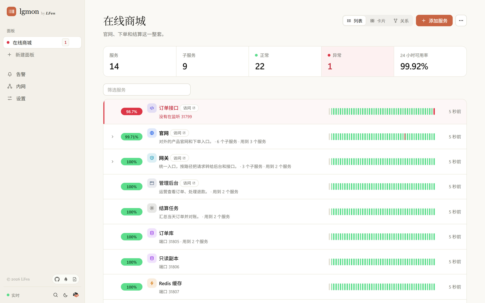
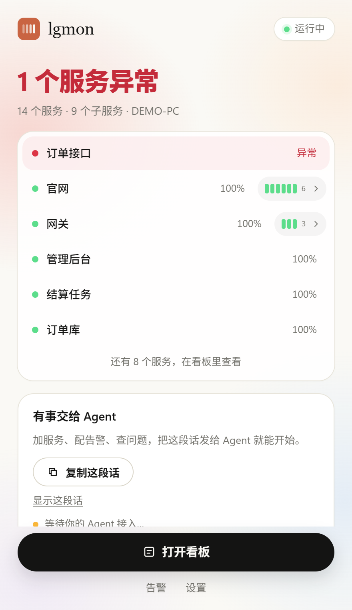
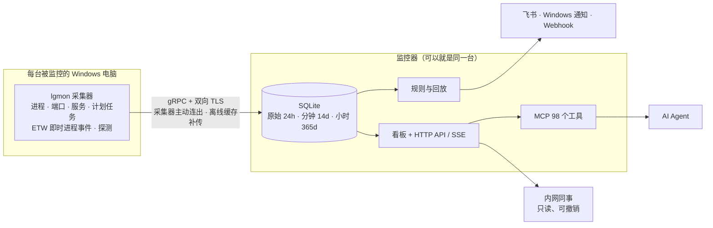

<div align="center">


# lgmon

**盯住 Windows 上你在乎的每一个服务，再把它整个交给 AI Agent。**

网站 · 接口 · 端口 · Windows 服务 · 进程 · 计划任务 · 批处理任务

[](https://github.com/LFenX/lg-monitor/releases/latest)


[](LICENSE.md)

[下载](https://github.com/LFenX/lg-monitor/releases/latest) · [快速开始](#快速开始) · [让 Agent 接管](#让-agent-接管) · [关系图](#服务关系图) · [内网共享](#内网共享) · [文档](#文档)



</div>

---

## lgmon 是什么

一个装在 Windows 上的单文件监控器：一个 `lgmon.exe`，自带看板、SQLite 存储、告警和通知，不需要 Docker、数据库或任何运行时。

- **一眼看清**：一个面板放一组服务，主服务下面挂子服务（Cloudflare 隧道、网关、数据库），子服务坏了主服务整体算异常；每个服务有 24 小时心跳、可用率和异常原因。
- **画出关系**：16 种依赖关系，各有自己的颜色、线型和箭头，一张图看懂谁调用谁、谁读写哪个库、哪条链路断了会影响谁。
- **交给 Agent**：98 个 MCP 工具覆盖 lgmon 的全部能力。把一段话发给 Claude Code、Codex、Cursor 等 Agent，它会自己接入、在这台电脑上找到你说的服务、确认后加好监控、告警和图表。
- **出事就知道**：飞书（群、个人、卡片上确认/静音）、Windows 通知、自定义机器人、通用 Webhook；告警可以一键生成诊断包交给 Agent 排查。
- **同事也能看**：同一局域网的人申请查看你的面板，双方核对 6 位配对码、你同意后对方只读看到你能看到的一切（关系图、服务详情、文档），随时撤销。每台电脑有自己的头像和昵称，内网里不显示电脑名；可以建部门、按部门看同事的面板。
- **波西米亚**：面板里的助手，按意思和关键词检索使用说明、每个服务的资料和你选定的文档；网页上能看能改的它都能做（添加新服务除外），删除和对外发送前先问你。没有模型密钥的同事可以用你共享的模型，密钥不离开你的电脑。

<table>
<tr>
<td width="62%"></td>
<td width="38%"></td>
</tr>
<tr>
<td align="center"><sub>关系图：调用、读写、经由、转发、消息、同步、备份、故障切换…</sub></td>
<td align="center"><sub>打开 lgmon 的小窗口：结论、异常在前、子服务折叠</sub></td>
</tr>
</table>

## 快速开始

### 1. 安装

从 [Releases](https://github.com/LFenX/lg-monitor/releases/latest) 下载 **`lgmon-setup-<版本>.exe`**（发布页上唯一的安装程序），双击：一个窗口、一个“安装”按钮和一条进度条，装好后点“打开 lgmon”。

- 程序装进 `Program Files\lg-monitor`，以 Windows 服务运行，开机自动启动；配置和数据在 `%ProgramData%\lg-monitor`，卸载后保留。
- 之后从开始菜单点 **lgmon** 打开小窗口；完整看板在 <http://127.0.0.1:7444/>。
- 有新版本时，小窗口会出现“可以更新了”，点“下载更新”、再“重启并更新”，角色和数据都保留。

> 发布文件用 `SHA256SUMS` 校验。安装器没有代码签名，Windows SmartScreen 可能提示“已保护你的电脑”，点“更多信息 → 仍要运行”。

### 2. 交给 Agent

在小窗口里点 **“复制这段话”**，发给能在本机执行命令的 Agent（Claude Code、Codex、Cursor、Gemini CLI……）。它会自己接入 lgmon，需要时请你确认一次 Windows 管理员授权，然后问你想监控什么。令牌只在内存里使用，你不用手动运行命令或粘贴令牌。

### 3. 说你想监控什么

> 帮我盯住本机 3000 端口上的博客，还有给它做外网穿透的 cloudflared 隧道，挂了发飞书。

Agent 会在这台电脑上找到它们、跟你确认、加好监控、告警和通知，并把隧道挂成博客的子服务。也可以自己点面板右上角“添加服务”，从正在运行的端口、Windows 服务、进程、计划任务里选一个，或者填网址。

## 让 Agent 接管

```powershell
# 手动接入：打印 Claude Code、Codex 的 mcp add 命令，以及通用的 mcpServers JSON
lgmon agent connect

# 能力较弱的 Agent 只给一小组常用工具（面板、监控、助手）
lgmon agent connect --tools essential
```

| 你可以这样说 | Agent 会用到 |
|---|---|
| “看看这台电脑上跑着哪些服务，挑重要的监控起来” | `start_here` → `explore` → `add_monitor` |
| “官网经由网关调订单接口，订单接口读写订单库，把关系画出来” | `edit_monitor`（`depends`、`role`） |
| “订单接口挂了，帮我查原因” | `list_alerts` → `get_alert_diagnostics` |
| “严重告警发到值班群，用排查模板” | 飞书与卡片模板工具 |
| “把这个面板分享给隔壁的同事” | 内网共享工具 |
| “每天凌晨的备份任务，传完了没有” | 批处理任务监控工具 |

完整的工具列表和参数见 [MCP](docs/mcp.md)；给 Agent 的使用说明见 [使用指南](docs/agent-guide.md)。

面板里还有助手“波西米亚”（Ctrl J）：问服务状况或 lgmon 怎么用，它直接回答；也能改服务名字和卡片样式、整理面板、处理告警，删除和对外发送前先问你。需要 DeepSeek 和阿里云百炼的 API Key。

## 服务关系图

面板切到“关系”，就是一张从上到下的依赖图：人直接用的服务在上，它们依靠的网关、数据库、隧道在下。依赖写在使用的一方，可以跨面板，只用来看，不影响告警（主服务的整体健康仍由 `parent` 决定）。

| 关系 | 意思 | 画法 |
|---|---|---|
| `uses` 依赖 · `calls` 调用接口 · `forwards` 转发到 | 直接使用 | 实线，实心箭头 |
| `data` 读写数据 · `writes` 写入 | 数据落在对方 | 实线，菱形 |
| `reads` 读取 | 只读对方的数据 | 实线，空心箭头 |
| `via` 经由 | 经由隧道、网关、代理对外 | 虚线 |
| `runs` 触发 | 由它启动或定时触发 | 点线 |
| `sends` 发送消息 · `consumes` 消费消息 | 异步消息 | 虚线 / 点线，空心箭头 |
| `auth` 认证 · `monitors` 监控 | 登录鉴权、健康检查 | 圆圈 |
| `syncs` 双向同步 | 数据双向流动 | 两端箭头 |
| `replicates` 复制到 · `backup` 备份到 | 数据副本 | 方块 |
| `fallback` 故障切换到 | 出故障时才用 | 虚线，空心箭头 |
| `"optional": true` | 可选依赖：它坏了服务还能降级运行 | 细虚线，标“可选” |

```yaml
# targets.yaml（通常由 Agent 写好）
- id: api
  name: 订单接口
  role: api
  depends:
    - {target: db, relation: data, note: 订单表}
    - {target: cache, relation: reads, optional: true}
    - {target: mq, relation: sends, note: 下单事件}
    - {target: replica, relation: fallback}
```

多条线从一个服务出入时，接点沿卡片边缘错开；线上的说明会找一个不压住服务、也不压住其他说明的位置；没有自己依赖的正常子服务收进主服务下方的“N 个子服务”，点开再展开。

## 内网共享

在“内网”页打开 **让内网看到我的面板**，同一局域网（或 Tailscale）的 lgmon 就能搜到你：

1. 对方点你某个面板旁的“申请查看”，双方屏幕上出现同一个 6 位配对码；
2. 你当面或电话核对一致后点“同意”；
3. 对方侧栏出现“别人的面板”（带你的头像和昵称），只读实时查看，可以点进每个服务看详情和文档；你随时撤销，对方的画面立即清空。

**部门** 不需要打开内网可见：谁都可以建部门（它托管在建的人的电脑上），同一内网的人能看到并申请加入，由负责人在自己的电脑上同意；部门可以多级嵌套、有多位负责人，侧栏里别人的面板按部门分组。

打开内网可见时，lgmon 会在 Windows 防火墙添加一条只属于 `lgmon.exe` 的入站规则：成员端口 7445/TCP 和发现端口 7446/UDP，只接受私有网段和 Tailscale 地址，网络被标成“公用”时也生效；关闭时删除。没有管理员权限时，“内网”页会给出可以直接复制的放行命令。详见 [内网共享](docs/teams.md)。

## 它是怎么搭起来的



- 一个 `lgmon.exe` 有三种角色：`both`（默认，单机）、`monitor`、`collector`；采集器也可以同时连多个监控器。
- 网页（React + ECharts）嵌在 exe 里，和 API 同一个端口，默认只监听本机。
- 采集器的命令行只在本机用于匹配，不上传、不入库；密钥用机器级 DPAPI 加密保存，没有打印明文的命令。

## 能力一览

| | |
|---|---|
| **监控对象** | 网站（HTTP、证书到期）、TCP 端口、Windows 服务、进程（含命令行匹配）、计划任务、[批处理任务](docs/jobs.md)（按业务日期一天一条记录）、脚本探测、[事件日志](docs/collection.md)、[启动项与计划任务清单](docs/inventory.md) |
| **看板** | 列表 / 卡片 / 关系三种视图，六种卡片样式，服务详情（24 小时与 30 天、响应时间、事件），[声明式图表](docs/dashboards.md)与[自定义 HTML 面板](docs/html-dashboards.md)，Ctrl K 全局搜索，深浅色 |
| **告警** | 进程不在、端口关闭、探测失败、服务停止、指标阈值、SQL 多实例规则；持续时长、重复提醒、确认、静音、抖动合并、[历史回放](docs/rules.md)；采集器失联告警 |
| **通知** | 飞书应用（群 / 个人、[卡片上确认和静音](docs/card-actions.md)、[卡片模板](docs/card-templates.md)）、自定义机器人、[通用 Webhook](docs/webhooks.md)、Windows 通知、全局暂停 |
| **排查** | [诊断包](docs/diagnostics.md)（网页、HTTP、MCP、`lgmon diagnose`）、只读 SQL 与表结构说明、[受限服务重启](docs/service-operations.md)（默认关闭，逐条授权） |
| **对接** | [Prometheus / OTLP 导出](docs/exports.md)（默认关闭）、HTTP API、SSE、MCP、[多监控器](docs/multi-monitor.md) |

## 命令行速查

```powershell
lgmon                         # 打开小窗口（后台运行 + 托盘）
lgmon run --no-tray           # 只在终端里运行
lgmon status                  # 服务和告警现状（--json 给机器读）
lgmon alerts                  # 触发中的告警
lgmon diagnose <告警ID>        # 生成诊断包
lgmon config validate         # 校验配置，逐行指出错误
lgmon feishu setup            # 接入飞书
lgmon secret set <名称>        # 保存密钥（输入不回显）
lgmon agent connect           # 接入 Agent
```

所有子命令支持 `--home`（数据目录，默认 `%ProgramData%\lg-monitor`，也可用 `LGMON_HOME`）和 `--json`。完整命令见 [CLI](docs/cli.md)。

配置在数据目录的 `config/` 下：`targets.yaml`、`rules.yaml`、`notifiers.yaml`、`settings.yaml`、`boards.yaml`，以及 `card-templates/`、`dashboards/`、`docs/`。改完自动热加载，写错时保留上一次有效的配置；JSON Schema 在 [schemas/](schemas/)，示例在 [examples/](examples/)。

## 资源占用

20 个模拟采集器、每台 50 个目标，整条链路真实运行 30 分钟（Windows 11、24 个逻辑处理器，只量监控器进程）：

| 项目 | 实测或折算 |
|---|---|
| 监控器平均 CPU / 最大内存 | 1.74% / 102.8 MiB |
| 数据库增长 | 约 480 MB/小时（这是 1000 个目标的量） |
| 默认保留（原始 24h、分钟 14d、小时 365d） | 约 32.5 GB 折算上限 |
| 每台采集器离线缓存 | 默认 500 MB；50 个目标断网 24 小时约用一半 |

单机监控几十个服务时远低于这个量。完整场景和原始报告见 [第一版验收](docs/acceptance-m1.md#m1-22-工程证据)。

## 从源码构建

需要 Go 1.27、Git、Node 22.22.2+ 和 pnpm 11.21.0：

```powershell
.\scripts\build.ps1                 # 生成 bin\lgmon.exe 和 bin\lgmon-window.exe
.\bin\lgmon.exe --home .\dev-home    # 用开发目录打开，不需要管理员终端
.\scripts\build-installer.ps1 -Version 0.0.0-dev   # 可选：打安装器（需要 Inno Setup 6.7.4）
```

提交前请通过：

```powershell
gofmt -l .        # 输出必须为空
go vet ./...
go test ./...
pnpm --dir web test
```

依赖系统的部分（进程、端口、服务、飞书、防火墙、时间）都通过接口注入，默认测试只用假实现，不会碰这台电脑上的真实服务；真实系统测试使用 `-tags integration`。不引入 cgo，`CGO_ENABLED=0` 必须能编译。给开发 lgmon 的 Agent 的约定见 [AGENTS.md](AGENTS.md)。

推送 `v*` 标签后，GitHub Actions 会跑测试、构建、打安装器、生成 `SHA256SUMS` 并发布到 Releases；已安装的 lgmon 从这里检查更新。

## 文档

| 用 lgmon | 接 Agent 与系统 | 了解内部 |
|---|---|---|
| [Web 面板](docs/web-panel.md) | [MCP 工具](docs/mcp.md) | [需求 PRD](docs/PRD.md) |
| [安装与更新](docs/installer.md) | [Agent 使用指南](docs/agent-guide.md) | [执行计划与记录](docs/PLAN.md) |
| [内网共享与团队](docs/teams.md) | [HTTP API](docs/api.md) | [采集通道](docs/transport.md) |
| [规则与回放](docs/rules.md) | [Webhook](docs/webhooks.md) | [数据汇总与保留](docs/storage.md) |
| [批处理任务](docs/jobs.md) | [指标导出](docs/exports.md) | [更多采集项](docs/collection.md) |
| [诊断包](docs/diagnostics.md) | [CLI](docs/cli.md) | [Windows 服务](docs/windows-service.md) |

## 许可

lgmon 以 [PolyForm Noncommercial 1.0.0](LICENSE.md) 发布：可以个人使用、学习和修改，也可以在非营利机构里使用；**不允许任何商业用途和营利行为**。想商用请先联系作者。内置头像来自 [fiora](https://github.com/yinxin630/fiora)（MIT，见 `web/src/avatars/LICENSE`）。

作者 **LFen** · [GitHub](https://github.com/LFenX/lg-monitor) · [lfen.ink](https://lfen.ink/) · [留白 margin.lfen.ink](https://margin.lfen.ink/)

## 现状

工程功能都有自动化测试覆盖；需要真人才能确认的部分（真实飞书收件、双机部署、服务重启、托盘与弹窗、24 小时资源验收）仍在逐项人工验收中，结论记录在 [逐项工程核验](docs/prd-verification.md) 和 [PLAN 执行记录](docs/PLAN.md)。遇到问题欢迎提 [Issue](https://github.com/LFenX/lg-monitor/issues)。
