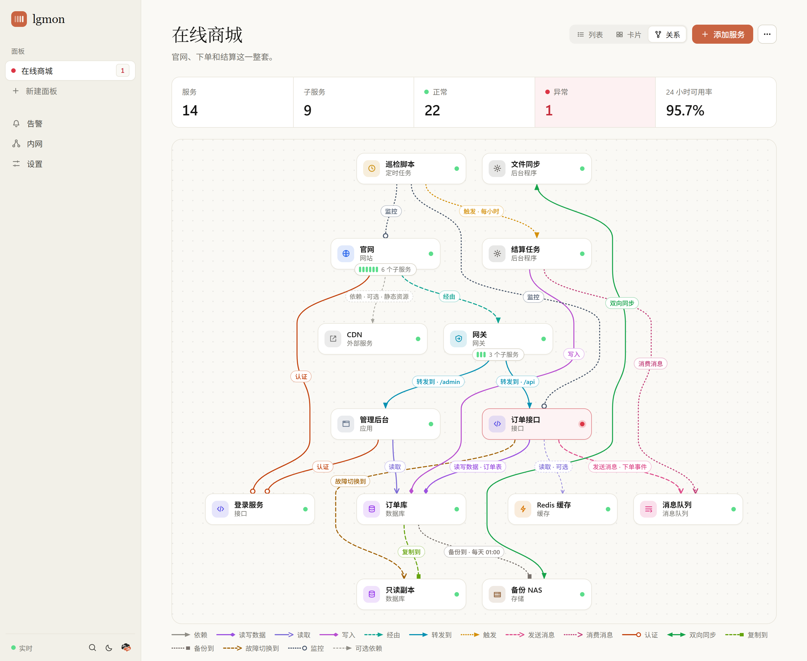
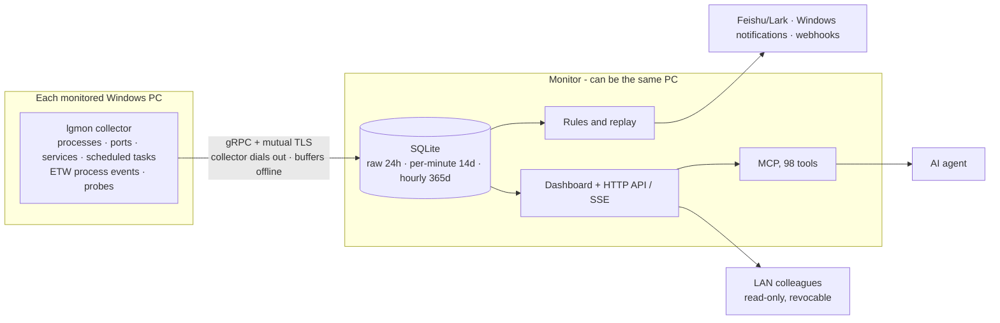

<div align="center">


# lgmon

**A single-file service monitor for Windows that your AI agent can set up and run for you.**

Websites · APIs · ports · Windows services · processes · scheduled tasks · batch jobs

**English** · [简体中文](README.zh-CN.md)

[](https://github.com/LFenX/lg-monitor/releases/latest)


[](LICENSE.md)

[Download](https://github.com/LFenX/lg-monitor/releases/latest) · [Quick start](#quick-start) · [Agents](#working-with-agents) · [Dependency map](#dependency-map) · [LAN sharing](#lan-sharing) · [Docs](#documentation)


</div>

---

## What is lgmon

lgmon watches the services you run on your own Windows machines (the blog on port 3000, the Cloudflare tunnel in front of it, the database behind it, last night's backup job) and tells you on Feishu/Lark or with a Windows notification when one of them breaks.

It ships as one `lgmon.exe` with the dashboard, storage (SQLite), alerting and notifications built in. There is no Docker, database server or runtime to install.

What sets it apart is that **everything lgmon can do is exposed to AI agents through 98 MCP tools**. You don't have to fill in forms. You tell Claude Code, Codex or Cursor something like *"keep an eye on my blog and its tunnel, and message me on Feishu if either goes down"*. The agent finds both on the machine, confirms them with you, and sets up the checks, alerts and dependency map.

### Is it for you?

| lgmon fits if you… | Look elsewhere if you… |
|---|---|
| self-host websites, APIs, tunnels, databases or jobs on Windows 10/11 PCs | run your servers on Linux or Kubernetes (the collector is Windows-only) |
| want to know within seconds when a process, port or service stops | need uptime checks from many regions of the public internet |
| would rather describe monitoring to an agent than configure it by hand | need full APM: distributed tracing, log search, profiling |
| want one small exe, not a Prometheus + Grafana stack (lgmon can still export to them) | plan to use it commercially (the license is noncommercial) |

> **Language:** the interface and the documentation are currently in Simplified Chinese. Agents work with lgmon in any language.

## Highlights

- **The whole picture on one board.** Group related services on a board and attach sub-services (a Cloudflare tunnel, a gateway, a database) to the service that depends on them. If a sub-service breaks, the main service counts as down. Every service shows a 24-hour heartbeat, its uptime and the reason it failed.
- **A map of how things connect.** 16 relation types (calls, reads/writes, via, sends, backup, fallback…), each with its own line style and arrowhead, show what calls what and what a broken link takes down with it.
- **Built for agents.** The 98 MCP tools cover every feature. Copy one paragraph into your agent and it connects itself; you never run commands or paste tokens.
- **Alerts that reach you.** You get alerts through Feishu/Lark (groups or direct messages, with acknowledge and mute buttons on the card), Windows notifications, custom bots or generic webhooks. Any alert can produce a diagnostic bundle for an agent to investigate.
- **Read-only sharing on your LAN.** Colleagues on the same network (or tailnet) can ask to view a board. You both check a 6-digit pairing code, you approve, and you can revoke at any time. Departments group your colleagues' boards.
- **A built-in assistant.** Bohemia (波西米亚, <kbd>Ctrl</kbd>+<kbd>J</kbd>) answers questions about your services and about lgmon. It can do anything the web UI can except add services, and it asks before deleting or sending anything. Colleagues without a model key can use yours; the key never leaves your machine.

<table>
<tr>
<td width="62%"></td>
<td width="38%"></td>
</tr>
<tr>
<td align="center"><sub>Dependency map: calls, reads/writes, via, forwards, messages, sync, backup, failover…</sub></td>
<td align="center"><sub>The compact window: verdict first, problems on top, sub-services folded</sub></td>
</tr>
</table>

## Quick start

### 1. Install

Download **`lgmon-setup-<version>.exe`** from [Releases](https://github.com/LFenX/lg-monitor/releases/latest) (it is the only installer on the page) and run it. The installer is one window with an Install button and a progress bar; when it finishes, click the button to open lgmon.

- lgmon installs to `Program Files\lg-monitor` and runs as a Windows service that starts with the computer. Configuration and data live in `%ProgramData%\lg-monitor` and are kept if you uninstall.
- Open the compact window from **lgmon** in the Start menu. The full dashboard is at <http://127.0.0.1:7444/>.
- When a new version is out, the compact window offers to download it and restart into it. Roles and data are kept.

> Verify downloads against `SHA256SUMS`. The installer isn't code-signed, so Windows SmartScreen may warn you; choose **More info → Run anyway**.

### 2. Hand it to your agent

In the compact window, click **复制这段话** ("copy this prompt") and paste it into any agent that can run commands on this machine: Claude Code, Codex, Cursor, Gemini CLI and so on. The agent connects to lgmon on its own, asks you once for Windows administrator approval if it needs it, then asks what you want to monitor. The access token stays in memory, so you never handle it.

### 3. Say what to watch

> Watch the blog on local port 3000 and the cloudflared tunnel that exposes it. Message me on Feishu if either goes down.

The agent finds both on the machine, confirms with you, sets up the checks, alerts and notifications, and attaches the tunnel to the blog as a sub-service.

You can also add services yourself: click **添加服务** ("add service") at the top right of the board and pick a listening port, Windows service, process or scheduled task, or enter a URL.

## Working with agents

```powershell
# Print the `mcp add` commands for Claude Code and Codex, plus a generic mcpServers JSON block
lgmon agent connect

# Give smaller models a 27-tool subset (boards, monitors, assistant) instead of all 98
lgmon agent connect --tools essential
```

| You say | The agent uses |
|---|---|
| "See what's running on this PC and monitor the important ones" | `start_here` → `explore` → `add_monitor` |
| "The website calls the orders API through the gateway, and the API reads and writes the orders DB. Map it." | `edit_monitor` (`depends`, `role`) |
| "The orders API is down. Find out why." | `list_alerts` → `get_alert_diagnostics` |
| "Send critical alerts to the on-call group with the troubleshooting card" | Feishu and card-template tools |
| "Share this board with the colleague next door" | LAN sharing tools |
| "Did the nightly backup job finish?" | Batch-job tools |

See [MCP tools](docs/mcp.md) for every tool and parameter, and the [agent guide](docs/agent-guide.md) for the instructions agents follow.

Bohemia, the built-in assistant, needs a DeepSeek API key for answers and an Alibaba Cloud Model Studio (Bailian) key for searching the docs, unless a paired colleague shares their model with you.

## Dependency map

Switch a board to **关系** ("relations") to see a top-down dependency graph: the services people use directly are at the top, and the gateways, databases and tunnels they rely on sit below. A dependency is declared on the service that uses it and can point across boards. The map is for understanding only and does not change alerting; whether a main service is healthy is still decided by its `parent` links.

| Relation | Meaning | Drawn as |
|---|---|---|
| `uses` · `calls` · `forwards` | Direct use | Solid line, filled arrow |
| `data` · `writes` | Its data lives in the target | Solid line, diamond |
| `reads` | Reads the target's data | Solid line, open arrow |
| `via` | Reaches the outside through a tunnel, gateway or proxy | Dashed line |
| `runs` | Started or scheduled by it | Dotted line |
| `sends` · `consumes` | Asynchronous messages | Dashed / dotted line, open arrow |
| `auth` · `monitors` | Authentication, health checks | Circle |
| `syncs` | Data flows both ways | Arrows at both ends |
| `replicates` · `backup` | A copy of the data | Square |
| `fallback` | Used only during failover | Dashed line, open arrow |
| `optional: true` | The service still runs, degraded, without it | Thin dashed line, marked "optional" |

```yaml
# targets.yaml (usually written by the agent)
- id: api
  name: Orders API
  role: api
  depends:
    - {target: db, relation: data, note: orders table}
    - {target: cache, relation: reads, optional: true}
    - {target: mq, relation: sends, note: order events}
    - {target: replica, relation: fallback}
```

When several lines meet one service, lgmon spreads their attachment points along the card edge and places each label where it doesn't cover a service or another label. Healthy sub-services with no dependencies of their own fold into an "N sub-services" row under their parent, which you can expand.

## LAN sharing

On the **内网** ("LAN") page, turn on **让内网看到我的面板** ("let the LAN see my boards"). Other lgmon installs on the same LAN or tailnet can then find you:

1. Your colleague clicks **申请查看** ("request to view") next to one of your boards, and the same 6-digit code appears on both screens.
2. You confirm the codes match, in person or by phone, and click **同意** ("approve").
3. Your board appears in their sidebar under your avatar and nickname. They see it live and read-only, including each service's details and documents. When you revoke access, their view clears immediately.

Computers on the LAN show an avatar and nickname, never the machine name.

**Departments** don't require LAN visibility. Anyone can create a department, which is hosted on the creator's computer. Others on the LAN can see it and ask to join, and a department lead approves on their own computer. Departments can be nested and can have several leads; colleagues' boards are grouped by department in the sidebar.

Turning on LAN visibility adds a Windows Firewall inbound rule scoped to `lgmon.exe`: 7445/TCP for members and 7446/UDP for discovery, accepting only private-range and Tailscale addresses. The rule works even when Windows marks the network as Public, and it is removed when you turn sharing off. Without administrator rights, the LAN page shows a ready-to-copy command to allow it. See [LAN sharing](docs/teams.md).

## How it works



- One `lgmon.exe` runs in one of three roles: `both` (the default, for a single machine), `monitor` or `collector`. A collector can report to several monitors at once.
- The web UI (React + ECharts) is embedded in the exe and served on the same port as the API, which listens only on localhost by default.
- Collectors use process command lines locally for matching and never upload or store them. Secrets are encrypted with machine-level DPAPI, and no command prints them in plain text.

## Features at a glance

| | |
|---|---|
| **What it monitors** | Websites (HTTP, certificate expiry), TCP ports, Windows services, processes (including command-line matching), scheduled tasks, [batch jobs](docs/jobs.md) (one record per business date), script probes, the [Windows event log](docs/collection.md), and an [inventory of startup items and scheduled tasks](docs/inventory.md) |
| **Dashboard** | List, card and relation views; six card styles; service details (24 hours and 30 days, response time, events); [declarative dashboards](docs/dashboards.md) and [custom HTML dashboards](docs/html-dashboards.md); <kbd>Ctrl</kbd>+<kbd>K</kbd> search; light and dark themes |
| **Alerting** | Process missing, port closed, probe failed, service stopped, metric thresholds, and multi-instance SQL rules. Rules support minimum durations, repeat reminders, acknowledgement, muting, flap merging and [replay against history](docs/rules.md). Collectors that go offline raise their own alert |
| **Notifications** | Feishu/Lark app (groups or direct messages, [acknowledge and mute from the card](docs/card-actions.md), [card templates](docs/card-templates.md)), custom bots, [generic webhooks](docs/webhooks.md), Windows notifications, global pause |
| **Troubleshooting** | [Diagnostic bundles](docs/diagnostics.md) (from the web UI, HTTP, MCP or `lgmon diagnose`); read-only SQL with schema notes; [restricted service restarts](docs/service-operations.md) (off by default, authorized one by one) |
| **Integrations** | [Prometheus / OTLP export](docs/exports.md) (off by default), HTTP API, SSE, MCP, [multiple monitors](docs/multi-monitor.md) |

## CLI cheat sheet

```powershell
lgmon                         # Open the compact window (runs in the background with a tray icon)
lgmon run --no-tray           # Run in the terminal only
lgmon status                  # Services and alerts (--json for machines)
lgmon alerts                  # Firing alerts
lgmon diagnose <alert-id>     # Build a diagnostic bundle
lgmon config validate         # Validate config and point to the line with each error
lgmon feishu setup            # Connect Feishu/Lark
lgmon secret set <name>       # Store a secret (input is hidden)
lgmon agent connect           # Connect an agent
```

Every subcommand accepts `--home` (the data directory; defaults to `%ProgramData%\lg-monitor`, or set `LGMON_HOME`) and `--json`. See the full [CLI reference](docs/cli.md).

Configuration lives in `config/` under the data directory: `targets.yaml`, `rules.yaml`, `notifiers.yaml`, `settings.yaml` and `boards.yaml`, plus `card-templates/`, `dashboards/` and `docs/`. Changes are hot-reloaded; if a file is invalid, lgmon keeps the last valid configuration. JSON Schemas are in [schemas/](schemas/) and examples in [examples/](examples/).

## Resource usage

Measured over a 30-minute end-to-end run with 20 simulated collectors and 50 targets each (Windows 11, 24 logical processors, monitor process only):

| Metric | Measured or projected |
|---|---|
| Monitor CPU (average) / memory (peak) | 1.74% / 102.8 MiB |
| Database growth | About 480 MB per hour, for 1,000 targets |
| Default retention (raw 24h, per-minute 14d, hourly 365d) | Projected ceiling of about 32.5 GB |
| Offline buffer per collector | 500 MB by default; 50 targets offline for 24 hours use about half |

A single machine watching a few dozen services uses far less. The full scenario and raw report are in the [M1 acceptance record](docs/acceptance-m1.md#m1-22-工程证据).

## Building from source

Requires Go 1.27, Git, Node 22.22.2+ and pnpm 11.21.0:

```powershell
.\scripts\build.ps1                                 # Builds bin\lgmon.exe and bin\lgmon-window.exe
.\bin\lgmon.exe --home .\dev-home                   # Run against a dev data directory; no admin shell needed
.\scripts\build-installer.ps1 -Version 0.0.0-dev   # Optional: build the installer (needs Inno Setup 6.7.4)
```

Before committing, make sure these pass:

```powershell
gofmt -l .        # Must print nothing
go vet ./...
go test ./...
pnpm --dir web test
```

Everything that touches the system (processes, ports, services, Feishu, the firewall, time) sits behind an interface. Default tests use fakes only and never touch real services on the machine; tests against the real system run with `-tags integration`. lgmon has no cgo dependencies and must build with `CGO_ENABLED=0`. Conventions for agents that develop lgmon are in [AGENTS.md](AGENTS.md).

Pushing a `v*` tag makes GitHub Actions test, build, package the installer, generate `SHA256SUMS` and publish a release. Installed copies of lgmon check for updates there.

## Documentation

The documentation is in Simplified Chinese.

| Using lgmon | Agents and integrations | Internals |
|---|---|---|
| [Web dashboard](docs/web-panel.md) | [MCP tools](docs/mcp.md) | [Product requirements](docs/PRD.md) |
| [Install and update](docs/installer.md) | [Agent guide](docs/agent-guide.md) | [Plan and execution log](docs/PLAN.md) |
| [LAN sharing and teams](docs/teams.md) | [HTTP API](docs/api.md) | [Collector transport](docs/transport.md) |
| [Rules and replay](docs/rules.md) | [Webhooks](docs/webhooks.md) | [Rollups and retention](docs/storage.md) |
| [Batch jobs](docs/jobs.md) | [Metric export](docs/exports.md) | [More collection sources](docs/collection.md) |
| [Diagnostic bundles](docs/diagnostics.md) | [CLI](docs/cli.md) | [Windows service](docs/windows-service.md) |

## Project status

All engineering features are covered by automated tests. The parts that need a person to confirm (real Feishu delivery, two-machine deployment, service restarts, the tray and pop-ups, the 24-hour resource run) are still being checked by hand one by one; results are recorded in the [verification log](docs/prd-verification.md) and the [PLAN execution log](docs/PLAN.md). Please report problems in [Issues](https://github.com/LFenX/lg-monitor/issues).

## License

lgmon is released under [PolyForm Noncommercial 1.0.0](LICENSE.md). You may use, study and modify it for personal use, and use it at nonprofit organizations. **Commercial and for-profit use is not allowed**; contact the author if you want to use it commercially.

The built-in avatars include lgmon's own animals, the [DiceBear Lorelei](https://www.dicebear.com/styles/lorelei/) illustrations by Lisa Wischofsky (CC0 1.0) and avatars from [fiora](https://github.com/yinxin630/fiora) (MIT). See `web/src/avatars/LICENSE`.

Made by **LFen** · [GitHub](https://github.com/LFenX/lg-monitor) · [lfen.ink](https://lfen.ink/) · [留白 margin.lfen.ink](https://margin.lfen.ink/)
