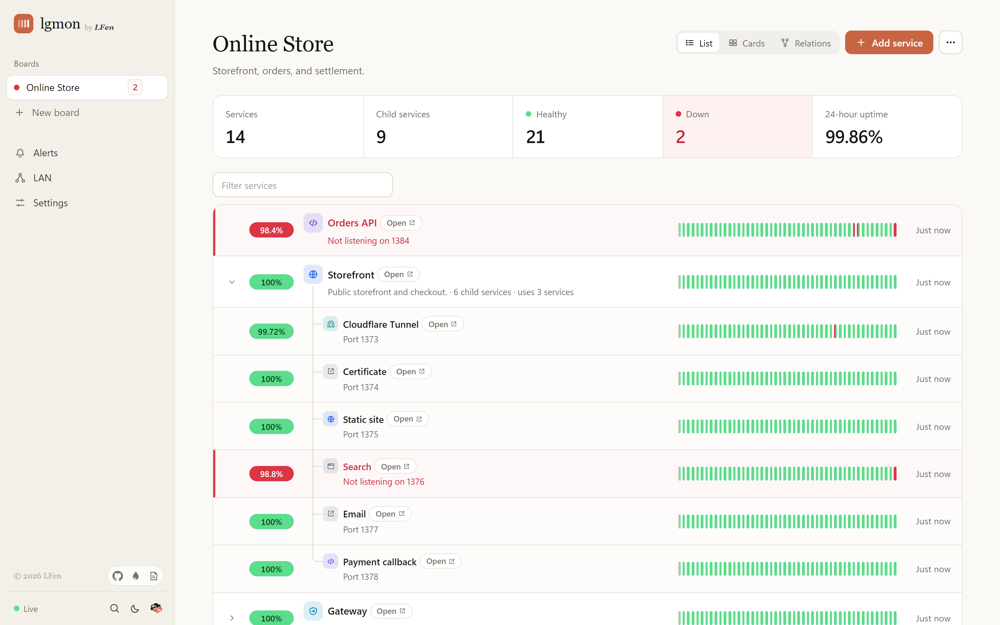
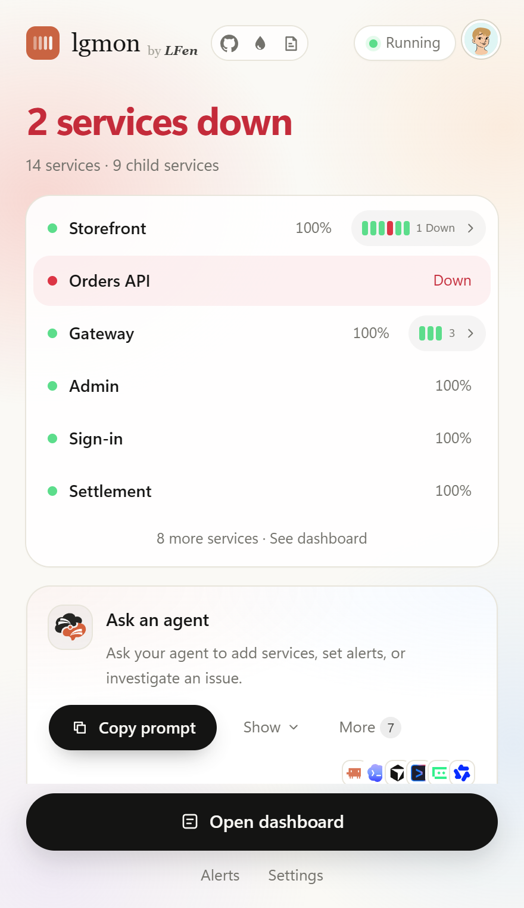
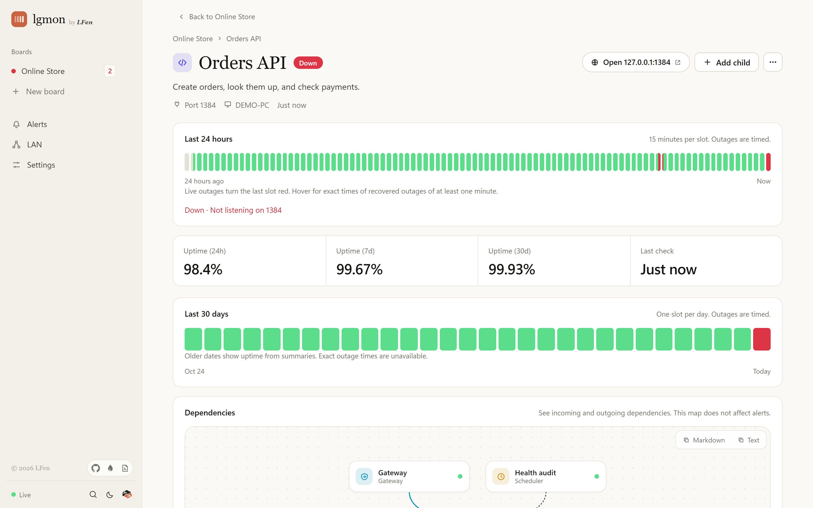
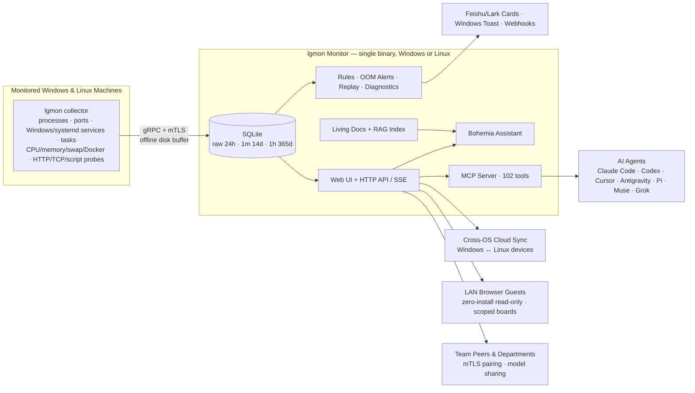

<div align="center">


# lgmon

### AI-Native Service & Device Monitor, Architecture Map, Living Knowledge Base & Team Hub — One Binary for Windows & Linux.

Websites · APIs · Ports · Windows & systemd Services · Processes · Containers · Device OOM Alerts · Living Docs · Cross-OS Cloud Sync · Team Sharing

**English** · [简体中文](README.zh-CN.md)

[](https://github.com/LFenX/lg-monitor/releases/latest)
[](https://github.com/LFenX/lg-monitor/releases)
[](https://github.com/LFenX/lg-monitor/stargazers)


[](LICENSE.md)

[Download Latest](https://license.lfen.ink/download/readme) · [Why lgmon](#why-lgmon) · [Living Docs & Knowledge Base](#living-docs--knowledge-base) · [Team & LAN Sharing](#team-collaboration--lan-sharing) · [AI Agents & Bohemia](#ai-agents--bohemia) · [Dependency Map](#dependency-map) · [Quick Start](#quick-start)



<sub>One single executable — live service status, architecture graph, runbooks, and team sharing without Docker or external databases.</sub>

</div>

---

## Why lgmon?

Most monitoring tools stop at *"is port 3000 up?"* — leaving your architecture diagrams stale in Notion, your runbooks scattered across chat threads, and your teammates constantly pinging *"hey, is the staging API down or is it just me?"*.

**lgmon brings five workflows together into one lightweight single binary (`lgmon.exe` on Windows, `lgmon` on Linux):**

1. **Real-Time Service & Device Monitoring** — Watches websites, APIs, ports, Windows & systemd services, processes (with ETW instant events on Windows), scheduled tasks, daily batch jobs, plus per-core CPU, memory/swap, per-process & Docker container resource trends with OOM early warnings ([device monitoring](docs/devices.md)), backed by built-in SQLite and Feishu/Lark interactive alerting.
2. **Live Architecture & Cross-Device Dependency Map** — Visualizes 16 typed relationships (*calls, reads/writes, via tunnel, sends/consumes, fallback, backup…*) — including **cross-device external dependencies** across your Windows and Linux machines signed into the same cloud account — so you immediately see blast radius when anything breaks.
3. **Living Service Docs & RAG Knowledge Base** — Every service carries its own Markdown runbook right next to its live heartbeat, authored and updated by your AI agent from real machine configs and searchable via **Bohemia** (embeddings + rerank Q&A).
4. **Cross-OS Cloud Account Sync** — Sign into the same account on your Windows PCs and Linux servers to bidirectionally sync boards, live status, docs, and batch job logs across devices.
5. **Zero-Friction Team Collaboration & LAN Read-Only Sharing** — Share live dashboards (including selected boards from your other synced devices) over your LAN or Tailscale with **zero installation for browser guests**, fine-grained visibility controls, peer-to-peer departments, and secure AI model sharing.

> **Bilingual by design**: Switch seamlessly between **English** and **简体中文** in the dashboard, Settings, or compact startup window — language state syncs instantaneously across every open window, including all Agent prompts and Bohemia chat.

### Is lgmon right for you?

| lgmon is built for you if you… | Look elsewhere if you… |
|---|---|
| run websites, APIs, tunnels, databases, containers, or scheduled jobs on **Windows 10/11 or Linux (amd64 / arm64)** | need Kubernetes cluster orchestration or multi-region public-internet synthetic probes |
| want **service + device OOM monitoring + dependency map + living runbooks + team status page** in one binary | need heavy distributed tracing / APM profiling |
| prefer telling Claude Code / Codex / Cursor / Antigravity / Pi / Muse / Grok what to watch instead of clicking forms | plan commercial / for-profit use (see [License](#license--provenance)) |
| want your Windows PCs and Linux servers synced under one account, plus zero-install LAN viewing for teammates | — |

---

## Living Docs & Knowledge Base

Documentation rots the moment it leaves your operations tool. In **lgmon**, every service has a **living Markdown document** stored right alongside its monitor (`config/docs/`):

- **AI-authored from ground truth**: Click *"Let your agent write this doc"* (or pick **Write / edit service docs** from the Agent prompt sheet). Your agent inspects actual configs, ports, startup commands, and dependencies on the machine and writes a structured runbook with a table of contents and embedded live dependency diagram.
- **Always one click from an incident**: When an alert fires, the service page shows 24h/30d uptime, response latency, event timeline, sub-services, dependency neighborhood, **and** its runbook side-by-side.
- **RAG-powered Knowledge Base via Bohemia (<kbd>Ctrl</kbd>+<kbd>J</kbd>)**: Bohemia indexes your service docs and lgmon guides using vector embeddings + rerank (DashScope) and answers questions with DeepSeek — ask *"How is the orders API started?"*, *"Which services depend on Postgres?"*, or *"Summarize last night's outage for my team"* and get grounded answers with clickable links.
- **Shared with your team automatically**: Anyone viewing your board over LAN sharing or read-only browser access can read your service docs and ask Bohemia about them — turning your monitor into an instant internal engineering portal.

---

## Team Collaboration & LAN Sharing

lgmon makes sharing operational visibility across a small team effortless, private, and safe — with **two complementary modes** on your LAN or Tailscale network:

### 1. LAN browser access and guest permissions
Turn on **LAN web access** on the **LAN** page. Guests start in read-only mode.

- **Open in any browser**: Teammates open your LAN / Tailscale URL directly — no installation, no accounts, no token pasting.
- Guests can inspect live status, dependency maps and service docs, and ask Bohemia questions.
- On the host, an administrator can generate an optional **Full access key** and choose its expiry. A visitor can select **Unlock full access** and enter the key to manage all boards, settings and services. The administrator can change the expiry, replace the key or revoke it. Expiry, replacement and revocation invalidate existing sessions.
- **LAN guest visibility** — Expand a board to choose individual services and sub-services. Restricted dependencies appear as gray nodes with a name and no detail link. Host administrators can reopen and copy keys generated by this version under **LAN → Full access key**.
- **Live visitor presence**: See who is viewing your dashboard right now at the bottom of your sidebar, with charming deterministic avatars and an IP activity dialog.

### 2. Peer-to-Peer Board Sharing, Departments & Shared AI Models
- **6-digit pairing approval**: Colleagues running lgmon on the same LAN / Tailscale can request to view a board; both screens show a 6-digit code, you approve once confirmed, and you can revoke access instantly at any time.
- **Nested Departments**: Organize colleagues into peer-to-peer departments (hosted on the creator's machine with multi-lead approval). Shared boards group neatly by department in the sidebar, and your compact startup window shows a live **Shared Boards health summary** right beside your own status!
- **Share Bohemia's AI model safely**: Teammates who don't have a DeepSeek API key can use yours over the encrypted peer link — requests forward through your machine and **your API key never leaves your computer**.
- **Automatic scoped Windows Firewall rules**: Turning on LAN visibility creates a tight inbound rule for `lgmon.exe` (7445/TCP & 7446/UDP, private & Tailscale ranges only) and removes it cleanly when turned off. See [LAN sharing](docs/teams.md).

---

## AI Agents & Bohemia

### Built for AI Agents — 102 MCP Tools
Everything lgmon can do is exposed over **MCP** (Model Context Protocol). Copy one prompt from the startup window (or the compact **Edit with Agent** widgets on any written doc or dependency map) and paste it into **Claude Code, Codex, Cursor, Antigravity, Gemini CLI, Pi, Muse, Grok, Windsurf, Copilot, Trae, Qwen, or Cline** — the agent connects itself and gets to work:

```powershell
# Print ready-to-run `mcp add` commands for Claude Code & Codex + generic mcpServers JSON
lgmon agent connect

# Give smaller models a focused core subset (boards, monitors, devices, assistant) instead of all 102
lgmon agent connect --tools essential
```

| What you tell your agent | What lgmon MCP does |
|---|---|
| *"Discover what's running on this PC and monitor the important ones"* | `start_here` → `explore` → `add_monitor` |
| *"Write deployment & troubleshooting docs for every service on my board"* | Inspects local configs/code → `put_monitor_doc` |
| *"Map how the web app, API gateway, Postgres, and Cloudflare tunnel connect"* | `edit_monitor` (`depends`, `role`) |
| *"The orders API is down — investigate why and give me a summary"* | `list_alerts` → `get_alert_diagnostics` |
| *"Send critical alerts to our Feishu on-call group with interactive buttons"* | Feishu setup & card-template tools |
| *"Share this board with teammates on LAN in read-only mode"* | LAN sharing & visibility tools |

The built-in **Other uses** prompt sheet includes ready-to-copy prompts for every scenario: *Watch services · Add services · Edit services & sub-services · Write / edit service docs · Map dependencies · Diagnose issues · Configure alerts · Connect Feishu · LAN sharing & team boards · Install agent skill*.

### Built-in Assistant: Bohemia (<kbd>Ctrl</kbd>+<kbd>J</kbd>)
**Bohemia (波西米亚)** lives inside every dashboard page:
- Answers questions about live status, 7-day incident trends, service docs, and how to use lgmon.
- Performs safe dashboard edits (rename services, change card styles, organize boards, acknowledge/silence alerts) and **always asks for confirmation** before deleting anything or sending external messages.
- Works in **read-only mode** for LAN web guests and supports **English & Chinese** seamlessly.

---

## Dependency Map

Switch any board to **Map** to see a live top-down architecture graph: user-facing services at the top, gateways, APIs, databases, queues, and tunnels below. **16 semantic relation types** each have a distinct line style and arrowhead:

| Relation | Meaning | Visual style |
|---|---|---|
| `uses` · `calls` · `forwards` | Direct request / call | Solid line, filled arrow |
| `data` · `writes` | Stores or writes data | Solid line, diamond |
| `reads` | Reads data | Solid line, open arrow |
| `via` | Routed through tunnel, gateway, or proxy | Dashed line |
| `runs` | Started or scheduled by | Dotted line |
| `sends` · `consumes` | Async queue / pub-sub messages | Dashed / dotted line, open arrow |
| `auth` · `monitors` | Authentication or health checks | Circle |
| `syncs` | Bidirectional sync | Double-headed arrow |
| `replicates` · `backup` | Data replication or backup | Square |
| `fallback` | Failover target | Dashed line, open arrow |
| `optional: true` | Degraded gracefully if unavailable | Thin dashed line labeled "optional" |

Healthy sub-services without external links fold neatly under their parent card and expand on demand.

---

## Screenshots

<table>
<tr>
<td width="62%"></td>
<td width="38%"></td>
</tr>
<tr>
<td align="center"><sub><b>Dependency map</b>: 16 typed relations showing blast radius at a glance</sub></td>
<td align="center"><sub><b>Compact startup window</b>: instant verdict, shared boards overview & one-click Agent handoff</sub></td>
</tr>
</table>

<table>
<tr>
<td width="50%"></td>
<td width="50%"></td>
</tr>
<tr>
<td align="center"><sub><b>Dark mode cards</b>: 6 customizable card styles per service</sub></td>
<td align="center"><sub><b>Service detail</b>: 24h / 30d history, latency, sub-services, incidents & living doc</sub></td>
</tr>
</table>

---

## Quick start

### 1. Download & Install (Windows or Linux)

**Windows (10 / 11, x64)** — Download **`lgmon-setup-<version>.exe`** from [GitHub Releases](https://github.com/LFenX/lg-monitor/releases/latest) and run it:
- Installs to `Program Files\lg-monitor` and runs as a Windows service starting with your PC (`%ProgramData%\lg-monitor` keeps all configs & data across upgrades/uninstalls).
- Open **lgmon** from the Start menu for the compact window, or visit <http://127.0.0.1:7444/> for the full dashboard.
- Click **Update now** in the dashboard sidebar or startup window to trigger automatic SHA-256 verification and in-place upgrade.

**Linux (amd64 / arm64, systemd & SSH-first)** — One-line install:
```sh
curl -fsSL https://github.com/LFenX/lg-monitor/releases/latest/download/install.sh | sudo sh
```
- Downloads `lgmon-linux-<arch>.tar.gz`, verifies `SHA256SUMS`, installs `/usr/local/bin/lgmon`, and sets up the `lgmon` systemd service (data in `/var/lib/lg-monitor`).
- Open the dashboard safely over SSH without exposing ports: `ssh -L 7444:127.0.0.1:7444 user@your-server`, then open <http://127.0.0.1:7444/>.
- Sign into the same lgmon cloud account to sync your Linux server bidirectionally with your Windows dashboard.
- Upgrade anytime over SSH with `sudo lgmon update -y` (automatically matches your OS/architecture, verifies SHA-256, swaps atomically, and restarts `lgmon.service`).

> Releases include `SHA256SUMS` and GitHub **SLSA Build Provenance Attestations** for both Windows and Linux packages. Because the Windows binary isn't EV code-signed yet, SmartScreen may prompt on first run — choose **More info → Run anyway**.

### 2. Connect your AI Agent (or add services manually)
Click **Copy prompt** in the startup window (or run `lgmon agent connect` over SSH on Linux) and paste it into Claude Code, Codex, Cursor, Antigravity, Pi, Muse, Grok, or any MCP-capable agent — or click **Add service** in the dashboard to pick running ports, processes, Windows/systemd services, scheduled tasks, or URLs directly.

---

## Architecture



- **Zero external dependencies**: Single Go binary (`CGO_ENABLED=0`) with embedded React + ECharts web UI and pure-Go SQLite.
- **Privacy & security first**: Process command lines are matched locally and never uploaded; secrets are encrypted locally (Windows DPAPI on Windows, 0600 per-home AES-GCM master key on Linux) and never printed in plain text.

---

## Features at a glance

| Area | Capabilities |
|---|---|
| **Monitoring** | Websites (HTTP + TLS expiry), TCP ports, Windows & systemd services, processes (command-line + ETW on Windows), scheduled tasks, [batch jobs](docs/jobs.md), [device CPU/memory/swap/Docker stats & OOM warnings](docs/devices.md), script probes, [Windows Event Log](docs/collection.md), [startup & task inventory](docs/inventory.md) |
| **Dashboard & UX** | List / Card / Dependency Map views (with cross-device external dependencies); 6 card styles; <kbd>Ctrl</kbd>+<kbd>K</kbd> command palette; Light & Dark themes; **English & 简体中文** with real-time cross-window sync; [declarative](docs/dashboards.md) & [custom HTML dashboards](docs/html-dashboards.md) |
| **Docs & AI** | Living Markdown service docs with embedded dependency diagrams & collapsible Agent edit widgets; RAG search + **Bohemia** (<kbd>Ctrl</kbd>+<kbd>J</kbd>); **102 MCP tools**; one-click [diagnostic bundles](docs/diagnostics.md) |
| **Alerting** | Process/port/service/probe/metric/container/SQL rules; min-duration, flap merging, repeat reminders, ack, silence, [historical replay](docs/rules.md); Feishu/Lark interactive cards ([ack & mute in chat](docs/card-actions.md)), custom bots, [webhooks](docs/webhooks.md), Windows Toast |
| **Cloud & LAN** | Bidirectional **Windows ↔ Linux cloud account sync**; zero-install **LAN read-only browser access** (including shared boards from other synced devices) with per-board visibility scope & live visitor list; peer-to-peer 6-digit pairing; nested departments; secure Bohemia model key sharing |
| **Integrations** | [Prometheus / OTLP export](docs/exports.md), OpenAPI 3.1 HTTP API, SSE live stream, [multi-monitor reporting](docs/multi-monitor.md), [restricted service restarts](docs/service-operations.md) |

---

## CLI cheat sheet

```powershell
lgmon                         # Open compact window (tray icon in background)
lgmon run --no-tray           # Run in terminal only
lgmon status                  # Services & alerts (--json for scripts)
lgmon alerts                  # Firing alerts
lgmon diagnose <alert-id>     # Generate an AI-ready diagnostic bundle
lgmon config validate         # Validate YAML configs with line numbers
lgmon feishu setup            # Connect Feishu/Lark interactively
lgmon secret set <name>       # Store an encrypted secret (DPAPI on Windows / AES-GCM on Linux)
lgmon agent connect           # Print MCP setup for AI agents
lgmon update --check          # Check for updates (or `sudo lgmon update -y` on Linux)
```

Full reference: [CLI documentation](docs/cli.md). Schemas live in [schemas/](schemas/) and examples in [examples/](examples/).

---

## Resource usage

Measured over a 30-minute end-to-end run with **20 simulated collectors × 50 targets = 1,000 targets** (Windows 11, monitor process):

| Metric | Measured / Projected |
|---|---|
| Monitor CPU (avg) / Memory (peak) | **1.74% / 102.8 MiB** |
| Database growth (1,000 targets) | ~480 MB / hour |
| Default retention ceiling (24h raw / 14d 1m / 365d 1h) | ~32.5 GB |
| Offline disk buffer per collector | 500 MB default (~250 MB for 24h offline × 50 targets) |

A typical PC monitoring 10–50 services uses only a tiny fraction of this. See [M1 acceptance evidence](docs/acceptance-m1.md#m1-22-工程证据).

---

## Building from source

Requires Go 1.27, Git, Node 22.22.2+, and pnpm 11.21.0:

```powershell
.\scripts\build.ps1                                 # Builds bin\lgmon.exe and bin\lgmon-window.exe
.\bin\lgmon.exe --home .\dev-home                   # Run against a dev data directory (no admin needed)
.\scripts\build-installer.ps1 -Version 0.0.0-dev   # Optional: build Windows installer (Inno Setup 6.7.4)
```

Verification gates before committing:

```powershell
gofmt -l . && go vet ./... && go test ./... && pnpm --dir web test
```

---

## Documentation

| Using lgmon | Agents & Integrations | Internals |
|---|---|---|
| [Web dashboard](docs/web-panel.md) | [MCP tools (102)](docs/mcp.md) | [Product requirements](docs/PRD.md) |
| [Device monitoring](docs/devices.md) | [Agent guide](docs/agent-guide.md) | [Plan & execution log](docs/PLAN.md) |
| [Install & update](docs/installer.md) | [HTTP API](docs/api.md) | [Collector transport](docs/transport.md) |
| [Rules & replay](docs/rules.md) | [Webhooks](docs/webhooks.md) | [Rollups & retention](docs/storage.md) |
| [Batch jobs](docs/jobs.md) | [Metric export](docs/exports.md) | [Collection sources](docs/collection.md) |
| [Diagnostic bundles](docs/diagnostics.md) | [CLI reference](docs/cli.md) | [Windows service](docs/windows-service.md) |

---

## License & Provenance

lgmon is released under [PolyForm Noncommercial 1.0.0](LICENSE.md) (see also [NOTICE](NOTICE)). Free for personal, academic, and nonprofit use; **commercial / for-profit use requires permission from the author**.

Built-in avatars include lgmon's original illustrations, [DiceBear Lorelei](https://www.dicebear.com/styles/lorelei/) (CC0 1.0), and [fiora](https://github.com/yinxin630/fiora) (MIT) — see `web/src/avatars/LICENSE`.

Made with care by **LFen** · [GitHub](https://github.com/LFenX/lg-monitor) · [lfen.ink](https://lfen.ink/) · [留白 margin.lfen.ink](https://margin.lfen.ink/)
