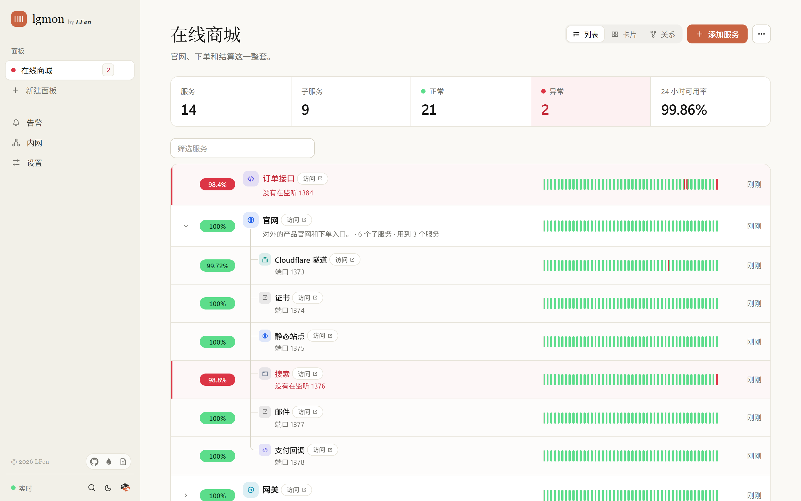
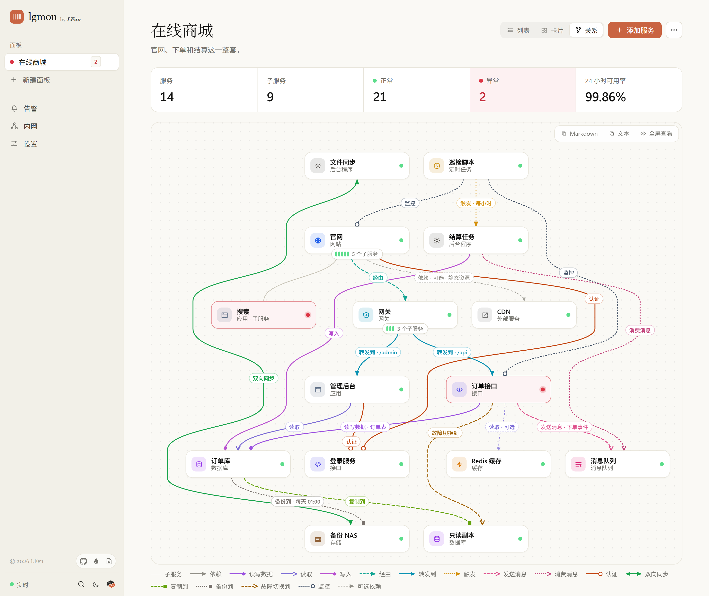
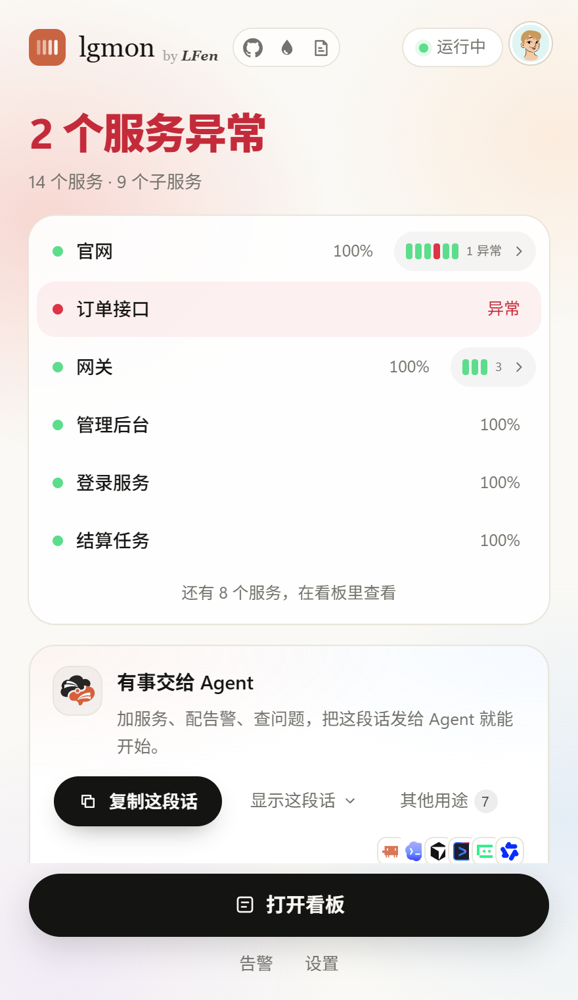
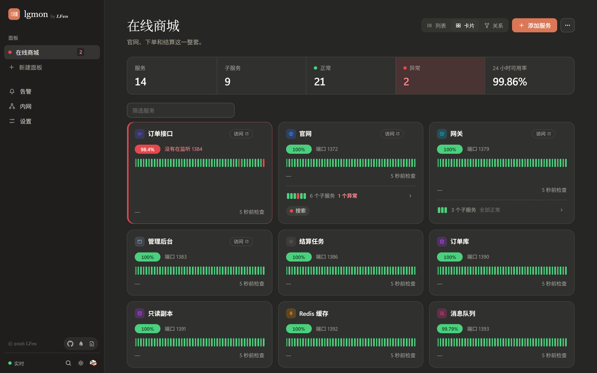
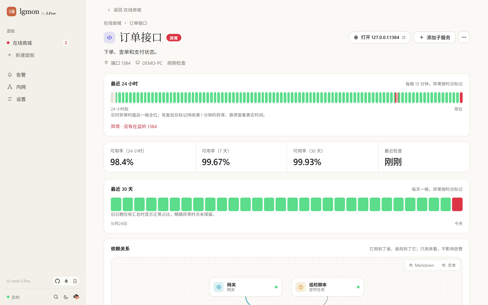
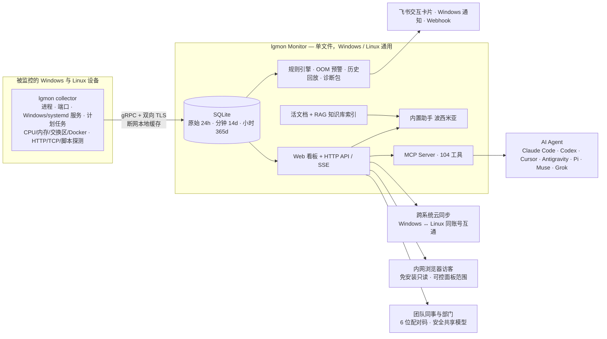

<div align="center">


# lgmon

### AI 原生的服务与设备监控、架构依赖图、活文档知识库与跨平台团队协作面板 — Windows 与 Linux 单文件直跑。

网站 · 接口 · 端口 · Windows 与 systemd 服务 · 进程 · 容器与设备 OOM 预警 · 活文档 · 跨系统云同步 · 内网共享

[English](README.md) · **简体中文**

[](https://github.com/LFenX/lg-monitor/releases/latest)
[](https://github.com/LFenX/lg-monitor/releases)
[](https://github.com/LFenX/lg-monitor/stargazers)


[](LICENSE.md)

[下载最新版](https://license.lfen.ink/download/readme) · [为什么是 lgmon](#为什么是-lgmon) · [活文档与知识库](#活文档与服务知识库) · [团队协作与内网共享](#团队协作与免安装内网共享) · [AI Agent 与波西米亚](#ai-agent-与内置助手波西米亚) · [服务关系图](#服务关系图) · [快速开始](#快速开始)



<sub>无需 Docker、无需数据库服务器——一个单文件可执行程序，同时搞定实时监控、架构拓扑、运维知识库与团队内网共享。</sub>

</div>

---

## 为什么是 lgmon？

传统监控工具往往只回答「3000 端口通不通」，结果架构图躺在过期的文档里、排障步骤散落在聊天记录中、同事天天跑来问「测试环境接口是挂了还是我网络问题？」。

**lgmon 把五件高频运维与协作场景融进了一个轻量级单文件程序（Windows `lgmon.exe` / Linux `lgmon`）：**

1. **秒级服务与设备资源监控**：盯住网站、API、端口、Windows 与 systemd 服务、进程（Windows 支持 ETW 即时事件）、计划任务、每日批处理任务，以及逐核 CPU、内存/交换区、按程序/Docker 容器内存占比与即将 OOM 预警（详见[设备监控](docs/devices.md)）；自带 SQLite 存储与飞书交互卡片告警（群里直接点击确认、静音）。
2. **动态服务架构与跨设备依赖图**：内置 16 种语义关系（调用、读写、经由隧道、消息队列、备份、故障切换……），并支持关联**同账号另一台 Windows / Linux 设备上的外部依赖服务**，一眼看清故障影响面与上下游链路。
3. **活文档与 RAG 服务知识库**：每个服务旁边就是它的 Markdown 运维文档，可由 AI Agent 根据本机真实代码与配置一键编写或随时修改，并由内置助手 **波西米亚** 通过向量检索 + Rerank 随时问答。
4. **Windows 与 Linux 同账号双向云同步**：在 Windows 电脑与 Linux 服务器上登录同一个云账号，看板结构、实时状态、活文档和批处理任务记录自动双向同步，在任一设备都能一站总览。
5. **零门槛团队协作与内网只读共享**：一键开启**内网浏览器只读看板**（支持开放同账号其他设备的精选面板、同事免安装打开链接即看、自定义可见范围 + 实时查看在线访客），并支持点对点内网配对、多级部门管理与安全的 AI 模型密钥共享。

> **完整中英双语**：网页看板、设置页与启动小窗均可一键切换 **简体中文 / English**，通过 SSE 跨窗口实时同步，连所有 Agent 提示词与波西米亚对话界面也全面覆盖双语。

### 适不适合你？

| 非常契合如果你… | 建议看其他方案如果你… |
|---|---|
| 在 **Windows 10/11 或 Linux（amd64 / arm64）** 上自建网站、API、隧道、数据库、容器或定时任务 | 需要 Kubernetes 集群级调度或全球多地区公网分布式拨测 |
| 想用一个轻量单文件同时解决**服务监控 + 设备 OOM 预警 + 架构图 + 活文档 + 团队状态页** | 需要重型分布式链路追踪 / APM 性能剖析 |
| 更想用自然语言让 Claude Code / Codex / Cursor / Antigravity / Pi / Muse / Grok 替你建监控、写文档、改依赖图、查故障 | 打算直接用于商业盈利（见 [许可证](#许可证与原创声明)） |
| 希望 Windows 办公机与 Linux 服务器登录同账号双向同步，并让内网 / Tailscale 同事**免安装**打开网页就能查状态 | — |

---

## 活文档与服务知识库

文档一旦脱离运维工具就会迅速过期。在 **lgmon** 里，**每个服务都自带一份随状态实时同屏的 Markdown 活文档**（存于 `config/docs/`）：

- **基于本机真相由 AI 编写与维护**：点一下「让 Agent 写这篇文档」（或在「其他用途」里选择 **写文档 / 改文档**），Agent 会检查本机真实的端口、启动脚本、配置文件和依赖关系，自动产出带目录和内嵌依赖图的标准化运维文档。
- **排障零跳转**：告警响起时，点进服务详情就能同屏看到 24 小时/30 天可用率、响应耗时、子服务、上下游依赖和这份服务文档——怎么部署、怎么重启、挂了先查哪一目了然。
- **内置 RAG 知识库问答（波西米亚 <kbd>Ctrl</kbd>+<kbd>J</kbd>）**：通过阿里云百炼向量模型 + Rerank 索引服务文档与使用指南，搭配 DeepSeek 回答——直接问 *「订单接口是怎么启动的？」*、*「哪些服务依赖 Postgres？」*、*「把昨晚的故障整理成发给同事的说明」*，回答自动附带可点击的面板与文档链接。
- **自动共享给团队**：开启内网共享或只读浏览器看板后，同事同样可以直接阅读服务文档、向只读波西米亚提问，把你的监控看板瞬间变成团队的内部服务门户。

---

## 团队协作与免安装内网共享

无论团队成员有没有装 lgmon，都能在同一局域网或 Tailscale 下安全高效地同步服务状态：

### 1. 内网浏览器访问与访客权限
在 **内网** 页面打开 **内网浏览器访问**。访客默认只读。

- **浏览器打开即看**：把内网 / Tailscale 链接发给同事，对方无需安装任何软件即可只读查看实时看板、依赖图和服务文档，甚至可以**只读使用波西米亚**查询状态与文档。
- 主机管理员可以在本机的 **内网 → 完全访问密钥** 中生成密钥并设置有效期。访客点击 **解锁完全访问** 并输入密钥后，就能管理所有面板、设置和服务。管理员可以单独修改有效期，也可以更换或撤销密钥。密钥到期、更换或撤销后，旧会话立即失去权限。
- **内网访客可见范围**　展开面板可单独勾选服务和子服务。受限依赖在关系图中显示为灰色节点，访客只能看到名称。主机管理员可在「内网 → 完全访问密钥」再次查看和复制新版生成的密钥。
- **实时访客感知**：在你的侧边栏底部实时看到正在浏览你看板的内网访客头像与数量，点击弹窗即可查看每个访客的 IP 与活跃时间；访客底部则带有醒目的 GitHub 入口、实时下载量 / Star / Fork 数据与一键下载最新版按钮。

### 2. 点对点内网共享、多级部门与模型密钥共享
- **6 位配对码安全授权**：同样装了 lgmon 的同事可一键申请查看你的面板，双方核对 6 位配对码后同意，随时一键撤销；内网只显示头像和昵称，不暴露主机名。
- **多级部门树**：支持在内网创建与加入多级部门（托管在创建者本机，支持多名管理员审批），侧边栏按部门归类同事的看板；**启动小窗顶部也会用紧凑胶囊实时汇总所有共享面板的健康状态**。
- **安全共享波西米亚模型**：没有 DeepSeek 密钥的同事可使用你共享的模型——请求经由你的电脑加密转发，**你的 API Key 永远不会离开你的电脑**。
- **自动管理 Windows 防火墙**：开启内网可见自动为 `lgmon.exe` 放行 7445/TCP 与 7446/UDP（仅限内网与 Tailscale 网段），关闭即自动清理规则。详见 [内网共享与团队文档](docs/teams.md)。

---

## AI Agent 与内置助手波西米亚

### 为 AI Agent 而生：102 个 MCP 工具全覆盖
lgmon 的全部能力都通过 **MCP（Model Context Protocol）** 开放。在启动小窗（或任意已写好文档、依赖图旁的折叠修改入口）点一下 **复制这段话**，粘贴给 **Claude Code、Codex、Cursor、Antigravity、Gemini CLI、Pi、Muse、Grok、Windsurf、GitHub Copilot、Trae、Qwen、Cline** 等任意主流 Coding Agent，它会自动完成接入并开始干活：

```powershell
# 输出 Claude Code、Codex 的 mcp add 命令以及通用的 mcpServers JSON 配置
lgmon agent connect

# 轻量模型可使用精简核心工具集（面板、监控、设备、助手），而非全部 102 个
lgmon agent connect --tools essential
```

| 你只需说一句 | Agent 自动调用的能力 |
|---|---|
| 「看看这台电脑上跑着哪些重要服务，帮我加进监控」 | `start_here` → `explore` → `add_monitor` |
| 「给我面板上的服务都补齐部署和排障文档」 | 检查本机代码与配置 → `put_monitor_doc` |
| 「把官网、网关、数据库和 Cloudflare 隧道的依赖关系画出来」 | `edit_monitor`（`depends`、`role`） |
| 「订单接口挂了，帮我查明原因并整理结论」 | `list_alerts` → `get_alert_diagnostics` |
| 「把严重告警发到值班飞书群，卡片上带确认和静音按钮」 | 飞书接入与卡片模板工具 |
| 「帮我配置内网只读共享并限制访客只能看生产面板」 | 内网共享与权限工具 |

点击「其他用途」即可一键复制覆盖全场景的提示词：**照看服务 · 加服务 · 改服务 / 加子服务 · 写文档 / 改文档 · 梳理依赖关系 · 查问题 · 配告警 · 接飞书 · 内网共享与同事面板 · 安装 Skill**。

### 内置助手：波西米亚（<kbd>Ctrl</kbd>+<kbd>J</kbd>）
- 随时回答服务现状、最近 7 天故障趋势、服务文档内容和 lgmon 使用方法。
- 支持直接代劳看板常见操作（改名、换卡片样式、整理面板、确认/静音告警），凡涉及删除或对外发送消息前**必先弹窗向你确认**。
- 内网只读访客同样可用（自动锁定为只读问答），完整支持中英文界面。

---

## 服务关系图

把面板切换到 **关系** 视图，即可看到自上而下的实时架构依赖图：面向用户的入口在上方，网关、接口、数据库、队列和隧道在下方。**16 种语义关系** 各有专属线型与箭头：

| 关系 | 含义 | 视觉样式 |
|---|---|---|
| `uses` · `calls` · `forwards` | 直接调用或转发 | 实线 + 实心箭头 |
| `data` · `writes` | 读写或存储数据 | 实线 + 菱形 |
| `reads` | 只读数据 | 实线 + 空心箭头 |
| `via` | 经由隧道、网关或代理 | 虚线 |
| `runs` | 由其启动或调度 | 点线 |
| `sends` · `consumes` | 异步消息投递与消费 | 虚线 / 点线 + 空心箭头 |
| `auth` · `monitors` | 鉴权或健康检查 | 圆点 |
| `syncs` | 双向数据同步 | 双向箭头 |
| `replicates` · `backup` | 副本复制或备份 | 方块 |
| `fallback` | 故障降级兜底 | 虚线 + 空心箭头 |
| `optional: true` | 弱依赖（断开后可降级运行） | 细虚线，标注「可选」 |

健康且无外部依赖的子服务会自动折叠在父服务下方，按需展开，大拓扑依然清爽。

---

## 界面截图

<table>
<tr>
<td width="62%"></td>
<td width="38%"></td>
</tr>
<tr>
<td align="center"><sub><b>服务关系图</b>：16 种关系清晰标注影响面与依赖链路</sub></td>
<td align="center"><sub><b>启动小窗</b>：一眼看结论、右侧共享面板概览、一键交给 Agent</sub></td>
</tr>
</table>

<table>
<tr>
<td width="50%"></td>
<td width="50%"></td>
</tr>
<tr>
<td align="center"><sub><b>深色模式卡片视图</b>：6 种卡片样式可按服务自由定制</sub></td>
<td align="center"><sub><b>服务详情页</b>：24h / 30d 可用率、耗时、子服务、告警与活文档</sub></td>
</tr>
</table>

---

## 快速开始

### 1. 下载安装（Windows 或 Linux）

**Windows（10 / 11，x64）** — 从 [GitHub Releases](https://github.com/LFenX/lg-monitor/releases/latest) 下载 **`lgmon-setup-<版本>.exe`** 双击运行：
- 默认安装到 `Program Files\lg-monitor`，以 Windows 服务开机自启；配置与数据保留在 `%ProgramData%\lg-monitor`。
- 从开始菜单打开 **lgmon** 启动小窗，或在浏览器访问 <http://127.0.0.1:7444/> 进入完整看板。
- 新版本发布时，在网页侧边栏或启动小窗点 **立即更新** 即可自动弹出小窗并完成校验 `SHA256SUMS` 与无缝升级全流程。

**Linux（amd64 / arm64，systemd + SSH 优先）** — 一键安装：
```sh
curl -fsSL https://github.com/LFenX/lg-monitor/releases/latest/download/install.sh | sudo sh
```
- 自动按架构下载 `lgmon-linux-<arch>.tar.gz`、核对 `SHA256SUMS`、安装 `/usr/local/bin/lgmon` 并配置 `lgmon.service`（数据保存在 `/var/lib/lg-monitor`）。
- 无需暴露公网端口，通过 SSH 转发即可打开看板：`ssh -L 7444:127.0.0.1:7444 user@your-server`，随后访问 <http://127.0.0.1:7444/>。
- 登录与你 Windows 上相同的云账号，即可双向同步两台设备的看板、活文档、批处理记录与跨设备依赖。
- 后续升级只需在 SSH 中运行 `sudo lgmon update -y`（自动匹配架构、校验 SHA-256、原子替换并重启服务）。

> 每次发布均提供覆盖 Windows 与 Linux 安装包的 `SHA256SUMS` 与 GitHub 官方 **SLSA 构建溯源证明（Artifact Attestations）**。Windows 安装包暂未购买商业代码签名，SmartScreen 首次提示时点「更多信息 → 仍要运行」即可。

### 2. 交给 Agent（或手动添加）
在启动小窗点 **复制这段话**（或在 Linux SSH 下执行 `lgmon agent connect`）发给 Claude Code / Codex / Cursor / Antigravity / Pi / Muse / Grok 等 Agent，它会自己接入并询问你要监控什么；也可以直接在看板右上角点 **添加服务**，从本机监听端口、进程、Windows / systemd 服务、计划任务或网址中一键添加。

---

## 工作原理



- **零外部依赖**：纯 Go 单文件（`CGO_ENABLED=0`），内置 React + ECharts 前端和纯 Go SQLite。
- **隐私与安全**：进程命令行仅在本地匹配、绝不上传；所有密钥均在本地加密存储（Windows 用 DPAPI，Linux 用 0600 独立主密钥 AES-GCM），任何命令都不会明文输出。

---

## 全部能力一览

| 模块 | 能力清单 |
|---|---|
| **监控采集** | 网站（HTTP + TLS 证书到期）、TCP 端口、Windows 与 systemd 服务、进程（命令行匹配 + Windows ETW 即时事件）、计划任务、[批处理任务](docs/jobs.md)、[设备 CPU/内存/交换区/Docker 容器占用与 OOM 预警](docs/devices.md)、脚本探针、[Windows 事件日志](docs/collection.md)、[启动项与计划任务清单](docs/inventory.md) |
| **看板与体验** | 列表 / 卡片 / 关系图三种视图（支持跨设备外部依赖）；6 种卡片样式；<kbd>Ctrl</kbd>+<kbd>K</kbd> 全局搜索；浅色 / 深色主题；**中英双语 + 跨窗口实时同步**；[声明式仪表盘](docs/dashboards.md)与[自定义 HTML 仪表盘](docs/html-dashboards.md) |
| **文档与 AI** | 服务 Markdown 活文档 + 内嵌依赖图 + 常驻可折叠 Agent 修改入口；向量检索 + **波西米亚**（<kbd>Ctrl</kbd>+<kbd>J</kbd>）；**102 个 MCP 工具**；一键生成[诊断包](docs/diagnostics.md) |
| **告警与通知** | 进程/端口/服务/探针/指标/容器/多实例 SQL 规则；持续时长、抖动合并、重复提醒、确认、静音与[历史回放](docs/rules.md)；飞书交互卡片（[群内直接确认/静音](docs/card-actions.md)）、自定义机器人、[通用 Webhook](docs/webhooks.md)、Windows 通知 |
| **云同步与内网** | **Windows ↔ Linux 同账号双向云同步**；**免安装内网浏览器只读看板**（支持按面板开放本机与同账号其他设备面板 + 侧边栏实时在线访客）；点对点 6 位配对码共享；多级部门树；安全的波西米亚模型共享 |
| **扩展集成** | [Prometheus / OTLP 导出](docs/exports.md)、OpenAPI 3.1 HTTP API、SSE 实时流、[多监控器上报](docs/multi-monitor.md)、[受控服务重启](docs/service-operations.md) |

---

## 常用 CLI 命令

```powershell
lgmon                         # 打开启动小窗（后台托盘运行）
lgmon run --no-tray           # 仅在终端运行
lgmon status                  # 查看服务和告警摘要（支持 --json）
lgmon alerts                  # 列出正在触发的告警
lgmon diagnose <alert-id>     # 生成可直接交给 AI 排查的诊断包
lgmon config validate         # 校验 YAML 配置并精确定位报错行号
lgmon feishu setup            # 交互式接入飞书应用
lgmon secret set <name>       # 安全加密保存密钥（Windows DPAPI / Linux AES-GCM）
lgmon agent connect           # 输出 AI Agent 的 MCP 接入配置
lgmon update --check          # 检查更新（Linux 下执行 sudo lgmon update -y 自动升级）
```

完整命令见 [CLI 文档](docs/cli.md)，配置 Schema 见 [schemas/](schemas/)，示例见 [examples/](examples/)。

---

## 资源占用实测

30 分钟端到端压测：**20 个模拟采集器 × 50 个目标 = 1,000 个监控目标**（Windows 11，仅统计监控端进程）：

| 指标 | 实测 / 估算 |
|---|---|
| 监控端平均 CPU / 峰值内存 | **1.74% / 102.8 MiB** |
| 数据库增长速率（1,000 目标） | 约 480 MB / 小时 |
| 默认保留期上限（原始 24h / 分钟 14d / 小时 365d） | 约 32.5 GB |
| 采集器离线缓存 | 默认上限 500 MB（50 目标断网 24h 约占一半） |

普通个人或团队电脑监控几十个服务时，资源占用极低。详见 [M1 验收记录](docs/acceptance-m1.md#m1-22-工程证据)。

---

## 从源码构建

需要 Go 1.27、Git、Node 22.22.2+ 与 pnpm 11.21.0：

```powershell
.\scripts\build.ps1                                 # 构建 bin\lgmon.exe 与 bin\lgmon-window.exe
.\bin\lgmon.exe --home .\dev-home                   # 使用开发目录启动（无需管理员权限）
.\scripts\build-installer.ps1 -Version 0.0.0-dev   # 可选：打包 Windows 安装器（需 Inno Setup 6.7.4）
```

提交前验证：

```powershell
gofmt -l . && go vet ./... && go test ./... && pnpm --dir web test
```

---

## 文档索引

| 使用指南 | Agent 与集成 | 架构与原理 |
|---|---|---|
| [Web 看板说明](docs/web-panel.md) | [MCP 工具参考（104 个）](docs/mcp.md) | [产品需求文档](docs/PRD.md) |
| [设备资源与 OOM 预警](docs/devices.md) | [Agent 使用指南](docs/agent-guide.md) | [开发计划与执行记录](docs/PLAN.md) |
| [安装与自动更新](docs/installer.md) | [HTTP API](docs/api.md) | [采集传输协议](docs/transport.md) |
| [告警规则与回放](docs/rules.md) | [Webhook 通知](docs/webhooks.md) | [数据聚合与保留](docs/storage.md) |
| [批处理任务监控](docs/jobs.md) | [指标导出](docs/exports.md) | [更多采集源](docs/collection.md) |
| [诊断包](docs/diagnostics.md) | [CLI 命令参考](docs/cli.md) | [Windows 服务](docs/windows-service.md) |

---

## 许可证与原创声明

lgmon 基于 [PolyForm Noncommercial 1.0.0](LICENSE.md) 发布（另见 [NOTICE](NOTICE)）。欢迎个人学习、使用、修改及非营利组织使用；**禁止未经授权的商业用途**，如需商用请联系作者。

内置头像包含 lgmon 原创插画、[DiceBear Lorelei](https://www.dicebear.com/styles/lorelei/)（CC0 1.0）与 [fiora](https://github.com/yinxin630/fiora)（MIT），详见 `web/src/avatars/LICENSE`。

由 **LFen** 设计与开发 · [GitHub](https://github.com/LFenX/lg-monitor) · [lfen.ink](https://lfen.ink/) · [留白 margin.lfen.ink](https://margin.lfen.ink/)
