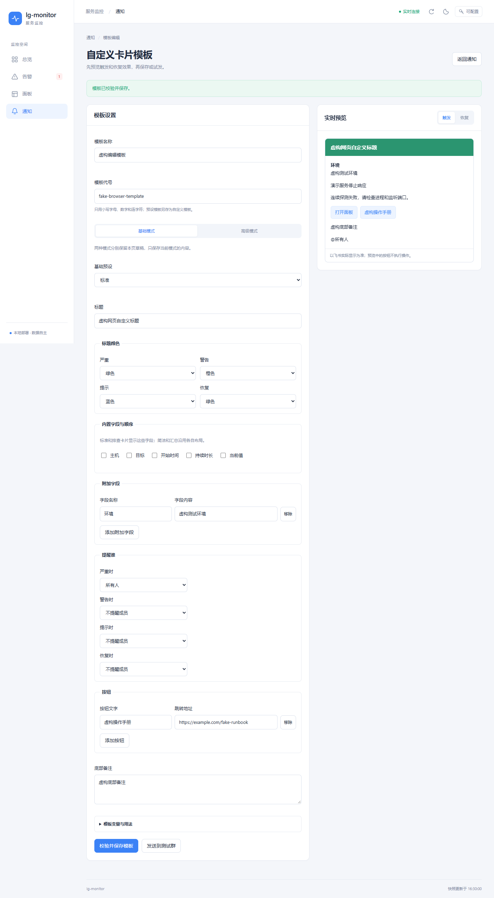
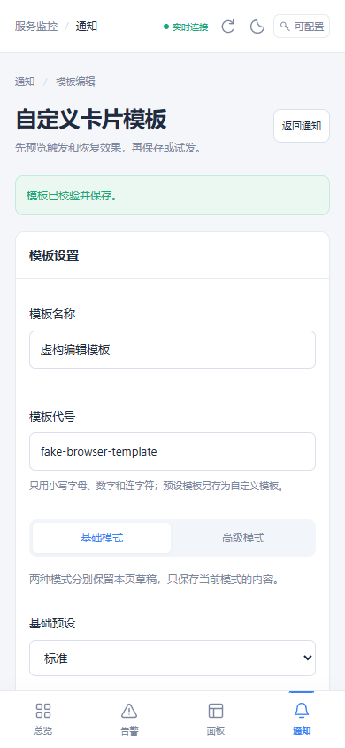
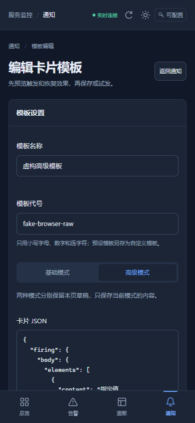
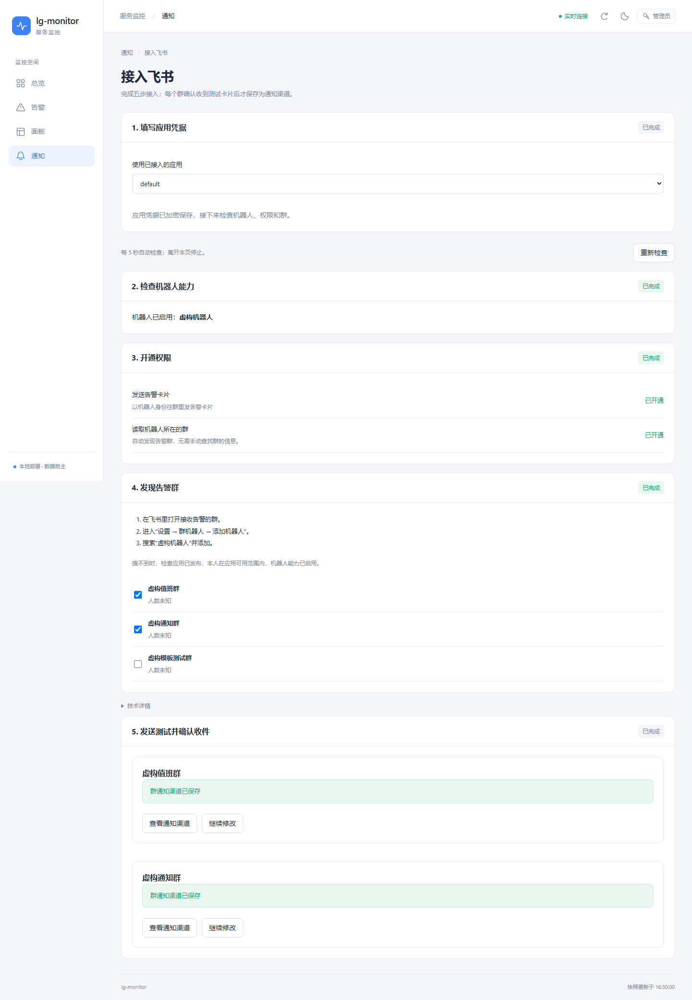
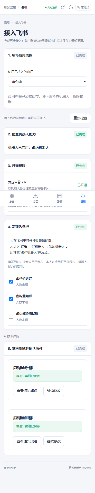
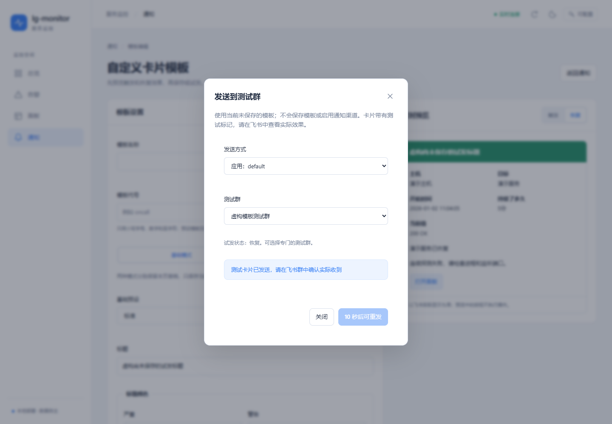
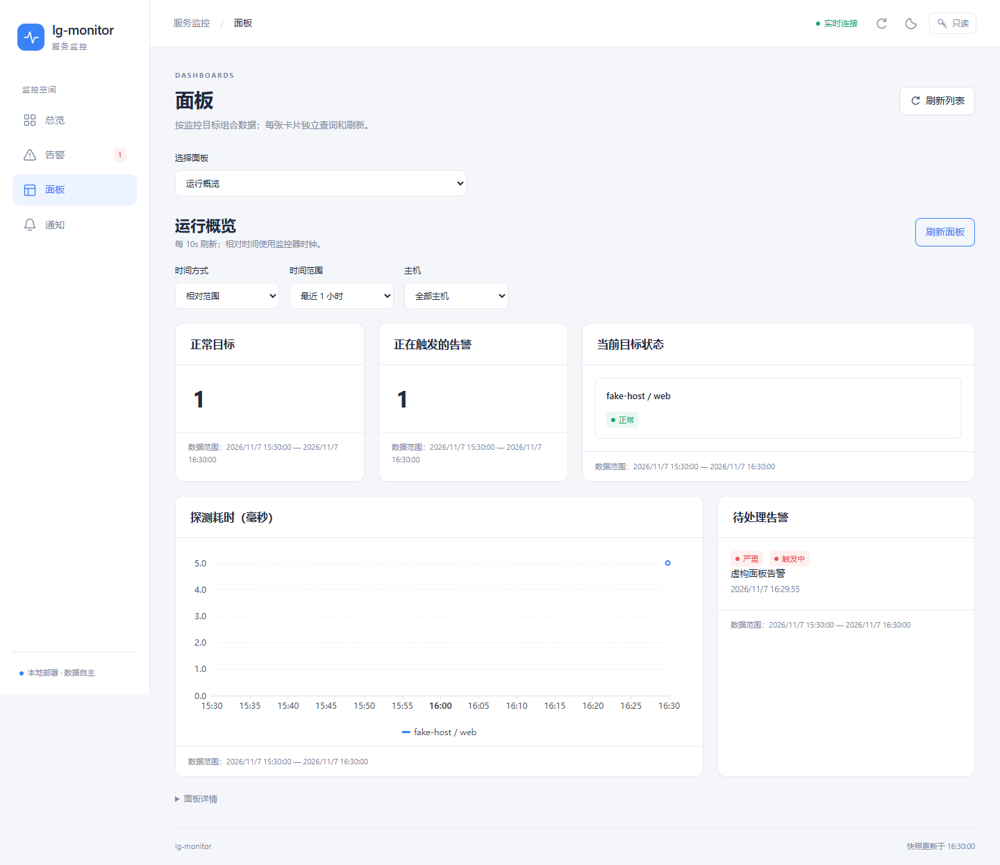
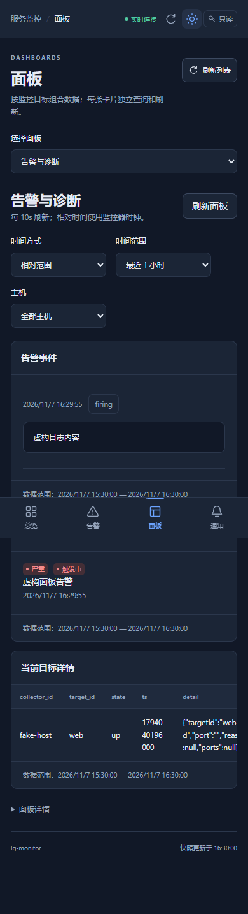
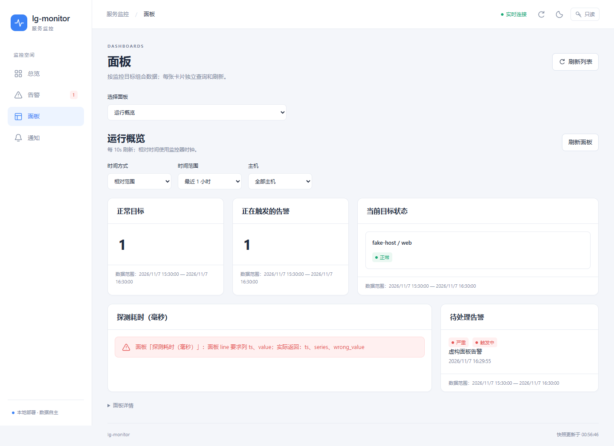

# lg-monitor 执行计划

需求见 [PRD.md](PRD.md)。本文是给执行者（Codex 等编程 Agent）的逐步计划。

## 怎么用这份计划

- 按编号顺序做。每个任务是一个独立提交，提交信息以任务编号开头，例如 `M0-03: process collector`。
- 每个任务都写了“完成标准”。全部满足、`go vet ./...` 和 `go test ./...` 都通过后才算完成，然后在本文对应任务前把 `[ ]` 改成 `[x]`，和代码放在同一个提交里。
- 遇到计划没写清、或者照做明显不对的地方：在本文末尾的“执行记录”里写下问题和你的处理方式，然后继续。不要悄悄偏离。
- 不要提前做后面阶段的功能。接口可以预留，功能不要写。
- Claude 的审查意见写在 [REVIEW.md](REVIEW.md)，是对本计划的修订；两者冲突时，以审查意见为准。每个任务开始前，先处理那里还没关闭的条目。

## 全局约定

| 项目 | 约定 |
|---|---|
| Go 版本 | 本机是 Go 1.27.3，`go.mod` 写 `go 1.27` |
| 模块名 | `github.com/LFenX/lg-monitor` |
| 程序 | 只有一个可执行文件 `lgmon.exe`，入口在 `cmd/lgmon` |
| 命令行框架 | `github.com/spf13/cobra` |
| 日志 | 标准库 `log/slog`，JSON 格式写文件，开发时文本格式输出到控制台 |
| SQLite | `modernc.org/sqlite`（纯 Go）。禁止引入任何需要 cgo 的依赖，`CGO_ENABLED=0` 必须能编译 |
| 飞书 | 官方 Go SDK `github.com/larksuite/oapi-sdk-go/v3`，用应用自己的 App ID 和 App Secret 调用开放平台接口。**程序运行时不依赖 lark-cli** |
| 配置文件 | YAML，用 `gopkg.in/yaml.v3` 解析（报错要能带行号） |
| 时间 | 一律存 UTC 的 Unix 毫秒（`int64`），只在显示时转本地时间 |
| 错误信息 | 面向用户的报错用中文，写明哪里错了、怎么改；日志和代码注释用英文 |
| 测试 | 依赖系统的部分（进程、端口、飞书接口、时间）都要定义成接口，测试里用假实现。真实系统测试加构建标签 `//go:build integration`，默认不跑 |
| 安全 | 测试和验收只能操作自己启动的演示进程。**不准关闭、重启或修改这台电脑上已经在跑的真实服务**（LFEN、lgplayblog、Nebula、PostgreSQL、cloudflared 等） |

### 数据目录

| 用途 | 正式运行（Windows 服务） | 开发时 |
|---|---|---|
| 配置 | `%ProgramData%\lg-monitor\config\` | `--home .\dev-home` 下的 `config\` |
| 数据库、缓存、证书、密钥 | `%ProgramData%\lg-monitor\data\` | `dev-home\data\` |
| 日志 | `%ProgramData%\lg-monitor\logs\` | `dev-home\logs\` |

所有子命令都支持 `--home <目录>`，也可以用环境变量 `LGMON_HOME`。`dev-home/` 已写进 `.gitignore`。

### 目录结构

```
cmd/lgmon/                main.go，子命令注册
internal/app/             把各模块组装起来（run 命令）
internal/config/          配置结构体、加载、校验、热加载、生成 JSON Schema
internal/secrets/         密钥存储（DPAPI 加密）
internal/collector/       采集器：进程、端口、探测、系统指标、服务、脚本
internal/collector/match/ 监控目标匹配
internal/pipeline/        采集器与监控器之间的接口（M0 用内存实现，M1 换成 gRPC）
internal/transport/       M1：gRPC、配对、证书、离线缓存
internal/store/           SQLite：建表、迁移、写入、查询、清理
internal/rules/           规则判断和告警状态机
internal/feishu/          飞书开放平台客户端、错误识别、开通向导的逻辑
internal/notify/          通知调度与各渠道
internal/notify/cards/    卡片模板引擎与预设模板
internal/api/             M1：HTTP API、SSE、只读 SQL、MCP
internal/winsvc/          M1：Windows 服务安装与运行
proto/                    M1：protobuf 定义
web/                      M1：React 面板
schemas/                  生成的 JSON Schema（提交进仓库）
examples/                 示例配置
scripts/                  build.ps1、验收脚本
```

### 已核实的飞书事实

2026-11-06 用 lark-cli 1.0.99，以机器人身份在真实租户上核实过下面这些事实，可以直接依赖。和实际返回不一致时，以飞书的实际返回为准，并在执行记录里更新本节。

| 事实 | 内容 |
|---|---|
| 获取令牌 | `POST /open-apis/auth/v3/tenant_access_token/internal`，用 App ID 和 App Secret 换取 |
| 机器人信息 | `GET /open-apis/bot/v3/info`，返回 `app_name`、`avatar_url`、`open_id`、`activate_status`（实测已启用机器人的应用为 `2`） |
| 查询应用权限 | `GET /open-apis/application/v6/scopes`（机器人身份），返回 `data.scopes[]`，每项含 `scope_name`、`scope_type`（`tenant` 或 `user`）、`grant_status`（实测 `1` 表示已授权）。只列出应用已经申请过的权限，没申请过的不出现 |
| 缺权限的报错 | 错误码 `99991672`，报错里带缺少的权限名（可能不止一个） |
| 一键开通链接 | `https://open.feishu.cn/page/scope-apply?clientID=<AppID>&scopes=<权限名用英文逗号连接后整体做 URL 编码>`。实例：`.../page/scope-apply?clientID=cli_xxx&scopes=hire%3Ajob%3Areadonly%2Chire%3Apeople_cli` |
| 机器人所在的群 | `GET /open-apis/im/v1/chats`（机器人身份），返回 `data.items[]`，含 `chat_id`（`oc_` 开头），分页参数 `page_size`、`page_token`。在只开通了 `im:chat:read`、没有 `im:chat:readonly` 的应用上调用成功 |
| 发消息 | `POST /open-apis/im/v1/messages?receive_id_type=chat_id`，卡片用 `msg_type: interactive`，`content` 是卡片 JSON 序列化后的字符串 |
| 卡片格式 | 卡片 JSON 2.0（`"schema": "2.0"`） |
| 代理 | 这台电脑的用户环境变量里有 `HTTPS_PROXY=http://127.0.0.1:7890`；以 Windows 服务运行时没有这个变量 |

本机的 lark-cli（`lark-cli api GET <路径> --as bot`）已经配好一个测试应用，可以用它查看接口的真实返回，写成测试用的样例数据。**只能调用只读接口**；发消息只能发到用户确认过的测试群。

---

## M0 单机原型

**目标**：一台电脑上运行 `lgmon run --role both`。用户用 `lgmon feishu setup` 填入飞书应用的 App ID 和 App Secret，按引导一键开通权限、把机器人拉进群；之后关掉一个被监控的进程，15 秒内群里收到告警卡片，进程恢复后收到恢复卡片。

整个 M0 里，采集器和监控器在同一个进程内，通过 `internal/pipeline` 定义的接口用 Go channel 通信。这个接口要设计成 M1 换成 gRPC 时，采集器和监控器两边的代码都不用改。

### [x] M0-01 项目骨架

- `go mod init github.com/LFenX/lg-monitor`，建立上面的目录结构（空目录放 `doc.go`，写一行包说明）。
- `cmd/lgmon`：cobra 根命令，带 `--home`、`--log-level`；子命令 `version`，输出版本号、提交号和构建时间（通过 `-ldflags` 注入）。
- `scripts/build.ps1`：`CGO_ENABLED=0` 编译出 `bin\lgmon.exe`，注入版本信息。
- `.github/workflows/ci.yml`：在 `windows-latest` 上运行 `go vet`、`go test ./...`，并执行 build 脚本。

**完成标准**：`scripts\build.ps1` 生成可运行的 `bin\lgmon.exe`，`lgmon version` 能输出版本信息；CI 通过。

### [x] M0-02 配置

配置目录下的文件，每个都可以不存在（视为空）：

`targets.yaml`：监控目标

```yaml
targets:
  - id: nebula                 # 小写字母、数字、横线
    name: Nebula 网站
    match:                     # 以下条件全部满足才算匹配；至少写一个
      process: node.exe        # 进程名，不区分大小写
      cmdline: 'D:\\appmy\\GRM' # 正则，匹配命令行
      port: 3001               # 该进程在监听这个端口
    probes:
      - type: http
        url: http://127.0.0.1:3001/
        interval: 15s
        timeout: 5s
        expectStatus: "<500"   # 也可以写 200、"2xx"
    tags: [web]
```

`match` 还支持 `service`（Windows 服务名），但 M0 只需要解析和校验，不用实现。

`rules.yaml`：规则

```yaml
rules:
  - id: nebula-down
    name: Nebula 进程不在
    type: process_absent       # M0 支持：process_absent、port_closed、probe_failed
    target: nebula
    for: 10s                   # 持续多久才触发
    severity: critical         # critical | warning | info
    notify: [feishu-alerts]
    template: detailed         # 可选；不写就用通知渠道的默认模板
```

`notifiers.yaml`：飞书应用和通知渠道

```yaml
feishuApps:
  - id: default
    appId: cli_xxxxxxxx
    secretRef: feishu-default   # App Secret 不写在这里，存在加密的密钥库里（见 M0-09）
    domain: feishu              # feishu | lark
    proxy: auto                 # auto（读取环境变量）| none | http://...

notifiers:
  - id: feishu-alerts
    type: feishu_app            # M0 只做这一种
    app: default
    chatId: oc_xxxxxxxx
    chatName: 服务告警           # 只用于显示，由向导自动填写
    template: standard          # 默认卡片模板
```

`card-templates/*.yaml`：自定义卡片模板，格式见 M0-10。

要求：

- 配置结构体定义在 `internal/config`，校验所有引用关系（规则引用的目标、通知渠道、模板必须存在；通知渠道引用的飞书应用必须存在；ID 不能重复；`for` 必须是合法时长）。
- 报错格式：`rules.yaml 第 7 行：规则 nebula-down 引用的目标 nebla 不存在`。
- `lgmon config validate`：校验配置并以中文列出所有错误，有错时退出码为 1。
- `lgmon config schema`：用 `github.com/invopop/jsonschema` 从结构体生成 `schemas/*.schema.json`，提交进仓库。`examples/` 里的示例文件开头写上 `# yaml-language-server: $schema=...`。
- 用 `github.com/fsnotify/fsnotify` 监听配置目录。文件变化后重新加载，校验失败就保留旧配置并记录错误，不能让程序崩溃。

**完成标准**：`examples/` 里的示例文件都能通过校验；每类错误各写一个会失败的测试用例；热加载测试通过（写入错误配置后旧配置仍然有效）。

### [x] M0-03 进程与端口采集

- 定义接口 `ProcessSource`：返回进程快照（PID、父 PID、名称、命令行、可执行文件路径、创建时间、CPU%、内存 RSS、线程数）。~~真实实现用 `github.com/shirou/gopsutil/v4/process`~~。真实实现已经由 REVIEW R1-02、R1-03 修订：核心字段用 `NtQuerySystemInformation` 一次取全，exe 路径和命令行按进程身份缓存。
- 定义接口 `PortSource`：返回 TCP 监听列表（本地地址、端口、PID）。真实实现用 gopsutil 的 `net.Connections("tcp")`，只保留 `LISTEN` 状态。
- 进程的身份由（PID，创建时间）共同确定，防止 PID 被复用后认错。
- 拿不到命令行（权限不足）时字段留空，不能报错退出。
- 每次采集要计时，超过 1 秒记一条警告日志。

**完成标准**：用假实现写单元测试；加一个 `integration` 标签的测试，自己启动 `ping -t 127.0.0.1` 子进程，确认快照里能找到它，测试结束时关掉它。

### [x] M0-04 监控目标匹配

- `internal/collector/match`：输入进程快照和端口列表，输出每个监控目标的状态：`up`（找到匹配进程）或 `down`，以及匹配到的进程和端口。
- 匹配规则见 M0-02。一个目标匹配到多个进程时都记录下来，只要有一个就算 `up`。
- 匹配结果要附带原因，方便排查，例如“进程名匹配，但没有在监听 3001”。

**完成标准**：表驱动测试覆盖：只按名称匹配、名称加命令行、名称加端口、端口被别的进程占用、多个进程匹配、没有任何匹配。

### [x] M0-05 HTTP 与 TCP 探测

- 每个探测按各自的间隔独立运行，同一时间只允许一个实例在跑。
- HTTP 探测：不走系统代理，不自动跳转，记录状态码、耗时和错误；按 `expectStatus` 判断成功或失败。
- TCP 探测：`host:port` 能否在超时内连上。
- 结果写入探测结果流，包含目标 ID、探测编号、成功与否、耗时、错误信息。

**完成标准**：用 `net/http/httptest` 测试各种状态码、超时和连接被拒；TCP 用一个本地监听测试。

### [x] M0-06 采集器组装与 pipeline 接口

- `internal/pipeline` 定义采集器发出的消息：`TargetStatus`（目标状态变化，以及每 10 秒一次的全量快照）、`ProbeResult`、`ProcessSample`（被匹配进程的 CPU 和内存），每条消息带采集器 ID、递增序号和时间戳。
- 定义接口 `Sink`（采集器往里写）和 `Source`（监控器从里读），M0 用带缓冲的 channel 实现。
- 采集器主循环：每 2 秒采集一次进程和端口，计算目标状态，只在状态变化时立即发送；探测按自己的间隔运行。
- 采集器 ID：第一次运行时生成 UUID，存在 `data\collector-id`。

**完成标准**：测试里用假的进程源模拟“进程消失 → 恢复”，确认 `Sink` 按顺序收到对应的状态变化。

### [x] M0-07 存储

表结构（用 `embed` 内嵌迁移 SQL，按版本号顺序执行，启动时自动迁移）：

```sql
CREATE TABLE collectors (id TEXT PRIMARY KEY, hostname TEXT, first_seen INTEGER, last_seen INTEGER, version TEXT);
CREATE TABLE target_status (collector_id TEXT, target_id TEXT, ts INTEGER, state TEXT, detail TEXT, PRIMARY KEY (collector_id, target_id, ts));
CREATE TABLE probe_results (collector_id TEXT, target_id TEXT, probe TEXT, ts INTEGER, ok INTEGER, latency_ms INTEGER, error TEXT);
CREATE TABLE process_samples (collector_id TEXT, target_id TEXT, ts INTEGER, pid INTEGER, cpu REAL, rss INTEGER);
CREATE TABLE alerts (id TEXT PRIMARY KEY, rule_id TEXT, collector_id TEXT, target_id TEXT, state TEXT, severity TEXT,
                     started_at INTEGER, resolved_at INTEGER, last_notified_at INTEGER, summary TEXT);
CREATE TABLE alert_events (alert_id TEXT, ts INTEGER, kind TEXT, message TEXT);
CREATE TABLE notifications (id TEXT PRIMARY KEY, alert_id TEXT, notifier_id TEXT, template TEXT, ts INTEGER,
                            ok INTEGER, error TEXT, message_id TEXT);
```

给需要的列加索引（按时间范围查询的表都要有 `(collector_id, target_id, ts)` 索引）。

- 打开数据库时设置 `journal_mode=WAL`、`busy_timeout=5000`、`foreign_keys=ON`。
- 只用一个协程负责写入，批量提交（每 500 毫秒或攒满 500 条提交一次）。
- 清理：原始数据保留 24 小时，每小时清理一次。M0 不做汇总表。

**完成标准**：迁移可以重复执行；写入 1 万条数据的测试在 2 秒内完成；清理测试通过。

### [x] M0-08 规则引擎与告警状态机

- 状态：`ok` → `pending`（条件满足但还没到 `for` 的时长）→ `firing` → `resolved`。在 `pending` 期间条件不再满足就回到 `ok`，不发通知。
- 规则只看最新的目标状态和探测结果；每 1 秒评估一次，收到状态变化时也立即评估。
- 同一条规则、同一个采集器、同一个目标只能有一个处于触发状态的告警。
- 目标状态为 `unknown` 时（见 REVIEW R1-04），不触发新告警，也不会让已经触发的告警恢复；规则处于 `pending` 时，按条件不满足处理，回到 `ok`。
- 触发时生成告警 ID，写入 `alerts` 和 `alert_events`，通知一次；恢复时通知一次。M0 不做重复提醒、静音和确认。
- 程序重启后，从数据库恢复仍处于 `firing` 状态的告警，不能重复发送“触发”通知。

**完成标准**：用可控时钟（注入 `now func() time.Time`）的测试覆盖：抖动（`pending` 时恢复）、正常触发再恢复、重启后恢复状态、`for: 0s` 立即触发。

### [x] M0-09 密钥存储与飞书客户端

**密钥库**（`internal/secrets`）

- 存放在 `data\secrets.json`，每个值用 Windows DPAPI 加密（`golang.org/x/sys/windows` 的 `CryptProtectData`），使用机器级别（`CRYPTPROTECT_LOCAL_MACHINE`）。原因：M1 起监控器以 SYSTEM 身份作为服务运行，用户级加密的值服务读不出来。为弥补机器级加密的范围，`secrets.json` 的访问权限设为只允许 SYSTEM、Administrators 和创建它的用户。
- `lgmon secret set <名称>`：从标准输入读取，在终端里输入时不回显（`golang.org/x/term`）。`lgmon secret list` 只列出名称。不提供把明文打印出来的命令。
- 日志、报错、`--json` 输出里都不能出现密钥明文。写一个测试：把一个密钥值走一遍会写日志的流程，检查日志里不含它。

**飞书客户端**（`internal/feishu`）

- 用官方 SDK 处理令牌获取和缓存。SDK 没有直接封装的接口（权限查询、机器人信息），用 SDK 的通用请求方法调用。
- 域名：`feishu` 用 `https://open.feishu.cn`，`lark` 用 `https://open.larksuite.com`。
- 代理：`proxy: auto` 时读取 `HTTPS_PROXY`，`none` 时直连，也可以写具体地址。
- 提供这些方法：`TenantToken`、`BotInfo`、`AppScopes`、`ListChats`（自动翻页）、`SendCard`、`CreateChat`（M0-11 的可选功能用）。
- **错误识别**：把飞书的错误转换成有类型的错误，向导和日志都靠它给出人能看懂的提示：

  | 类型 | 识别依据 | 给用户的提示 |
  |---|---|---|
  | 凭证错误 | 获取令牌失败（App ID 不存在、Secret 错误） | App ID 或 App Secret 不对，去开发者后台“凭证与基础信息”页复制 |
  | 缺少权限 | 错误码 `99991672` | 列出缺少的权限，附上一键开通链接 |
  | 机器人未启用 | `bot/v3/info` 失败，或 `activate_status` 不是已启用 | 去开发者后台“应用能力”里添加“机器人” |
  | 机器人不在群里 | 发消息时报“不在群里” | 把机器人重新拉进群 |
  | 频率限制 | 限流错误码 | 自动退避重试，不提示用户 |
  | 网络问题 | 连接失败、超时、证书错误 | 检查网络和代理设置 |

  具体错误码以真实返回为准：用 lark-cli 的只读接口、用故意写错的 Secret 获取令牌等方式拿到真实响应，去掉应用 ID 和 log_id 后存成 `internal/feishu/testdata/*.json`，测试用这些样例数据。“机器人不在群里”的样例需要真的发一次消息才能拿到；拿不到就按飞书文档写，并在执行记录里注明“未经实测”。
- **一键开通链接**：`ApplyURL(appID string, scopes []string) string`，格式见“已核实的飞书事实”。用文中的实例写测试，生成结果必须逐字一致。
- 发消息的幂等：请求体里带 `uuid`，取 `告警ID + 状态` 的哈希（不超过 50 个字符），重试时不会重复发出。
- 失败重试 3 次（间隔 2、5、15 秒），超时 20 秒。每次结果写入 `notifications` 表，成功时记录飞书返回的消息 ID。

**完成标准**：用 `httptest` 模拟飞书服务器，测试令牌缓存与过期刷新、每种错误类型的识别、翻页、幂等字段、重试；DPAPI 加密后解密一致；密钥不出现在日志里。

### [x] M0-10 卡片模板

**预设模板**：四套，每套都包含“触发”和“恢复”两种状态的样子。用卡片 JSON 2.0 实现。

| 编号 | 名称 | 适合 | 内容 |
|---|---|---|---|
| `standard` | 标准 | 大多数情况，默认 | 标题栏按严重程度着色（严重红色、警告橙色、提示蓝色、恢复绿色）；字段两列排列：主机、目标、开始时间、持续时长、当前值；一段详情；按钮“打开面板”（配置了面板地址时才显示） |
| `compact` | 简洁 | 告警多、不想刷屏的群 | 没有标题栏，一行带图标的文字加一行时间 |
| `detailed` | 排查 | 需要马上动手处理的严重告警 | 在“标准”的基础上增加：相关进程（PID、CPU、内存）、最近日志末尾（折叠面板，默认收起）、可能的原因和建议、一段“复制给 Agent 排查”的诊断文本 |
| `digest` | 汇总 | 抖动合并、短时间内大量告警 | 一张卡片列出多条告警：每条一行，包含状态、目标、主机和时间；最多 20 条，超出时显示“还有 N 条” |

`compact` 和 `standard` 的恢复卡片要写明“持续了多久”。

**自定义模板**：放在配置目录的 `card-templates/<id>.yaml`，热加载。有两种写法：

1. **在预设基础上改**，适合大多数人：

   ```yaml
   id: oncall
   name: 值班群
   extends: standard          # 基于哪个预设
   title: "{{.SeverityIcon}} {{.Rule.Name}}"
   colors: { critical: carmine, warning: orange, info: blue, resolved: green }
   fields: [host, target, startedAt, duration]   # 从内置字段里选，可以调整顺序
   extraFields:
     - label: 负责人
       value: 张三
   mention:
     critical: all            # 严重告警 @所有人；也可以写 open_id 列表
   buttons:
     - text: 值班手册
       url: https://example.com/runbook
   note: "处理完请在群里回复"
   ```

2. **完全自定义**：`raw` 字段直接写整张卡片的 JSON 2.0，值的位置写模板变量。用户可以先在飞书的“卡片搭建工具”里拖拽设计好卡片，导出 JSON，再把具体值换成变量。可以分别为 `firing`、`resolved` 写两份，不写 `resolved` 时恢复卡片沿用同一份。

四套预设本身也用第 1 种写法实现（放在 `internal/notify/cards/presets/`，用 `embed` 内嵌），这样“在预设基础上改”和预设走的是同一条代码路径。

**模板变量**（全部写进 `docs/card-templates.md`，附例子）：

| 变量 | 含义 |
|---|---|
| `.Alert.ID` `.Alert.State` `.Alert.Severity` `.Alert.Summary` `.Alert.Detail` | 告警本身 |
| `.Alert.StartedAt` `.Alert.ResolvedAt` `.Alert.Duration` | 时间，已格式化成本地时间和中文时长 |
| `.Rule.ID` `.Rule.Name` | 规则 |
| `.Target.ID` `.Target.Name` `.Target.Tags` | 监控目标 |
| `.Host.Name` `.Host.CollectorID` | 主机 |
| `.Value` | 触发时的数值（有的话） |
| `.SeverityIcon` `.SeverityText` | 🔴 严重 / 🟠 警告 / 🔵 提示 / ✅ 已恢复 |
| `.DashboardURL` | 面板里这条告警的地址，没配置时为空 |
| `.Processes` `.LogTail` `.Diagnosis` | 排查信息（`detailed` 用） |
| `.Alerts` | 告警列表（`digest` 用） |

**渲染要求**：

- 使用 `text/template`，开启 `missingkey=error`；提供 `duration`、`time`、`truncate`、`default` 等辅助函数。
- 所有变量的值在放进卡片前都要转义：JSON 转义，以及飞书 Markdown 里有特殊含义的字符。特别是要把 `<` 转义，防止进程名或日志里的 `<at id=all>` 变成真的 @所有人。只有 `mention` 配置能产生 @。
- 渲染结果必须是合法 JSON，并且不超过 28 KB（飞书单张卡片的上限约 30 KB，留出余量）。超出时先截断日志末尾和告警列表，还超出就退回 `compact`。
- 自定义模板渲染失败时，改用 `standard` 发出，并在卡片底部加一行“自定义模板 xxx 出错，已使用标准模板”，同时记录错误日志。**告警绝不能因为模板错误而发不出去。**

**命令**：

- `lgmon template list [--json]`：列出预设模板和自定义模板。
- `lgmon template validate [<id>]`：用内置的样例告警（触发、恢复、汇总三种）渲染，检查合法性和大小。
- `lgmon template preview <id> --state firing|resolved|digest`：输出渲染后的卡片 JSON，可以直接贴进飞书卡片搭建工具查看效果。
- `lgmon template new <id> --from standard`：生成一份带注释的自定义模板文件，用户在此基础上修改。

**完成标准**：四套预设 × 三种状态都有黄金文件测试（`testdata/*.golden.json`）；转义测试覆盖引号、换行、Markdown 符号和 `<at id=all>`；超长测试验证截断和退回；模板出错时能退回标准模板。

### [x] M0-11 飞书开通向导（命令行版）

把“填凭证 → 启用机器人 → 开通权限 → 拉进群 → 选模板 → 发测试卡片”做成一条龙。向导的逻辑写在 `internal/feishu/setup`，只依赖 M0-09 的客户端接口，不包含任何界面代码；M1 的网页向导、HTTP API 和 MCP 都复用这里。

**所需权限**（写在代码里，每项都带中文说明，向导原样显示给用户）：

| 用途 | 权限 | 是否必需 | 给用户看的说明 |
|---|---|---|---|
| 发送告警 | `im:message:send_as_bot` | 必需 | 以机器人身份往群里发告警卡片 |
| 自动获取群 ID | `im:chat:read` | 必需 | 读取机器人所在的群，这样不用你手动查群 ID |
| 一键创建告警群 | `im:chat:create` | 可选 | 让机器人帮你新建一个告警群 |

权限名以“已核实的飞书事实”为准。如果真实调用时 `99991672` 报出的缺少权限和上表不同，以报错为准，更新上表并写进执行记录。

**向导步骤**：

1. **填写凭证**：输入 App ID（校验以 `cli_` 开头）和 App Secret（不回显），选择飞书或 Lark。获取令牌验证凭证，成功后把 Secret 存进密钥库。
   如果用户还没有应用，打印创建步骤：打开 `https://open.feishu.cn/app` → 创建企业自建应用 → 填写名称和描述 → 进入应用后在“凭证与基础信息”里复制 App ID 和 App Secret。
2. **检查机器人能力**：调用机器人信息接口。没有启用就说明怎么开（开发者后台 → 应用能力 → 添加应用能力 → 机器人），然后每 5 秒检查一次，启用后自动进入下一步。成功时显示机器人的名称，后面会用到。
3. **检查权限**：调用应用权限接口，对比所需权限，逐项显示“已开通 / 未开通”。有未开通的：
   - 生成一键开通链接，把未开通的权限全部放进去，自动用浏览器打开（`rundll32 url.dll,FileProtocolHandler <链接>`，不经过 `cmd`）；
   - 每 5 秒重新检查，全部开通后自动进入下一步；
   - 60 秒后还没生效，提示：自建应用新开通的权限通常要发布新版本才生效（开发者后台 → 版本管理与发布 → 创建版本 → 申请发布）；如果企业开启了审核，还要等管理员审批。
   - 权限查询接口本身也可能报缺少权限。这时用报错里的权限名生成开通链接，同样处理。
   - 发布流程的具体界面需要用户用真实应用走一遍来确认，把实际步骤更新进提示文字和执行记录。
4. **选择告警群**：列出机器人所在的所有群（群名和人数）。
   - 已经有群：让用户选一个，把群 ID 和群名写进 `notifiers.yaml`。**用户不需要自己查群 ID。**
   - 一个群都没有：显示拉机器人进群的步骤——在飞书里打开要接收告警的群 → 右上角“设置” → “群机器人” → “添加机器人” → 搜索「<第 2 步拿到的机器人名称>」→ 添加。然后每 3 秒检查一次，发现新群就显示“检测到机器人已加入「群名」，用这个群接收告警吗？”。
   - 搜不到机器人时，给出常见原因：应用还没有发布；你不在应用的可用范围内（开发者后台 → 版本管理与发布 → 可用范围）；第 2 步的机器人能力没有生效。
   - 也可以选择“帮我新建一个告警群”：需要可选权限 `im:chat:create`（没开通就回到第 3 步的流程），机器人建群后把用户拉进来。用户的 open_id 怎么获取，由执行者调查后选一种最省事的方式（例如让用户先给机器人发一条私聊消息）；调查结果写进执行记录。做不出来就只保留“拉机器人进群”这一条路。
5. **选择模板并测试**：列出四套预设和自定义模板，选一个作为这个群的默认模板；发送一张测试卡片（内容标明“这是测试消息”）。询问“群里收到了吗？”：收到就保存配置并结束；没收到就显示发送结果和对应的错误提示。

**命令**：

- `lgmon feishu setup`：交互式走完以上 5 步。也可以用参数一步完成，供 Agent 和脚本使用：`--app-id`、`--secret-stdin`、`--chat-id`、`--template`、`--yes`。中途退出后再次运行，已经完成的步骤会显示为已完成并跳过。
- `lgmon feishu check [--json]`：只检查，不修改配置。输出凭证、机器人能力、每项权限的状态、一键开通链接、机器人所在的群列表。
- `lgmon feishu chats [--watch] [--json]`：列出机器人所在的群；`--watch` 持续检查，有新群加入时输出。
- `lgmon feishu test --notifier <id> [--template <id>]`：发一张测试卡片。
- `--json` 输出里，每一步都带 `status`（`ok` | `action_required` | `error`）、给人看的 `message`、可以直接打开的 `url`（如果有），这样 Agent 也能带着用户走完流程。

**完成标准**：用假的飞书客户端测试五个步骤的每个分支（凭证错误、机器人未启用、缺少权限后补齐、没有群后加入、测试发送失败）；`ApplyURL` 与实例逐字一致；交互流程测试中途退出后可以续上。真实应用上的完整流程放在 M0-13 由用户确认。

### [x] M0-12 运行命令与 CLI

- `lgmon run --role both`：加载配置，启动采集器、存储、规则引擎和通知，Ctrl+C 时按顺序优雅退出（先停采集，等写入和通知完成，再关闭数据库）。
- 启动时如果还没有配置任何飞书通知渠道，打印一行提示：运行 `lgmon feishu setup` 完成飞书接入。
- `lgmon status [--json]`：读数据库，列出每个目标的当前状态和正在触发的告警。程序没有运行时也能用。
- `lgmon alerts [--json] [--all]`：列出告警，默认只列出正在触发的。
- `lgmon targets test <id>`：只采集一次，打印这个目标的匹配结果和原因，用来调试配置。
- 所有 `--json` 输出要稳定，字段名用 camelCase，并写进 `docs/cli.md`。

**完成标准**：`docs/cli.md` 写完，覆盖到目前为止的所有命令；每个命令都有至少一个测试（用临时目录作为 `--home`）。

### [ ] M0-13 原型验收

分两部分。

**A. 飞书接入（由用户操作，执行者写好步骤）**：在 `docs/acceptance-m0.md` 里写清楚：

1. 用一个飞书自建应用运行 `lgmon feishu setup --home .\dev-home`（可以是本机 lark-cli 正在用的那个测试应用，也可以新建一个）；
2. 按提示开通权限，记录实际看到的页面和步骤（包括是否需要发布版本），把真实流程更新进 M0-11 的提示文字；
3. 新建一个测试群，把机器人拉进去，确认向导自动发现了这个群；
4. 用四套模板各发一张测试卡片，截图放进 `docs/images/`。

**B. 告警链路（脚本）**：`scripts/m0-acceptance.ps1`，复用 A 中保存好的飞书配置：

1. 在临时的 `--home` 下生成配置：监控目标是脚本自己启动的演示 HTTP 服务（`python -m http.server <空闲端口>`，或一个小的 Go 测试程序），规则 `for: 5s`，模板 `detailed`。
2. 启动 `lgmon run --role both`。
3. 等目标变为 `up` 后关掉演示服务，开始计时。
4. 轮询 `lgmon alerts --json`，确认 15 秒内出现 `firing` 状态的告警，且 `notifications` 记录成功。
5. 重新启动演示服务，确认告警变为 `resolved` 并且恢复通知发送成功。
6. 清理所有自己启动的进程和临时目录。

**完成标准**：脚本打印每一步的耗时和结果；用户确认测试群里收到了触发和恢复两张卡片，并确认 A 部分走通。

工程准备已提交，人工验收待办见 [acceptance-m0.md](acceptance-m0.md)；未达到上述完成标准，保持未勾选。按 AGENTS 的人工待验约定，记录后继续不依赖真实收件的 M1 工作。

---

## M1 第一版

**目标**：两台电脑通过 Tailscale 互联，采集器作为 Windows 服务运行；断网 10 分钟后恢复，数据完整；Agent 只看文档就能加监控目标、规则和面板；有 Web 面板（含飞书开通向导和模板编辑）、HTTP API 和 MCP。

### [ ] M1-01 protobuf 与 gRPC 通道

`proto/lgmon/v1/collector.proto`，用 `buf` 生成代码（`buf.gen.yaml` 提交进仓库，生成的代码也提交）：

```proto
service CollectorLink {
  // The collector opens one long-lived stream; everything flows over it.
  rpc Connect(stream CollectorMessage) returns (stream MonitorMessage);
}
message CollectorMessage {
  oneof body {
    Hello hello = 1;            // first message: collector id, hostname, version, last acked seq
    Batch batch = 2;            // seq-numbered records
    Heartbeat heartbeat = 3;
    ConfigApplied config_applied = 4;
  }
}
message MonitorMessage {
  oneof body {
    Welcome welcome = 1;        // accepted, resume from seq
    Ack ack = 2;                // highest contiguous seq stored
    ConfigPush config = 3;      // targets + probes for this collector, with a version
  }
}
```

`Batch` 里的记录与 M0 的 `pipeline` 消息一一对应。把 pipeline 的 channel 实现换成 gRPC 客户端和服务端实现，采集器和监控器的业务代码不改。

- 监控器默认监听 `:7443`，可配置。
- 开启 gzip 压缩；单条消息上限 4 MB。

**完成标准**：在同一台机器上用两个进程（`--role collector` 和 `--role monitor`，不同的 `--home`）跑通 M0 验收的 B 部分。

本机双进程工程联测已使用假飞书发送端跑通；真实发送沿用 [M0 验收脚本](acceptance-m0.md) 的 `-SplitRoles` 模式，等待本人确认测试群及收件后关闭。未把假发送当作真实 B 部分完成。

### [x] M1-02 证书与配对

- 监控器首次启动时生成私有 CA（ECDSA P-256，有效期 10 年）和服务端证书。服务端证书的 SAN 包括主机名、所有本机 IP，以及 Tailscale IP（用 `tailscale ip` 获取，失败就跳过）。
- `lgmon pair new [--ttl 10m]`：生成一次性配对码（例如 `K7QF-3M9X`），过期或用过一次即作废。
- `lgmon pair join --monitor 100.126.79.86:7443 --code K7QF-3M9X`（在采集器上运行）：
  1. 用 TLS 连接监控器，但这一步不校验服务端证书；
  2. 发送配对码和自己生成的 CSR；
  3. 监控器验证配对码后签发客户端证书，连同 CA 证书一起返回；
  4. 采集器保存证书。之后的所有连接都用 mTLS 并校验 CA。
  为防止第一步被中间人截获，监控器的 `pair new` 同时显示 CA 证书指纹的前 16 位十六进制，分为四组，如 `3F2A-9C1B-77D0-4E85`。`pair join` 打印收到的指纹，要求两边一致（`--fingerprint` 接受这 16 位或完整 64 位，忽略大小写、连字符和冒号，拒绝 8 位前缀）。
- 配对接口与 gRPC 共用一个端口，用一个不要求客户端证书的独立 gRPC 方法实现。
- `lgmon collectors list|revoke <id>`：列出和吊销采集器。吊销后该采集器立即断开，并且再也连不上。

**完成标准**：测试覆盖：正确配对、配对码错误、过期、重复使用、指纹不一致、被吊销的证书被拒绝。

### [x] M1-03 离线缓存与断点续传

- 采集器把要发送的批次先写进本地 `data\outbox.db`（SQLite），收到监控器的 `Ack` 后再删除。
- 重连后用 `Hello` 中的最后确认序号和监控器返回的 `Welcome.resumeFrom` 对齐，从断点补发。
- 监控器按（采集器 ID，序号）去重，重复的批次直接确认，不重复写入。
- 缓存上限默认 24 小时或 200 MB，超出后丢弃最旧的数据，并在恢复连接后发送一条“数据缺口”事件。
- 重连使用指数退避（1 秒起步，最长 60 秒，带随机抖动）。

**完成标准**：集成测试：运行中断开连接 2 分钟，期间目标状态变化 3 次，恢复后监控器数据库里 3 次变化都在、顺序正确、没有重复。

### [x] M1-04 配置下发

- 监控目标和探测配置改成在监控器上统一管理：每个目标增加 `collector` 字段（采集器 ID 或主机名，写 `"*"` 表示所有采集器）。
- 监控器在采集器连接时，以及配置变化时，推送 `ConfigPush`（带版本号）；采集器应用后回复 `ConfigApplied`，并把配置缓存到本地，离线重启时使用缓存。
- 规则、通知渠道、飞书应用和卡片模板只存在于监控器，不下发。

**完成标准**：在监控器上修改 `targets.yaml`，5 秒内采集器开始监控新目标。

### [x] M1-05 心跳与采集器失联

- 采集器每 10 秒发送一次心跳；监控器更新 `collectors.last_seen`。
- 新规则类型 `collector_offline`：`for` 默认 30 秒。所有配对过的采集器自动适用，不用为每台单独写规则；在 `rules.yaml` 里可以修改它的 `for`、通知渠道和模板。

**完成标准**：关掉采集器进程，35 秒内产生告警；重新启动后告警恢复。

### [ ] M1-06 Windows 服务

- `lgmon install --role collector|monitor|both`：用 `golang.org/x/sys/windows/svc/mgr` 注册服务 `lgmon`，以 LocalSystem 运行，开机自动启动，失败后 10 秒自动重启。需要管理员权限，没有就提示用户用管理员身份运行。
- `lgmon uninstall`、`lgmon service start|stop|status`。
- 以服务运行时，程序日志写到 `logs\`，同时把启动和异常退出写入 Windows 事件日志（来源名 `lgmon`）。
- 以服务运行时没有用户的环境变量，`proxy: auto` 读不到 `HTTPS_PROXY`。安装时如果检测到当前用户设置了代理，提示用户：飞书接口一般不需要代理，保持直连即可；确实需要代理时，在 `notifiers.yaml` 里写明代理地址。
- 安装后用 `lgmon feishu test` 以服务身份发一张测试卡片，确认服务能读出密钥并发出消息（密钥库是机器级加密，见 M0-09）。

**完成标准**：在一台电脑上安装为服务，重启电脑后不登录也能在另一台电脑的监控器上看到它在线，并且告警能发到飞书（由用户手动验证）。

工程实现与自动验证已保存；真实注册/重启/跨机器和服务身份收件仍待本人授权与确认，具体步骤见 [Windows 服务验收](windows-service.md)。按 AGENTS 的人工待验约定继续不依赖这些操作的任务，未将本项打勾。

### [x] M1-07 更多采集项

| 采集项 | 实现 | 频率 |
|---|---|---|
| 系统指标：CPU、内存、各磁盘使用率、网络收发速率、开机时长 | gopsutil | 5 秒 |
| Windows 服务：状态、启动类型 | `svc/mgr` 枚举，只上报变化 | 10 秒 |
| 监控目标 `match.service` | 按服务名匹配，服务的进程也纳入 | 跟随目标 |
| 脚本探测 | 见下 | 按配置 |

脚本探测（`probes` 里的 `type: script`）：

```yaml
- type: script
  script: backup-age.ps1
  args: ["--max-hours", "24"]
  interval: 5m
  timeout: 30s
```

脚本由管理员放在采集器本机 `<home>\scripts\` 目录；只接受文件名，参数受安全字符限制。具体约定见 REVIEW R3-04。

脚本最后一行输出 JSON：`{"ok": true, "message": "最近备份 2 小时前", "metrics": {"backup_age_hours": 2}}`。退出码非 0 或输出不是合法 JSON 都算失败，失败时附带输出的最后 20 行。`metrics` 写入新表 `script_metrics(collector_id, target_id, probe, ts, name, value)`。

**完成标准**：每种采集项都有单元测试；脚本探测测试成功、失败、超时、输出不合法四种情况。

### [x] M1-08 规则补全

- 新规则类型：`metric_threshold`（例：CPU > 90% 持续 5 分钟）、`service_stopped`、`script_failed`、`sql`。
- `sql` 规则：一条只读查询，每 `interval` 执行一次，返回的每一行是一个告警实例；必须返回 `key` 列（用来区分实例），可选返回 `summary` 列。查询走单独的规则连接，详见下面的“SQL 规则与回放”。
- 重复提醒：`renotify: 1h`，告警持续期间每隔这么久再提醒一次。
- 静音：`lgmon silence add --rule <id> | --target <id> --for 2h --reason "..."`。静音期间状态照常记录，只是不发通知。
- 确认：`lgmon alerts ack <告警ID>`。确认后不再重复提醒，恢复时仍然通知。
- 抖动合并：10 分钟内同一告警触发超过 3 次，标记为“抖动”，改用 `digest` 模板只发一张汇总卡片，直到稳定 10 分钟。
- `lgmon rules test <id> --since 24h`：用历史数据回放这条规则，输出会在什么时间触发、什么时间恢复。详见下面的“SQL 规则与回放”。

#### SQL 规则与回放

（2026-11-07 补充。执行者在 M1-08 中途提出计划没写回放怎么做，下面是约定。）

回放要回答的问题是：**按库里现在的数据，这条规则在过去这段时间里，会在什么时间触发、什么时间恢复**。做法是：在过去的每个评估时刻 T，把同一条查询重新执行一遍，并且保证查询只能看到 T 和 T 以前的数据。实时评估和回放走同一套代码，区别只在 T 的取值。

写法：

```yaml
- id: nebula-slow
  name: Nebula 探测变慢
  type: sql
  interval: 1m           # 默认 1m，最小 10s
  for: 5m
  severity: warning
  notify: [feishu-alerts]
  query: |
    SELECT collector_id || '/' || target_id AS key,
           '最近 5 分钟平均耗时 ' || CAST(avg(latency_ms) AS INTEGER) || ' ms' AS summary
    FROM probe_results
    WHERE target_id = 'nebula' AND ts > :now - 300000
    GROUP BY collector_id, target_id
    HAVING avg(latency_ms) > 2000
```

**1. 评估时刻 `:now`**

- 查询里用 `:now` 表示评估时刻，单位是 UTC 毫秒。实时评估时取引擎的 `now()`，回放时取被回放的时刻 T。
- 每次评估都绑定 `:now`，不管查询有没有用到。驱动在缺少命名参数时会报错，多传参数不会报错。
- 查询不能读系统时钟。校验时拒绝下面这些写法：
  - `CURRENT_TIMESTAMP`、`CURRENT_DATE`、`CURRENT_TIME`；
  - 字符串 `'now'`（不区分大小写）；
  - 不带时间参数的 `date()`、`time()`、`datetime()`、`julianday()`、`unixepoch()`，以及只带格式参数的 `strftime('<格式>')`。

  报错时给出改法，例如“把 `datetime('now','-5 minutes')` 改成 `:now - 300000`”。做词法扫描就够了，不需要完整解析 SQL；注意跳过注释，也不要误判普通字符串里的内容。

**2. 按时刻 T 截断数据**

规则里不用自己写 `ts <= :now`。引擎把规则查询包进一层和表同名的 CTE，查询里写的表名就会指向“截至 `:now` 的数据”：

```sql
WITH target_status AS NOT MATERIALIZED (SELECT * FROM main.target_status WHERE ts <= :now),
     probe_results AS NOT MATERIALIZED (SELECT * FROM main.probe_results WHERE ts <= :now),
     ...
SELECT * FROM (
<规则查询>
)
```

- 先去掉规则查询末尾的分号。规则查询单独占一段，前后各加一个换行，否则查询末尾的 `-- 注释` 会把右括号也注释掉。
- 必须写 `NOT MATERIALIZED`。同一张表在查询里出现两次时，SQLite 默认会把 CTE 物化成临时表，每次评估都要把 24 小时的数据扫一遍。我用 modernc.org/sqlite v1.61.1 实测过：加上之后，截断条件会下推到原表，照样走 `(collector_id, target_id, ts)` 索引。
- 规则查询自己也可以以 `WITH` 开头，可以用 `WITH RECURSIVE`，也可以带 `ORDER BY` 和 `LIMIT`，这些都实测可用。
- 哪些表可以读、怎样截断，在 `internal/store` 里用 Go 代码登记成一张表，上面的前缀由它生成：

| 表 | 截断方式 |
|---|---|
| `target_status`、`probe_results`、`process_samples`、`system_metrics`、`disk_metrics`、`network_metrics`、`service_status`、`script_metrics`、`collector_events` | `ts <= :now` |
| `collectors` | `first_seen <= :now`，并且只提供 `id`、`hostname`、`first_seen`、`version` 四列。`last_seen` 只保存了最新值，回放时还原不出过去的值。查询用到它时，SQLite 会报“no such column: last_seen”，要把这个报错换成中文提示：判断采集器失联请用内置的 `collector_offline` 规则 |
| `alerts`、`alert_events`、`notifications` | 不能读。这几张表记录的是规则自己产生的告警和通知，规则再读它们会形成反馈；回放时这些表里也没有回放产生的数据 |
| `collector_offsets`、`collector_inbox` | 不能读，是传输层的内部状态 |

- 以后新增的表和视图（M1-09 的汇总表、M1-15 的 `v_*` 视图）都要在这里登记：
  - 汇总表只能看到已经结束的时间桶，即 `桶开始时间 + 桶长度 <= :now`。否则 T 时刻会看到在 T 之后才汇总进去的数据。
  - 视图不会经过这层 CTE。视图的定义直接按库里的表解析，我实测外层 CTE 对它不起作用。所以视图要么在前缀里补一个同名的定义（基于截断后的表），要么登记为不能读。
- 写一个测试：遍历 `sqlite_schema` 里的所有表和视图，每一个都必须已经登记，否则测试失败。

**3. 限制规则查询能读的内容**

- 规则查询用单独的只读连接池，打开方式和 `View` 一样（`mode=ro`、`query_only`）。
- 单条语句检查和 5 秒超时，与 M1-11 共用同一份实现。M1-11 还没做，所以先在 M1-08 里写成公共函数，M1-11 直接复用。
- 在这个连接池上，用 `modernc.org/sqlite` 的授权回调（`RegisterAuthorizer`）限制查询：
  - 要新建一个专用的 `sqlite.Driver`，在它上面调用 `RegisterConnectionHook` 安装回调，这样连接池里每一条新建的物理连接都会装上。
  - 不要用全局的 `sqlite.RegisterConnectionHook`，它会影响写入连接。也不要用 `Conn.Raw` 只给一条连接装：连接池重建连接后，新连接上就没有这个回调了。
  - M1-11 的通用查询连接不装这个回调，两者分开。

回调的规则（这些规则在 v1.61.1 上实测过）：

- `SQLITE_SELECT`、`SQLITE_RECURSIVE`：允许。
- `SQLITE_FUNCTION`：允许，但 `current_timestamp`、`current_date`、`current_time` 拒绝，和词法检查互为补充。
- `SQLITE_READ`，满足以下任一条件就允许：
  - 数据库名是 `main`，表在“可以读”的列表里，并且回调的最后一个参数（发起读取的视图或 CTE 的名字）等于这张表的名字，也就是经过前缀 CTE 读取的；
  - 表名是 `json_each` 或 `json_tree`；
  - 数据库名为空，并且表名不是库里任何一张表或视图的名字，也就是读的是查询自己定义的 CTE。
- 其他情况一律拒绝。

注意：`count(*)` 这类不读取具体列的写法，回调收到的数据库名也是空的。所以不能只要数据库名为空就放行，必须同时检查表名。

依赖驱动具体行为的地方都要有测试，以后升级驱动时才能发现行为变了。

除了授权回调，词法检查还要拒绝带库名前缀的表名，包括 `main.`、`temp.`，以及加引号的写法（`"main".`、`[main].`、`` `main`. ``）。原因是，查询如果自己定义一个和前缀同名的 CTE，在里面写 `main.target_status`，就能绕过截断，而授权回调区分不出来。我实测过，这样确实能读到 T 之后的数据。

**4. 结果的含义**

- 每一行是一个告警实例。
  - `key` 必须有，转成文本使用；有一行的 `key` 为空或 NULL，这次评估就算出错。
  - 同一个 `key` 出现多行时，合并为一个实例，`summary` 取第一行的。像“最近 1 分钟里出现过 down”这种写法会自然返回多行，不应该算错。
- 某个 `key` 出现了，这个实例的条件就满足；没出现，就不满足。`for`、`pending` 和恢复都按 M0-08 的状态机处理。
- 一次评估最多返回 100 行，超过就算出错，防止写错的查询一次产生成千上万条告警。
- 评估出错（语法错误、超时、超过行数、被授权回调拒绝）时，这条规则的所有实例按 `unknown` 处理，规则同 M0-08：不触发新告警；已经触发的不恢复；处于 `pending` 的回到 `ok`。连续出错时写日志，`lgmon status` 显示最近一次错误。

**5. 回放（`lgmon rules test`）**

- **入口**
  - 回放函数接收一条已经通过校验的规则定义，不接收规则 ID，这样还没保存的规则也能试运行。
  - 命令行：`lgmon rules test <id> [--since 24h] [--json]`，以及 `lgmon rules test --file draft.yaml`（文件里只写一条规则）。
  - M1-10 的 `POST /api/v1/rules/{id}/test` 和 MCP 的 `test_rule` 调用同一个函数，输出同一个结构；请求体里也可以直接带一条规则定义。
- **时间范围**
  - 结束时刻 `end` 取开始回放时的 `now()`，起点 `from = end - since`。
  - `since` 默认 24h，最长等于原始数据的保留时长（M1-09 之前固定是 24h）。超过时按最长处理，并在输出里说明。
- **评估时刻**
  - 依次是 `from`、`from + interval`、`from + 2 × interval`……，直到不超过 `end`。间隔和实时评估相同。
  - 不能为了省时间放大步长，否则 `for` 的效果会和实时评估不一样。
  - 评估次数超过 10000 次时直接报错，并告诉用户按这个间隔最多能回放多长时间。
- **驱动真实的规则引擎**
  - `Repository` 用内存实现，`NotificationSink` 只记录、不发送，时钟用回放时钟，告警 ID 用确定的序号。
  - 所以回放不写 `alerts`，也不发通知。
  - 回放开始时没有任何告警，不从数据库恢复。
- **连接和事务**
  - 回放用自己的一条规则连接，不跟实时评估抢连接。
  - 每次评估是一条独立的语句，不要在整个回放期间开一个长事务：长时间的读事务会让 WAL 检查点无法完成。
- **出错**
  - 第一次评估就出错，多半是查询写错了，直接返回这个错误。
  - 之后的出错按 `unknown` 处理，并计入输出。
- **时间上限**：整个回放最多 60 秒。超时或者调用方取消时，返回已经算出的部分，并标记为未完成。
- **不模拟的功能**：静音、确认、重复提醒和抖动合并只影响通知，回放不模拟。

输出格式。`--json`、API 和 MCP 用同一个结构；时间都是 UTC 毫秒，命令行的文本输出转成本地时间显示：

```json
{
  "rule": "nebula-slow",
  "type": "sql",
  "requestedFrom": 1794000000000,
  "from": 1794000000000,
  "to": 1794086400000,
  "step": 60000,
  "evaluations": 1441,
  "complete": true,
  "events": [
    {"key": "c1/nebula", "state": "firing", "ts": 1794009900000, "startedAt": 1794009600000, "summary": "最近 5 分钟平均耗时 2350 ms"},
    {"key": "c1/nebula", "state": "resolved", "ts": 1794011100000}
  ],
  "totals": {"fired": 1, "resolved": 1, "firingAtEnd": 0},
  "errors": {"count": 0, "first": null},
  "notes": []
}
```

- `events` 里的 `ts` 是状态变化发生的那次评估的时刻。`startedAt` 和 `alerts.started_at` 的含义相同，是条件第一次满足的时刻。
- `notes` 用中文写出这次结果的局限，至少包括这几种情况：
  - 起点因为超过保留时长被截断；
  - 回放开始时按“没有告警”处理，所以起点附近的第一次触发，可能比实际晚；
  - 按时间窗口统计的查询，在起点附近看到的数据不完整。

**6. 回放和实际告警可能不一致**

这两点要写进 `docs/agent-guide.md`（M1-18）：

- 回放按数据自带的时间戳截断。采集器离线时缓存、事后补传（M1-03）的数据，在实时评估时还没到达，回放时已经在库里了。所以回放可能报出当时实际没有发生的告警。实际发生过什么，以 `alerts` 表为准。
- 实时评估也经过同一层截断。采集器的时钟比监控器快时，它刚发来的数据，要等监控器的时间追上，SQL 规则才能看到。

**7. 其他规则类型的回放**

- 内置类型把历史数据按时间顺序喂给同一个规则引擎，输出格式和 SQL 规则相同。
- `collector_offline` 没有心跳历史（`collectors` 只保存最后一次心跳），所以不能回放。`rules test` 遇到这种规则时，直接说明这一点。

**实现提示**：SQL 查询最长可能执行 5 秒，不要在持有引擎锁的时候执行。先在锁外查完，再加锁更新状态。

**完成标准**：每个功能都有使用可控时钟的测试。SQL 规则和回放另外需要这些测试：

- 同一组数据，让可控时钟逐步前进做实时评估，得到的触发和恢复时刻，与回放的输出完全一致。
- 在时刻 T 之后插入新数据，T 时刻的评估结果不变。
- 同一张表在查询里出现两次时，`EXPLAIN QUERY PLAN` 显示走索引、没有物化。
- 下面这些写法都被拒绝，并给出中文改法：
  - 第 1 节列出的读系统时钟的写法；
  - 带 `main.` 或 `temp.` 前缀的表名，包括同名 CTE 绕过截断的写法；
  - 读 `alerts`，包括 `count(*)` 写法；
  - 读 `sqlite_schema`、调用 `pragma_*` 函数、读视图、使用 `collectors.last_seen`。
- 下面这些写法可以正常执行：查询自己的 `WITH` 和 `WITH RECURSIVE`、带别名的相关子查询、`json_each(detail)`、`datetime(ts/1000,'unixepoch')`。
- 连接池重建连接以后，授权回调仍然生效。
- 回放的出错和上限：
  - 第一次评估就出错时，直接返回错误；
  - 中途出错计入 `errors`；
  - 评估次数超过 10000 次时报错；
  - 60 秒用完时返回部分结果。
- 回放前后，`alerts`、`alert_events`、`notifications` 的行数不变，假发送端没有收到任何消息。
- 登记测试：`sqlite_schema` 里的每张表和视图都已登记。

### [x] M1-09 数据汇总与保留

- 新增汇总表：分钟级与小时级的指标平均值、最大值，以及探测成功率和平均耗时。
- 默认保留：原始数据 24 小时，分钟级 14 天，小时级 365 天，在 `settings.yaml` 里可以修改。
- 清理和汇总放在后台任务中运行，不能阻塞写入。

#### 保留时长与迟到数据

（2026-11-07 补充。执行者问了两件事：三级保留时长能不能各自设置；原始数据已经删掉之后，又收到旧时间桶的迟到采样，已有汇总怎么处理。下面是约定。）

**1. 保留时长**

```yaml
# settings.yaml
retention:
  raw: 24h
  minute: 14d
  hour: 365d
```

- 三项各自设置，但必须满足 `raw ≤ minute ≤ hour`（可以相等）。不满足时，`config validate` 报错，例如“settings.yaml 第 4 行：分钟级数据的保留时长（7d）不能短于原始数据（10d）”。这样要求有两个原因：
  - 迟到数据会触发重算（见第 4 节），重算要用到下一级的数据。保留时长逐级递增，才能保证原始数据还在的时间段，分钟级数据也一定还在。
  - 查询和面板按时间范围从细到粗取数，粗一级比细一级先过期没有意义。
- `raw` 最短 24h。采集器离线缓存默认保留 24 小时（M1-03），规则回放默认回放 24 小时（M1-08），短于这个时长，离线较久的采集器补传的数据会被直接丢弃。
- 时长写法增加 `d`（`1d` 等于 `24h`），所有时长字段通用，JSON Schema 同步更新。
- 修改后从下一次清理开始生效。改小时，下一次清理就会删掉超出的数据；改大不能找回已经删掉的数据。
- M1-08 回放的最长回放时长，改为读取 `raw` 的设置值。

**2. 汇总的存法**

- 汇总行只存可以合并的量：
  - 指标存样本数 `count`、总和 `sum` 和最大值 `max`，需要时再加最小值；
  - 探测存总次数、成功次数和耗时总和。

  平均值和成功率在查询时用总和除以次数得到，也可以用视图直接提供。

  不要只存平均值。小时级要由 60 个分钟级合成；Agent 用 SQL 求一天的平均值时也需要权重。直接对平均值再求平均，结果是错的。
- 分钟桶和小时桶都按 UTC 对齐。分钟级由原始数据算出，小时级由分钟级算出。
- 汇总一个桶时，用下一级的数据把整个桶重新算一遍，覆盖原来的行，而不是在原值上累加。这样同一个桶汇总多少次，结果都一样。
- 后台任务只汇总已经结束的桶，并留出正常的传输延迟，例如桶结束 30 秒以后再汇总。
- 清理和重算都分小批提交，例如每批 5000 行或一个桶，批与批之间释放写锁，不能让采集数据的写入等太久。
- 汇总表要在 M1-08 的“可以读的表”里登记，截断方式是 `桶开始时间 + 桶长度 <= :now`。

**3. 清理边界**

- 每张原始表的清理截止时间，向下取整到 UTC 整点：`cutoff = 向下取整到整点(now - raw)`。这样一个分钟桶或小时桶要么完整保留，要么整个删除，不会只剩半个桶。分钟级和小时级的清理也按整点对齐。
- 每张原始表记一个“完整起点”水位 `raw_complete_from`，取值是最近一次清理用的截止时间：
  - 水位只增不减，调大保留时长时也不往回退；
  - 存在一张小表里，例如 `rollup_state(table_name, raw_complete_from)`；
  - 和清理在同一个事务里更新。
- `service_status` 现有的规则不变：每个服务的最后一条状态一直保留。这张表不做数值汇总，也不参与下面的迟到处理。

**4. 迟到数据**

迟到数据是指：一条采样到达时，它所在的分钟桶已经汇总过了（时间戳早于汇总进度）。按时间戳分两种情况处理：

- **时间戳 ≥ 这张表的 `raw_complete_from`**：原始数据还完整。
  - 照常写入原始表；
  - 在同一个事务里，把它所在的分钟桶记为待重算，例如写入 `rollup_dirty(table_name, collector_id, bucket_start)`，用主键去重；
  - 后台任务按第 2 节的方法重算这个分钟桶，再重算它所在的小时桶，然后删掉待重算记录。
- **时间戳 < `raw_complete_from`**：这个桶的原始数据已经删了，没法重算。
  - **已有的汇总保持不变**：不覆盖，也不累加；
  - 这条采样也不写入原始表，写进去，下次清理也会删掉；
  - 按（采集器，表）合并计数，每个接收批次处理完后写一条 `collector_events`，`kind` 为 `late_dropped`，写明丢弃了多少条、时间范围是什么，在界面上和 M1-03 的“数据缺口”一样能看到。

不做累加，是因为累加要确认这条采样以前没有被算进去过，还要记下哪些数据已经合并过。这种情况只在边界上出现，例如采集器离线将近 24 小时，不值得为它多做一条汇总路径。

**完成标准**：测试用伪造的 3 天数据验证汇总值正确、过期数据被删除。另外还要测试：

- 保留时长校验：`raw` 大于 `minute` 时报错；`raw` 短于 24h 时报错；三项相等时可以通过；`14d` 能正确解析。
- 小时级由分钟级合成后，平均值等于直接用原始数据算出的平均值，包括各分钟样本数不同的情况。
- 同一个桶重复汇总，结果不变。
- 汇总完成后，再写入同一分钟桶的迟到采样：分钟级和小时级都被重算，结果和数据一次到齐时的汇总结果相同。
- 迟到采样早于 `raw_complete_from` 时：汇总不变，原始表没有新增行，`collector_events` 里有 `late_dropped`，条数和时间范围正确。
- 清理后不存在只剩半个桶的情况；调大保留时长后，水位不往回退。
- 清理或重算正在进行时，写入 1 万条数据的测试仍在原来的时限内完成。

### [x] M1-10 HTTP API

- 监听 `127.0.0.1:7444`；在 `settings.yaml` 里可以改成监听所有地址，以便手机访问。`settings.yaml` 的 `publicBaseUrl` 用于卡片里的“打开面板”按钮。
- 认证：`Authorization: Bearer <token>`。令牌分三种权限：`read`、`config`（可以修改配置）、`admin`。`lgmon token create --scope read --name phone` 生成令牌；数据库只保存令牌的哈希。本机回环地址访问 Web 面板时，自动使用一个仅限本机的会话令牌；这个令牌只有 `read` 权限，见 REVIEW 第 3 轮给 M1-10 的提示。每个接口需要哪种权限，见下面的“接口权限”一节。
- 接口（全部返回 JSON，错误格式统一为 `{"error": {"code": "...", "message": "中文说明"}}`）：

| 方法与路径 | 说明 |
|---|---|
| `GET /api/v1/collectors` | 采集器列表与在线状态 |
| `GET /api/v1/targets` | 所有目标的当前状态 |
| `GET /api/v1/targets/{collector}/{target}/history?from&to&step` | 状态、探测与进程指标的历史数据 |
| `GET /api/v1/metrics?collector&name&from&to&step` | 系统指标与脚本指标 |
| `GET /api/v1/alerts?state&since` | 告警列表 |
| `POST /api/v1/alerts/{id}/ack` | 确认告警 |
| `POST /api/v1/silences`、`DELETE /api/v1/silences/{id}` | 静音 |
| `GET/PUT /api/v1/config/{targets|rules|notifiers|settings}` | 读取或整体替换配置；写入前先校验，失败返回带行号的错误 |
| `POST /api/v1/rules/{id}/test` | 回放规则 |
| `POST /api/v1/notifiers/{id}/test` | 发送测试通知 |
| `GET /api/v1/feishu/check?app=` | 与 `lgmon feishu check --json` 输出一致 |
| `GET /api/v1/feishu/chats?app=` | 机器人所在的群 |
| `POST /api/v1/feishu/apps` | 新增或修改飞书应用；App Secret 只能通过这个接口或命令行写入，写入后任何接口都不再返回它 |
| `GET /api/v1/templates`、`GET/PUT/DELETE /api/v1/templates/{id}` | 卡片模板 |
| `POST /api/v1/templates/{id}/preview` | 用样例告警渲染，返回卡片 JSON |
| `POST /api/v1/query` | 只读 SQL（见 M1-11） |
| `GET /api/v1/stream` | SSE 实时推送：目标状态变化、新告警、新采集数据 |
| `GET /api/v1/openapi.json` | OpenAPI 3.1 描述 |

#### 接口权限

（2026-11-07 补充。执行者问：确认告警、静音、规则回放、模板预览、测试通知、写入飞书凭证这几类接口，最低需要哪种令牌。下面的对照表覆盖上表的全部接口。）

**1. 三种权限怎样划分**

权限逐级包含：`admin` 能做 `config` 能做的所有事，`config` 能做 `read` 能做的所有事。

- `read`：查看数据，以及不改变任何状态、也不向外发送任何内容的计算，例如只读 SQL、规则回放、模板预览。
- `config`：改变监控什么、怎样告警、通知发到哪里。确认告警、静音，以及会发出真实消息的操作，也在这一级。
- `admin`：改变谁能访问、密钥和数据保留时长。

以后新增的接口，也按这三条归类。

**2. 对照表**

| 接口 | 最低权限 | 说明 |
|---|---|---|
| `GET` 采集器、目标、历史、指标、告警（上表前五行） | `read` | |
| `GET /api/v1/stream`、`GET /api/v1/openapi.json`、`GET /api/v1/schema`（M1-11） | `read` | |
| `POST /api/v1/query` | `read` | 只读连接；令牌数据不在这个库里，见第 4 节 |
| M1-15 增加的 `GET /api/v1/dashboards`、`GET /api/v1/dashboards/{id}`、`GET /api/v1/dashboards/{id}/panels/{panel}/data` | `read` | 见 M1-15 的“读取面板与查询参数” |
| M1-16 增加的 `GET /api/v1/collectors/{id}/processes`、`POST /api/v1/config/validate` | `read` | 进程列表不含命令行；校验没有副作用。见 M1-16 |
| M1-16 增加的 `POST /api/v1/collectors/{id}/processes/match` | `config` | 用命令行正则试匹配，反复试可以猜出命令行内容，所以要 `config`。见 M1-16 |
| M1-17 增加的 `GET /api/v1/notifications/pause` | `read` | 见 M1-17 |
| M1-17 增加的 `PUT /api/v1/notifications/pause`、`DELETE /api/v1/notifications/pause` | `config` | 暂停全部通知，理由和静音相同。见 M1-17 |
| M1-17 增加的 `GET /api/v1/session` | 不需要令牌 | 只对真正的本机访问返回 `read` 会话令牌，其他一律 403。见 M1-17 |
| R5-02 增加的 `GET /api/v1/rule-errors` | `read` | 和 `lgmon status` 看到的规则错误相同。见 REVIEW R5-02 |
| M2-02 增加的 `GET /api/v1/collectors/{id}/service-switch` | `read` | 预览导入，不写任何文件。见 M2-02 |
| M2-02 增加的 `POST /api/v1/collectors/{id}/service-switch/import` | `config` | 写 `targets.yaml`。见 M2-02 |
| `POST /api/v1/rules/{id}/test` | `read` | 回放不改数据、不发通知。请求体里带临时规则定义时也是 `read`。同一时间只运行一个回放，另一个请求返回 429 |
| `GET /api/v1/templates`、`GET /api/v1/templates/{id}` | `read` | |
| `POST /api/v1/templates/{id}/preview` | `read` | 只渲染，不发送。请求体里带未保存的模板时也是 `read`。前提是模板渲染有上限，见第 3 节 |
| `GET /api/v1/config/{...}` | `read` | 配置文件里没有密钥 |
| `POST /api/v1/alerts/{id}/ack` | `config` | 原因见表后 |
| `POST /api/v1/silences`、`DELETE /api/v1/silences/{id}` | `config` | 原因见表后 |
| `PUT /api/v1/config/targets`、`rules`、`notifiers` | `config` | |
| `PUT /api/v1/templates/{id}`、`DELETE /api/v1/templates/{id}` | `config` | 保存前按第 3 节检查 |
| `POST /api/v1/notifiers/{id}/test`，以及 M1-14 增加的 `POST /api/v1/feishu/test` | `config` | 会真的发出消息。同一个目的地 10 秒内只能发一次，超出返回 429。只返回成功或失败和中文原因，不返回对方服务器的响应内容 |
| M1-14 增加的 `POST /api/v1/feishu/notifiers` | `config` | 保存或更新一个飞书群渠道，见 M1-14 |
| `GET /api/v1/feishu/check`、`GET /api/v1/feishu/chats` | `config` | 要用应用凭证调用飞书；群列表只在配置通知时需要 |
| `PUT /api/v1/config/settings` | `admin` | 能改监听地址和保留时长；保留时长改短会删掉历史数据 |
| `POST /api/v1/feishu/apps` | `admin` | 写入 App Secret |
| M1-12 的 Webhook 地址和签名密钥（`feishu_webhook` 和 `webhook` 两种） | `admin` | Webhook 地址里通常带着令牌，例如飞书自定义机器人的地址，拿到就能往群里发消息。所以地址和签名密钥都存进密钥库，写入后任何接口都不再返回 |
| 令牌管理 | 没有接口 | 只能以管理员身份在本机运行 `lgmon token create`、`lgmon token list`、`lgmon token revoke` |
| `/mcp` 的每个工具 | 和对应接口相同 | 例如 `ack_alert`、`silence` 是 `config`；`put_config` 写 settings 时是 `admin`；`validate_config`、`list_processes` 是 `read` |

**确认和静音为什么需要 `config`**：

- 本机会话令牌是 `read`，这台电脑上的任何用户都能拿到。如果 `read` 能静音，普通用户就能让告警不再通知。
- 静音按规则或目标生效，时长没有上限，效果和修改规则差不多。所以不为确认和静音单独设一级权限。
- 手机只用来查看，就给 `read` 令牌；在手机上也要确认和静音，就给 `config` 令牌。这一点写进 `lgmon token create` 的帮助和 `docs/cli.md`。

**3. 开放模板接口之前，先给模板渲染加上限**

卡片模板用 Go 的 `text/template` 执行，新版 Go 允许 `range` 遍历整数。我在本机用 Go 1.27.3 实测，空循环每秒大约 7500 万次：

- `{{range 100000000000}}{{end}}` 要二十多分钟才结束。嵌套的 `range`，或者 `define` 定义的模板用 `template` 调用自己，次数还会成倍增加。
- `text/template` 执行到一半不能取消。
- 通知由一个后台任务逐条发送（`internal/app/notifications.go` 的 `run`）。渲染卡住以后，后面的通知全部发不出去。

现在模板只能由管理员放进配置目录，所以影响不大。M1-10 开放了模板的保存和预览以后：

- `config` 令牌保存一个这样的模板，就能让所有通知停下来；
- `read` 令牌调用一次预览接口，就会占住一个 CPU 核。

改法：

- 解析模板以后检查语法树：
  - `range` 只能遍历数据里的三个列表：`.Alerts`、`.Processes`、`.Target.Tags`，写成 `$.Alerts` 这种形式也可以。数字、变量、函数的结果都不能拿来遍历。
  - `range` 里面不能再有 `range`。
  - 不允许 `define`、`template` 和 `block`。
  - 四套预设、`docs/card-templates.md` 和 `examples/card-templates/` 都没有用到这些写法，不受影响。
- 每次执行模板时，输出写进一个有上限的缓冲区，例如 64 KiB，超过就停止并报错。卡片本身最大 28000 字节，这个上限不影响正常模板，但能挡住 `printf` 生成的超长字符串。
- 配置目录里已有的模板，在加载和 `lgmon template validate` 时也做同样的检查。不合格时，和其他配置错误一样报错，并给出行号。

**4. 认证的其他要求**

- **令牌只从 `Authorization` 头读取**：不用 Cookie，也不接受放在 URL 参数里的令牌。这样，别的网站没法借用户的浏览器发出带令牌的请求，也就不用另外防跨站请求伪造。浏览器自带的 `EventSource` 不能设置请求头，所以前端用 `fetch` 读取 `/api/v1/stream`。
- **检查 `Host` 头**：
  - 只接受 `127.0.0.1`、`localhost`、`[::1]`、实际监听的地址，以及 `publicBaseUrl` 里的主机名，其他一律返回 403。
  - 请求带 `Origin` 头时，`Origin` 也必须是这些地址之一。
  - 不发送任何 CORS 头。
  - 不检查的话，恶意网页可以把自己的域名重新解析到 `127.0.0.1`（DNS 重绑定），读到本机会话令牌和监控数据。
  - `/mcp` 同样检查。MCP 规范也要求 Streamable HTTP 服务检查 `Origin` 头。
- **本机会话令牌只发给真正的本机访问**，必须同时满足三个条件：
  - 对方地址是回环地址；
  - `Host` 是 `127.0.0.1`、`localhost` 或 `[::1]` 加端口，而不是 `publicBaseUrl` 的主机名；
  - 请求里没有 `Forwarded`、`X-Forwarded-For`、`CF-Connecting-IP` 这类代理头。

  这台电脑上运行着 cloudflared。以后如果用它或者别的反向代理把面板发布出去，经过代理的请求，来源地址也是回环地址。只看来源地址，就会把令牌发给外网的访问者。
- **令牌存在单独的 `data\auth.db`**，和 `pairing.db` 一样，不放进 `lgmon.db`，只读 SQL 和 SQL 规则都读不到。令牌虽然只存哈希，但令牌名称、权限和最后使用时间属于访问记录，不应该让 `read` 令牌看到。以后如果加一次性登录链接，也存在这里。
- **错误码**：
  - 没有令牌或者令牌无效：返回 401，`code` 为 `unauthorized`。
  - 权限不够：返回 403，`code` 为 `insufficient_scope`，消息写明需要哪一级、怎样获得，例如“这个操作需要 config 权限，当前令牌只有 read。请以管理员身份运行 lgmon token create --scope config”。
  - `Host` 或 `Origin` 不在允许范围：返回 403，`code` 为 `forbidden_host`。
- **日志**：每个需要 `config` 或 `admin` 的请求，在服务日志里记下令牌名称、方法、路径和结果，不记请求体。

**5. 实现提示**

- 每条路由注册时声明最低权限。没有声明权限的路由，程序启动时直接报错。
- OpenAPI 里每个操作用 `x-lgmon-scope` 标明权限，和路由表来自同一份数据。
- MCP 的每个工具对应一个接口，权限也取自同一份数据：
  - 通过 `lgmon mcp` 访问时，请求经过 HTTP API，由 HTTP API 检查；
  - 通过 `/mcp` 访问时，在调用工具之前检查。
- 令牌管理没有 HTTP 接口。`lgmon token create`、`list`、`revoke` 直接读写 `data\auth.db`。R3-03 以后，服务的数据目录只有管理员能写，所以只有管理员能管理服务的令牌。

**完成标准**：每个接口都有 `httptest` 测试；OpenAPI 描述与实际实现一致（写一个测试，检查所有路由都出现在 OpenAPI 里）。另外还要测试：

- 对每条路由，分别用无令牌、无效令牌和三种令牌请求，401、403 和放行的结果都和对照表一致；OpenAPI 里的 `x-lgmon-scope` 和路由表一致。
- 本机会话令牌调用确认、静音和 `PUT` 配置，都返回 403。
- `Host` 不在允许范围时返回 403。来自回环地址的请求带了 `X-Forwarded-For`，或者 `Host` 是 `publicBaseUrl` 的主机名时，拿不到本机会话令牌。
- 只读 SQL 查不到任何令牌数据。
- 同一个渠道 10 秒内第二次测试通知，返回 429；一个回放还在运行时，第二个回放返回 429。
- 模板：
  - 用 `range` 遍历数字、变量或 `len` 的结果，嵌套 `range`，`define` 加 `template` 调用自己：保存、预览和 `template validate` 都报错。按 REVIEW R4-03，1 秒上限只计语法树检查函数；CLI 完整命令含配置加载的测试上限为 10 秒。
  - 遍历 `.Alerts` 时每次输出 1 MB 的字符串：执行在输出上限处停止并报错。
  - 四套预设和 `examples/card-templates/` 照常通过。

### [x] M1-11 只读 SQL

- 单独打开一个只读连接（`mode=ro`，并执行 `PRAGMA query_only=ON`）。
- 只允许单条 `SELECT` 或 `WITH` 语句；执行超时 5 秒；结果最多 10000 行，超出时截断并标记 `truncated: true`。
- `GET /api/v1/schema` 和 `lgmon query --schema`：返回所有表和列的说明（说明写在迁移文件的注释里，由程序解析）。
- `lgmon query "SELECT ..." [--json]`。

**完成标准**：测试覆盖：写入语句被拒绝、多条语句被拒绝、超时、截断。

### [x] M1-12 通知补全

- `feishu_webhook`：飞书群的自定义机器人，给不想创建应用的用户用。只需要 Webhook 地址和可选的签名密钥。两者都存进密钥库，只能通过 `admin` 权限的接口或命令行写入，见 M1-10 的“接口权限”。这种方式不能自动列出群，也不能检查权限；卡片模板照常适用。
- `webhook`：通用 HTTP POST，发送告警的 JSON。地址同样存进密钥库。
- `toast`：在监控器所在电脑上弹出 Windows 通知。以服务运行时，要通过当前登录用户的会话弹出；做不到就跳过并记录日志。
- 路由：通知渠道可以设置 `filter`（按严重程度、标签、采集器筛选）。

#### Webhook 协议与 filter

（2026-11-07 补充。执行者问：通用 `webhook` 发送的 JSON 和签名用什么格式；`filter` 有哪些字段，怎样组合。下面是约定。）

**1. 签名：采用 Standard Webhooks**

签名不自己设计，照 [Standard Webhooks 1.0](https://github.com/standard-webhooks/standard-webhooks/blob/main/spec/standard-webhooks.md) 做。这样接收方可以直接用现成的各语言库验证。

- 每个请求带三个头：
  - `webhook-id`：这次投递的 ID。同一条通知重试或者重启后重放，ID 都不变，接收方用它去重。计算方法：和飞书消息 UUID 用同一组输入（告警 ID、状态和 `NotificationKey`），再加上渠道 ID，取 SHA-256 的前 20 字节，写成 40 位十六进制。测试通知每次随机生成。
  - `webhook-timestamp`：发出这一次请求时的 Unix 秒数。每次重试都重新取时间、重新签名。
  - `webhook-signature`：配置了签名密钥时才有，格式是 `v1,<签名>`。
- 签名的算法：
  - 密钥写成 `whsec_` 加 Base64，解码后是 24～64 字节的随机数。管理员没有提供密钥时，由 `lgmon` 生成 32 字节，只在生成时显示一次。
  - 去掉 `whsec_` 前缀，Base64 解码得到的字节，作为 HMAC-SHA256 的密钥。
  - 被签名的内容是 `webhook-id`、`webhook-timestamp` 和请求体，用英文句点连起来：`<id>.<timestamp>.<body>`。签名用的请求体必须和实际发出的字节完全一致。
  - 签名结果用标准 Base64 编码，保留末尾的 `=`。
- 规范允许在 `webhook-signature` 里用空格分隔多个签名，用来轮换密钥。M1 不做轮换：换密钥时，接收方要同时更新。
- 文档写明接收方怎样验证：
  - 用常量时间比较签名；
  - 时间戳和当前时间相差超过 5 分钟，就拒绝；
  - 按 `webhook-id` 去重。

**2. 请求体**

```json
{
  "type": "alert.firing",
  "timestamp": "2026-11-07T08:01:02.123Z",
  "data": {
    "version": 1,
    "alert": {
      "id": "…",
      "state": "firing",
      "severity": "critical",
      "summary": "官网打不开",
      "detail": "…",
      "value": "HTTP 502 · 120ms",
      "startedAt": "2026-11-07T08:00:31.000Z",
      "resolvedAt": null,
      "acknowledged": false,
      "flapping": false
    },
    "rule": { "id": "web-down", "name": "官网打不开", "type": "probe_failed" },
    "target": { "id": "web", "name": "官网", "tags": ["web"] },
    "collector": { "id": "…", "hostname": "WEB-01" },
    "dashboardUrl": "https://…"
  }
}
```

- `type` 有四种取值：
  - `alert.firing`：触发；
  - `alert.renotify`：重复提醒，也就是 `NotificationKey` 以 `renotify:` 开头的通知；
  - `alert.resolved`：恢复；
  - `alert.test`：测试通知。`data` 用样例告警，`summary` 里写明“这是测试消息”。
- 抖动合并时（M1-08 的 digest），`type` 不变，`alert.flapping` 为 `true`。
- 字段的取值：
  - `timestamp` 和所有时间都用 UTC 的 RFC 3339 格式，精确到毫秒。
  - 时间和链接没有值时写 `null`，例如还没恢复时的 `resolvedAt`，以及没有设置 `publicBaseUrl` 时的 `dashboardUrl`。字符串字段没有内容时写空字符串。
  - `acknowledged` 表示这条告警是否已经确认。
  - `target.tags` 取当前配置里这个目标的标签，没有时是空数组 `[]`。采集器失联告警的 `target.id` 是 `@collector`。
  - `collector.hostname` 不知道时，等于采集器 ID。
- 不包含进程列表、日志尾部这类长内容。`summary`、`detail`、`value` 各自最多 2000 个字符，超出的部分截掉，末尾加“…”。这样请求体一般在 20 KB 以内，符合 Standard Webhooks 的建议。
- `data.version` 现在是 1。以后只增加字段时不改版本；删除字段或者改变字段含义时加 1。
- 生成 JSON Schema `schemas/webhook-payload.schema.json`，和其他 Schema 一样做同步测试。
- 请求头还带 `Content-Type: application/json` 和 `User-Agent: lg-monitor/<版本号>`。

**3. 发送**

- 用 `POST`，每次请求最多等 15 秒。
- 只有 2xx 算成功。不跟随重定向；收到 3xx 算失败，提示“对方要求跳转，请把 Webhook 地址改成跳转后的地址”。
- 重试沿用飞书的间隔（2、5、15 秒，最多发 4 次）。只有网络错误、超时、408、429 和 5xx 才重试，其他 4xx 不重试。
- 程序重启后，24 小时内没发成功的通知照常重放（M0-12），`webhook-id` 不变。
- 对方的响应最多读 4 KiB，读完丢掉：不写日志，也不出现在任何接口里。发送记录只写状态码和中文原因。
- 地址只能是 `http` 或 `https`。文档里建议用 `https`：用 `http` 时，告警内容会明文传输。
- **每个渠道单独排队发送**：
  - 现在所有渠道共用一个后台任务，逐个发送（`internal/app/notifications.go` 的 `run`）。一个 Webhook 接收方不响应时，一条通知最多要等 4 次 15 秒，再加上重试间隔，大约 80 秒。这段时间里，飞书通知也只能跟着等。
  - 改成每个渠道一个队列。同一个渠道内，通知仍然按先后顺序发送。

**4. filter**

```yaml
notifiers:
  - id: oncall
    type: feishu_app
    app: main
    chatId: oc_xxx
    filter:
      severity: [critical]
  - id: web-team
    type: webhook
    # 地址和签名密钥的引用，沿用现有写法
    filter:
      severity: [critical, warning]
      tags: [web, api]
      collectors: [web-01, WEB-02]
```

- 三个字段，都是列表：
  - `severity`：告警的严重程度，取值是 `critical`、`warning`、`info`；
  - `tags`：告警所属目标在当前配置里的标签，区分大小写；
  - `collectors`：采集器 ID 或主机名，主机名不区分大小写。规则和目标的 `collector` 字段相同，但不能写 `*`。
- 组合规则：
  - 同一个字段里有多个值时，满足任意一个即可；
  - 不同字段之间必须同时满足；
  - 不写某个字段，表示这一项不限制；不写 `filter`，表示全部接收；
  - 某个字段写成空列表 `[]` 时，校验报错，提示“不限制就不要写这一项”。否则有人会以为空列表表示全部接收，有人会以为表示全部不接收。
  - 写了 `tags` 时，没有标签的告警都不匹配，包括采集器失联告警和没有对应目标的 SQL 规则告警。这一点要写进文档。
- **和规则的关系**：规则的 `notify` 决定发给哪些渠道，`filter` 再从中筛选。`filter` 不会让一个渠道收到 `notify` 里没有列出它的规则的告警。默认生成的采集器失联规则会通知所有渠道，同样要经过各渠道的 `filter`。
- **什么时候判断**：每次发送前判断。用告警自己记录的严重程度和采集器，以及当前配置里目标的标签。触发、重复提醒和恢复各自判断。如果中间改过配置，恢复通知可能和触发通知去向不同。
- **被筛掉不算失败**：
  - 不写失败记录，也不重试。重启重放时，按当前配置重新判断。
  - 一条告警被所有渠道都筛掉，也不算错误，只记一条 info 日志。不能走现在“没有可用的通知渠道”的报错路径，否则规则引擎会一直重试。
- 测试通知（`POST /api/v1/notifiers/{id}/test`）不经过 `filter`。
- **配置校验**：规则在 `notify` 里明确列出了某个渠道，而这个渠道的 `severity` 不包含这条规则的严重程度时，报错，例如“规则 web-down 的严重程度是 warning，但通知渠道 oncall 只接收 critical，这条规则永远不会发到 oncall”。默认生成的采集器失联规则不做这个检查。

**完成标准**：每个渠道都用 `httptest` 测试请求内容和签名。另外还要测试：

- 签名使用 Standard Webhooks 参考库测试用的数据：
  - 密钥 `whsec_MfKQ9r8GKYqrTwjUPD8ILPZIo2LaLaSw`；
  - `webhook-id` 为 `msg_p5jXN8AQM9LWM0D4loKWxJek`；
  - 时间戳 `1614265330`；
  - 请求体 `{"test": 2432232314}`；
  - 签名结果必须是 `v1,g0hM9SsE+OTPJTGt/tmIKtSyZlE3uFJELVlNIOLJ1OE=`。我在本机用上面的算法算过，结果一致。
- `httptest` 接收方按文档写的步骤验证签名通过。改动请求体、时间戳或 ID 中的任何一个，验证都失败。
- 同一条通知第一次收到 500、第二次收到 200：两次请求的 `webhook-id` 相同，时间戳和签名重新计算。收到 404 不重试；收到 3xx 不跟随。
- 四种 `type` 的请求体都通过 `schemas/webhook-payload.schema.json` 校验。
- Webhook 接收方一直不响应时，同时配置的飞书渠道（假客户端）仍然在 1 秒内收到通知。
- filter：
  - 三个字段分别单独使用、组合使用、不写、写成空列表，各测一次；
  - 写了 `tags` 时，没有标签的告警被筛掉；
  - 所有渠道都被筛掉时，不报错，也不重试；
  - 测试通知不受 `filter` 影响；
  - `severity` 冲突时，配置校验报错。

### [x] M1-13 Web 面板

- 前端放在 `web/`：React、TypeScript、Vite，图表用 ECharts，包管理用 pnpm。构建产物通过 `go:embed` 嵌入程序，由 HTTP API 的同一个端口提供，路径 `/`。
- `scripts/build.ps1` 先构建前端再编译 Go。仓库里不提交构建产物；CI 里要先构建前端。
- 页面：
  - **总览**：每台采集器一张卡片（在线状态、CPU、内存、目标正常数）；正在触发的告警放在最上面。还没有接入飞书时，顶部显示提示条“还没有设置告警通知”，点击进入飞书向导。
  - **主机详情**：系统指标曲线、目标列表、Windows 服务列表。
  - **目标详情**：状态时间线、探测耗时曲线、进程 CPU 与内存曲线、最近告警。
  - **告警**：列表，可以确认、静音。
  - **面板**：渲染 M1-15 的声明式面板。
  - **通知**：飞书应用、通知渠道和卡片模板，内容见 M1-14。
- 数据实时更新走 SSE；手机宽度可用；支持深浅色。
- 视觉风格与“服务开关”保持一致：浅色背景、白色圆角卡片、蓝色主色。

**完成标准**：`pnpm build` 不报错；前端组件有基本的测试（`vitest`）；在 1440 和 390 两种宽度下截图，放进本文的执行记录。

### [x] M1-14 飞书开通向导与模板编辑（网页版）

**向导**：把 M0-11 的五个步骤做成网页上的分步向导，逻辑完全复用 `internal/feishu/setup`，通过 M1-10 的接口调用。

- 每一步显示状态（已完成 / 需要你操作 / 出错），需要用户操作的步骤给出带编号的说明和一个大按钮：
  - 第 3 步的按钮是“一键开通权限”，在新标签页打开开通链接；页面上同时列出要开通的权限及用途，并每 5 秒自动刷新状态。
  - 第 4 步显示“去飞书把「机器人名称」拉进群”的步骤，自动刷新群列表，有新群时高亮显示；也提供“帮我新建告警群”（如果 M0-11 做出来了）。
- 整个过程不出现“群 ID”“scope”这类术语，只说“群”“权限”；技术细节放进可展开的“详情”里。
- 可以配置多个群：例如严重告警发“值班群”，其他发“通知群”，每个群各自选默认模板。

**模板库与编辑器**：

- 模板库：列出四套预设和自定义模板，每张都显示“触发”和“恢复”两种状态的预览图。
- 预览：前端实现一个简化的卡片渲染器，只覆盖预设和常见自定义会用到的组件（标题栏及颜色、Markdown 文本、两列字段、分割线、按钮、折叠面板），效果接近飞书即可，并注明“以飞书实际显示为准”。
- 编辑器：
  - 基础模式：表单编辑 `extends` 写法的各个字段（标题、颜色、字段的选择和顺序、附加字段、@ 谁、按钮、底部备注），右侧实时预览。
  - 高级模式：编辑 `raw` JSON，带语法校验、变量提示和实时预览；提供“去飞书卡片搭建工具设计”的链接。
  - “发送到测试群”：用当前编辑中的模板发一张卡片到选定的群。
- 保存前先在后端校验（与 `lgmon template validate` 相同），失败时把错误标注到对应字段上。
- 规则编辑处可以给单条规则选择模板。

#### 测试发送与保存群的接口

（2026-11-08 补充。执行者问了两件事：网页向导怎样给还没有设成通知渠道的群发测试卡片，并在用户确认收到以后保存；模板编辑器怎样用还没保存的模板试发。现有的 `POST /api/v1/notifiers/{id}/test` 只接受已保存的渠道和模板 ID，这两件事都做不到。下面是约定。）

**1. 先从命令行向导里拆出两个公共函数**

`internal/feishu/setup` 的 `Machine.SendTest` 和 `Machine.Confirm`，各拆出一个不依赖检查点的函数：

- **发测试卡片**：传入客户端、应用、群、模板（已保存模板的 ID，或者未保存的定义）和状态，负责渲染和发送。
- **保存群渠道**：传入应用、群和渠道设置，按 M0-11 的方式合并写入 `notifiers.yaml`，保留其他应用、渠道和注释。

命令行向导和下面两个新接口，都调用这两个函数。

网页向导不读写命令行向导的检查点文件。每一步的状态，由 `GET /api/v1/feishu/check`、群列表和当前配置算出来。测试卡片发出以后、确认收到以前关掉了页面，重新发一次即可。

**2. 给任意群发测试卡片：`POST /api/v1/feishu/test`**

```json
{
  "app": "default",
  "chatId": "oc_xxx",
  "template": "standard",
  "state": "firing"
}
```

- `app`：配置里的应用 ID。只有一个应用时可以省略。
- `chatId`：机器人所在的任何一个群，不要求已经设成通知渠道。机器人不在这个群里时，返回飞书错误对应的中文说明。
- 模板二选一：
  - `template`：已保存模板的 ID；
  - `draft`：一份还没保存的模板定义，格式和 `PUT /api/v1/templates/{id}` 的请求体相同。

  两个都不写时用 `standard`；两个都写时返回 400。
- `state`：`firing` 或 `resolved`，默认 `firing`。用来分别查看触发和恢复两种卡片。
- 返回值和 `POST /api/v1/notifiers/{id}/test` 相同：`ok` 和中文的 `message`，不返回消息 ID。卡片超过大小限制、改用了简洁模板时，`message` 里要说明。
- 最低权限是 `config`。限频按目的地计算：同一个应用的同一个群，10 秒内只能发一次。指向这个群的已保存渠道，和这个接口共用同一个计数。

**3. 用未保存的模板试发**

- 模板编辑器的“发送到测试群”调用 `POST /api/v1/feishu/test`，带上 `draft`。
  - 群可以从机器人所在的全部群里选，默认选中第一个已经设成通知渠道的群。
  - 这样可以专门建一个测试群，改模板时不用一遍遍打扰值班群。
- `POST /api/v1/notifiers/{id}/test` 也接受同样的 `draft`（和 `template` 二选一），用来给 `feishu_webhook` 渠道试发。`webhook` 和 `toast` 渠道不使用卡片模板，带 `draft` 时返回 400。
- 发送前，`draft` 先经过和保存模板完全相同的校验，包括 M1-10 第 3 节的语法树检查和输出上限。校验失败时不发送，返回和保存模板相同的错误格式，前端把错误标到对应字段上。
- **试发不能退回标准模板**：
  - 现在 `Render` 遇到模板出错，会改用标准模板发送（`standardFallback`）。这对正式告警是对的：宁可样子不对，也要把告警发出去。
  - 但试发时这样做，用户看到群里收到了卡片，会以为自己的模板没有问题。
  - 所以试发 `draft` 或指定的 `template` 时，渲染出错就直接返回错误，不发送。
- `draft` 只用于这一次发送，不保存，也不写进任何配置。
- 测试卡片照 M0-11 的做法，一律加上“这是测试消息”。

**4. 确认收到以后保存：`POST /api/v1/feishu/notifiers`**

网页向导第 5 步的流程：

1. 选群和模板，点“发送测试卡片”，调用 `POST /api/v1/feishu/test`。
2. 发送成功后，问“群里收到了吗？”，给两个按钮：
   - “收到了，保存”：调用下面的保存接口；
   - “没收到”：显示和命令行向导相同的排查提示（选的群对不对、机器人能力有没有启用、应用有没有发布），10 秒后可以重发。

保存接口的请求体：

```json
{
  "app": "default",
  "chatId": "oc_xxx",
  "template": "standard",
  "filter": { "severity": ["critical"] },
  "rules": ["web-down", "db-down"]
}
```

- **确认群还在**：保存前重新查一次机器人所在的群，确认这个群还在，并用查到的群名写入 `chatName`。群已经不在时，返回 409 和中文说明。
- **新建还是更新**：
  - 同一个应用下，已经有指向这个群的 `feishu_app` 渠道时，更新它，ID 不变。请求里没给的字段（例如 `filter`）保持原值。
  - 没有时新建。ID 依次尝试 `NotifierID(app)`（例如 `feishu-alerts`）、加 `-2`、加 `-3`……取第一个没有被占用的。界面上不显示这个 ID，只放在“详情”里。
- **`filter`**：可选，规则见 M1-12。向导里用一个简单的选项来设置：“全部告警”（不写 `filter`）、“只要严重告警”、“严重和警告”。
- **`rules`**：可选。把这个渠道加进这些规则的 `notify`，已经在里面的不重复添加。
  - 为什么需要：M1-12 以后，渠道只收到 `notify` 里列出了它的规则的告警。新建第二个群时，如果不加进规则，这个群除了默认的采集器失联告警，什么都收不到。
  - 向导默认勾选全部规则，用户可以取消勾选。
- **写入方式**：
  - 和 `PUT /api/v1/config/...` 相同：先对整套配置做完整校验，再原子替换文件并热加载，加载失败时恢复原文件。
  - `notifiers.yaml` 和 `rules.yaml` 都只修改涉及的条目，保留其他内容和注释。
  - 先写 `notifiers.yaml`，再写 `rules.yaml`。后者失败时，返回“群已保存，但没能加进规则：……”，前端提示用户去规则页面手动添加。
- **服务端不检查这个群之前有没有测试成功**。“收到了才保存”由网页的流程保证，和命令行向导一样。原因是：`config` 令牌本来就可以直接用 `PUT /api/v1/config/notifiers` 写渠道，服务端再记一份测试状态，挡不住什么，只会多出一份要维护的状态。
- 最低权限是 `config`。
- 向导第 1 步写入应用凭证需要 `admin`（M1-10）。当前令牌权限不够时，这一步显示“需要管理员令牌”，并给出两种办法：用管理员身份运行 `lgmon token create --scope admin`；或者直接在命令行运行 `lgmon feishu setup`。

**5. MCP**

M1-16 的 `test_notifier` 同样接受 `draft`。另外增加两个工具：`feishu_test_chat` 对应 `POST /api/v1/feishu/test`，`feishu_save_chat` 对应 `POST /api/v1/feishu/notifiers`。这样 Agent 也能带着用户走完“发测试、确认收到、保存”。

**完成标准**：用 Playwright 写端到端测试，飞书接口使用假实现，覆盖：向导从零走完、缺权限时出现开通按钮、拉群后自动发现、基础模式改字段后预览变化、高级模式写错 JSON 时报错。真实飞书上的完整流程由用户确认。另外还要测试：

- `POST /api/v1/feishu/test`：
  - 给还不是通知渠道的群发送成功；
  - `template` 和 `draft` 同时给出时返回 400；
  - 同一个群 10 秒内第二次发送返回 429，不论两次分别走的是哪个接口。
- `draft`：
  - 校验失败时不发送，错误能定位到字段；
  - 渲染出错时返回错误，不退回标准模板；
  - 发送后，模板和配置文件都没有变化。
- `POST /api/v1/feishu/notifiers`：
  - 新建渠道；
  - 同一个群保存两次，第二次是更新，不新增渠道；
  - ID 被占用时加后缀；
  - 其他渠道和注释保留；
  - `rules` 加入后不重复；
  - 群已经不在时返回 409；
  - `rules.yaml` 写入失败时，渠道已保存，并返回相应说明。
- Playwright：
  - 向导第 5 步点“没收到”时不保存；点“收到了，保存”以后，渠道出现在列表里。
  - 编辑器用未保存的模板试发，假飞书收到的卡片内容和编辑中的模板一致。

### [x] M1-15 声明式面板

- 配置目录下的 `dashboards/*.yaml`，每个文件是一页面板，热加载。
- 格式（同时生成 JSON Schema）：

```yaml
id: web-sites
title: 网站
refresh: 10s
panels:
  - id: online            # 同一页内唯一，^[a-z0-9-]+$
    type: stat            # stat | line | bar | status_grid | table | alerts | log
    title: 在线网站
    query: "SELECT count(*) AS value FROM v_target_current WHERE state = 'up'"
    width: 3              # 12 列栅格
  - id: latency
    type: line
    title: 探测耗时
    query: "SELECT ts, target_id AS series, latency_ms AS value FROM probe_results WHERE ts > :from"
    width: 9
```

- 每张卡片有一个固定的 `id`，同一页内不能重复。M2 的团队共享按它选择分享哪几张卡片，所以改标题、调顺序时不要改 `id`。
- 查询都走只读 SQL。提供常用视图，降低写查询的难度：`v_target_current`（每个目标的最新状态）、`v_alerts_active`、`v_collectors`。这些视图的输出里要保留 `collector_id`，和目标有关的还要保留 `target_id`。M2 共享时按这两列限定主机和目标，见“M2 之后”。
- 查询可以使用参数 `:from`、`:to`、`:collector`，由面板顶部的时间范围和主机选择器提供。怎样提交、省略时代表什么，见下面的“读取面板与查询参数”。
- 每种面板类型规定了查询必须返回哪些列，在 `docs/dashboards.md` 里写清楚，并给出示例。

#### 读取面板与查询参数

（2026-11-08 补充。执行者问了两件事：网页读取 `dashboards/*.yaml` 用什么接口、返回什么结构、需要什么权限；现有的 `POST /api/v1/query` 只有 `sql` 字段，面板的 `:from`、`:to`、`:collector` 怎样提交，省略时各代表什么。下面是约定。）

**1. 面板的查询由服务端执行**

网页不把面板里的 SQL 发给 `POST /api/v1/query`，而是按“哪一页的哪张卡片”请求结果，由服务端从已经加载的面板定义里取出查询来执行。这样做有三个好处：

- 面板文件热加载以后，下一次请求自动用新的查询；
- “查询返回的列对不对”只在服务端检查一次，网页、MCP 和 M2 的团队共享都用同一份结果；
- M2 的团队成员不能提交 SQL，只能按卡片取结果（见“M2 之后”）。这里先把接口形状定成这样，M2 直接复用。

**2. 文件和 `id`**

- 文件名（不含 `.yaml`）必须和文件里的 `id` 相同，例如 `dashboards/web-sites.yaml` 里写 `id: web-sites`。不一致时，这个文件报错。这样即使文件写坏、解析不出 `id`，也能用文件名指出是哪一页。
- 增加一个可选字段 `defaultRange`：打开这一页时默认的时间范围，写法和其他时长相同（例如 `6h`、`7d`），默认 `1h`。
- 每个文件单独加载。一个文件写坏了，不影响其他页：
  - 这个文件以前加载成功过，继续使用上一次成功的版本，同时带上错误；
  - 从来没有加载成功过，列表里仍然列出它，只带错误。
- 加载时就检查每张卡片的查询：是不是单条 `SELECT` 或 `WITH`，用到的参数是不是只有 `:from`、`:to`、`:collector`。有问题的卡片带上错误，同一页的其他卡片照常显示。

**3. 接口**

三个接口最低权限都是 `read`，所以本机会话令牌也能看面板。

`GET /api/v1/dashboards`：列出所有面板页，按 `id` 排序。

```json
[
  {
    "id": "web-sites",
    "title": "网站",
    "file": "dashboards/web-sites.yaml",
    "version": "3f2a9c1b77d04e85",
    "panelCount": 2,
    "error": null
  }
]
```

`GET /api/v1/dashboards/{id}`：一页面板的完整定义。

```json
{
  "id": "web-sites",
  "title": "网站",
  "refresh": "10s",
  "defaultRange": "1h",
  "file": "dashboards/web-sites.yaml",
  "version": "3f2a9c1b77d04e85",
  "error": null,
  "panels": [
    { "id": "online", "type": "stat", "title": "在线网站", "width": 3,
      "query": "SELECT …", "parameters": [], "error": null },
    { "id": "latency", "type": "line", "title": "探测耗时", "width": 9,
      "query": "SELECT …", "parameters": ["from"], "error": null }
  ]
}
```

- `version`：文件内容 SHA-256 的前 16 位十六进制。
- `error`：文件级的错误。中文说明，带文件名和行号；没有错误时为 `null`。
- `panels[].parameters`：这张卡片的查询用到了哪些参数。用现有的 SQL 词法检查找出来，字符串和注释里的不算。只要有一张卡片用到了 `collector`，网页就显示主机选择器，否则不显示。
- `panels[].error`：这张卡片在加载时发现的错误。
- 本地接口返回 `query`，方便用户和 Agent 查看。M2 团队成员用的接口不返回 `query`。
- 这一页从来没有加载成功过时，返回 422，错误信息就是文件级的错误。

`GET /api/v1/dashboards/{id}/panels/{panel}/data`：执行一张卡片的查询。参数放在 URL 里，见第 4 节。

```json
{
  "version": "3f2a9c1b77d04e85",
  "params": { "from": 1762500000000, "to": 1762503600000, "collector": null },
  "columns": ["ts", "series", "value"],
  "rows": [[1762500000000, "web", 120]],
  "truncated": false
}
```

- `params`：这次实际使用的参数值。网页用它画时间轴，不用自己算。
- `version`：网页发现它和手里定义的版本不一致时，重新读取这一页的定义。
- 执行方式和 M1-11 相同：单独的只读连接，最多 5 秒，最多 10000 行，超出时 `truncated` 为 `true`。
- 查询结果的列，按卡片类型要求的列检查（见 `docs/dashboards.md`）。不符合时返回 422，`code` 为 `panel_columns`，消息写明要求哪些列、实际返回了哪些列。
- 其他错误：
  - 面板页或卡片不存在：404，`code` 为 `dashboard_not_found` 或 `panel_not_found`；
  - 参数不对：400，`code` 为 `invalid_params`；
  - SQL 出错：400，`code` 为 `invalid_query`；
  - 超时：408，`code` 为 `query_timeout`，和 M1-11 一样。

  网页把错误显示在这张卡片里，不影响其他卡片。
- 每张卡片单独请求，按这一页的 `refresh` 刷新。一张卡片慢或者出错，不拖累其他卡片。

**4. 参数怎样提交，省略时代表什么**

面板数据接口用 URL 参数：`?range=1h&collector=<采集器 ID>`，或者 `?from=<毫秒>&to=<毫秒>`。`POST /api/v1/query` 增加一个可选的 `params` 对象，字段和规则完全相同：

```json
{ "sql": "SELECT …", "params": { "range": "6h", "collector": "c-01" } }
```

时间按下面的顺序确定：

| 提交了什么 | `:to` | `:from` |
|---|---|---|
| `from` 和 `to` | `to` | `from` |
| `range`，可以再加 `to` | `to`；没给就是服务器当前时间 | `:to` 减去 `range` |
| 只有 `from` | 服务器当前时间 | `from` |
| 只有 `to` | `to` | `:to` 减去默认范围 |
| 都没有 | 服务器当前时间 | `:to` 减去默认范围 |

- 默认范围：面板数据接口用这一页的 `defaultRange`；`POST /api/v1/query` 用 `1h`。
- `:from` 和 `:to` 都是 UTC Unix 毫秒的整数，和全局约定以及 M1-10 的历史接口相同。
- 网页选“最近 1 小时”这类相对范围时，提交 `range`，不提交自己算好的 `from`、`to`。这样每次刷新都以服务器时间为准，不受手机或其他电脑时钟误差的影响。只有用户选了固定的起止时间，才提交 `from` 和 `to`。
- 同时提交 `range` 和 `from` 时返回 400。`from` 必须早于 `to`，`range` 必须大于 0。
- `:collector`：
  - 提交时是采集器 ID，必须是监控器认识的采集器，否则返回 400。
  - 省略时绑定 `NULL`，表示“全部主机”。
  - 查询要写成 `(:collector IS NULL OR collector_id = :collector)`，才能在“全部主机”时返回所有主机的行。我本机实测过：只写 `collector_id = :collector` 时，`NULL` 一行也匹配不上，卡片会是空的。这个写法要写进 `docs/dashboards.md`，示例面板也照这样写。
- **绑定方式**：每次执行都把 `from`、`to`、`collector` 三个参数全部绑定上，不用先分析语句里用到了哪些。我本机实测过 modernc.org/sqlite v1.61.1：
  - 多绑定的、语句里没用到的命名参数，会被忽略；
  - 语句里用到、但没有绑定的参数会报错，例如把 `:from` 写成 `:form`，会报 `missing named argument "form"`。

  这个英文报错要换成中文：“查询用到了参数 :form，只能使用 :from、:to、:collector”。加载时的参数检查（第 2 节）一般已经先发现了。
- 返回结果都带上 `params`。`POST /api/v1/query` 的返回同样增加这个字段。
- 命令行 `lgmon query` 增加 `--range`、`--from`、`--to`、`--collector`，规则相同。

**5. 实时更新**

M1-10 的 SSE 增加 `dashboard` 事件，只带 `id` 和 `version`。删除文件时带 `deleted: true`。面板文件热加载以后推送这个事件，网页收到后重新读取对应页的定义。

**6. MCP**

M1-16 的 `query_sql` 接受同样的 `params`。另外增加 `list_dashboards`、`get_dashboard`、`get_panel_data` 三个工具，Agent 写完面板文件以后，可以用它们确认每张卡片都能正确出数。

**完成标准**：`examples/dashboards/` 里提供三个示例面板，都能正确渲染；查询列不符合要求时，面板上要显示具体错误，不能整页崩溃。另外还要测试：

- 文件名和 `id` 不一致时报错；写坏的文件继续使用上一次成功的版本，并带上错误；其他页不受影响。
- 卡片用到 `:host` 这类不支持的参数时，加载时报错，同一页的其他卡片照常显示。
- 第 4 节参数表里的每一行各测一次。同时提交 `range` 和 `from` 时返回 400；采集器不存在时返回 400。
- 省略 `collector` 时，按 `IS NULL` 写法的查询返回全部主机。
- 返回的列不符合卡片类型的要求时，返回 422，并写明要求的列。
- 改动面板文件以后，SSE 推送新的 `version`，数据接口也返回新的 `version`。
- 三个接口用本机会话令牌都能访问。

### [x] M1-16 MCP 服务

- 使用官方 Go SDK `github.com/modelcontextprotocol/go-sdk`。
- `lgmon mcp`：通过 stdio 提供服务，通过 HTTP API 访问监控器（需要令牌，从 `LGMON_TOKEN` 读取）。HTTP API 同时在 `/mcp` 提供 Streamable HTTP 方式。
- 工具：`list_collectors`、`list_targets`、`get_target_history`、`query_sql`、`get_schema`、`list_alerts`、`ack_alert`、`silence`、`get_config`、`put_config`、`validate_config`、`test_rule`、`test_notifier`、`list_processes`（某台采集器的当前进程表，用来帮助 Agent 写匹配规则）、`feishu_check`、`feishu_list_chats`、`list_templates`、`preview_template`、`put_template`。
- MCP 不提供写入 App Secret 的工具。需要用户提供密钥时，工具返回提示，让用户在命令行或网页里填写。
- 每个工具需要的权限和对应的 HTTP 接口相同，见 M1-10 的“接口权限”。
- M1-14 增加的两个飞书接口也要有对应的工具：`feishu_test_chat` 和 `feishu_save_chat`。`test_notifier` 接受 `draft`。见 M1-14 的“测试发送与保存群的接口”。
- M1-15 增加 `list_dashboards`、`get_dashboard`、`get_panel_data`；`query_sql` 接受 `params`。见 M1-15 的“读取面板与查询参数”。
- 每个工具的描述写清楚适用场景，参数要有 JSON Schema。

#### list_processes 与 validate_config

（2026-11-08 补充。执行者问了两件事：`list_processes` 的 HTTP 路径、返回结构、怎样从远端采集器取数据、返回不返回命令行；`validate_config` 的 HTTP 路径、输入和返回结构，校验的是磁盘上的配置还是未保存的草稿。现有 API 没有这两个接口。下面是约定。）

**1. 命令行不返回**

R2-03 把命令行留给 M1 决定。决定是：`list_processes` 不返回命令行，命令行仍然只留在采集器上，用来做匹配。原因：

- 命令行里经常带密码和连接串，`list_processes` 的结果会进 Agent 的上下文，也就是会发给模型服务商。
- 按关键词遮盖（例如把 `--password=` 后面的值换成星号）总有漏网的写法，做不到可靠。

Agent 需要按命令行区分同名进程时（例如三个 `python.exe`），用第 3 节的“试匹配”：Agent 写一个命令行正则，采集器在本机比对，只返回匹配到了哪些进程，不返回命令行本身。正则可以从用户那里问来，例如“博客是运行 blog.py 的那个 python”。

本机的 `lgmon targets test <id>` 保持现状：它只在本机临时采集、不存库，可以显示命令行（R2-03）。

**2. 远端采集：监控器向采集器发请求**

现在的 gRPC 连接只有“采集器上报、监控器确认”和“监控器下发配置”，没有“监控器问、采集器答”。在 `Connect` 流上增加一对消息：

- `MonitorMessage` 增加 `ProcessQuery { request_id, match_json }`。`match_json` 为空表示列出全部进程；不为空时，内容是第 3 节的草稿 `match`。
- `CollectorMessage` 增加 `ProcessList { request_id, collected_at, processes, truncated, reason, error }`。

规则：

- 这对消息不进采集器的离线缓存，没有序号，也不需要确认。采集器断线时，请求直接失败，不排队。
- 采集器用最近一次常规采集的快照回答，不另外再枚举一遍进程，`collected_at` 写快照的时间。这样多问几次也不会增加采集器的负担。
- 每个进程带上：PID、父 PID、名称、程序路径、创建时间、CPU、内存、线程数，以及它监听的端口，还有它承载的 Windows 服务名（从 C4、C5 的同一份快照里取）。不带命令行。
- 最多返回 5000 个进程，超出时 `truncated` 为 `true`。
- `Hello` 增加 `capabilities` 列表，新版采集器在里面写 `process_query`。监控器只向声明了这项能力的采集器发请求；旧版采集器返回“采集器版本过旧，请升级后再试”，不要发过去让它断线。
- 监控器最多等 10 秒。结果只在内存里转交给调用方，不写数据库，也不写日志。
- 单机模式（`both`）同样走本机回环上的这条连接，不另写一套。

**3. 接口**

| 接口 | 最低权限 | 说明 |
|---|---|---|
| `GET /api/v1/collectors/{id}/processes?name=<关键词>` | `read` | 列出进程。`name` 可选，按进程名包含关键词筛选，不区分大小写 |
| `POST /api/v1/collectors/{id}/processes/match` | `config` | 试匹配：请求体是 `{"match": {...}}`，格式和 `targets.yaml` 里目标的 `match` 完全相同 |

两个接口的返回结构相同：

```json
{
  "collector": { "id": "c-01", "hostname": "WEB-01" },
  "collectedAt": 1762500000000,
  "processes": [
    {
      "pid": 1234, "parentPid": 880, "name": "python.exe",
      "exe": "C:\\Python312\\python.exe", "createdAt": 1762400000000,
      "cpuPercent": 0.4, "rss": 52428800, "threads": 6,
      "ports": [{ "address": "0.0.0.0", "port": 8080 }],
      "services": []
    }
  ],
  "truncated": false,
  "reason": null
}
```

- **试匹配**：采集器用和正式监控目标完全相同的匹配代码（`match.New` 和 `MatchWithServices`），只返回会被选中的进程。`reason` 写匹配器给出的原因，例如“进程名匹配，但命令行读取不到（权限不足）”，和 M0-08 的状态原因一致。草稿 `match` 先按目标配置的规则校验，不合法时返回 400 和带字段的中文错误。
- **为什么试匹配要 `config`**：用命令行正则反复试，可以一点点猜出命令行内容，例如先试 `--password=a`，再试 `--password=b`。`config` 令牌本来就能写目标、看状态，做到同样的事，所以把试匹配放在 `config`，不额外扩大能力。`read` 令牌（包括本机会话令牌，本机任何用户都能拿到）只能列进程，看不到任何和命令行有关的信息。
- **限频**：同一台采集器，两个接口合计最快 2 秒一次，超出返回 429。
- **其他错误**：
  - 采集器不存在：404；
  - 采集器离线：503，`code` 为 `collector_offline`；
  - 采集器版本过旧：409，`code` 为 `collector_outdated`；
  - 10 秒没有回应：504，`code` 为 `collector_timeout`。
- MCP：`list_processes` 对应 `GET`；增加 `test_target_match` 对应试匹配。工具说明里写明：不返回命令行；要按命令行区分进程时，先问用户关键词，再用 `test_target_match` 确认。
- 不增加对应的 CLI 命令。本机用 `lgmon targets test`。

**4. validate_config：`POST /api/v1/config/validate`**

最低权限是 `read`：它只做计算，不改任何状态，也不对外发送（M1-10 第 1 节）。

请求体可以为空，也可以带草稿：

```json
{
  "files": {
    "rules.yaml": "rules:\n  - id: web-down\n    ...",
    "dashboards/web-sites.yaml": "id: web-sites\n...",
    "card-templates/old.yaml": null
  }
}
```

- **不带 `files`，或者是空对象**：校验磁盘上现有的全部配置。热加载遇到错误时会继续用旧配置，所以“文件改了没生效”时，用这个就能看到磁盘上的文件哪里有错。
- **带 `files`**：校验“磁盘上的配置，再把这些文件换成草稿”以后的整套配置。
  - 值是文件内容（YAML；JSON 也是合法的 YAML）；
  - `null` 表示假设这个文件被删除，用来检查删掉以后有没有别的地方还在引用它；
  - 没有列出的文件，用磁盘上的版本。这样跨文件的引用（规则引用通知渠道、目标引用脚本等）也能一起检查。
- 允许的路径：`targets.yaml`、`rules.yaml`、`notifiers.yaml`、`settings.yaml`、`card-templates/<名字>.yaml`、`dashboards/<名字>.yaml`。其他路径、带 `..` 的路径返回 400。
- 大小限制：最多 64 个文件，每个最多 1 MiB，合计最多 4 MiB。
- **实现**：在磁盘配置目录上叠一层内存里的 `fs.FS`，草稿覆盖同名文件，`null` 隐藏文件，然后调用和热加载、`PUT /api/v1/config/...` 完全相同的加载和校验。包括 M1-08 的 SQL 规则检查、M1-10 的模板语法树检查、M1-12 的 `filter` 冲突检查，以及 M1-15 的卡片检查。
- **没有任何副作用**：不写文件，不热加载，不下发给采集器，不写密钥，不调用飞书。

返回 200（校验不通过也是 200，因为校验结果就是这次请求要的内容）：

```json
{
  "valid": false,
  "issues": [
    { "file": "rules.yaml", "line": 12, "message": "通知渠道 oncall 不存在" }
  ],
  "files": [
    { "path": "rules.yaml", "source": "draft" },
    { "path": "targets.yaml", "source": "disk" },
    { "path": "card-templates/old.yaml", "source": "deleted" }
  ]
}
```

- `issues` 和 `PUT` 校验失败时返回的 `issues` 结构相同（`config.Issue`）。草稿文件的行号，按草稿内容计算。
- `files` 列出这次实际参与校验的每个文件，以及它来自草稿、磁盘还是被假设删除。
- `lgmon config validate` 保持现状，校验磁盘上的配置，并和这个接口共用同一个函数。
- MCP 的 `validate_config` 对应这个接口，参数就是可选的 `files`。

**完成标准**：用 SDK 自带的客户端写集成测试，逐个调用所有工具。另外还要测试：

- 进程列表：
  - 假进程的命令行里带 `--password=s3cret`，经过采集器、gRPC、监控器、HTTP 和 MCP，返回的字节里搜不到 `s3cret`，也没有命令行字段；
  - 端口和服务名正确；`name` 筛选生效；超过上限时 `truncated` 为 `true`。
- 试匹配：
  - 用命令行正则区分两个同名假进程，只返回匹配到的那个；
  - 读不到命令行时，`reason` 和正式目标的状态原因一致；
  - `read` 令牌调用返回 403。
- 远端请求：
  - 采集器离线返回 503；不声明 `process_query` 的旧采集器返回 409，并且连接不断开；
  - 采集器不回应时，10 秒后返回 504；
  - 同一台采集器 2 秒内第二次请求返回 429；
  - 这对消息不进离线缓存，监控器的数据库里没有新增行。
- validate_config：
  - 不带 `files` 时，报出磁盘上的错误；
  - 草稿修好这个错误后，`valid` 为 `true`，磁盘上的文件没有变化；
  - 用 `null` 假设删除一个被引用的模板时，报出引用错误；
  - 草稿的行号按草稿内容计算；
  - 非法路径和超过大小限制时返回 400；
  - 整个过程中没有热加载，也没有向采集器下发配置。

### [ ] M1-17 托盘

工程实现与自动验证见末尾“2026-11-08 M1-17 协议补充后的执行”；真实托盘显示/菜单及登录启动的本人验收保留 Pending，未据自动测试勾选。

- 监控器以普通程序运行时显示托盘图标（`fyne.io/systray`）：图标颜色反映是否有正在触发的告警；菜单包括“打开面板”“暂停通知 1 小时”“退出”。
- 以服务运行时没有托盘。`lgmon tray` 作为单独的命令，在用户登录时启动，通过 HTTP API 读取状态。

#### 暂停通知与托盘的认证

（2026-11-08 补充。执行者问了两件事：“暂停通知 1 小时”是什么样的全局操作，HTTP 接口怎样定义，现有的 `POST /api/v1/silences` 必须指定规则或目标，不能全局暂停；单独运行的 `lgmon tray` 读取状态和执行暂停时怎样认证，本机会话只有 `read`，暂停需要 `config`。下面是约定。）

**1. 暂停和静音是两回事**

暂停不复用静音，单独做一个资源。两者的区别：

| | 静音（M1-08） | 暂停通知 |
|---|---|---|
| 范围 | 一条规则或一个目标 | 全部告警、全部渠道 |
| 用途 | 已知某个目标在维护，这期间的告警都不需要 | 临时不想被打扰，例如开会 |
| 结束以后 | 静音期间被压下的通知不再补发（M1-08 已定） | 补发仍然需要知道的通知，见第 3 节 |
| 同时存在 | 可以有很多条 | 最多一个 |

为什么暂停结束后要补发：

- 静音是用户针对某个目标做的决定，这期间的告警本来就不需要。
- 暂停的意思是“这一个小时先别打扰我”。暂停期间开始、到结束时还没恢复的严重故障，如果直接丢掉，用户就再也收不到了。没有设置重复提醒的规则，不会再通知第二次。

**2. 接口**

| 接口 | 最低权限 | 说明 |
|---|---|---|
| `GET /api/v1/notifications/pause` | `read` | 当前是否暂停 |
| `PUT /api/v1/notifications/pause` | `config` | 开始暂停，或者修改结束时间 |
| `DELETE /api/v1/notifications/pause` | `config` | 立即恢复通知 |

暂停需要 `config`，理由和静音相同（M1-10 第 2 节）：本机会话令牌是 `read`，这台电脑上的任何用户都能拿到。

`PUT` 的请求体是 `{"for": "1h", "reason": "开会"}`：

- `for` 从现在算起，最短 1 分钟，最长 24 小时。已经在暂停时再 `PUT` 一次，就把结束时间改成“现在加上 `for`”，可以延长，也可以缩短。
- `reason` 可选，最多 200 个字符。

三个接口都返回当前状态：

```json
{
  "paused": true,
  "startedAt": 1762500000000,
  "until": 1762503600000,
  "reason": "开会",
  "by": "tray-alice",
  "suppressed": 3
}
```

- `by`：发起暂停的令牌名称。监控器进程内的托盘和命令行写 `local`。
- `suppressed`：这次暂停压下了多少条通知。
- 没有暂停时，`paused` 为 `false`，其余字段为 `null`。

数据库增加 `notification_pauses` 表，每次暂停一行，记录开始时间、预定结束时间、实际结束时间、原因、发起人和补发完成时间。不放进配置文件：它和静音一样，是运行时的状态。

**3. 暂停期间和结束以后**

- **暂停期间**：
  - 在 `EvaluateNotification` 里，静音检查之后再检查暂停。事件发生的时间落在暂停期间的通知，抑制原因记为 `paused`，告警状态照常记录。
  - 所有渠道都暂停，包括 Windows 通知和 Webhook。
  - 测试通知不受影响，那是用户主动点的。
- **结束时**（到期，或者调用了 `DELETE`）：逐条告警，看它在暂停期间最后一个被压下的通知。
  - 告警现在仍在触发：补发一次触发通知。
  - 告警已经恢复，而且暂停之前已经发过它的触发通知：补发恢复通知，免得群里一直挂着一张没有恢复的卡片。
  - 告警在暂停期间开始、又在暂停期间恢复：不补发。网页和历史记录里都查得到。
  - 补发前照常检查静音和确认：现在被静音的不补发；已经确认过的告警，不补发触发通知。
- **补发的身份**：补发使用新的事件身份，例如 `NotificationKey` 为 `resume:<暂停 ID>`。这样重试不会重复发，也不会和原来那次通知的飞书 UUID 相同。卡片和 Webhook 的 `detail` 里注明“通知暂停期间发生，恢复通知后补发”。
- **补发不能漏**：
  - 补发完成后，在这次暂停的记录里写上补发完成时间。
  - 监控器启动时，检查有没有已经结束、但还没补发完的暂停，有就补做。所以停机期间暂停到期，也不会漏发。
  - 监控器每 5 秒检查一次暂停是否到期，到期后马上开始补发。
- **让用户看得到**：
  - SSE 增加 `pause` 事件，暂停开始、修改和结束时推送当前状态。
  - 网页顶部在暂停期间显示“通知已暂停到 14:30”，旁边是“恢复通知”按钮（需要 `config`）。
  - `lgmon status` 也显示暂停状态。
- **命令行**：`lgmon notify pause --for 1h [--reason ...]`、`lgmon notify resume`。和现有的确认、静音命令一样直接写数据库，运行中的监控器在每 5 秒一次的检查里看到变化。
- **MCP 不提供暂停工具**：暂停影响全部告警，只让人通过托盘、网页或命令行操作。

**4. 托盘的认证**

托盘分两种情况。

**监控器以普通程序运行时**：托盘就在监控器进程里，直接调用内部函数，不走 HTTP，也不需要令牌。启动这个进程的人，就是监控器的主人。

**监控器以服务运行时**：`lgmon tray` 是登录用户会话里的一个单独进程，通过 HTTP API 访问监控器。

- **读状态用本机会话**：
  - 增加 `GET /api/v1/session`，不需要令牌。只对 M1-10 定义的“真正的本机访问”（回环地址、本机的 Host、没有代理头）返回 `{"token": "...", "scope": "read"}`，其他请求一律返回 403。
  - 它返回的就是网页首页注入的那个会话令牌，只是给不读 HTML 的本机程序用。
  - 所以托盘不需要任何设置，就能显示告警状态。
- **暂停需要 `config` 令牌，用 `lgmon tray setup` 设置一次**：
  - 这条命令要以管理员身份运行，和 `lgmon token create` 一样。它生成一个名为 `tray-<Windows 用户名>` 的 `config` 令牌。
  - 令牌用当前 Windows 账户的用户级 DPAPI 加密：调用 `CryptProtectData` 时不加 `CRYPTPROTECT_LOCAL_MACHINE`，这一点和 `internal/secrets` 用的机器级加密不同。加密后存到 `%LOCALAPPDATA%\lg-monitor\tray-token`。
  - 同一个目录下的 `tray.json` 记录监控器的地址：`setup` 以管理员身份读出 `settings.yaml` 的 `httpListen` 写进去。托盘以普通用户运行，读不到受保护的配置目录（R3-03）。没有这个文件时，托盘使用 `127.0.0.1:7444`。
  - 只有这个 Windows 账户能解密令牌，其他账户的托盘仍然只能看状态。提权时要用平时登录的那个账户；如果管理员是另一个账户，令牌会存到那个账户下面。
  - 再运行一次 `setup`，会吊销旧令牌、生成新的。`lgmon tray setup --remove` 吊销令牌并删除文件。也可以用 `lgmon token revoke` 单独吊销。
  - 只有加上 `--autostart`，才会在 `HKCU\Software\Microsoft\Windows\CurrentVersion\Run` 里登记登录时启动；不加这个参数，不改注册表。测试不写真实的注册表（AGENTS.md）。
- **没有可用的 `config` 令牌时**（没有文件、解密失败，或者令牌已被吊销、返回 401）：“暂停通知 1 小时”菜单项变灰，说明文字是“需要管理员运行一次 lgmon tray setup”，点击时打开网页面板。
- **令牌只在内存里使用**：不写日志，也不出现在命令行参数里。
- **监听地址不是回环地址时**（例如只监听 Tailscale 地址），本机会话不可用。这时托盘只能用 `setup` 存下的令牌读取状态；没有设置过，就显示“连不上监控器，请运行 lgmon tray setup”。

**5. 托盘的显示**

- 每 10 秒读一次正在触发的告警（`GET /api/v1/alerts?state=firing`）和暂停状态。
- 图标颜色：
  - 有 `critical` 告警正在触发：红色；
  - 只有 `warning` 或 `info`：橙色；
  - 没有告警：绿色；
  - 暂停中：灰色，加暂停标记；
  - 连不上监控器：灰色，悬停提示“连不上监控器”。
- 鼠标悬停时显示“正在触发 N 条告警”。暂停中显示暂停到几点。
- 菜单：
  - “打开面板”：用默认浏览器打开面板地址，打开方式和 M0-11 打开链接相同。
  - “暂停通知 1 小时”。暂停中变成“恢复通知（已暂停到 14:30）”。
  - “退出”：只退出托盘，不影响监控器服务。

**完成标准**：用户手动确认托盘能正常显示和操作。另外还要测试：

- 暂停：
  - 暂停期间的触发和恢复通知都被压下，`suppressed` 计数正确，告警状态照常记录；测试通知不受影响。
  - 结束后：仍在触发的，补发一次触发通知；暂停前已经通知过、暂停期间恢复的，补发恢复通知；暂停期间开始又恢复的，不补发；补发前已被静音或已确认的，不补发。
  - 补发的重试不会重复发；补发做到一半时重启，重启后补完，而且不重复。
  - 停机期间到期的暂停，启动后补发。
  - `PUT` 的上下限、延长和缩短；`DELETE` 立即恢复并补发。
  - 本机会话令牌调用 `PUT` 和 `DELETE` 都返回 403。
- `GET /api/v1/session`：本机访问返回 `read` 令牌；带代理头、Host 不是本机名、来源不是回环地址时，都返回 403。
- 托盘（用假的 HTTP 服务）：
  - 没有令牌文件时，暂停菜单项是灰的；令牌有效时能暂停和恢复；令牌被吊销以后又变回灰色。
  - 令牌文件用用户级 DPAPI 加密，换一个账户解不开。可以用测试替身代替真实的第二个账户。
  - `--autostart` 写注册表的部分通过接口注入，测试里不写真实注册表。

### [ ] M1-18 给 Agent 的文档

工程实现和自动验证见末尾 M1-18 执行记录；“新会话只给 prompt 完成实际 Nebula 配置”的本人验收保持 Pending，未据自动测试勾选。

- `docs/agent-guide.md`：写给使用 lg-monitor 的 Agent（不是开发它的 Agent）。内容包括：概念、各个配置文件、CLI、API、MCP，以及常见任务的完整步骤：添加一个网站的监控、接入飞书（Agent 怎样带着用户完成需要人工操作的步骤）、告警发到另一个群、改卡片模板、做一页面板、排查一条一直触发的告警。
- `lgmon agent install [--target claude|codex|all]`：把技能文件安装到 `~/.claude/skills/lg-monitor/` 和 `~/.codex/skills/lg-monitor/`，文件内容来自 `docs/agent-guide.md` 的精简版，并填入本机实际的路径。
- `lgmon agent prompt --wish "..."`：生成一段可以直接粘贴给 Agent 的指令。

**完成标准**：新开一个 Agent 会话，只给它 `agent prompt` 生成的指令，它能独立完成“给 Nebula 加监控、写规则、做一页面板、把严重告警改用排查模板”（由用户执行并确认）。

### [ ] M1-19 第一版验收

M1-20、M1-21 补的是 PRD 里 C3、C6 两项 P0；M1-22 补的是 PRD 第 6 节离线缓存和规模两项的证据。这三项完成、真实检查也做完以后，M1-19 才能勾选。人工验收和后续开发怎样并行，见“M2 之后”的“推进规则”。

写 `docs/acceptance-m1.md`（需要人参与的步骤）和 `scripts/m1-acceptance.ps1`（能自动化的步骤）：

1. 电脑 B 安装为监控器，在网页向导里从零完成飞书接入（新应用或已有应用都可以）。
2. 电脑 A 安装为采集器服务，通过 Tailscale 与 B 配对。
3. 电脑 A 关掉演示进程，15 秒内飞书收到告警卡片。
4. 断开电脑 A 的网络 10 分钟，期间关掉再打开演示进程。恢复网络后，监控器上能看到这两次变化，且时间正确。
5. 电脑 A 关机，35 秒内收到“采集器失联”告警；开机后（不登录）告警恢复。
6. 在网页上基于“标准”新建一个自定义模板，发到测试群确认效果。
7. 只读 SQL、MCP、面板各做一次 Agent 任务，见 M1-18。
8. 采集器 24 小时平均 CPU < 1%，内存 < 40 MB（用 `lgmon` 自己的进程监控记录）。

#### 资源判定口径

（2026-11-08 补充。第 8 项按下面的口径判定，`scripts/m1-acceptance.ps1 -Mode Resources` 据此给出 `Passed`、`Failed` 或 `Pending`。）

**用什么数据**：自监控目标在 `process_samples` 里的原始采样。采集器每个目标周期记一条 `cpu` 和 `rss`，目标周期目前固定为 2 秒（`internal/app/collector.go` 的默认值；以后改成可配置时，从配置读取）。不用分钟、小时汇总，也不用任务管理器的读数。

**内存**

- `rss` 是进程的工作集（WorkingSetSize），单位字节，包含共享页。任务管理器“内存”一列显示的是专用工作集，通常比它小。以记录值为准，这样更严。
- 40 MB 按 Windows 显示内存的习惯取二进制：40 × 1024 × 1024 = 41943040 字节。
- 判定看**最大值**：窗口内每一条原始采样都要小于 41943040。PRD 只给 CPU 写了“平均”，内存是上限。
- 另外报告平均值，以及第一个小时和最后一个小时的平均值，方便看有没有缓慢增长。这三项只报告，不参与判定。

**CPU**

- `cpu` 已经按逻辑处理器数换算成整机百分比，不要再除。
- 每条采样的值是“从上一条到这一条”这段时间里的平均占用，所以按时间加权：相邻两条的间隔 Δt 作为后一条的权重，平均值 = Σ(cpu × Δt) ÷ ΣΔt。窗口内的第一条只作为起点，不计入。Δt ≤ 0（时钟回拨）的那一条不计入，并在结果里列出。
- 判定：平均值小于 1.0（百分比）。

**完整的 24 小时**。下面任何一条不满足，结果都是 `Pending`（证据不完整，换窗口或重做），并写明原因：

1. `to − from` 不少于 24 小时。
2. 窗口内的采样只属于一个进程身份（同一 PID 加同一启动时间），并且这个进程在 `from` 之前已经启动。身份变了说明采集器在窗口内重启过；不是本人主动重启的，要当作稳定性问题另外记录。
3. 没有哪个时间点同时匹配到多个进程。
4. 第一条采样不晚于 `from` 之后 10 秒，最后一条不早于 `to` 之前 10 秒。
5. 相邻两条采样的间隔都不超过 30 秒，和失联判定的 30 秒一致。间隔更长通常是电脑睡眠或采集停顿；实验期间 A 机不能睡眠。
6. 采样条数不少于“窗口时长 ÷ 目标周期”的 95%（24 小时、2 秒周期时为 41040 条）。
7. 这台采集器在窗口内没有 `data_gap`、`late_dropped` 事件。`clock_skew`、`clock_synced` 不算缺口，但要列出来。

**结论**

- `Failed`：任意一条采样的 `rss` ≥ 41943040（即使覆盖不完整，这也是已经发生的事实），或者覆盖完整但 CPU 平均值 ≥ 1.0。
- `Passed`：覆盖完整，CPU 平均值 < 1.0，`rss` 最大值 < 41943040。
- 其余情况都是 `Pending`。
- 不论哪种结果，`manualAcceptance` 都保持 `Pending`：由本人确认自监控目标确实是 A 的采集器服务进程，窗口里 A 机是平常的负载。

**负载**：用 A 机实际分配到的目标（至少包括两个验收目标），周期用默认值，结果里记下目标数和探测数。这次实验不能证明 50 个目标时的占用，PRD 的规模要求另算，验收表已经单列。

**结果字段**（放在 `evidence` 里）：`windowMs`、`targetIntervalMs`、`samples`、`expectedSamples`、`maxGapMs`、`identities`、`ambiguousSamples`、`gapEvents`、`clockEvents`、`cpuAveragePercent`、`rssMaxBytes`、`rssMaxAt`、`rssAverageBytes`、`rssFirstHourAverageBytes`、`rssLastHourAverageBytes`、`thresholds`（`cpuPercent: 1`、`rssBytes: 41943040`）、`reasons`（`Pending` 或 `Failed` 的原因列表）。

### [ ] M1-20 按目录匹配监控目标

（2026-11-08 补充，对应 PRD C3 的“所在目录”。在 M1-19 勾选之前完成。）

工程实现、自动/原生与浏览器验证见末尾 M1-20 执行记录；A 机 workDir 目标的本人确认仍 Pending，不用自动夹具代替验收，不据此勾选。

`match` 增加两个条件：

```yaml
- id: blog
  match:
    process: node.exe
    workDir: 'D:\sites\blog'      # 进程当前的工作目录
- id: nebula
  match:
    exeDir: 'D:\tools\nebula'     # 程序文件所在的目录
```

- **为什么要两个**：编译好的程序（Nebula、cloudflared）靠程序文件的位置区分。`node`、`python` 这类解释器，程序文件都在解释器的目录里；同一台电脑上的两个博客只能靠工作目录区分，命令行里常常只有相对路径。
- **写法**：
  - 只接受绝对路径：盘符路径（`D:\sites\blog`）或 UNC 路径（`\\server\share\app`）。相对路径、只有盘符（`D:`）、含 `*?"<>|` 的，校验报错并指出行号。
  - `/` 等同 `\`；末尾的 `\` 忽略；`.`、`..` 先规整；不展开 `%VAR%`。
  - 按 Windows 的路径规则实现，不用运行平台的 `filepath`。监控器以后可能跑在 Linux 上，校验结果必须一样。
- **怎样算匹配**：
  - 实际目录等于配置的目录，或者在它下面，不区分大小写。按整段比较：`D:\site` 不匹配 `D:\sites`。
  - `exeDir` 看程序文件路径的上一级目录。采集器已经在读程序路径，并按进程身份缓存，不增加开销。
  - `workDir` 读进程当前的工作目录（PEB 里的 CurrentDirectory；gopsutil 的 `CwdWithContext` 已经处理了 32 位和 64 位进程）。比较前去掉 `\\?\` 前缀（`\\?\UNC\` 换成 `\\`）和末尾的 `\`。
  - 和其他条件是“并且”的关系，与 `cmdline` 相同。
- **开销边界**：
  - `workDir` 不能单独使用，必须同时有 `process`、`cmdline`、`exeDir` 中的至少一个，校验时检查。
  - 只对已经满足其他全部条件的候选进程读工作目录。同一进程身份最多每 10 秒（完整状态上报的周期）重读一次，其余时候用缓存。
- **读不到时**：
  - 程序路径为空，或者读工作目录失败、读到空串，这个条件算“未知”，不算“不匹配”。gopsutil 在拒绝访问时返回空串和 nil，必须当作读不到。
  - 处理和现有的“命令行读不到”一样：目标状态为 `unknown`，原因写明哪个进程、哪个条件读不到，建议以服务身份运行采集器或者去掉这个条件。不能因为读不到就判成进程不在，否则会误报。
- **旧版采集器**（M1-20、M1-21 新增的全部字段都按这条处理）：
  - 采集器在 `Hello.capabilities` 里声明 `match_dir`。
  - 监控器下发前检查：分配给某台采集器的目标用到了它没声明的能力，就不下发这一版配置，采集器继续用上一版。现在的情况是，旧版采集器收到不认识的字段会整份拒收，监控器每 3 秒重发一次，只留下一条日志。改成不发，并把状态显示出来。
  - `GET /api/v1/collectors`、`lgmon collectors list --json` 和网页的采集器列表增加 `config: {state, version, message}`。`state` 取值：`applied`（已应用）、`pending`（已发送、未确认）、`rejected`（采集器拒收，`message` 是它返回的错误）、`outdated`（版本过旧，`message` 写明哪个目标用了哪个字段，需要升级采集器）。`rejected` 和 `outdated` 同时在网页顶部提示。
- **其他接口**：
  - Schema、`targets test`、`config validate`、M1-16 的 `processes/match`（试匹配）都支持这两个字段。
  - 试匹配返回的进程增加 `workDir`，只在草稿用了 `workDir` 时返回。`GET .../processes` 的列表不增加这个字段。
  - `docs/agent-guide.md` 和技能文件加一个例子：两个工作目录不同的 node 博客。

**完成标准**：

- 单元测试：路径规整（大小写、`/`、末尾分隔符、`..`、`\\?\`、UNC）、整段比较、与其他条件组合、读不到时为 `unknown`、`workDir` 缺少其他条件时校验报错、工作目录的缓存周期。
- Windows 原生测试：自己启动两个工作目录不同的 `ping.exe`，各自只匹配到自己；`exeDir` 能匹配 `System32` 下的程序。
- 能力检查：用不声明 `match_dir` 的假采集器验证不下发、`config.state` 为 `outdated`，其他采集器不受影响。
- `acceptance-m1.md` 的 PRD 追溯表更新 C3；本人在 A 机上用一个 `workDir` 目标确认一次。

### [ ] M1-21 HTTP 关键字与证书到期

（2026-11-08 补充，对应 PRD C6 的“关键字”和“证书到期”。在 M1-19 勾选之前完成。）

工程实现及逐条验证见末尾执行记录；真实 HTTPS 与浏览器证书链日期的本人对照仍 Pending，不用本地 CA 或浏览器假样本替代，不据此勾选。

**关键字**

```yaml
probes:
  - type: http
    url: https://blog.example.com/
    interval: 30s
    timeout: 10s
    expectStatus: 2xx
    keyword: '欢迎来到'          # 正文里必须出现
    # keywordAbsent: true       # 改成“正文里不能出现”，用来发现错误页
```

- 状态码符合 `expectStatus` 以后才检查关键字；状态码不对时，仍按原来的原因失败。
- 普通子串，区分大小写，按 UTF-8 字节比较，不做字符集转换（GBK 页面请用 ASCII 关键字）。服务端用 gzip 压缩时，Go 的客户端会自动解压，比较的是解压后的正文。
- `keyword` 长 1 到 256 字节；`keywordAbsent` 只能和 `keyword` 一起用；这两个字段只有 `type: http` 能用。
- 最多检查正文的前 1 MiB，后面的不读。必须边读边找：用 32 KiB 的缓冲区，每一块和上一块末尾的 `len(keyword) − 1` 个字节拼起来找。不能把正文整个读进内存，几十个探测同时进行时，采集器会超过 40 MB 的限制。
- 失败原因写成：正文前 1 MiB 不包含关键字“…”，或者正文包含关键字“…”。原因里的关键字最多显示 64 个字符。
- 正文不存库，也不出现在任何接口里。

**证书到期**

- 每个 `https` 探测都自动记录证书的到期时间，不需要配置。
- 记哪一张：服务器证书链里，叶子证书和中间证书中**最早到期**的那张，跳过自签名的根证书。握手验证通过时取 `VerifiedChains[0]`；验证失败时从 `tls.CertificateVerificationError.UnverifiedCertificates` 取。这样证书已经过期时，探测失败，到期时间照样记下来。（已在临时测试里核实：验证通过的链包含根证书，能取到更早到期的中间证书；叶子证书过期时，错误里带着服务器发来的证书，原因是 `x509.Expired`。）
- 探测不复用连接，传输层设置 `DisableKeepAlives: true`。否则复用的旧连接一直出示旧证书，续期以后告警也不恢复；服务端换了坏证书，也要等连接断开才发现。因此探测耗时以后包含建立连接和 TLS 握手的时间，文档里写明。
- 证书验证失败时，错误原因写具体：已过期（附到期日）、域名不符、颁发者不受信任。仍然不把 URL 写进错误。
- 传输：`ProbeResult` 增加 `tls_not_after`（Unix 毫秒，0 表示没有）和 `tls_subject`（那张证书的 CN；没有 CN 时取第一个 DNS 名称，最多 200 个字符）。采集器声明能力 `http_checks`，`keyword`、`keywordAbsent` 也由这个能力把关，处理方式同 M1-20。
- 存储：`probe_results` 增加 `tls_not_after INTEGER`（可为 NULL）和 `tls_subject TEXT`，写进表结构说明。面板用的视图和目标详情接口带上这两项；网页的目标详情显示“证书到期：日期（还剩 N 天）”。

**新规则类型 `cert_expiry`**

```yaml
- id: blog-cert
  type: cert_expiry
  target: blog
  # probe: 0              # 可选；省略时，这个目标的每个 https 探测各算一个实例
  within: 14d             # 剩余时间不超过这个值就触发，默认 14d
  severity: warning
  notify: [ops-group]
```

- 实例：每个（采集器，目标，探测）一个。
- 触发：最近一次带证书信息的结果里，`tls_not_after − 当前时间 ≤ within`。`within` 取 1h 到 365d。
- 恢复：新的结果显示剩余时间大于 `within`，也就是证书已经续期。
- 探测失败、没有证书信息的结果不改变状态：网站暂时打不开时既不恢复，也不新触发。网站打不开由 `probe_failed` 负责。
- 不接受 `for`，写了就校验报错（到期时间不会抖动）。
- 卡片和 Webhook：消息写“证书将在 N 天后到期（日期）”，已过期写“证书已于（日期）过期”，日期用监控器本地时区。模板数据增加 `.Cert`（`notAfter`、`subject`、`daysLeft`），只在这类告警里有值。
- 回放（`lgmon rules test`）、静音、确认、重复提醒和补传的处理，都和其他内置规则一样。

**完成标准**：

- 关键字：用本地测试服务器覆盖包含、不包含、反向、关键字跨 32 KiB 块的边界、正文超过 1 MiB、gzip、状态码不符时不检查关键字；用计数的 Reader 验证最多读 1 MiB，缓冲区不随正文变大。
- 证书：用测试里自己生成的 CA 和证书（不访问外网），覆盖正常、即将到期、已过期、中间证书先到期，以及续期后下一次探测立刻看到新日期（不复用连接）。
- 规则：触发、恢复、探测失败时保持原状态、回放结果和实时一致。
- 能力检查同 M1-20。
- `acceptance-m1.md` 的 PRD 追溯表更新 C6；本人选一个真实的 https 网站，确认网页显示的到期日和浏览器看到的一致。

### [x] M1-22 离线缓存容量与规模验证

（2026-11-08 补充。PRD 第 6 节的“离线缓存至少 24 小时”和“一个监控器承载 20 个采集器、每台 50 个目标”还没有证据。在 M1-19 勾选之前完成。）

**实测发现**：我用现有的 outbox 写了 10 分钟的模拟数据。条件是 50 个进程目标、每个目标一个进程，每 2 秒一条进程采样，每 10 秒一次完整状态，每 5 秒一次系统指标，不含探测；一共 18120 条记录。

- 每条记录在 SQLite 里平均占 92.5 字节（其中 protobuf 本身 72.4 字节），折算 24 小时约 241 MB，超过默认上限 200 MB。
- 按默认上限，能撑满 24 小时的目标数只有 40 个左右。
- 一个目标匹配到多个进程时（例如几个工作进程），采样条数成倍增加。

所以按现在的默认值，PRD 的“至少 24 小时”在 PRD 自己的规模下不成立。

**1. 缓存上限和剩余时长**

- 默认上限从 200 MB 改为 500 MB（500000000 字节）。按上面的实测，50 个目标大约用一半。
- 现在上限只能在代码里改。增加采集器本机 `settings.yaml` 的可选项 `cache.maxSize`（例如 `500MB`），范围 64 MB 到 10 GB，校验时检查。这一项只在采集器本机生效，不经配置下发。
- 采集器按最近 1 小时实际写进缓存的字节数（不满 1 小时按已运行的时间折算），估算按当前速度缓存能撑多少小时：`projectedHours = maxBytes ÷ 每小时字节数`。还没有写入时为空。
- 估算值随心跳上报。`Heartbeat` 增加 `cache_bytes`、`cache_max_bytes`、`cache_bytes_per_hour` 三个字段，只加字段。
- 监控器的采集器接口、`lgmon collectors list --json` 和网页的采集器列表增加 `cache: {bytes, maxBytes, bytesPerHour, projectedHours}`。
- `projectedHours` 小于 24 时，网页提示、`lgmon status` 警告：“按当前数据量，断网时只能缓存约 N 小时。可以减少目标，或者调大 `cache.maxSize`。”PRD 的 24 小时靠这个提示兑现：达不到时，用户能看到。
- `transport.md` 和 `cli.md` 写明估算方法：每个进程目标每天约 4.8 MB（每 2 秒一条采样），每个 30 秒一次的 HTTP 探测每天约 0.3 MB。

**1a. 用量和写入速度怎样算**（2026-11-08 补充，回答执行者的问题）

上限实际按 SQLite 已用的页数控制（`max_page_count`），而 `outbox_meta.bytes` 只是 protobuf 负载的合计。两者差多少，我用临时测试量过（测完已删除）：

| 记录 | 负载 | 实际占用 | 额外开销 |
|---|---|---|---|
| 进程采样 | 52.2 字节 | 70.0 字节 | 17.9 字节 |
| 完整状态 | 149.0 字节 | 172.0 字节 | 23.0 字节 |

所以拿负载估算会偏乐观，进程采样偏差约 25%。约定如下：

- **`bytes`（当前占用）**：`(page_count − freelist_count) × 4096`，和上限比较的是同一个量。每次发心跳时读两条 PRAGMA，不另外累计。不含 WAL：WAL 有单独预留的 8 MiB。
- **`maxBytes`**：本次运行实际生效的上限（见 1b）。
- **`bytesPerHour`（写入速度）**：
  - 每写入一条记录，按“负载字节数 + 24”记账。24 是上表额外开销取整后再留余量；进程采样会多估约 9%，估算偏保守。
  - 只要写进了缓存就计入：在线时很快被确认删除的、因为过期或超限被丢弃的，都算。它衡量的是“断网时缓存每小时要多装多少”，和记录后来去了哪里无关。
  - 用最近 1 小时的滑动窗口，在内存里按分钟分桶累计。运行不满 1 小时时，按已运行的时间折算。运行不满 5 分钟时不报（`bytesPerHour`、`projectedHours` 都为空），避免刚启动时的完整状态把估计拉高。
  - 重启后从零开始累计，不持久化。
- **`projectedHours`**：`(maxBytes − 8 MiB) ÷ bytesPerHour`，也就是从空缓存开始能装多少小时，扣掉 WAL 的预留。在线时缓存基本是空的，这个数就是“现在断网能撑多久”。
- **容量测试**（第 2 部分）增加一条断言：不确认、连续写入以后，`bytes` 和按“负载 + 24”累计的值相差不超过 10%，并且累计值不小于 `bytes`。以后记录格式变化让开销变大时，这条断言会先报出来。

**1b. 修改 `cache.maxSize`**

- **重启采集器后生效**，不热更新。上限只在打开缓存时设置；配置热加载时不改它。`lgmon status` 发现文件里的值和正在用的值不同时，提示“cache.maxSize 已修改，重启采集器后生效”。
- **调大**：重启后直接生效。
- **调小**：现在的做法要改。现在打开缓存时，只要文件页数超过新上限，就报错“请恢复原上限”并拒绝启动。可是确认删除以后文件不会变小，空闲页仍然算在页数里：断过一次网的采集器，即使缓存已经是空的，调小上限也起不来，作为服务还会每 10 秒重启一次。改成下面的做法，任何情况都不拒绝启动：
  1. 已用的数据装得下新上限：先执行 `VACUUM`，再执行 `PRAGMA wal_checkpoint(TRUNCATE)` 把文件缩小，然后设新上限。我实测过：确认删除后 555 页的文件只剩 3 页，之后 `max_page_count` 才能设到更小的值；近乎空的缓存只用了 8 毫秒。
  2. 已用的数据装不下新上限（还有没补发完的数据）：**不为了改配置删数据**。本次运行的有效上限取现有文件的页数：文件不再变大，写满以后照常丢最旧的记录并上报缺口。缓存确认清空以后，自动执行一次第 1 步，改用新上限，不用再重启。
  3. `VACUUM` 失败（例如磁盘空间不够）：按第 2 步运行，并在状态里写明原因。
- 第 2、3 步的情况下，`lgmon status` 和采集器日志说明：“新的缓存上限 X 小于未发送的数据，暂按 Y 运行，补发完成后自动生效。”心跳里的 `cache_max_bytes` 报实际生效的值。
- **完成标准**增加：调大；调小且数据装得下（文件确实缩小，新上限生效）；调小且装不下（不删数据、不拒绝启动，清空后自动改用新上限）；`VACUUM` 失败时照常运行。

**2. 容量测试**（进常规 CI）

- 把上面的测量写成正式测试：50 个目标，每个目标一个进程、一条 30 秒的 HTTP 探测，模拟 10 分钟，断言折算 24 小时的占用不超过默认上限的 70%。
- 数据的形状写成常量。以后协议加字段让记录变大时，这个测试会先报出来。

**3. 规模测试**（不进常规 CI，用单独的构建标签手动运行，结果写进 `acceptance-m1.md`）

- 一个监控器：真实的存储、规则和通知流程，通知用假渠道。
- 20 个模拟采集器，经回环 mTLS 连接，用真实的传输层和配对证书。每台 50 个目标，按真实周期产生数据：每 2 秒一条采样，每 10 秒一次完整状态，每 5 秒一次系统指标，每个目标一条 30 秒的 HTTP 探测结果。运行 30 分钟。
- 运行中注入两种情况：
  - 每 5 分钟让一个随机目标 down，过一会儿再 up；
  - 让一台采集器断开 2 分钟后重连补传。
- 通过标准：
  - 入库：从采集器发出到监控器提交，p99 小于 2 秒，待处理的数据不随时间增长。
  - 发现和送达：注入 down 以后，规则 5 秒内看到，假渠道 15 秒内收到提交（PRD 第 6 节）。
  - 补传：断开期间的数据完整、不重不漏，已经恢复的故障不当成新故障通知（R3-02）。
  - 接口：网页总览用到的接口（目标列表、当前告警、采集器列表）在负载下 p95 小于 500 毫秒。
- 只报告、不判定的数字：监控器的 CPU 平均值和内存最大值；数据库每小时的增长，以及按默认保留时长折算的磁盘占用。把这些数字写进 README 的“资源需求”，让用户知道 20×50 规模下监控器需要多少磁盘。
- 只用自己启动的进程和临时目录，结束时全部清理（AGENTS.md）。

**完成标准**：上面三部分完成；`acceptance-m1.md` 里“离线至少 24h、20×50 规模”这一行改成引用这次的数据。真实断网 24 小时仍然是可选的人工项，不用模拟结果冒充。

---

## M2 之后

M2 和 M3 的内容见 PRD 第 8 节。原来规定 M1 验收通过后再展开 M2。人工验收要两台电脑、服务和真实飞书，进度取决于本人的时间；2026-11-08 改成下面的推进规则：用验收基线把人工验收和后续开发隔开，两边并行。

### 推进规则（2026-11-08）

1. **验收基线**：M1-22 完成、CI 通过以后，在 `acceptance-m1.md` 记下这个提交的完整 SHA，并推送标签 `m1-rc1`。本人用这个版本做全部人工验收；之后 main 上的新提交不影响它。
2. **验收中发现问题**：执行者在 `acceptance-m1.md` 记录现象和证据，修复用 `M1-19:` 前缀提交。修完推送下一个标签（`m1-rc2`，依此类推），只重做受影响的验收项，并写明其余项为什么不受影响。
3. **先后顺序**：REVIEW 里未关闭的条目 → 验收中发现的问题 → M1-22 → 下表的 M2 任务，按表中顺序。
4. **兼容**：M2 的改动不能破坏 M1 已有的协议和行为。
   - proto 只加字段；新功能用 `Hello.capabilities` 把关，做法同 M1-20。
   - 数据库迁移只追加；配置只加可选字段。
   - M1 功能的行为只在修缺陷时才改。
   这样基线版的采集器和新版的监控器可以混用。
5. **勾选**：M1-19 由本人签字后才勾选。M2 任务做完工程验证就可以勾选，但 M2 的整体验收要等 M1-19 勾选以后才开始。
6. **设计**（2026-11-09 用户授权更新）：用户原话“后续类似决定请均自行决定，除非碰到远端出现claude审查意见”。表里写“设计待补”的任务及类似接口/字段缺口，由执行者按 PRD 自行补充方案、验收和处理依据，写进本计划后推进；远端 Claude 未关闭审查仍优先处理。
7. **工程与人工并行**（2026-11-09 用户再次授权）：用户原话“人工验收先保留 Pending，不要卡住开发。调整 PLAN 的开工条件，继续做 M2-05，用测试夹具完成工程验证，提交、推送并确认 CI 通过；暂不安装真实服务。”因此后续任务的工程开发不再等待前面的真实人工验收；依次用临时 home、假数据、测试证书和自建进程验证工程结果。原有真实双机、服务、飞书收件等要求继续作为人工验收项保留 Pending，不能用夹具代签。服务安装、防火墙、开机启动、真实外发和现有业务服务的授权边界不变。本次先完成 M2-05，不提前实现后续任务。

### M2 任务与开工条件

| 任务 | PRD | 设计 | 什么时候能开工 |
|---|---|---|---|
| [x] M2-01 事件日志 | C9，以及 A1 的事件日志匹配 | 工程已实现，逐条验证见执行记录 | 本地与最终精确 CI 已通过，M2 整体验收仍受 M1-19 条件约束 |
| [x] M2-02 导入服务开关配置 | C11 | 工程已实现，协议和逐条验证见下面及执行记录 | 本地与精确 CI 已通过，真实 A 机导入仍待本人 |
| [x] M2-03 自定义 HTML 面板 | D3 | 工程已实现，协议与逐条验证见下面及执行记录 | 本地与完整精确 CI 已通过 |
| [x] M2-04 开机项与计划任务 | C8 | 工程已实现，协议与逐条验证见下面及执行记录 | 本地与最终完整精确 CI 已通过 |
| [x] M2-05 团队共享面板 | D6 | 工程已实现，原文对照和验证见本项执行记录 | 两个临时 home、测试 mTLS、SQL 范围与全套原生集成验证通过；真实双机验收仍 Pending |
| M2-06 飞书卡片上的“确认”“静音 1 小时”按钮 | N5（用户已决定提前到 M2） | 设计待补 | 前项工程完成并检查远端审查后，补齐设计并用夹具验证；真实接入和收件仍由本人验收 |
| M2-07 受限远程操作（重启服务） | T6 | 设计待补 | 前项工程完成并检查远端审查后，补齐设计并用受限测试执行器验证；真实 LocalSystem 服务、双机和开机验收仍 Pending |
| [x] M2-08 诊断包 | A6 | 工程已实现，协议和逐条验证见下面及执行记录 | 本地与最终完整精确 CI 已通过；不代替人工验收 |
| M2-09 安装包 | 第 8 节 M2 | 设计待补 | 前项工程完成并检查远端审查后，用临时目录/安装夹具完成工程验证；实际安装及服务验收由本人执行 |

PRD 里的 A5（试运行）、N2、N4（Webhook）、N6（路由）、K6（网页模板库）已经在 M1 提前做完，不再列入。D5、C10、T7 是 P2，放在 M3。

### 团队共享面板（已定设计）

（2026-11-08 用户提出，对应 PRD 的 D6。下面四点已经和用户确认：成员实时读取负责人监控器上的数据；用邀请码加入，之后由设备记住身份；分享可以选卡片，也可以限定主机和目标；放进 M2。这一节是任务 M2-05，开工条件见“M2 任务与开工条件”。M1 只做了 M1-15 里的两点准备：卡片的固定 `id`，以及视图保留 `collector_id`、`target_id` 列。2026-11-09 用户授权现在用夹具进行工程开发，真实双机和服务验收继续 Pending。）

**1. 概念**

- **游客**：不加入任何团队，照现在的方式单机使用，可以建自己的面板，不需要登录。没有团队时，这个功能对用户完全不可见。
- **团队**：建在某个人自己的监控器上，这个人就是负责人。一个人可以建多个团队，也可以同时是别人团队的成员。
- **成员**：用邀请码加入。成员只能查看分享给自己的卡片，不能修改，也不能再分享给别人。
- **分享**：负责人把自己的一页声明式面板分享出去。分享时可以：
  - 只分享其中几张卡片；
  - 限定只显示某些主机（采集器）或监控目标的数据；
  - 分享给整个团队，或者团队里的指定成员。
- M2 的自定义 HTML 面板（PRD D3）不能分享：它在浏览器里自己拼查询语句，没法限定成员能看什么。

**2. 数据从哪里来**

- 团队、成员和分享记录都存在负责人的监控器上，放在 `data\auth.db`（M1-10），只读 SQL 读不到。
- 成员的软件连到负责人的监控器读取数据，不复制。查询结果只放在内存里，不写磁盘。所以：
  - 取消分享或者移除成员，立即生效；
  - 成员的电脑上没有这份数据，也就没有东西可以再分享。“成员不能二次分享”靠这一点保证，而不是靠成员端软件自觉遵守；
  - 负责人的监控器不在线时，成员看到“负责人的电脑不在线”，看不到数据。
- **成员不能写 SQL**：
  - 成员只能请求“某次分享里的某张卡片”的结果，查询语句由负责人的监控器按保存的面板定义执行。
  - 成员能传的参数只有时间范围和主机选择，主机只能在分享范围内选。
  - 返回给成员的只有卡片的类型、标题、宽度和查询结果，不包含查询语句。

**3. 加入团队**

- 负责人在网页上，或者用 `lgmon team invite <团队>` 生成一段邀请文字，里面包含三样东西：
  - 负责人监控器的地址；
  - CA 指纹（16 位，同 R3-05）；
  - 一次性邀请码。

  邀请默认 24 小时有效。生成时填写对方的显示名。
- 成员在自己的软件里粘贴邀请。加入过程复用 M1-02 的配对：先核对指纹，再用邀请码换一张成员客户端证书，私钥存进成员自己电脑的密钥库。之后这台电脑每次都用这张证书连接，不用密码。
- 邀请码只能用一次，库里只存哈希，和配对码相同。
- 一台电脑对应一个成员身份，换电脑要重新邀请。
- 负责人的地址变了，成员在软件里改地址即可。证书和指纹不变，身份也不受影响。
- 移除成员就是吊销这张证书，连接立即断开（复用 M1-02 的吊销）。
- 不做局域网自动发现。邀请里已经带了地址，用户不用自己找。

**4. 分享的范围**

一次分享包含这些内容：

| 内容 | 说明 |
|---|---|
| 面板 | 一页声明式面板的 `id` |
| 卡片 | 卡片 `id` 的列表（M1-15）。不选表示整页。面板文件里删掉了某张卡片，这张卡片就不再显示；新加的卡片，只在整页分享时自动出现 |
| 主机和目标 | `collectors` 和 `targets` 两个列表，组合规则和 M1-12 的 `filter` 相同：同一字段满足任意一个即可，不同字段同时满足，不写表示不限制，空列表报错 |
| 对象 | 一个团队，以及可选的成员列表。不指定成员就是整个团队，之后加入的成员也能看到；指定了成员，就只有这些人能看到 |

负责人可以随时修改或者取消一次分享。同一页面板可以分享给多个团队，每次分享各自设置范围。

**5. 按主机和目标过滤**

做法复用 M1-08 的同名 CTE：执行分享卡片的查询时，在前面加上同名 CTE，把每张可读的表和视图，换成只包含范围内主机和目标的行，例如 `targets AS NOT MATERIALIZED (SELECT * FROM main.targets WHERE collector_id IN (...))`。授权回调和禁止 `main.` 前缀，都沿用 M1-08。

- **登记过滤列**：在 `internal/store` 的可读表登记里，给每张表和视图标明哪一列是主机、哪一列是目标。汇总表（M1-09）也一样登记。
- **缺列的表不能读**：分享限定了某个维度，只有带这个维度对应列的表和视图才能读。例如限定了目标，系统指标表没有目标列，这时就不能读。卡片显示“这张卡片用到的数据不能按目标过滤”，不能把范围外的数据显示出来。
- **视图要单独处理**：
  - 我在本机用 modernc.org/sqlite v1.61.1 实测过：外层的同名 CTE 不影响视图内部引用的表。只替换表 `t` 时，`SELECT * FROM vt`（`vt` 是建在 `t` 上的视图）仍然返回全部主机的行。把视图 `vt` 也按它自己的输出列替换以后，结果才正确。
  - 所以每个视图要么输出主机列和目标列、按自己的名字单独替换，要么在有范围限制的分享里不能读。M1-15 的 `v_*` 视图因此要保留 `collector_id` 和 `target_id`。
- 分享卡片看的是实时数据，不加 M1-08 的 `:now` 截断。
- 没有主机和目标限制的分享，也走同一个只读连接和授权回调，只是不加过滤。

**6. 网络和权限**

- **单独的监听端口**：成员连接走一个单独的 HTTPS 监听，例如 `settings.yaml` 的 `teamListen`。
  - 服务端证书由监控器的 CA 签发，并要求成员出示客户端证书。
  - 这个端口只提供成员用的接口：列出分享给我的面板、取某张卡片的结果。它不提供 `/api/v1` 的任何接口，成员的证书在 `/api/v1` 上也无效。
  - 没有建团队就不打开这个端口。
- **防火墙**：需要在 Windows 防火墙放行这个端口时，程序给出命令，让用户自己执行，不自动修改（AGENTS.md）。
- **负责人的操作需要 `admin`**：建团队、生成邀请、移除成员、建立或修改分享，都是在改变谁能访问，按 M1-10 第 1 节属于 `admin`。
  - 命令行：`lgmon team create|list|invite|remove`，`lgmon share create|list|update|revoke`。
  - 对应的 HTTP 接口也是 `admin`。
  - MCP 不提供这些工具：Agent 不能替用户授予别人访问权。
- **限频**：同一个成员对同一张卡片，最快 10 秒取一次。卡片查询的超时和行数上限沿用 M1-11。
- **访问记录**：记录每个成员最后一次访问的时间和次数，负责人可以看到谁在看。不记录查询结果。

**7. 成员这边的界面**

- 面板列表里多一个“团队共享”分组，按团队和负责人列出可以看的面板。
- 打开以后和本地面板一样渲染，可以选时间范围，也可以在分享范围内选主机。
- 成员不能编辑，也不能把共享面板复制成自己的本地面板。

**完成标准**（拆成任务时细化）：

- 两个临时 home 分别扮演负责人和成员，走完“建团队 → 邀请 → 加入 → 分享两张卡片、限定一台主机 → 成员查看 → 取消分享 → 移除成员”。
- 限定主机以后，直接查表、经过视图、经过子查询，范围外的行都拿不到。没有登记过滤列的表在有范围限制时报错。
- 成员的证书访问 `/api/v1` 的任何接口都被拒绝；成员没有办法提交自己的 SQL。
- 指定成员的分享，团队里的其他成员看不到。
- 取消分享或移除成员以后，正在打开的页面在下一次刷新时就拿不到数据。

#### M2-05 接口和工程约定（2026-11-09，执行者按用户授权补充）

1. **管理与身份**：所有负责人管理及本机加入/改地址/离开操作均为 admin，查看本机已加入团队及共享结果为 read。新增 `/api/v1/teams/state`（read，仅 owned/joined/enabled 计数）、`GET/POST /teams`、`GET /teams/{id}/members`、`POST /teams/{id}/invites`、`DELETE /teams/{id}/members/{member}`、`GET/POST /shares`、`PUT/DELETE /shares/{id}`（其余均 admin）。团队存 id/name/ownerName/createdAt；成员存设备证书的 id/serial、显示名、加入/吊销/最后访问时间与次数；分享存 teamId/dashboardId/panels/collectors/targets/members/revision。修改分享须提交当前 revision，冲突返回 409；撤销和移除幂等。管理操作不开放 MCP，现有 30 个工具不增加授予访问权的入口。
2. **范围输入**：collectors 使用采集器 ID，targets 使用目标 ID；列表内 OR、两维之间 AND。省略表示不限制，显式空列表、null、重复项、通配符或无效标识报错，不会变成整机/全员授权。panels 省略或空列表表示整页；members 省略表示全团队，显式空列表报错，指定成员须属于该团队且未吊销。创建/修改时确认声明式面板及所选卡片存在；HTML 页面拒绝。成员每次读取使用最新已校验的面板定义，删除卡片立即消失；配置有当前错误时不把旧副本继续对外分享。
3. **邀请与配对**：邀请为带版本前缀的编码文字，载荷只有 address/fingerprint/code；fingerprint 为 16 位 CA 短指纹，code 内含团队 ID 和高熵一次性随机码，默认 24 小时有效。auth.db 只保存码的 SHA-256。成员 UI/CLI 须先显示并核对指纹，再提交邀请码；bootstrap 只取得公开 CA，第二条已固定 CA 且校验证书主机名的 TLS 连接才发送码和 P-256 CSR。客户端私钥本机生成，仅写入既有受保护密钥库；auth.db 的本机加入记录只存地址、团队/成员身份、CA/成员公有证书和 keyRef，不存邀请码或查询结果。同一设备对同一 CA/团队不重复加入；多个负责人/团队分别保存身份。
4. **成员 HTTPS**：`settings.teamListen` 默认 127.0.0.1:7445，`teamPublicUrl` 可选 HTTPS 基础地址（无凭据/路径/查询/片段）；配置热更新先成功绑定新监听再关闭旧监听，失败保留旧监听。没有自建团队时不打开此端口。本端口仅 `/team/v1/authority`、`POST /team/v1/join` 为配对 bootstrap，其余 `GET /team/v1/shares`、`GET /team/v1/shares/{id}`、`GET /team/v1/shares/{id}/panels/{panel}` 必须使用已登记、serial 匹配、未吊销的成员客户端证书；采集器/管理证书不被当作成员。成员证书不能访问采集流或任何 `/api/v1` 接口。服务端复用原 CA，Team 服务证书覆盖当前主机/配置地址，改地址不替换 CA 或成员身份。不自动设置防火墙。
5. **只读导出**：成员接口只接受 range/from/to/collector，不接受 SQL、路径、配置或额外参数。返回分享/团队/负责人标识、面板标题、卡片 id/type/title/width 和结果，不含 SQL、面板源文件或内部错误原文。每张可读表/视图登记主机列、目标列和视图依赖；按同名 CTE 过滤，禁止 main./temp.、保留对象名 CTE 遮蔽和授权回调绕过。缺少所需维度的对象不可读，卡片显示不能按该维度过滤；没有范围限制仍使用同一只读/授权路径。保持实时语义，不加规则回放的 :now 截断。选择 collector 时额外收紧行范围，不能只依赖查询作者使用 :collector。
6. **撤销与资源**：每次读取均检查成员和分享权限，返回前再验证分享 revision/成员状态；撤销/改范围/移除取消在途查询并断开相关连接，结果不在磁盘缓存。每成员对同一 dashboard/panel（含通过不同分享重复请求）十秒限一次；5 秒查询、10000 行和 16 MiB 结果上限，全局并发有界。负责人离线或权限失效时成员页面清空旧结果，显示原因，不以旧数据充当实时结果。访问记录只记时间和次数。
7. **本机代理与 CLI**：本机 `/api/v1/team-joins/preview`、`POST /team-joins`、`PUT/DELETE /team-joins/{id}` 为 admin；`GET /team-joins`、`GET /team-joins/{id}/shares`、`GET /team-joins/{id}/shares/{share}`、`GET /team-joins/{id}/shares/{share}/panels/{panel}` 为 read。预览/加入接收 invitation，加入另须 fingerprint；预览不消耗邀请码。CLI 沿用 `team create/list/invite/remove`、`share create/list/update/revoke`，补充 `team join/joined/address/leave/shared/view` 与 --json；邀请通过 stdin 读入。CLI 复用受保护本机管理证书经原 Pairing 通道新增 TeamAdmin RPC 调用同一管理器，不临时生成 HTTP admin 令牌、不绕过运行时撤销和并发控制；旧监控器明确提示升级。
8. **网页与游客**：没有自建或加入团队时不显示团队导航/分组；首次负责人通过 CLI create 启用，成员可按邀请说明直接打开 `/#/teams/join` 或使用 CLI 加入。启用后面板列表出现“团队共享”，按负责人/团队列出；负责人 admin 管理成员和分享，read 仅查看。成员复用现有声明式卡片渲染器及时间/主机选择，最快十秒刷新，不能编辑、复制为本地面板或二次分享。地址可编辑但 CA pin 和成员身份保持。深浅色/手机、错误重试、撤销和离线清空都用原生浏览器验证。

### 事件日志（已定设计）

（2026-11-08 定阶段。PRD 的 A1 把“事件日志匹配”列为 P0，但它依赖的 C9 事件日志采集是 P1，里程碑表把事件日志写进 M2，技术栈也写着“P1 开发时再定”。按后三处执行：事件日志规则和 C9 一起放进 M2，PRD 的 A1 已经改过。这一节就是任务 M2-01，按“推进规则”现在可以开工。）

**1. 采集**

- 只读 Application 和 System 两个日志。不读 Security 等其他日志：权限要求高，内容也敏感。
- 用 `wevtapi.dll` 的 `EvtSubscribe`（拉取模式）和 `EvtNext`，经 `golang.org/x/sys/windows` 的 `LazyDLL` 调用，不需要 cgo。
- 第一次启动从“现在”开始，不导入历史。之后用书签（`EvtCreateBookmark`、`EvtUpdateBookmark`）记住读到哪里。书签和事件在同一个本地事务里写进离线缓存（T3），重启、断网都不丢不重。
- **每个日志只开一个订阅、一个书签**（2026-11-08 修订，原来写的是“每个订阅一个书签”）。预设和所有自定义订阅合起来，Application、System 各一个订阅。这样同一条事件只读一次，不会因为命中好几个订阅而重复上报。
  - XPath 只按来源和事件 ID 粗筛，级别等其余条件在 Go 里判断。系统拒绝这条查询时（条件太多），退回只按来源筛选，其余都在 Go 里判断。
  - 配置下发改了订阅时，用新的查询从当前书签继续读：新订阅从生效时开始，不补以前的事件。
  - 书签指向的记录已经不在（日志被清空，或者采集器停止期间日志写满、旧记录被覆盖）时，从日志里现存最早的一条开始读，并写一条 `eventlog_gap` 事件，说明这段时间可能漏读。
- 内置三组，对应 PRD C9，采集器默认订阅：

  | 预设 | 日志 | 来源 | 事件 ID |
  |---|---|---|---|
  | `app_crash` | Application | Application Error、Application Hang | 1000、1002 |
  | `service_crash` | System | Service Control Manager | 7031、7034 |
  | `unexpected_shutdown` | System | EventLog、Microsoft-Windows-Kernel-Power | 6008、41 |

- 目标里可以加自定义订阅，只能在这两个日志里按来源、事件 ID、级别筛选。这样的目标可以不写 `match`：

  ```yaml
  - id: nebula-log
    collector: A
    eventlog:
      channel: Application
      provider: Nebula
      ids: [1, 2]
      levels: [error, critical]
  ```

- 每条事件上报这些字段：日志、来源、事件 ID、级别、记录号、发生时间（事件自己的时间，UTC 毫秒）、`subject`、`message`、`presets`、`targets`。
  - `subject`：1000、1002 取程序文件名，7031、7034 取服务名，其他为空。
  - `message`：用 `EvtFormatMessage` 渲染，最多 2 KiB；渲染失败时，用 EventData 的值拼接。
  - 不上传完整的事件 XML。
- **一条事件对应几个目标**（2026-11-08 补充）：采集器读到事件时，按当时生效的配置算出它命中了什么，随事件一起上报。
  - `presets`：命中的预设名，例如 `["app_crash"]`。
  - `targets`：命中的目标，每项是 `{id, via}`，最多 32 项。`via` 有两种：
    - `subscription`：目标自己带 `eventlog` 订阅，并且这条事件符合它的条件；
    - `subject`：这条事件属于某个进程或服务目标。`app_crash` 的事件，`subject` 和目标的 `match.process` 相同（不区分大小写，可以省略 `.exe`，和进程名匹配的规则一样）；`service_crash` 的事件，`subject` 和目标的 `match.service` 相同（不区分大小写）。只写了 `cmdline`、`port` 或目录、没有写进程名的目标，无法按程序名归属，不算。
  - 只上报命中至少一个预设或订阅的事件。
  - 归属在读到事件时就定下来，以后改配置不改历史。
- 限流：每台采集器每秒最多 100 条。超出的只计数，并写一条 `eventlog_dropped` 缺口事件。

**2. 存储**（2026-11-08 修订：事件和归属分两张表，原来的单个 `target_id` 列去掉）

- `eventlog_events(collector_id, channel, record_id, ts, provider, event_id, level, subject, message)`：每条事件一行，按 `(collector_id, channel, record_id, ts)` 去重。去重键带上时间：日志被清空后，记录号可能从头开始，只按记录号会把新事件当成重复丢掉。
- `eventlog_matches(collector_id, channel, record_id, ts, kind, name)`：每个命中一行。`kind` 是 `preset`、`subscription` 或 `subject`；`name` 是预设名或目标 ID。全部列一起去重。和事件在同一个事务里写入。
- 视图 `v_eventlog_targets`：每个（事件，目标）一行，列有 `collector_id`、`target_id`、`via`、`ts`、`channel`、`provider`、`event_id`、`level`、`subject`、`message`，面板和 SQL 按目标查事件用它。它带有 `collector_id` 和 `target_id`，M2-05 团队共享时可以按目标限定。`eventlog_events` 只有 `collector_id`，只能按主机限定。
- 保留时长和原始数据相同，两张表一起清理。写进表结构说明。

**3. 规则 `eventlog`**

```yaml
- id: nebula-crashed
  type: eventlog
  target: nebula            # 进程目标：只看 subject 等于它的进程名或服务名的事件
  preset: app_crash
  count: 1                  # window 内至少几条才触发，默认 1
  window: 10m               # 默认 10m
  severity: critical
  notify: [ops-group]
```

- 三种写法，分别用 `eventlog_matches` 里的哪种命中：
  - `target` 是进程或服务目标，配 `preset`：同时有 `subject` 命中这个目标、`preset` 命中这个预设的事件。
  - `target` 是带 `eventlog` 的目标，不写 `preset`：有 `subscription` 命中这个目标的事件。
  - 不写 `target`，只写 `preset`：有这个预设命中的事件。对全部采集器生效，每台采集器一个实例，和 `collector_offline` 一样。
- 同一条事件可以同时让好几条规则触发，各自独立。
- 事件是一瞬间的事，所以 `window` 内达到 `count` 条就触发；最近一个 `window` 内没有新事件，就自动恢复。触发期间的新事件只更新计数和最新的一条，不重新通知，重复提醒照常。
- 按事件自己的发生时间判断，先加上 R4-01 的时钟偏差校正。补传上来的旧事件按 R3-02 处理：到达时已经过了 `window` 的，只记录、不通知。
- 卡片里放最近一条事件的时间、来源、事件 ID、`subject` 和消息开头。
- 回放、静音、确认都和其他规则一样。采集器的能力名是 `eventlog`，旧版采集器的处理同 M1-20。

**4. 进程 down 时附上前后 60 秒的事件**（A6 的一部分；2026-11-08 补充，回答“以后 60 秒的事件怎样补进卡片、又不超过 15 秒时限”）

触发通知不会为了等以后的事件而推迟到 15 秒以外。做法是：先等一小段时间，然后照常发送；发送以后才到的事件，用更新飞书卡片的方式补上。

- **哪些告警**：`process_absent` 和 `service_stopped` 的触发通知，而且这个渠道用的模板引用了 `.Events`。内置的“排查”模板引用它，其他模板不引用就不等、也不收集。
- **时间窗**：以 down 状态的采样时间为准，前后各 60 秒。事件时间和这条采样都来自同一台采集器的时钟，直接比较，不需要时钟校正。只取 `eventlog_matches` 里 `subject` 命中这个目标的事件（进程目标是 1000、1002，服务目标是 7031、7034）。
- **发送前最多等一小段**：
  - 到了发送的时候，如果窗口内已经有符合的事件，立即发送。
  - 没有就等，直到符合的事件到达，或者监控器时间到了“down 采样时间加时钟偏差，再加 8 秒”，两者取先到的。
  - 进程退出后最迟 2 秒被采集到，等待截止在故障后约 10 秒，发送通常 1 到 2 秒，所以仍在 15 秒以内。规则写了 `for` 时，触发时这个截止早就过了，不会再等。
  - 补传、暂停后的补发、重复提醒都不等。
- **模板数据**：增加 `.Events`，最多 5 条，按时间从早到晚。每条有时间、来源、事件 ID、`subject`、消息的前 200 个字符。M1-10 的模板语法限制里，允许 `range` 的字段增加 `.Events`。通用 Webhook 的 `data` 增加可选的 `events` 数组，内容相同，只加字段。
- **发送以后才到的事件，更新飞书卡片**：
  - 只用于飞书应用渠道。飞书官方文档（`PATCH /open-apis/im/v1/messages/:message_id`，2026-11-08 读过）的限制是：
    - 卡片的 `config` 在更新前后都要声明 `"update_multi": true`；
    - 只能更新 14 天内发出的消息；
    - 同一条消息每秒最多更新 5 次；
    - 更新后的卡片不超过 30 KB；
    - 现有的 `im:message:send_as_bot` 权限就够，不用新申请。
  - 所以“排查”模板的卡片 `config` 写上 `"update_multi": true`。用户自己写的卡片 JSON 没有这一项时，不更新。
  - 窗口结束时（down 采样时间之后 60 秒，换算成监控器时间），如果发送以后又来了符合的事件，就用原来触发时的告警数据和同一个模板重新渲染，只换 `.Events`，更新一次。用的是发送时记下的 `message_id`。
  - 每条消息最多更新一次。更新失败只记日志，不重试；监控器在窗口结束前重启，就不更新。这是锦上添花，不影响告警本身。
  - 飞书自定义机器人、通用 Webhook、Windows 通知无法更新已发出的消息，只带发送时已有的事件。
- **网页**：告警详情总是查询完整的前后 60 秒，不受通知时间的限制。

**完成标准**（拆成任务时细化）：

- 测试事件用一个不注册的来源名写进 Application 日志（`svc/eventlog.Open` 加 `Info`），不需要管理员，也不改注册表。我在本机用普通权限实测过：能写进去，来源没有被注册；这种事件没有消息文件，正好覆盖“渲染失败时用 EventData 拼接”。用它覆盖订阅、书签续读、重启不丢不重、断网补传、限流计数。
- 三组预设能识别对应的事件 ID；`subject` 取值正确。
- 同一条事件命中预设和两个自定义订阅：只读一次、只存一行事件，`eventlog_matches` 里有三条命中，三条相关规则各自触发。
- 书签失效时从现存最早的记录读，并写 `eventlog_gap`；记录号重复但时间不同的事件不被当成重复。
- 规则按 `count`、`window` 触发和自动恢复；补传的旧事件不通知。
- 诊断：事件先于 down 到达时立即发送并带上事件；事件在发送后才到时，用假飞书服务验证窗口结束时只更新一次，Webhook 不更新；等待截止时发送，故障到提交不超过 15 秒（可控时钟）；没有引用 `.Events` 的模板不等待。
- 不读 Security 日志；消息超过 2 KiB 时截断。

#### 事件读取与双重归属补充（2026-11-09，用户授权执行者确定）

用户对两项待补约定分别回复“请自行决定该约定，并继续推进”和“请自行决定，并继续推进”，随后补充“后续类似决定请均自行决定，除非碰到远端出现claude审查意见”。以下作为本任务的对外契约；后续类似缺口由执行者在 PRD 范围内确定并记录，远端 Claude 未关闭审查仍优先处理。既有服务安装、真实收件和人工验收的授权边界不变：

- `targets` 每个不同目标一项，`via` 为 `subject`、`subscription` 或 `both`；同时命中两种时合为 `both`。上限是 32 个不同目标，先保留有 subject 归属的目标（含 both），各组再按目标 ID 升序，截取前 32 项；预设独立保留。落库时 both 展开为两条 `eventlog_matches`，kind 仍只用既定的三种值。`v_eventlog_targets` 按事件、目标合成一行，via 同样为上述三种字符串；查询 subject 归属可用 `via IN ('subject','both')`。
- 网页事件入口：`GET /api/v1/alerts/{id}/events`，最低 `read`，只读。只对 process_absent / service_stopped 的某次告警查询原始 down 采样时间前后各 60000ms、subject 命中同一采集器/目标的事件；窗口不按通知时间裁剪。其他规则或缺少原始采样时间的历史告警返回空事件、空窗口，未知告警返回 404。
- 返回 `{alertId, from, to, events, nextCursor}`；from/to 为采集器原始 UTC Unix 毫秒或 null，events 始终为数组。事件项为 `{ts, channel, provider, eventId, level, recordId, subject, message}`；ts 是原始 UTC Unix 毫秒，level 是 Windows 的原始数值，recordId 是十进制字符串，防止网页丢失 64 位精度；message 保留采集时最多 2 KiB 的文本。
- 完整窗口支持分页，不套用通知最多五条的限制：`limit` 默认 200，范围 1～500；`cursor` 为服务端返回的不透明续页值，绑定告警及窗口，跨窗口或无效值返回 400。按 `(ts, channel, record_id)` 升序，nextCursor 无下一页时为 null；网页提供续页和刷新，从第一页刷新可看到迟到事件。MCP 增加只读 `get_alert_events`，输入 alertId、可选 limit/cursor，返回与 HTTP 相同。
- 模板 `.Events` 每项字段为 `Time`、`Provider`、`EventID`、`Subject`、`Message`，遵循现有 `.Processes` 的首字母大写风格。Time 将事件原始 UTC 时间转为监控器本地 `YYYY-MM-DD HH:mm:ss`，不悄悄更改原始事件时钟；Message 取前 200 个 Unicode 字符。符合事件超过五条时选最新五条，再按时间从早到晚。
- 通用 Webhook 的可选 `data.events` 使用 `{time, provider, eventId, subject, message}`，time 为 UTC RFC3339 毫秒字符串；其余字段与模板对应，消息同为前 200 字符。与已定方案一致，Webhook 只带发送时的事件，不更新已发送消息。HTTP 读取则保留完整事件文本和完整窗口分页。
- 自定义订阅的 provider 与 Windows XPath 一致，按来源名称精确匹配；ids / levels 省略或空数组表示不限制该项。levels 接受 Windows 原始级别的名称 always=0、critical=1、error=2、warning=3、info=4、verbose=5。规则 window 允许 1s～24h，默认 10m；count 为 1～8640000，默认 1。上界分别对应已有 raw 最短 24h 和每秒 100 条的理论全天事件量；eventlog 规则不接受 for（包括显式 0s）。
- 新订阅的生效边界按日志当前最新 RecordId 确定，配置签名和边界随书签持久化。未变化订阅重启后保留原边界；新增或改变筛选条件的订阅只匹配边界之后的记录。书签失效时先写 gap 并恢复旧游标，再为新订阅设边界：编号继续递增的覆盖场景保留已有边界；当前末尾编号回退、表明日志清空时，重置原订阅在本代日志的边界，新订阅仍从采用配置时开始。不通过当前时间过滤积压事件，避免采集器时钟变化造成错误回溯。
- Windows 受限 XPath 不能安全表达同时含两种引号的来源字面量时，回退到读取该允许日志的全部事件，在 Go 中完整检查来源/ID/级别，只上传既定预设或订阅命中的记录。每批事件和最后书签同一事务提交；超限丢弃计数也随该书签提交，不制造传输序号缺口。

### 导入服务开关配置（已定设计）

（2026-11-08 补充，任务 M2-02，对应 PRD C11。按“推进规则”现在可以开工。）

服务开关是用户的另一个项目，把网站、Tunnel、PostgreSQL 和脚本登记在 `config/services.json` 里。我读了它的格式（`schemaVersion: 1`）和它自己的校验代码。导入做的事：把登记的网站、Tunnel、数据库变成 lg-monitor 的监控目标，先预览、本人确认后再保存。只生成目标，不生成规则。

**1. 从哪里读、读什么**

- **由采集器读**：`services.json` 在被监控的电脑上（PRD 把 C11 放在采集器一节），所以读文件的是这台电脑上的采集器，和 M1-16 查进程的方式一样。单机模式下，读文件的就是同一个进程里的采集器。
- **只读一个固定位置**：采集器本机 `settings.yaml` 的可选项 `serviceSwitch.path`，例如 `D:\tools\service-switch\config\services.json`。
  - 必须是绝对 Windows 路径，文件名必须是 `services.json`（不区分大小写），不展开 `%VAR%`。
  - 只能在采集器本机设置，不经配置下发；没有设置就不能导入。
  - 接口和 MCP 都**不接受路径参数**，只接受采集器 ID。这样导入功能不会变成“读采集器上任意文件”的口子。
  - 文件最大 1 MiB，只在收到预览或保存请求时读，不轮询。
- **只取需要的字段**：采集器在本机解析，只把下面这些字段发给监控器：

  | 来源 | 取哪些字段 |
  |---|---|
  | `apps[]` | `id`、`name`、`root`、`ports`、`healthPath`、`domain`、`controller`、`guardian.statusUrl`、`tunnel.metricsPort`、`autostart` |
  | `database` | `kind`、`name`、`ctl` |

  - `env`、`start`、`requires`、`scripts`、`settings`、`tunnel.config` 以及颜色等显示字段一律不发：`env` 可能放了密码，启动命令和脚本也不是监控需要的。
  - `schemaVersion` 不是 1 时报错。
  - 单个应用的字段不合法时，只跳过这一项并写明原因，不让整份导入失败。不合法的情况包括：ID 不符合服务开关自己的规则 `^[a-z0-9][a-z0-9-]{0,39}$`、端口不在 1 到 65535、`healthPath` 既不以 `/` 开头也不是 `none`、`statusUrl` 不是 http 或 https 地址。
- **指纹**：采集器返回 `sha256`，按上面这份精简结果的规范 JSON 计算，不按原文件计算。这样改颜色、改说明不会让已有的预览失效。
- **传输**：
  - `Connect` 流上增加 `ServiceSwitchQuery` 和 `ServiceSwitchSummary` 一问一答，做法同 M1-16 的进程查询。不进离线缓存，结果不存库。
  - 能力名是 `service_switch`。
  - 同一台采集器 2 秒限一次。
  - 错误码沿用 M1-16：
    - 采集器不存在：404；
    - 不在线：503 `collector_offline`；
    - 版本旧：409 `collector_outdated`；
    - 超时：504 `collector_timeout`。

    另加两种：
    - 没有设置路径：409 `source_not_configured`；
    - 文件不存在、太大、JSON 不合法、版本不对：422 `source_invalid`，`message` 写明原因。

**2. 怎样变成目标**

所有生成的目标都写 `collector: <采集器 ID>`（用 ID 不用主机名，改名也不受影响），`tags: [service-switch]`，以及新增的可选字段 `source`：

```yaml
- id: blog
  name: 博客
  collector: 3f2a-fake-collector-id
  tags: [service-switch]
  source: {kind: service-switch, collector: 3f2a-fake-collector-id, ref: "app:blog"}
  match: {port: 3000}
  probes:
    - {type: http, url: "http://127.0.0.1:3000/", interval: 30s, timeout: 10s, expectStatus: "<500"}
    - {type: http, url: "https://blog.example.com/", interval: 5m, timeout: 15s, expectStatus: "<500"}
```

`source` 只是监控器自己用的记录，下发给采集器时去掉，旧版采集器不受影响。

| 服务开关里的 | 生成的目标 | `ref` |
|---|---|---|
| 有端口的应用 | ID 用应用 ID。`match.port` 取第一个端口。探测：`healthPath` 不是 `none` 时，加 `http://127.0.0.1:<第一个端口><healthPath>`，`expectStatus: "<500"`（服务开关自己就是“低于 500 算正常”）；其余每个端口加一条 TCP 探测；`controller` 是 `lfen-guardian` 且有 `statusUrl` 时，加一条对它的 HTTP 探测（2xx）；有 `domain` 时，加 `https://<domain><healthPath 或 />`，每 5 分钟一次，顺带得到 M1-21 的证书到期时间 | `app:<id>` |
| 应用的 `tunnel.metricsPort` | ID 是 `<应用 ID>-tunnel`，名称是“<应用名> Tunnel”。`match.port` 取 `metricsPort`；探测 `http://127.0.0.1:<metricsPort>/ready`，期望 200。服务开关启动 cloudflared 时带的是 `--metrics 127.0.0.1:<metricsPort>`，它自己也用 `/ready` 判断隧道是否连通 | `tunnel:<id>` |
| `database`，`kind` 为 `postgres` | ID 是 `postgresql`。`match` 是 `process: postgres.exe` 加 `exeDir: <ctl 所在目录>`（M1-20）。不加探测：端口写在数据目录的配置文件里，导入不去读 | `database` |
| 没有端口的应用 | 跳过：“没有端口，无法自动识别进程，请手动添加目标” | — |
| 其他 `kind` 的数据库、全部 `scripts` | 跳过：脚本不是常驻服务 | — |

- 请求里可以带 `publicProbes: false`，不生成按 `domain` 访问公网地址的那条探测，默认生成。
- 服务开关里开机不自动启动（`autostart: off`）的应用也照常导入，预览里标出来。要不要给它写告警规则由用户决定：导入不生成规则，`agent-guide.md` 加一段“导入以后怎样加规则”。

**3. 去重：预览里每一项的动作**

按下面的顺序判断，结果写在 `action` 里：

1. 已有目标的 `source` 是同一台采集器、同一个 `ref`：生成的内容和现有的一样就是 `unchanged`，不一样就是 `update`。导入生成的目标由导入管理，更新时整条替换。想自己改，就删掉它的 `source`，之后导入不再碰它。
2. 已有一个没有 `source` 的目标，分配给同一台采集器（`collector` 是这个 ID 或主机名，`*` 不算），而且关键条件相同（应用和 Tunnel 是 `match.port` 相同；数据库是 `process` 和 `exeDir` 都相同）：`covered`，写明 `coveredBy`，不再新建。
3. 其余是 `create`。首选 ID 被别的目标占用时，依次试 `-2`、`-3`，做法同 M1-14。
4. 以前导入过、这次文件里已经没有的：`missing`。只有请求里明确写了 `removeMissing: true` 才删除，默认保留。
5. 字段不合法或者不支持的：`skipped`，带 `reason`。

**4. 预览和保存**

- **预览**：`GET /api/v1/collectors/{id}/service-switch?publicProbes=true`，最低 `read`，不写任何文件。返回：

  ```json
  {
    "collector": {"id": "3f2a-fake-collector-id", "hostname": "office-pc"},
    "sha256": "…",
    "readAt": 1762560000000,
    "targetsVersion": "…",
    "items": [
      {"ref": "app:blog", "kind": "app", "name": "博客", "autostart": "off",
       "action": "create", "targetId": "blog", "coveredBy": null, "reason": null,
       "target": {"id": "blog", "match": {"port": 3000}}}
    ]
  }
  ```

  - `targetsVersion` 是当前 `targets.yaml` 文件内容的 SHA-256。
  - `target` 是将要写入的完整目标（`unchanged`、`covered`、`skipped` 时为 null）。
  - 路径和端口会出现在结果里，和 `GET /api/v1/config/targets` 能看到的同一类信息，所以只需要 `read`。
- **保存**：`POST /api/v1/collectors/{id}/service-switch/import`，最低 `config`。请求：

  ```json
  {"sha256": "…", "targetsVersion": "…", "refs": ["app:blog", "tunnel:blog"], "removeMissing": false, "publicProbes": true}
  ```

  - 省略 `refs` 时，处理预览里全部 `create` 和 `update` 的项。
  - 服务器重新向采集器读一次，`sha256` 不同就返回 409 `source_changed`；`targets.yaml` 的版本不同就返回 409 `config_changed`。这两种都要求重新预览：保存的必须是本人看过的那一份。
  - 写入只经过 `config.Editor` 改 `targets.yaml`，和其他保存共用同一把锁、同一套校验。写法沿用 M1-14 保存渠道的做法：用 YAML 节点追加、替换或删除对应条目，其他条目和注释原样保留。校验失败时返回 422 和 `issues`，文件不变。
  - 返回 `{created, updated, removed, targetsVersion}`，里面都是目标 ID。保存后，新配置照常下发给采集器（M1-04）。
- **网页**：主机卡片上有“从服务开关导入”。预览表格里每项一个勾选框（`create`、`update` 默认勾上），`missing` 另有一个“一并删除”的开关。保存需要 `config` 令牌，只有 `read` 时按钮变灰并说明原因。
- **CLI**：`lgmon import service-switch --collector <ID 或主机名> [--public-probes=false] [--apply] [--refs a,b] [--remove-missing] [--yes] [--json] [--url http://127.0.0.1:7444]`。
  - 它要经过正在运行的监控器去问采集器，所以和 `lgmon mcp` 一样调用 HTTP API，令牌只从 `LGMON_TOKEN` 读取。
  - 不带 `--apply` 只预览；带 `--apply` 时先预览，再用预览得到的 `sha256` 和 `targetsVersion` 保存。
  - 交互运行时，列出变化并请本人确认；`--json` 时必须同时带 `--yes` 才会保存。
- **MCP**：增加 `preview_service_switch_import`（`read`）和 `import_service_switch`（`config`），输入、输出和 HTTP 相同。说明里写明：先预览，把变化告诉用户，用户同意以后再导入。

**完成标准**（拆成任务时细化）：

- 用假的 `services.json`（临时目录，值全部是假的）覆盖：三种目标的生成、各种跳过原因、`schemaVersion` 不对、文件超过 1 MiB、没有设置路径。
- 精简结果里没有 `env`、`start`、`scripts`；接口传入路径参数一律被拒绝。
- 去重的五种动作各有用例；ID 冲突时加后缀。
- 预览以后文件变了，保存返回 `source_changed`；`targets.yaml` 变了，返回 `config_changed`；`removeMissing` 默认不删。
- 保存后 `targets.yaml` 里原有的条目和注释不变；下发给采集器的 JSON 里没有 `source`。
- `read` 令牌能预览、不能保存；CLI 的 `--json` 不带 `--yes` 不保存；MCP 和 HTTP 结果一致。
- 本人在 A 机设置 `serviceSwitch.path`，导入真实的服务开关配置，确认生成的目标和探测都符合预期。

### 自定义 HTML 面板（执行者按用户授权补充）

（2026-11-09，M2-03，对应 PRD D3/D4、G1/G3/G5。用户已授权普通设计缺口自行决定，远端未出现新审查。）

**配置与兼容**：沿用 config/dashboards，不改原目录和命名规则。`<id>.yaml` 除既有 id/title/refresh/defaultRange 外，可写 `html: <id>.html`，引用同目录、同 ID 的一个 UTF-8 文件；与 panels 二选一，禁止绝对路径、其他文件名、子目录和穿越。文件最多 1 MiB，禁止 NUL，不执行服务端脚本。未写 html 的声明式面板行为不变。

```yaml
id: custom-overview
title: 自定义总览
refresh: 10s
defaultRange: 1h
html: custom-overview.html
```

HTML 文件也参与版本指纹、文件热加载和只读草稿校验。缺失、超限或编码错误只影响这一页面板，保留上次成功版本并显示文件名/原因；删除 YAML 才移除页面。不能因为坏 HTML 让监控或其他面板停止。

**读取**：复用现有 read 的 GET /api/v1/dashboards 和 /dashboards/{id}，不新增有副作用接口。列表可选 html: true；详情可选 html: {file,source}，HTML 页的 panels 为 []，声明式页省略 html。MCP get_dashboard 返回同一内容，工具总数不因此改变。源码经已认证 JSON 读取，不作为同源 HTML 文档直接发布；Agent 在本机写文件，网页只查看，与已有声明式面板一致。

**运行容器**：新增不含用户源码、令牌或数据的内置通用 /lgmon-frame.html 与 /lgmon.js；只接受 GET/HEAD。这是框架资源，不是用户文件发布接口。宿主页先认证读取源码，再向该 iframe 的专用 MessageChannel 传递内容；握手验证 event.source 和协议版本，换页、源码更新、换令牌后关闭旧端口与所有请求。

iframe 属性及响应 CSP 都只开放 allow-scripts，不开放同源、表单、下载、弹窗或顶层导航。容器可以运行内联脚本/样式和内置脚本，禁止直接网络连接及外部资源；图片只允许 data。宿主页的 script-src self 保持，子容器使用自己的 CSP；不使用继承父策略的 srcdoc 来放宽父页。父页面 frame-src self 限制子容器导航。HTML 仅在隔离容器里用惰性模板解析后装入，脚本显式创建执行，不能在宿主页解析用户 HTML。依据为 [WHATWG iframe/sandbox](https://html.spec.whatwg.org/multipage/iframe-embed-object.html) 和 [W3C CSP](https://www.w3.org/TR/CSP3/#directive-frame-src)；浏览器行为还必须实际验证，不能只检查属性字符串。

**lgmon.js**：容器在用户脚本前自动注入内置 SDK。只提供 `lgmon.query(sql, params?)`、`lgmon.subscribe(event, callback)`（返回取消函数）和只读上下文；不提供任意 HTTP 路径、写配置、确认/静音或执行操作。query 返回现有 {columns,rows,truncated,params}，由宿主页调用既有只读 POST /query，沿用 SQL 授权、五秒/一万行上限；每个容器最多四个并发查询，结果最多 16 MiB，取消/卸载会中止请求。空闲时不查询。

省略 params 使用网页的时间/主机选择；显式时间参数替换上下文时间，主机可显式选 ID 或 null（全部），最终仍由服务器 ResolveQueryParams 校验。参数缺省规则与现有 POST /query 一致。SDK 不接触 API 令牌，令牌只在宿主页发送请求时使用。

subscribe 允许既有 target/alert/sample/dashboard/pause/ruleErrors 及 *，不新增后台事件类型；宿主页共享现有一个 SSE 连接，按订阅推送，不为每个面板另建连接。另有 context（主题、范围、主机）和 connection 状态通知。内置基础样式随深浅色改变，并设置手机 viewport；自定义布局可使用 HTML/CSS/SVG/Canvas。SDK/脚本错误以纯文本提示，不把源码插入宿主页 DOM。

补充资源约定：最多保留 64 条尚未被容器确认处理的实时事件，超过时取消该容器订阅并显示刷新提示，宿主页 SSE 继续；query 可带第三个 options.signal 主动取消。HTML 页由作者用 query/subscribe 控制更新，descriptor.refresh 作为上下文提供，不自动增加轮询。

**完成标准**：

- Schema 与运行时都检查 panels/html 二选一、同 ID 文件、路径和大小/UTF-8/NUL；旧面板回归不变。真实文件监听证明只改 HTML 也更新版本/SSE，坏文件保留旧页。
- read HTTP/MCP 返回 HTML 源码一致；未认证不能读用户源码；框架资源和其 HEAD 不包含用户内容或本机会话令牌，直接访问不能得到数据。
- SDK 的查询成功、服务端 SQL 写入拒绝、参数合并、错误、四并发/结果上限、取消、订阅去重/取消与重连都有测试；只有 read 即可使用，不增加工具权限。
- Edge 真实容器内执行 HTML/JS 并显示真实假库数据，SSE 更新显示，热加载更新页面；切换主题和 390px 手机可用，保存并查看截图。
- 真实浏览器尝试读父 DOM/存储/令牌、请求配置写入、表单/弹窗/导航/外部图片或脚本均被隔离或阻止；伪造非目标窗口的握手不能取得端口。所有外部测试地址由测试拦截，不能实际外发。用户配置与通知记录无变化。
- 全部门禁、提交、推送和精确完整 CI 成功后再进入 M2-04；M2 整体验收和原有人工条件不变。

### 开机项与计划任务（执行者按用户授权补充）

（2026-11-09，M2-04，对应 PRD C8、G1/G2/G3/G4/G5。只读采集，不提供运行、启停、创建或删除系统任务/启动项的操作。）

- **来源**：计划任务通过 Windows Task Scheduler COM 只读枚举（含隐藏任务），只取名称/任务路径、状态、Enabled、LastRunTime、NextRunTime、LastTaskResult、NumberOfMissedRuns，不读 Definition/XML/Actions/凭据。启动项覆盖 HKLM 的 32/64 位 Run/RunOnce 和已加载用户 HKU 的共享 Run/RunOnce（共享视图只采一次），以及公共和这些用户的本机默认 Startup 文件夹。不加载未登录用户的 hive、不跟随重解析目录/文件、不访问 UNC；不承诺覆盖其他 Autoruns 扩展点或 Task Manager 未公开的 StartupApproved 状态。
- **隐私**：启动注册表值只在本机计算 HMAC-SHA256，不上传原命令、参数、环境变量或内容。文件夹只读名称/大小/修改时间等元数据，不解析快捷方式/脚本或读取文件内容。随机 HMAC key 复用已有本机加密密钥库，绝不上传；key 的公开 epoch 改变时重新建立基线，不误报所有项目变化。名称、scope 和指纹之外不上传用户目录路径。
- **采样**：本机 settings.yaml 新增可选 inventory.interval，默认 1m，允许 10s～1h；修改后重启采集器生效，不通过 T4 下发。独立低频采集不阻塞进程/探测/ACK。按来源 scope（每个 Run/RunOnce、Startup 目录，或全部 Task Scheduler）出完整快照；只有变化时上报，另在十分钟后的下一采集轮重发。每个 scope 至多 2048 项、JSON 768 KiB，注册表值和目录名枚举另有 4096 项上限，先限量读取再解析；超限或权限/枚举失败不发送截断结果，只报泛化错误，保留该 scope 旧值。已见用户卸载 hive 后记录不可读，不能当成项目删除。
- **消息与兼容**：追加 inventory capability、Record oneof 和 InventorySnapshot/InventoryEntry 字段，不改既有编号。快照有 kind（startup/tasks）、scope、epoch、entries、errorCode；错误快照不带条目。条目有 id/name/fingerprint/enabled/state/lastRun/nextRun/lastResult/missedRuns；任务时间 UTC Unix ms，未运行/未安排为 0，结果保留原始无符号 32 位值，不把所有非零调度器状态码称为失败。复用既有有序 outbox、批量 ACK、重传和 inbox 去重；新版监控器继续接收旧采集器，旧采集器显示尚无此数据。
- **持久化**：仅追加迁移。inventory_scopes 保存覆盖/错误/最近成功时间与递增序号，inventory_current 保存各 scope 当前条目，inventory_snapshots 保存变化或周期完整快照的历史 JSON，inventory_changes 保存 startup 的 added/changed/removed。首次成功建立基线，不能把所有现有项误报为新增；之后在同一事务比较、写变化并替换成功 scope，跨重启保留基线。错误/消失 scope 留旧值；旧序号或重复快照不能回滚当前值或重复事件。当前值/覆盖记录长期保留，历史与变化走 raw 保留水位；清理后迟到快照可更新有序当前值，但不复活已清理历史，并以接收时间记一条 late_dropped 缺口。
- **读取与告警**：网页主机详情新增只读清单、覆盖状态和最近变化；复用既有 read 的 POST /query、CLI query、MCP query，没有新写接口或工具。数据库 Schema 说明新表；SQL 规则可读事件时间受限的 snapshots/changes，current/scopes 属当前态，像既有 current 视图一样禁止历史回放访问。提供任务结果和变化查询配方，不自动生成规则或推断任务本应何时运行。
- **完成标准**：假后端覆盖基线、变更/删除、失败保留、hive 卸载、限额和敏感原值不泄露；native 只读枚举验证 COM/注册表/目录元数据，绝不注册测试任务/启动项。protobuf 往返、真实传输/离线重放、事务去重/顺序、跨 Store 重启、保留清理/迟到、SQL 权限/事件时间、新旧采集器均验证。Edge 主机详情在假库显示任务结果/变化/错误与 390px 深浅色，截图实际查看；原有主机页面回归。最后四项门禁、提交推送及精确完整 CI 全部成功，才处理下一项开工条件。

原生来源依据：[TaskService](https://learn.microsoft.com/en-us/windows/win32/taskschd/taskservice)、[RegisteredTask](https://learn.microsoft.com/en-us/windows/win32/taskschd/registeredtask)、[Run/RunOnce](https://learn.microsoft.com/en-us/windows/win32/setupapi/run-and-runonce-registry-keys)、[Known Folder IDs](https://learn.microsoft.com/en-us/windows/win32/shell/knownfolderid)、[WOW64 共享视图](https://learn.microsoft.com/en-us/windows/win32/winprog64/shared-registry-keys)。本项只使用其中的读取能力，不调用任务或启动项修改方法。

### 告警诊断包（执行者按用户授权补充）

（2026-11-09，M2-08，对应 PRD A6、K1、G2/G3/G5 和第 6 节安全要求。M2-05/06/07/09 的真实人工开工条件没有满足，本项可以独立实现。）

1. **日志与隐私边界**：A6/K1 的“日志末尾”在本阶段指已采集的 Windows 事件日志尾部，不增加任意文件/路径读取，不执行日志中出现的命令。诊断包只导出事件时间、provider/eventId/level/subject/recordId 和由已知事件类型生成的中文摘要；不导出原始 message/EventData。原有 M2-01 事件详情与通知行为不变。进程只含既有无命令行 ProcessRef；不导出命令/参数、原始配置/SQL/URL/探测错误正文、告警 summary/instanceKey、通知凭据、令牌、密钥、证书或数据库文件。元数据作为不可信证据，不当作 Agent 指令。
2. **范围与时钟**：按单个实际告警 ID 生成 schemaVersion=1 的 JSON 包，generatedAt/window/各项时间统一 UTC Unix ms。围绕 SourceTS（缺失时 StartedAt，再缺失取 now）前后各 15 分钟，明确 raw 时钟、采集器偏移及未来窗口尚未结束。只查该告警绑定的 collector；进程/目标/探测再限定 target，target 不明确时不枚举整机进程；告警没有单一 collector 时标记相关部分不可用，不扩成全主机包。
3. **证据与完整性**：告警只取 ID/归属/状态/严重程度/时间；采集器身份与最后心跳；故障点前最近一次及生成时最新目标快照各最多 50 个进程白名单字段。如果故障点快照已无进程，再读取窗口内故障前最近有匹配进程的一份快照（previousMatch，最多 50 个；总计仍最多 100 个进程），保留故障点为空的事实。窗口内最多 50 条探测、10 条系统指标、50 条事件日志元数据、50 条启动项变化及 50 条缺口/时钟事件（不含自由正文）。探测只导出已持久化的状态/耗时，不补造数据库未保存的 HTTP 状态码。单包最多 1 MiB。每部分返回 rows/limit/truncated/available/reason，明确已清理、无数据、旧版表缺失和目标不明确，不能用空数组证明故障不存在。保留水位与查询结果在同一只读事务快照中取得；没有新的存储迁移或采集协议。
4. **说人话与 Agent 交接**：返回简洁的诊断线索、已知限制和下一步只读检查，以及可复制的 Agent 提示。区分触发时事实、最近状态和当前配置；不猜根因，不把历史触发当作仍未恢复。排查卡片保留原内容，补上只读诊断页链接及 get_alert_diagnostics/CLI 入口；仅链接，不把生成诊断包放进通知时限链路，也不自动外发诊断包。
5. **HTTP/MCP/CLI**：新增 read 的 GET /api/v1/alerts/{id}/diagnostics，无路径、任意 SQL 或读取文件参数；不存在 404，未认证 401，不提高到 config/execute。OpenAPI 返回完整 typed 模型。MCP get_alert_diagnostics({id}) 复用此 HTTP，工具数 29→30，两种传输都验证。CLI `lgmon diagnose <告警ID> --home ... --json` 用同一只读 View，监控器停止后仍可查；无 json 输出交接文本，不创建缺失 home 或写数据库。
6. **网页与下载**：告警行进入 `/#/alerts/<id>/diagnostics`，read 即可查看；支持刷新、复制交接文本（附 JSON）和下载同一 JSON。文件名由固定前缀和安全 ID 组成，不接受保存路径；下载/复制只由用户点击触发。显示各部分的完整性、观测时间、原始窗口与查询上限；手机/深浅色可读，错误可重试。原事件详情/确认/静音行为不改。
7. **完成标准**：原始字段中植入虚构密码/令牌/URL/原始消息等，证明导出和复制/下载均无这些值；两台假 collector/target 不能串数据，事件 ID 大于 JS 精确整数范围仍为字符串。验证缺失/已清理/旧表/截断/未来窗口/读取取消及结果上限；真实 SQLite、HTTP/OpenAPI/权限、CLI（在线/停止后）、MCP 全工具与两种传输、卡片链接和原生 Edge 完整链路全部通过。查看桌面/手机截图。最后四项门禁、提交推送、最终精确完整 CI 成功；人工验收 Pending 不代签。

## 执行记录

（执行者在这里记录：与计划不一致的地方、做出的选择及原因、需要用户确认的事项、截图。）

### 2026-11-06 M0-01 项目骨架

- 用户请求原文：
  > 按照 AGENTS.md 的要求，先阅读 docs/PRD.md 和 docs/PLAN.md，从第一个未完成的任务开始开发，验证通过后提交。此后，claude制定计划和推进方案，你来执行
- 环境补充授权原文：`go需要你安装的`、`改呀，我批准`、`不要装便携版`。
- 勘察：基线提交 `eaf6ea7`，工作区初始干净，仅有需求与计划文档；第一个未完成任务为 M0-01。实际工作目录为 `D:\LFEN_project\dev_project\lgmon`，沿用该目录，不按 PRD 的旧路径迁移。PATH 和 `C:\Program Files\Go` 起初均没有 Go。
- 澄清告知原文：任务范围和验收标准已明确，本次跳过提问。范围与完成标准直接采用本任务原文；本次只执行 M0-01，后续由 Claude 制定推进方案。初始授权覆盖开发、必要验证、本地提交与 Go 标准版安装；本地提交后，用户答复原文 `推送并验证 CI`，追加推送与验证 Actions 的授权。不包含产品发布。
- 执行依据：先建立可编译模块及计划指定的目录，再完成根命令、版本注入与 Windows CI，最后逐项验证。保持原状无法生成可执行程序；改用其他语言、命令行框架或目录会偏离已定计划，因此沿用既定方案。不提前实现 M0-02 或 M1 功能，不接触任何已运行服务。回退可通过撤回本任务的 Git 提交完成。
- 留痕采用现有 PLAN 执行记录，遵守用户不改变项目结构的要求，不新增治理目录。
- 工具链安装：官方 Go 1.27.3 Windows amd64 MSI，SHA256 为 `89ec8325f667c674fe1b94a5a88e26932aa12323589881927ff54da99d4b7faa`，校验与官方清单一致，Google 数字签名有效。下载与执行合并的安装命令被自动审批拒绝；拆开下载、独立核验哈希和签名后，针对已核验安装包的标准安装命令获准执行。安装退出码为 0，`C:\Program Files\Go\bin\go.exe version` 返回 `go1.27.3 windows/amd64`，系统 PATH 已包含 `C:\Program Files\Go\bin`。未使用便携工具链进行开发或验证；未使用的下载与解压文件已移到系统临时目录。
- 原文逐项对照：

  | M0-01 原文要求 | 实现与证据 | 结果 |
  |---|---|---|
  | 初始化指定模块、建立计划目录、空目录放包说明 | `go.mod`、`go.sum`；`cmd/`、`internal/`、`proto/`、`web/`、`schemas/`、`examples/`、`scripts/`；空目录均有 `doc.go` | 已实现 |
  | Cobra 根命令、`--home`、`--log-level` | `cmd/lgmon/main.go`；四个 CLI 测试覆盖继承参数、目录优先级、无效日志级别和多余参数 | 已实现，测试通过 |
  | `version` 输出版本、提交、构建时间，由链接参数注入 | 构建后输出 `dev` / `eaf6ea7` / `2026-11-06T04:02:07Z`；指定版本再次构建输出 `0.1.0-m0.01` / `eaf6ea7` / `2026-11-06T04:03:26Z` | 已实现，实机通过 |
  | `build.ps1` 禁用 cgo，生成 `bin\lgmon.exe` | Windows PowerShell 5.1 实际执行成功；`go version -m bin\lgmon.exe` 确认 `CGO_ENABLED=0`、`GOOS=windows`、`GOARCH=amd64`；从 `docs/` 调用也能构建，且恢复调用者目录和环境变量 | 已实现，实机通过 |
  | `windows-latest` CI 运行 vet、test、build | `.github/workflows/ci.yml` 已配置，并加上格式及版本命令检查；全部对应检查已在本机和托管 runner 执行 | 已实现，远端通过 |
  | CI 通过 | [Actions 42161061255](https://github.com/LFenX/lg-monitor/actions/runs/42161061255)，代码版本 `e6393a4`，全部步骤成功 | 已验证 |

- 提交前检查：`gofmt -l .` 输出为空；`go vet ./...`、`go test ./...`、`scripts\build.ps1` 全部退出 0。四个测试全部通过，其他包当前仅保留文档占位。构建脚本使用 UTF-8 BOM，已验证 Windows PowerShell 5.1 可正确处理中文。
- 格式兼容：本机 Git 的 CRLF 转换会改变 Go 文件换行，新增 `.gitattributes` 固定 Go 源码与模块文件使用 LF，避免 Windows 检出后 `gofmt -l .` 报出格式差异。
- 首轮远端验证：[Actions 42160459757](https://github.com/LFenX/lg-monitor/actions/runs/42160459757) 在格式检查步骤执行前发生 PowerShell 语法错误。日志中的中文 `throw` 字符串被解码成乱码，报 `The string is missing the terminator`。将 CI 内联诊断文本改为 ASCII，避免 Windows PowerShell 5.1 对脚本编码的依赖；构建脚本本身已用 UTF-8 BOM 并在本机通过 5.1 验证。保留失败结果，修订本任务提交后重跑，不据此改动后续任务方案。
- 第二轮远端验证：[Actions 42160714774](https://github.com/LFenX/lg-monitor/actions/runs/42160714774) 的格式、vet、test 均通过，build 失败。日志显示 runner 同时有 Go 1.27.3 和 Go 1.24.13；`Get-Command -CommandType Application` 返回多个结果，脚本将两个路径拼成命令。修复为只取 PATH 中的第一个 Go，按调用者环境的优先级选择工具链。本地用临时目录联接指向既有 Go 安装，确认 PowerShell 5.1 返回两个 Go 命令后，构建、版本输出、格式、vet、test 全部通过；没有另装便携工具链。
- 工程结果：[Actions 42161061255](https://github.com/LFenX/lg-monitor/actions/runs/42161061255) 的格式、vet、test、build、version 和作业收尾全部成功，M0-01 已勾选。末次修订只更新本文件的勾选和结果记录，运行代码及 CI 工作流与该通过版本一致；本任务在 main 历史中保持一个提交。
- 未完成项：本任务无工程遗留项；用户验收决定为 `Pending`，没有代填。未启动 M0-02，后续由 Claude 制定计划和推进方案，Codex 执行。
- 外部依据：[Go 官方下载与校验清单](https://go.dev/dl/)、[Cobra 官方用法](https://github.com/spf13/cobra/blob/main/site/content/user_guide.md)、[checkout](https://github.com/actions/checkout)、[setup-go](https://github.com/actions/setup-go)。

### 2026-11-06 M0-02 配置

- 用户请求原文：
  > 继续按 docs/PLAN.md 执行 M0-02 配置任务，验证通过后提交并推送，确认 CI 通过。
- 勘察与授权：基线 `875ebb2`，工作区初始干净，M0-01 已完成，配置包仅有占位说明；本次只实现 M0-02，授权包含必要验证、本地提交、推送和等待 CI，不包含真实飞书调用、服务操作或产品发布。继续沿用现有目录和本执行记录，不引入新的治理目录。
- 澄清告知原文：当前配置包只有占位文件，M0-02 的范围和验收标准已明确，本次跳过提问。目标是让合法配置可加载、错误配置可定位且不能覆盖上次有效状态；全部判据来自 M0-02 原文。
- 执行依据：按既定依赖构建结构体、带源位置的加载与引用校验、CLI、Schema 和监听适配器。保持占位状态无法执行配置校验；直接在 CLI 内实现会使后续运行命令无法复用，因此实现集中在既有 `internal/config`，CLI 只适配输入输出。回退可撤回本任务提交；不修改用户配置或既有服务。
- 计划未展开处的处理：TCP 使用 `address: 主机:端口`，IPv6 示例需加 YAML 引号；`for` 省略时解析为 `0s`，显式空值或负值报错；探测 `interval`/`timeout` 必须显式提供正时长。ID 在各类型命名空间内唯一，自定义模板不能覆盖四套预设且 ID 须与文件名一致；`extends` 只引用预设。`raw` 接受卡片对象、包含 `firing`/`resolved` 的状态对象或模板字符串，本轮只校验结构与引用，变量和卡片渲染留给 M0-10。`secretRef` 只检查非空，不提前访问 M0-09 的密钥库。
- 加载与更新：配置文件缺失或主文件为空时视为空；严格拒绝未知字段，支持 YAML 引用与合并。先收集各文件解析错误，解析成功后汇总全部语义错误；错误包含文件名、实际行号和中文说明，不回显未知密钥字段的值。文件读取通过 `fs.FS`，热加载通过 `Loader`/`ChangeSource` 接口；默认测试使用假实现。
- 监听约定：真实 `fsnotify` 适配器在显式创建时建立配置和模板空目录，监听目录而非单文件，合并 100ms 内的保存事件；覆盖模板子目录及文件替换。`Manager` 校验整组配置后才发布可独立修改的快照，加载失败保留旧快照、记录英文日志并继续监听。运行命令组装留给 M0-12；`config validate` 本身不创建配置目录。
- Schema：用 `invopop/jsonschema` 从结构体生成四份 Schema，提交到既有 `schemas/`；例子覆盖 HTTP、TCP、服务匹配、规则、飞书假数据、继承和 raw 模板，均声明对应 Schema。测试使用独立的 JSON Schema 验证器检查所有示例，并核对已提交 Schema 与生成结果一致；复杂时长数值及跨文件引用仍以 CLI 校验为准。
- 验证过程：首轮 IPv6 夹具写成未加引号的 `[::1]:3000`，产生 YAML 语法错误；改为引号字符串后通过。随后补充小数端口拒绝、HTTP 端口范围、数字状态码规范化和 YAML 合并测试。
- 原文逐项对照：

  | M0-02 原文要求 | 实现与实际证据 | 结果 |
  |---|---|---|
  | 配置文件均可不存在，视为空；解析目标、规则、通知及自定义模板；支持服务匹配解析 | `types.go`、`load.go`；`TestLoadMissingAndEmptyFiles`、`TestLoadExamples`；CLI 在不存在的配置目录校验成功且不创建目录 | 本地通过 |
  | 结构体位于 `internal/config`，校验目标、通知、模板、应用引用，ID 重复及合法时长 | `validate.go`；`TestConfigurationErrors`、`TestDuplicateIDs`、`TestZeroAndMissingFor` | 本地通过 |
  | 错误格式含文件和行号，例如 rules.yaml 第 7 行 | `Issue`/`Errors`、YAML 源节点定位；测试逐字检查 `rules.yaml 第 7 行：规则 down 引用的目标 missing 不存在` | 本地通过 |
  | `lgmon config validate` 中文列出全部错误，有错退出 1 | `cmd/lgmon/config.go`；`TestAllSemanticErrorsAreReported` 和 CLI 测试；实际 exe 在一份配置的目标引用与 for 同时错误时输出两项中文错误、退出 1，合法示例退出 0 | 本地通过 |
  | `lgmon config schema` 从结构体生成并提交 Schema；示例首行声明 Schema | 四份 `schemas/*.schema.json`；实际 exe 生成四份有效 JSON；`TestExamplesMatchGeneratedSchemas` 用独立验证器逐个检查全部 YAML 示例及 Schema 同步 | 本地通过 |
  | fsnotify 监听配置目录，变更重新加载，校验失败保留旧配置并记错，不崩溃 | `watch.go`、`manager.go`；假源测试验证错误、修正、取消和关闭；`TestFileWatcherReload` 真实测试文件修改、错误保留、文件替换、模板新增、错误模板及删除 | 本地通过 |
  | 示例全可校验，每类错误有失败测试，热加载测试通过 | 所有示例运行时校验与 Schema 校验通过；重复/非法 ID、各类引用、时长、字段、探测、模板、YAML 及读取失败用例通过；CI 已增加带 integration 标签的配置监听测试 | 本地与 CI 通过 |

- 提交前检查：`gofmt -l .` 输出为空；`go vet ./...`、`go test ./...`、`go test -tags integration ./internal/config`、Windows PowerShell 5.1 执行 `scripts\build.ps1` 全部退出 0；构建环境 `CGO_ENABLED=0`。CLI 额外验证只操作系统临时目录，测试结束已清理，无真实飞书调用或服务操作。
- 远端证据：[Actions 42167513337](https://github.com/LFenX/lg-monitor/actions/runs/42167513337)，代码版本 `d6971de`，格式检查、vet、单元测试、配置监听集成测试、构建和版本检查及作业收尾全部成功。
- 工程状态：M0-02 实现及验证完成，已勾选；末次修订只更新本文件的勾选和结果记录，代码及 CI 工作流与上述通过版本一致，本任务在 main 中保持一个提交。用户验收决定为 `Pending`，没有代填；未开始 M0-03。
- 外部依据：[yaml.v3 官方接口](https://pkg.go.dev/gopkg.in/yaml.v3)、[fsnotify 官方说明](https://github.com/fsnotify/fsnotify)、[invopop/jsonschema](https://pkg.go.dev/github.com/invopop/jsonschema)、[测试用 JSON Schema 验证器](https://github.com/santhosh-tekuri/jsonschema)。

### 2026-11-06 M0-03 进程与端口采集

- 用户请求原文：
  > 继续按 docs/PLAN.md 执行 M0-03 进程与端口采集任务，验证通过后提交并推送，确认 CI 通过。
- 勘察与授权：基线 `963f9ad`，工作区初始干净，M0-02 已完成，`internal/collector` 仅有占位说明。本次只实现 M0-03，授权包含读取进程和连接表、启动并清理测试自建进程/端口、必要验证、提交、推送及等待 CI；不包含操作既有服务、服务安装、通知发送或发布。沿用现有目录和执行记录。
- 澄清告知原文：M0-03 的范围和验收标准已明确，本次跳过提问。结果为可复用的只读进程与 TCP 监听采集接口，全部判据直接采用 M0-03 原文。
- 执行依据：先定义 `ProcessSource`、`PortSource` 与快照类型，再通过可替换的 SDK 后端和注入的 `now func() time.Time` 实现采集，最后用假实现和真实 Windows 测试验证。保持占位状态无法返回采集数据；把系统调用直接写进后续业务会使测试依赖真实服务，因此保留接口边界。回退可撤回本任务提交；没有修改既有目录或命名，不实现 M0-04 匹配和 M0-06 调度。
- 计划未展开处的处理：`ProcessSource.Snapshot` 返回全部九个要求字段，创建时间为 UTC Unix 毫秒、RSS 为字节。CPU 采用相邻成功采样的用户态加内核态累计秒数之差，单核满载为 100%，首次采样或 PID 复用后的首次采样为 0；历史键为完整 `(PID, 创建时间)`，进程退出后清理历史，临时计数读取失败时保留上次成功基线。零/不可读创建时间的单条进程跳过并以 Debug 记录数量，避免用 PID 单独构造身份；其他不可读属性清空，不终止整表采集，不把字段内容或底层属性错误写进日志。
- TCP 使用 `gopsutil/net.ConnectionsWithContext(ctx, "tcp")`，是计划中 `Connections("tcp")` 的带上下文接口，只保留 `LISTEN`，保留 IPv4/IPv6 地址、端口和所属 PID。读取失败或取消返回包装错误，不伪装成成功的空表；结果排序固定。进程与端口每次调用均计时，严格超过一秒时记录英文 Warn 日志。
- 原文逐项对照：

  | M0-03 原文要求 | 实现与实际证据 | 结果 |
  |---|---|---|
  | ProcessSource 返回 PID、父 PID、名称、命令行、路径、创建时间、CPU%、RSS、线程数；真实实现用 gopsutil/process | `source.go`、`process.go`；`TestProcessSnapshotFields` 逐字段比对；真实 ping 测试核对身份、父 PID、路径/命令行及内存线程指标 | 本地通过 |
  | PortSource 返回 TCP 监听的本地地址、端口、PID；只保留 LISTEN | `port.go`；`TestTCPListenersOnly` 检查 tcp 参数、过滤及 IPv4/IPv6；`TestPortSourceFindsOwnListener` 核对自建回环端口及 PID | 本地通过 |
  | 身份由 PID 和创建时间共同确定，防止 PID 复用 | `Process.Identity()` 及 CPU 历史键；`TestProcessIdentityAndCPUHistory` 模拟同 PID 新创建时间，验证不同身份、CPU 基线重置和历史清理 | 本地通过 |
  | 命令行权限不足留空，不报错退出 | `available` 丢弃失败读取返回的部分值；`TestUnavailableProcessProperties/cmdline` 验证返回一行、命令行为空且不泄露字段内容 | 本地通过 |
  | 每次采集计时，超过一秒警告 | 注入时钟与 `instrumentation.finish`；`TestSlowCollectionWarning` 分别验证两类采集在恰好一秒、超过一秒 1ns、两秒时的告警边界 | 本地通过 |
  | 假实现单元测试；integration 测试自建 ping，找到并清理 | `source_test.go` 默认只用假 SDK 后端和时钟；Windows 集成测试启动隐藏窗口的 `ping -t 127.0.0.1`，只对持有的子进程句柄 Kill/Wait；自建 TCP listener 在 Cleanup 中关闭 | 本地与 CI 通过 |

- 验证：`gofmt -l .` 输出为空；`go vet ./...`、`go test ./...`、`go test -tags integration -v ./internal/config ./internal/collector`、Windows PowerShell 5.1 执行 `scripts\build.ps1` 全部退出 0，均使用 `CGO_ENABLED=0`。CI 的集成测试步骤已纳入采集包。
- 性能事实：本机真实全量进程采集实测 `20393ms`，实际输出 `Collection took longer than one second` 的 Warn 日志；ping 测试含清理耗时约 20.40 秒，端口测试通过。此数据不表示已满足后续两秒调度或 PRD 的故障发现时限。SDK 的 `NumThreadsWithContext` 实现逐进程读取 Windows 进程快照；尚未做分项计时，不能将全部耗时归因于该调用。性能与后续调度的处理方案由 Claude 决定，本次不改用计划之外的采集技术。
- 远端证据：[Actions 42172540163](https://github.com/LFenX/lg-monitor/actions/runs/42172540163)，代码版本 `acaa35c`，格式、vet、默认单元测试、配置与采集集成测试、构建、版本命令及作业收尾全部成功。
- 工程状态：M0-03 已按本任务完成标准实现并验证，已勾选。末次修订只更新本文件的勾选及结果记录，代码与 CI 工作流与上述通过版本相同；本任务在 main 中保持一个提交。上述全量采集耗时仍需后续方案处理，未声称满足 PRD 的性能验收；用户验收决定为 `Pending`，没有代填。未开始 M0-04。
- 外部依据：[gopsutil/process](https://pkg.go.dev/github.com/shirou/gopsutil/v4/process)、[gopsutil/net](https://pkg.go.dev/github.com/shirou/gopsutil/v4/net)、[当前 SDK 的 Windows 实现](https://github.com/shirou/gopsutil/blob/v4.26.10/process/process_windows.go)。

### 2026-11-06 持续执行约定

- 用户请求原文：
  > 请你继续推进后续阶段，每完成一个阶段重复上述上传和检查过程， 每次开始下一个阶段前，请检查远端仓库是否上传了审查修改意见，如果有，先根据意见进项修改，如果没有则继续推进，直到整个任务按照计划全部完成闭环，PRD中阐述的内容都得到实现
- 持续目标覆盖 PRD 全部需求，不将 M0、M1 或自动测试通过冒充整个 PRD 完成。当前先按既有任务编号顺序执行；M2/M3 尚未展开的工作以及 PRD 与 PLAN 的缺口需要在后续阶段如实追踪。
- 每项开始前 fetch 远端，检查新增提交、分支和审查文件，并读取 PR 审查、Issue/PR 评论和提交评论。新增意见先核实、修复、验证，再开始下一项；不执行审查文本中越过本项目权限边界的指令。
- 一个任务一个提交。本地完成标准和 AGENTS 的全部检查通过后提交并推送；GitHub Actions 是远端 CI 结果的权威来源，必须观察该提交 CI 成功才进入下一项。失败继续修复当前项，不带失败进入下一项；后续执行记录保存上一提交的实际 CI 链接，不为补写自身 CI 结果反复修订已发布提交。
- 沿用现有目录和 PLAN 留痕。真实飞书测试群、密钥本人输入、服务安装/重启、跨机器和托盘等人工步骤不伪造通过；先准备可检查的代码和具体操作，记录待验项并继续独立工作。用户此前选择不启动额外对抗性审查，继续按本计划执行。

### 2026-11-06 M0-04 监控目标匹配

- 阶段开始检查：本地与 `origin/main` 均为 `16b6389`，工作区干净；远端只有 main，没有新增审查文件、PR、Issue 或提交评论。需求与结构已明确，本轮跳过提问。
- 原文覆盖：`internal/collector/match` 接收进程快照与端口列表，返回每个目标的 up/down、全部匹配进程、匹配端口及中文原因；名称不区分大小写，配置条件按 AND 组合，端口须归属于同一进程。只要存在一个完整匹配就为 up，目标 ID 跨进程重启保持不变。
- 未展开处：没有配置端口条件时附带匹配进程的全部监听端口，配置了端口时只附带相应监听；无进程的孤立端口不构成 up。服务名仍遵循 M0-02 的只解析约定，返回明确的 M1-07 待实现原因，不静默忽略该条件。诊断原因不输出原始命令行。
- 验证：表驱动覆盖原文要求的只按名称、名称加命令行、名称加端口、其他进程占用端口、多个进程匹配、无匹配六类；另覆盖大小写、三条件同进程、仅端口/命令行、配置错误、服务待实现、进程重启、空快照和调用者修改配置。`gofmt -l .` 为空，`go vet ./...`、`go test ./...`、PowerShell 5.1 `scripts/build.ps1` 均通过，使用 `CGO_ENABLED=0`。
- 工程状态：本地完成标准满足，已勾选并准备推送；对应提交 CI 确认成功后才进入 M0-05。用户验收决定仍为 Pending，未代填。

### 2026-11-06 M0-05 HTTP 与 TCP 探测

- 上项门禁：[M0-04 CI 42175128389](https://github.com/LFenX/lg-monitor/actions/runs/42175128389) 对提交 `3aa5133` 全部成功后才开始本项。再次 fetch 后远端与本地一致；检查全部状态 PR、Issue、审查、行内/Issue/提交评论，均为空，没有新增审查文件或分支。检查工具曾将空 PR 数组当作单个对象而请求空编号接口；已修正数组展开并完整重查，不将失败读取当作“没有意见”。
- 原文覆盖：每个探测一个独立 worker 和 ticker，同一 worker 串行执行，慢探测不阻塞其他探测。`HTTPDoer`、`TCPDialer`、`ProbeExecutor`、`ProbeSink`、`ProbeClock` 定义外部边界；原生 HTTP 直连且不跟随重定向，TCP 通过带上下文的 Dial 建立连接。结果流包含目标 ID、零起始探测编号、UTC Unix 毫秒时间、成功状态、耗时、HTTP 状态码及中文错误。
- 实现选择：首次立即探测，随后按各自 interval 执行；每次执行有独立 timeout，取消后等待 worker 关闭并停止 ticker。HTTP 默认期望 2xx，支持配置中已有的精确码、状态组及比较操作。响应最多读取 32KiB 后关闭，不把正文写入结果；可能包含凭据的底层 URL 错误不序列化，只保留安全分类说明，原始 cause 仅供内部错误判断。网络与响应资源均关闭。
- 验证：httptest 覆盖多种状态、比较边界、重定向不跟随、通过非 localhost 域名和路由假拨号器验证不走系统代理、超时以及关闭自建服务器后的拒绝连接；TCP 使用自建回环 listener，并测试假拨号失败。假时钟/执行器测试独立调度、同一探测不重叠、结果流、sink 失败和停止清理；另验证毫秒耗时及错误中假敏感值不进入 JSON。首次格式命令的 Windows 通配符未展开，改为按目录格式化后执行完整检查。
- 本地门禁：`gofmt -l .` 为空，`go vet ./...`、`go test ./...` 和 PowerShell 5.1 `scripts/build.ps1` 全部通过，使用 `CGO_ENABLED=0`。已勾选本地完成项；观察本提交 CI 全部成功后才进入 M0-06。没有操作真实服务，用户验收决定为 Pending。
- 外部依据：[Go HTTP Client](https://pkg.go.dev/net/http#Client)、[HTTP Transport.Proxy](https://pkg.go.dev/net/http#Transport)、[Dialer.DialContext](https://pkg.go.dev/net#Dialer.DialContext)，同时核对了本机 Go 1.27.3 文档。

### 2026-11-06 M0-06 采集器组装与 pipeline 接口

- 开始门禁：先 `git pull --rebase origin main`，检查 REVIEW、全部状态的 PR/Issue、审查及各类评论；本轮 R1-01～R1-10 均已处理，没有新增意见。末项 `b50f9e2` [CI 全部通过](https://github.com/LFenX/lg-monitor/actions/runs/42179803084)。M0-05 在保留审查提交并 rebase 后为 `bd30dc3`，其代码已由 `5b31840` 的 [CI](https://github.com/LFenX/lg-monitor/actions/runs/42176984909) 完整验证，没有改写已发布历史。
- 澄清告知：M0-06 的范围、接口与验收标准明确，本次跳过提问。采集编排放在既有 `internal/app`，避免 `collector/match → collector` 与编排产生循环依赖；不改目录或名称，不提前接入数据库、规则、传输或 run 命令。
- 原文覆盖：pipeline 定义 TargetStatus、ProbeResult、ProcessSample 和带 collectorId、seq、UTC Unix 毫秒 ts 的消息；Sink/Source 的内存实现带有界缓冲、取消、关闭后排空和快照复制。统一 Emitter 串行分配序号并发送，探测并发完成时仍保持消息顺序。M0 每次运行从 1 开始；跨重启的序号持久化和离线可靠性按 M1-03 实现，没有提前宣称具备。
- 采集循环：首次立即采集，默认每 2 秒串行读取进程与端口，错过 tick 不叠加工作。状态、匹配身份、监听或原因变化时立即发送，CPU/RSS 变化独立作为 ProcessSample；每 10 秒重发全量目标状态。复用 up/down/unknown 常量。源读取失败返回错误，不将失败快照当作目标 down。
- 热加载：按 REVIEW 给 M0-06 的提示增加 `Manager.Subscribe(ctx)`，每个订阅收到隔离的完整有效快照，积压时保留最新版本，取消后注销。目标配置更新时先等待旧探测结束，再重建匹配器、发送全量状态、启动新探测；其他配置修改不重启探测。探测发送失败会取消正在进行的采集并保留真实错误。
- 身份持久化：`IDStore`/`FileIDStore` 生成 UUID v4，保存在 `data/collector-id`；完整写入临时文件并刷新后发布，禁止覆盖已有身份。Windows 使用不带 REPLACE_EXISTING 的 [MoveFileExW](https://learn.microsoft.com/en-us/windows/win32/api/winbase/nf-winbase-movefileexw)，并发首次启动收敛到同一身份；非法既存文件报错且不覆盖。
- 验证：假进程源和时钟验证 up → down → up 的顺序、目标身份稳定、CPU/RSS 更新不重复状态、10 秒全量、慢采集不重叠、配置更新停止旧探测并转发新结果、unknown 保留、源/sink 失败及探测故障中断采集。pipeline 测试验证 80 个并发发送的连续序号、缓冲所有权、关闭排空、反压与取消；身份测试验证 20 个并发首次启动及坏文件保护；订阅测试验证隔离、合并更新、拒绝错误和取消。全部默认测试与提交前检查通过，`CGO_ENABLED=0`；用户验收为 Pending。PRD 的长期资源与真实通知时限仍留给后续验收，不以单测代替。

### 2026-11-06 M0-07 存储

- 开始门禁：M0-06 提交 `0dc7549` [CI 全部通过](https://github.com/LFenX/lg-monitor/actions/runs/42181014390)。先 pull --rebase，再检查 REVIEW、PR/Issue、审查和全部评论；无新增意见。范围和完成标准明确，本次跳过提问，沿用既有 store 包及计划要求的内嵌迁移目录。
- 原文覆盖：采用 [modernc.org/sqlite v1.61.1](https://pkg.go.dev/modernc.org/sqlite@v1.61.1)，按其依赖要求同步 x/sys v0.49.0 和配套 libc，不引入 cgo。七张业务表按原文建立，增加 schema_migrations；内嵌 SQL 按数字版本顺序在事务中迁移，重复打开不重复执行、不丢历史。每个数据库连接设置 WAL、busy_timeout=5000、foreign_keys=ON；路径按 file URI 转义，中文、空格、#、% 可正常打开。
- 写入：一个后台协程处理全部业务写入、注册信息和清理，2048 条有界队列，500 条或 500ms 提交；Write 成功表示已入队，Flush 是此前记录全部提交的屏障，Close 排空队列后关闭数据库。入队前复制为标量/JSON，调用者复用快照不会改变待写数据。后台失败向 Flush、后续写入和 Close 传播，不静默丢弃。启动迁移在后台写入启动前完成。
- 未展开处：target_status 的同主机、目标、毫秒发生冲突时保留最后收到的状态；probe 存零起始编号的文本形式，按原表结构保存 ok/耗时/错误，HTTP 状态码仍在 pipeline 中。原始三表以 `(collector_id,target_id,ts)` 查询索引（target_status 主键已覆盖）和独立 ts 清理索引支持查询；alerts 没有 ts、另两张审计表没有主机/目标列，因此分别按实际的 started_at、alert_id/ts 建索引，不凭空改变字段。单独的只读 SQL 接口与汇总表留到 M1。
- 清理：每小时删除 target_status、probe_results、process_samples 中严格早于 now−24h 的记录，边界时刻保留；采集器元数据、告警和通知审计不作为原始采样删除。时间和两个 ticker 均可注入，未在业务内调用 time.Now。
- 验证：三次关闭重开验证迁移幂等和已有数据、查询 PRAGMA 核对设置；一万条从入队到全部提交实测 **79.7953ms**，测试断言小于 2 秒且实际行数为 10000。假时钟验证满 500 条自动提交、500ms 小批量提交和一小时清理；检查严格清理边界、unknown 最新状态、关闭时尾批提交、快照所有权、SQL 写入失败传播。首轮路径夹具含 Windows 禁止的 `?` 字符，改为合法的中文/#/% 路径后复验通过。
- 本地门禁：gofmt 输出为空，vet、全部默认测试、PowerShell 5.1 build、配置及采集 integration 测试全部成功，CGO_ENABLED=0；模块升级后的 Windows 真实采集也已复验。仅使用测试临时数据库；用户验收决定为 Pending。远端 CI 成功后再进入 M0-08。

### 2026-11-06 M0-08 规则引擎与告警状态机

- 开始门禁：M0-07 提交 `e2510e0` [CI 全部通过](https://github.com/LFenX/lg-monitor/actions/runs/42182215585)。pull --rebase 后检查 REVIEW、PR/Issue、审查和各类评论，无新增意见。任务和 REVIEW R1-04 的状态约定明确，本次跳过提问。
- 原文覆盖：Engine 支持 process_absent、port_closed、probe_failed，保存各主机/目标的最新状态和探测结果；收到状态或探测立即评估，独立 ticker 每秒评估。按规则、采集器、目标维护 ok/pending/firing/resolved；pending 条件中断回到 ok，for=0s 立即触发，同一问题不重复入通知队列，恢复后新故障使用新告警 ID。
- unknown：没有目标数据或目标为 unknown 时不新建、不恢复 firing；pending 回到 ok。多个探测中任一明确失败即满足 probe_failed，恢复需要所有配置探测都有成功结果；部分尚无数据不作为已恢复。
- 持久化：Repository 接口与通知队列接口先于实现；Store 在单写协程的同一事务内保存 alerts 和 alert_events。新增 002 迁移，以部分唯一索引保证同一规则/采集器/目标只能有一个 firing。启动加载仍 firing 的告警，不因恢复内存状态再次通知，也不因尚无采集数据而伪造恢复。
- 未展开处：StartedAt 记录首次持续满足条件的观察时间，触发事件另存实际触发时刻；pending 为瞬态，重启后重新计时。规则删除不等于恢复，已 firing 的告警保留，未触发状态清理；匹配或探测配置修改后废弃对应旧数据，等待新快照。保存结果不确定或通知入队失败时引擎返回并保持错误，禁止继续生成重复 ID。last_notified_at 不被恢复时的旧快照清零；真实发送成功时间由后续通知实现记录。
- 通知边界：本项只调用可替换的 Enqueue 接口，每次已提交状态转换调用一次；尚未发送真实飞书消息。网络重试、通知审计和运行组装分别按 M0-09、M0-12 继续；没有把“入队”写成用户已收到，也没有声称跨进程崩溃的端到端 exactly-once。
- 验证：注入时钟的单元测试覆盖 pending 抖动、正常触发/恢复、新故障新 ID、0s、重启恢复、unknown 三种处理、多探测恢复条件、每秒评估、配置更新及持久化失败。真实临时 SQLite 测试关闭重开后不重复触发、只发送同一告警的恢复；检查状态/事件原子回滚、唯一 firing 索引和通知时间保留。gofmt 无输出，vet、全部默认测试和 PowerShell 5.1 build 全部通过，CGO_ENABLED=0；用户验收为 Pending。CI 成功后进入 M0-09。

### 2026-11-06 M0-09 密钥存储与飞书客户端

- 开始门禁：M0-08 提交 `deea6b7` [CI 全部通过](https://github.com/LFenX/lg-monitor/actions/runs/42183470955)。pull --rebase 后检查 REVIEW、PR/Issue、审查及各类评论，无新增意见。范围和权限边界明确，本次跳过提问；不读取现有应用的 Secret，不发送真实消息，不建群或更改应用设置。
- SDK 实现事实与处理：已核对 [官方 SDK v3.12.2](https://github.com/larksuite/oapi-sdk-go/tree/v3.12.2) 的 core/cache.go、tokenmanager.go 和 client.go。NewCache 会替换进程全局 tokenManager，而公开的 GetTenantAccessTokenBySelfBuiltApp 只请求接口、不走缓存；直接为每个应用配置自定义缓存会相互影响。继续使用 SDK 的请求、令牌交换和 IM 接口，仅以 SDK Cache 接口适配每客户端独立、可注入时钟的缓存，并为请求显式提供令牌；不替换为手写裸 HTTP 客户端，不改 SDK 源码。该必要适配在此留痕，后续测试覆盖多应用隔离、缓存和过期刷新。
- 密钥库：先定义 Store、Protector、AccessPolicy，再实现机器级 [CryptProtectData](https://learn.microsoft.com/en-us/windows/win32/api/dpapi/nf-dpapi-cryptprotectdata) 和受保护 DACL。保存前先将临时文件权限限制为 SYSTEM、Administrators 和原创建者，再写加密值并原子替换；文件记录原创建者，后续 SYSTEM 写入不会移除其访问权。失败保留原文件，未知字段/损坏文件不回显内容，底层加密错误保留错误链但不输出可能包含明文的原始描述。
- CLI：secret set 从标准输入读取；真实终端使用 x/term.ReadPassword，不提供明文读取子命令。输入上限 64KiB，移除末尾换行，使用后清空自有输入缓冲；secret list 只读名称，缺失文件视为空且不创建目录。两者支持 --json，分别为 `{"ok":true}`、`{"names":[]}`；不输出值。
- 客户端：提供 TenantToken、BotInfo、AppScopes、自动翻页 ListChats、SendCard 和 CreateChat；机器人/权限用 SDK 通用请求，IM 用 SDK 生成接口。按计划支持 Feishu/Lark、auto/none/显式代理及 20 秒请求超时；HTTP 不跟随重定向。令牌过期刷新，服务器明确拒绝旧令牌时只刷新重试一次；SDK 日志适配器不打印原始参数或响应。
- 发送策略：原始 Client.SendCard 为单次 SDK 调用，重试和审计在既有 internal/notify.Sender 与 Store 中组合，避免只读客户端依赖数据库。网络、服务端暂时故障和限流最多重试三次，等待 2/5/15 秒；凭证、缺权限、机器人未启用/不在群等需要人工修复的错误立即返回，避免重复等待相同永久错误。每次尝试同步保存 notifications，成功写消息 ID 并更新告警 last_notified_at；幂等键为告警 ID 与状态的 SHA-256 前 40 个十六进制字符。M0-11 的测试发送和 M0-12 的运行发送须经 Sender 组合，不绕过审计。
- 真实返回与样例来源：仅用虚构 App ID/Secret 请求令牌接口，实际 HTTP 200、code=10003、msg=`invalid param`，去掉其他字段后存为 invalid_credentials.actual.json。只读 lark-cli 核实机器人启用状态 2、权限结构及当前空群列表，标识、名字、头像均替换为假值，并只保留相关权限；保存为 *.cli.json。CLI 输出经过封装，未将其 code=null 的封装结果冒充 HTTP 响应；httptest 用这些真实数据部分和文档约定构造协议外层。初次把查询串放进 CLI 路径被拒，改用 --params 后成功。
- 未实测分支：机器人未启用、缺权限、限流和机器人不在群的完整错误响应均为文档/已核实事实驱动的模拟数据，没有修改真实应用能力或权限、制造高频请求、发送消息。错误码参考 [官方通用错误码](https://open.feishu.cn/document/server-docs/api-call-guide/generic-error-code)及 [机器人不在群/未启用的接口错误说明](https://open.feishu.cn/document/uAjLw4CM/ukTMukTMukTM/reference/im-v1/message/list)。SDK channel 分类表对部分通用码的含义与文档不符，未直接复用它；未知业务限流码结合 HTTP 429 和频控说明识别。真实 Lark 租户尚未验收。
- 验证：假加密器/权限策略检查密文保存、原创建者保留、坏文件保护和日志/错误脱敏；真实 Windows DPAPI、权限主体逐 ACE 核对及文件替换通过。首次 ACL 测试按 SDDL 文本查找主体失败，改为读取实际 SID 集合后通过。SDK httptest 覆盖缓存/过期/多客户端隔离、令牌失效刷新、各类错误、机器人状态、结构化缺权限、分页、none 代理直连、超时/拒绝连接、幂等和建群请求；建群仅发生在本机假服务器。超时夹具首轮退出等待连接，增加 POST 正文消费和清理信号、停止自身测试后复验，未遗留测试进程。
- 联合验证：真实 SDK + httptest + 临时 SQLite 完成“前三次限流、第四次成功”，验证 2/5/15 秒假等待、四条审计记录、一次成功和四次相同幂等键。全部提交前检查与配置/采集/密钥 integration 测试通过，CGO_ENABLED=0，CI 已加入 DPAPI/ACL；构建后的 secret list --json 对不存在的临时 home 输出空名称列表且不创建目录。提交前再次检查远端，无新增意见。
- 人工步骤留待 M0-13：用户本人运行 `lgmon secret set <名称> --home <开发目录>` 输入测试凭证，确认终端不回显；随后按开通向导选定/加入测试群并确认测试消息、触发与恢复卡片。当前真实应用的群列表为空，没有发送真实消息、创建群或写入用户 Secret；工程任务本地完成，用户验收为 Pending，CI 成功后进入 M0-10。

### 2026-11-06 M0-10 卡片模板

- 开始门禁：M0-09 提交 `3bd71a9` [CI 全部成功](https://github.com/LFenX/lg-monitor/actions/runs/42187353336)。先 pull --rebase，再检查 REVIEW、PR/Issue、审查及各类评论，无新增意见。范围和验收标准明确，本次跳过提问，沿用既有 cards 包及计划指定的 presets/testdata 目录。
- 原文覆盖：四套 YAML 预设使用 embed 内嵌，与 extends 自定义模板共用类型和布局路径。支持标题颜色、字段顺序、附加字段、按状态的 @、按钮和备注；完整 raw 支持对象、JSON 模板字符串、触发/恢复分支及未配置恢复分支时复用触发。每次渲染读取 Manager 快照，不缓存过期模板。
- 卡片：标准两列字段、详情和有地址才展示的面板按钮；简洁无标题栏，恢复注明持续时长；排查含 PID/CPU/内存、默认收起的日志、建议及可复制诊断文本；汇总含状态、目标、主机、时间，最多 20 条及剩余数量。时间使用注入时钟和本地时区，黄金文件固定 UTC+8，避免 CI 所在时区改变预期。
- 转义与回退：text/template 开启 missingkey=error；对象 raw 按字符串叶节点执行后统一编码，避免先 JSON 编码破坏模板条件中的引号。变量的 JSON/Markdown 特殊字符均转义，原始 raw 中的 @ 标签也禁用，最后只追加 mention 配置产生的合法 @。28 KB 取保守的 28,000 字节，先截日志并缩减列表，再使用有界 compact；自定义模板错误回退 standard 并追加原文要求的说明，日志不写告警原文。
- CLI 与文档：实现 template list（含 --json）、validate、preview 和 new。validate 使用三种样例严格报告错误，preview 保持可发送回退并将提示写到 stderr；new 带注释且 O_EXCL 禁止覆盖，拒绝路径穿越或占用预设名称。docs/card-templates.md 覆盖全部变量、函数、两种自定义写法、命令、转义和大小规则。
- 验证：十二份黄金文件已生成并检查字段、颜色、两列、恢复时长、收起面板和汇总输出；独立断言覆盖引号/换行/Markdown/@ 注入、raw 状态分支、未知变量/语法/字段/颜色/JSON 出错回退、长日志保留末尾、长列表缩为一条、最终 compact 回退、最新快照以及仓库真实示例。首轮示例测试相对路径多回退一级，修正后通过；命令测试验证创建/不覆盖、非法参数、三状态预览及严格校验。gofmt 无输出，vet、全部默认测试和 PowerShell 5.1 build 全部成功，CGO_ENABLED=0；构建后 list/validate/preview 实测通过，读取不存在的 home 不创建目录。
- 依据与验收边界：按[官方 JSON 2.0 组件说明](https://open.feishu.cn/document/feishu-cards/card-json-v2-components/component-json-v2-overview?lang=en-US)及[发送内容示例](https://open.feishu.cn/document/server-docs/im-v1/message-content-description/create_json?lang=zh-CN)采用直接 button 和 open_url behaviors。折叠面板文档的正文未能通过文档读取工具取得，未将本地 JSON 测试冒充服务端组件验收。M0-13 由用户在确认的测试群核实排查卡片显示、折叠和链接；M0-12 运行组装还须处理服务端拒绝自定义卡片的标准模板回退。当前未发送真实消息，用户验收 Pending；CI 成功后继续 M0-11。

### 2026-11-06 M0-11 飞书开通向导（命令行版）

- 开始门禁：M0-10 提交 `975c773` [CI 全部成功](https://github.com/LFenX/lg-monitor/actions/runs/42190624117)。pull --rebase 后检查 REVIEW、PR/Issue、审查及全部评论，没有新增意见。步骤和完成标准明确，本次跳过提问。
- 原文覆盖：internal/feishu/setup 的状态机通过客户端、密钥、检查点、配置写入、模板及审计发送接口工作，不读写终端、不启动浏览器，不依赖 lark-cli。凭证校验成功后才加密保存 Secret；机器人、应用身份权限、群/模板、测试消息及最终保存逐步记录进度。已发送的测试不因续跑重复发送，发送失败或提交进度失败后使用同一测试 ID 重试；配置仅在确认步骤后保存。
- CLI：实现 feishu setup、check、chats（含 --watch）及 test（含 --notifier/--template）。交互式支持隐藏 Secret、列出群及人数、单群入群确认、模板选择和收件询问。机器人/权限每 5 秒检查，入群每 3 秒；权限链接用 rundll32 的独立参数打开，不经过 cmd，隐藏辅助窗口；60 秒提示发布版本与管理员审批。Ctrl+C 取消上下文并保留进度。应用多选时可用 --app 指定配置 ID。
- Agent 模式：setup 支持 --app-id/--secret-stdin/--chat-id/--template/--yes；未指定确认群时不自动选群发送。--json 逐行输出每一步的 status/message/url，遇到 action_required 即返回，Agent 可提示用户处理后续跑；不在 JSON 流里插入交互提示。check --json 固定为 steps 数组，chats/test 为步骤对象，watch 为步骤 JSON 行。--yes 跳过的是 CLI 收件问题，成功提示明确要求另行核对群内显示，未替用户认定真实验收通过。完整 CLI 字段文档按下一项 M0-12 编写。
- 人数与建群的处理：官方 SDK v3.12.2 的 IM GetChatRespData 有 user_count，而群列表没有该字段；增加只读 ChatInfo 适配并用 httptest 验证字符串人数、零人数、缺失和非法值。群详情不可读时明确显示人数未知并带权限链接，不伪造 0；当前真实应用没有群，未取得真实人数样例。CreateChat 的 user_id_list 需要用户标识，现有机器人客户端没有“当前操作者”身份；[用户标识说明](https://open.feishu.cn/document/home/user-identity-introduction/introduction)区分用户的 open_id 与机器人 ID。接入用户授权/通讯录查询或私聊事件会增加权限或事件通道；按本任务允许的退路只保留“拉机器人入群”，没有用机器人 open_id 冒充用户，没有创建真实群。
- 文件与审计：检查点只含 App 配置、步骤状态、群、模板及消息 ID，不含 Secret 或令牌；同目录临时文件刷新后原子替换。notifiers.yaml 读取最新文件合并所选项，保留其他应用、渠道和现有注释，坏文件不覆盖。向导单独读取通知配置和模板，避免尚待创建通知渠道的 rules.yaml 引用阻断向导。测试卡片无论 raw 是否引用摘要都追加“这是测试消息”标记，大小仍受限；发送经过 M0-09 Sender 和 SQLite，数据库约定为 home/data/lgmon.db；check/chats 不打开写库。
- 验证：假客户端覆盖错误凭证不落库、机器人启用后继续、user 权限不能冒充 tenant 权限、补齐权限、权限查询本身报 99991672、无群后加入、非法选群/模板、发送失败、同 ID 重试、不重复发送和收到/未收到分支。命令测试跑通参数式配置、交互中断后续跑、只读检查不改文件、监听新群不重复输出、显式测试发送、缺配置 JSON 和非法参数；注入时钟验证 5 秒轮询、一次浏览器跳转及 60 秒发布提示。ApplyURL 沿用逐字匹配已核实实例的测试。先前格式命令误用 Windows 不展开的通配符，改为按目录格式化后全量门禁通过。
- 本地门禁：gofmt 无输出，vet、全部默认测试和 PowerShell 5.1 build 通过，CGO_ENABLED=0；构建后 check/setup 的缺凭证 JSON 与退出码实测正确，不创建缺失的 home。提交前再次检查远端，无新增意见。未输入真实凭证、发送真实消息、开通权限或建群；发布界面、群人数和真实收件继续由 M0-13 验收，用户验收 Pending。观察本提交 CI 成功后进入 M0-12。

### 2026-11-06 M0-12 运行命令与 CLI

- 开始门禁：M0-11 `0cc70d1` [CI 全部通过](https://github.com/LFenX/lg-monitor/actions/runs/42193245370)，pull --rebase 与远端审查检查无新增意见后开始。首次本地验证后发现 Claude 上传第 2 轮审查，使用 git stash 保存尚未提交的 M0-12 改动，先逐项修复；审查处理记录只写 REVIEW。本项恢复前，R2-07 `bf43d76` [CI 已全部通过](https://github.com/LFenX/lg-monitor/actions/runs/42200547534)，同步后无新增意见；R2-06 按审查原文与本任务合并处理。
- 原文覆盖：run --role both 组装采集、pipeline、SQLite、规则和飞书通知；未配置渠道时提示 feishu setup。先恢复告警和补入历史通知，再启动实时采集处理。配置、状态消息和每秒规则评估在同一消费循环处理，通知另用单个 worker 串行发送；入队捕获对应配置的规则、目标与渠道，避免发送期间配置变化混用。模板仍每次读取最新有效快照。
- 退出：Ctrl+C 取消采集、探测和配置监听，排空已接受消息、完成队列里的发送和审计，再刷新并关闭数据库；关闭 HTTP 空闲连接和缓存客户端。单轮采集、原始批写、规则保存及通知入队失败遵循第 2 轮审查的重试约定；通知网络失败完成既定重试并保留审计，继续监控。关闭接收端、配置订阅异常关闭等错误明确返回。
- 通知与补发：有界通知队列满时立即返回并记错，规则保留待通知标记，不持锁等待网络；同一 worker 保证触发先于恢复。按告警事件逐页查询最近 24 小时转换（每页 256），按状态及渠道过滤成功记录，跳过 closed；补发入队完成后才处理新采集。新增 003 迁移给 notifications 保存 state，并加索引，以区分同一毫秒的触发/恢复。旧审计没有状态时不猜测，采取保守补发；飞书 UUID 去重只有 1 小时，未承诺永久 exactly-once。
- 自定义卡片：除了本地渲染错误回退外，飞书明确返回卡片内容创建失败 230099 时，由非 standard/compact 模板回退 standard，保留同一告警/状态/群的幂等键；失败与回退发送均记录审计。依据为[飞书官方团队的卡片错误定义](https://github.com/larksuite/openclaw-lark/blob/main/src/card/card-error.ts)，仅模拟此错误分支，未发送真实卡片。
- CLI：status、alerts 使用独立 mode=ro/query_only 连接，运行中和停止后均可查询，不触发迁移或清理；无数据库时输出 available=false 与空数组，退出 0 且不创建目录。targets test 只采集一次、显示匹配与原因，不存库；其本地诊断可包含命令行，持久化状态只含精简 ProcessRef。docs/cli.md 覆盖当前所有命令及 JSON 字段，文本时间转本地，JSON 保留 UTC 毫秒；README 已更新已实现能力及验收边界。
- 测试：真实临时 SQLite 联测故障/恢复、发送审计、服务端卡片拒绝后回退及取消时排空；模拟“转换已存库但未发送”启动后只补一次，验证同毫秒触发/恢复、不同渠道成功隔离、已成功不重发和 closed 排除。队列满测试验证立即返回。旧运行测试曾期待采集错误直接退出，按 R2-02 修正为下一轮恢复；关闭接收端的错误仍验证传播。所有命令有临时 home 测试，文档覆盖检查通过；只读连接实测拒绝 DELETE。
- 原生验证：Windows 集成测试仅创建和关闭自身 TCP listener，本项复验约 568ms 记录 up、关闭后约 1.99s 记录 down，停止后仍能查询；未操作真实服务。gofmt 输出为空，vet、全部默认测试、配置/采集/密钥/运行 integration 和 PowerShell 5.1 build 全部通过，CGO_ENABLED=0；CI 已纳入 app 集成测试。构建后的 status/alerts 缺数据 JSON 实测正确。真实飞书流程、卡片显示及 15 秒收件仍待 M0-13，用户验收 Pending；本提交 CI 成功后继续。

### 2026-11-06 M0-13 原型验收准备（人工待验）

- 开始门禁：M0-12 `4ec4b7c` [CI 全部成功](https://github.com/LFenX/lg-monitor/actions/runs/42203007163)。pull --rebase 后检查 REVIEW、全部 PR/Issue、审查及各类评论，没有新增意见。本项工程范围清楚，跳过实现提问；真实接入与收件仍由本人确认。
- 原文逐项：docs/acceptance-m0.md 覆盖 A 的自建应用向导、权限/审批/版本发布实际步骤回填、本人建测试群并加机器人、群自动发现、四套模板发送及卡片截图位置；没有伪造后台按钮、发布流程或截图。B 的脚本在新建系统临时目录生成独立 home，使用自身 Go HTTP 演示进程，按名称/随机命令行/端口匹配，process_absent 持续 5 秒并使用 detailed。等待 up 后仅停止自己的进程，15 秒内要求 firing 和相应渠道/状态成功审计；重启自己的进程后对同一告警检查 resolved 和对应成功审计，再清理全部自建进程及临时目录。逐步报告耗时。
- 密钥与只读边界：只取明确指定渠道及其应用，凭据经过 DPAPI 解密后立即重加密到受保护的新密钥库，清空所持明文字节；不直接复制 ciphertext 文件、不修改源 home、不打印 App/群标识或密钥。audit 用 mode=ro/query_only 连接按告警/状态/渠道查询，不把曾经成功的 lastNotifiedAt 当成恢复成功。-CheckOnly 只解析渠道并构建临时演示程序，不读取密钥或发消息；实际发送必须显式加 -SendConfirmed 表示本人已经确认测试群。
- 验证：准备配置测试验证仅复制所选渠道、5 秒规则、detailed、命令行随机标记、密钥字节清零、源目录不变和拒绝覆盖既有目标 home；通知查询测试区分触发/恢复/其他渠道/失败尝试。Windows 真实进程和端口采集、HTTP 演示服务、SQLite 与假飞书联测：初始 up 约 0.51 秒，关闭自身监听后 firing 加成功审计约 7.52 秒，恢复加成功审计约 0.05 秒，均在 15 秒内；这不证明真实飞书到达。PS5.1 实跑只读检查、未确认发送时拒绝、临时目录清理通过。外部烟测夹具初次路径比较遇到 Windows 短路径别名，统一为 GetTempPath 后通过，遗留假配置逐文件清理。CI 增加无发送模式脚本检查，app 集成覆盖该 5 秒规则。
- 本地门禁：gofmt 无输出、vet、全部默认测试、原生链路集成和 PS5.1 build 成功，CGO_ENABLED=0。没有操作真实服务、发送真实消息、建群或改变应用设置。
- 未完成与解除步骤：本人按 acceptance-m0.md 完成 A，记录真实权限/发布流程，确认四张卡片显示并保存已脱敏截图；本人确认测试渠道后执行 B，回报触发/恢复两张真实卡片及耗时，再关闭 M0-13。用户验收 Pending，PLAN 保持未勾选。工程结果先提交推送并确认 CI，随后按 AGENTS 的人工待验条款继续独立 M1 工作，不将验收准备当作原型验收完成。
- 复验修正：PS5.1 以 -File 启动时参数默认表达式中的 PSScriptRoot 尚不可用，改为脚本正文初始化默认路径；使用独立假配置 home 再次直接启动、清理与拒绝未确认发送均通过。CI 以临时 config/notifiers.yaml 检查同一路径，不把 examples 根目录误作完整 home。

### 2026-11-06 M1-01 protobuf 与本机 gRPC 通道（真实收件待验）

- 开始门禁：M0-13 工程准备 `23d01f8` [CI 全部通过](https://github.com/LFenX/lg-monitor/actions/runs/42205309518) 后，pull --rebase 并检查 REVIEW、PR/Issue、审查与全部评论，没有新增意见。原型人工步骤按 AGENTS 留待本人确认，继续独立工程。本项协议与双进程目标明确，跳过实现提问。
- 原文覆盖：proto/lgmon/v1/collector.proto 定义 CollectorLink 双向流、Hello/Batch/Heartbeat/ConfigApplied 与 Welcome/Ack/ConfigPush；Record 用 oneof 精确对应现有三类 pipeline 消息，包含全部精简进程、端口和探测字段，没有原始命令行。提交 buf.yaml、buf.gen.yaml 和生成代码，Buf v1.75.0 调用固定本地生成器 v1.36.12/v1.6.2；运行依赖 grpc-go v1.85.0、protobuf v1.36.12，工具与缓存仅在系统临时目录。
- 组装：run 支持 collector/monitor 两角色及 --listen/--monitor，monitor 默认 :7443，collector 默认 127.0.0.1:7443。采集器仍使用原 Collector 和 pipeline.Sink，监控器复用原 Runtime 的存储、规则、通知处理，通过可关闭 Source 注入远端消息。Ack 仅在该消息经 SQLite Flush 成功后发送；提交失败不确认。连接注册实际采集器信息，不把监控器注册为远端采集器。通知 worker 读取对应采集器的主机名，Enqueue 保持非阻塞，不把监控器名字错误显示成故障机器。
- 协议边界：双向 gzip，客户端与服务端均限制压缩前/解压后 4 MiB；首条必须 Hello，Batch 先完整校验、再按连续序号接收，最多 256 条。拒绝重复身份连接、错误记录和未知消息。取消连接仍有待提交记录时保留原会话，提交释放后才能重连，避免同序号新请求误领旧确认。当前发送每批一条，持久序号、离线队列、重连和持久去重仍按 M1-03 执行。
- 计划未展开处与处理：mTLS 明确排在 M1-02，本项明文阶段服务端拒绝所有非回环 TCP 对端、客户端拒绝非回环目的地，不把明文阶段开放给跨机器。M0 的 both 内存路径保留作为兼容和单元测试入口；整机统一回环协议在证书/配置组装后继续接入。ConfigPush/Heartbeat 只定义协议，实际配置下发/心跳按 M1-04/M1-05，不提前实现。docs/transport.md、cli.md 和 README 明确这些边界。
- 验收准备：m0-acceptance.ps1 新增 -SplitRoles，以不同临时 home 启动真实 lgmon collector 和 monitor，选取独立回环端口；只把 targets.yaml 复制给采集器，通知配置和 DPAPI 密钥留在监控器，沿用 5 秒规则、15 秒触发与恢复审计和全部自建进程清理。真实发送仍须已确认测试群并显式 -SendConfirmed，本轮未执行真实发送。
- 验证：bufconn 测试三类消息的完整往返、双向 gzip、提交前不返回、失败不确认、取消写入、错误首包、序号检查、重复采集器、解压后超限与回环限制；独立测试取消后旧记录不能向重连会话捐出确认。Windows integration 启动独立 monitor、collector 和演示 HTTP 子进程，仅结束自己的演示进程：首次约 7.85 秒完成 firing 与成功审计、重启约 0.11 秒完成同一告警 resolved 与成功审计；全量 app 集成复验约 7.84/0.11 秒，均小于 15 秒。采集器 home 不含监控数据库或密钥库，子进程全部结束并等待退出。发送端为假实现，不证明真实群收件。
- 工程检查：Buf generate、lint、format --diff --exit-code 通过；gofmt 无输出、vet、全部默认测试、Windows app 集成与 PS5.1 build 通过，CGO_ENABLED=0。PS5.1 只读验收检查和未确认发送拒绝通过。推送后观察本提交 CI 成功才进入下一项。
- 未完成：M0-13 的真实权限/发布流程、四套卡片及群收件，以及本项 -SplitRoles 的真实群触发/恢复收件仍待本人按文档执行，保持本项未勾选，user_decision 为 Pending。按 AGENTS 继续不依赖这些人工步骤的 M1-02；未宣称 PRD 全部闭环。
- 主机名复验：两个子进程分别注入 MonitorHost 与 RemoteHost，假发送端拒绝含监控器名或缺少采集器名的卡片；最终联测约 7.90 秒触发、0.05 秒恢复并记录成功，子进程正常停止。主机查询放通知 worker，未使规则入队等待数据库。

### 2026-11-06 M1-02 开始分析

- 门禁：M1-01 `febdd50` [CI 全部通过](https://github.com/LFenX/lg-monitor/actions/runs/42207624402)；pull --rebase 和远端各类审查检查均无新增意见。M0-13 与 M1-01 的真实飞书收件保持人工待验，依 AGENTS 继续独立工作。本项验收六个分支明确，跳过实现提问。
- first_principles_analysis（安全改动，Deep）：结果是只有经核对指纹、一次性码配对的采集器能接入，吊销立即阻断已有与新连接；事实是当前仅有回环明文 gRPC、身份文件、DPAPI 密钥库和已通过的双进程联测（上项 CI/源码）；约束来自本任务 CA P-256/10 年、同端口配对、一次性/过期、六类测试及 AGENTS 的不安装服务/不改防火墙/不提交密钥。未知为真实第二台机器和人工指纹比对结果，用户持有，留在跨机器验收，不阻断接口与假实现测试；假设本机 IP/Tailscale 枚举有失败分支，使用可注入发现接口和测试核对，失败跳过 Tailscale。
- 基础要素与因果链：身份、可信 CA、本人持有的配对码、证书私钥及吊销状态共同决定授权。首次握手没有可信根，因此先读取公共 CA、显示并核对指纹，再用已固定 CA 的 TLS 发送码和 CSR，防止先泄漏配对码后才比对。常态使用 mTLS，并将证书主体与 Hello 的 ID 绑定。私钥进入已有 DPAPI 库，公共证书与密钥引用单独发布；配对码只存哈希，使用与证书登记在事务里原子提交。管理操作使用本机受保护的管理客户端证书，区别于不要求客户端证书的引导接口。
- 备选：保持回环明文不能满足 T2；TLS 但只凭配对码且事后核对指纹仍会先暴露码；本地独立管理端口可实现管理隔离，但违反同端口和增加监听。选同端口 TLS，公共 Authority/Join 与证书鉴权管理方法区分，常态采集须有效客户端证书；选择标准为指纹先验、配对原子性、吊销及时性、密钥不落明文及既有 CLI/双进程兼容。
- 推导计划与验证：先定义 PKI/码与证书登记接口并实现标准 crypto/x509 和持久化边界，再接入同端口 TLS 配对和即时吊销，最后接 CLI、原生适配及双进程脚本；依次核对 CA/SAN/密钥保护、六个原文分支、匿名数据流被拒、ID 冒用被拒、管理证书权限、既有链路和全部门禁。变更仅在本机临时演示资源中验证；若失败，恢复到上项已发布版本和原有 both 路径，不删除既有 CA/配对数据或降级绕过认证。
- 分析修订：公钥与 CA 虽不保密，其写权限决定后续信任。Windows 的 os.Chmod 不能提供所需 DACL；StateStore 在写入前保护 data/pki 目录，继承权限限定 SYSTEM、Administrators 和原目录所有者，保留原创建者在 SYSTEM 后续写入时的访问。该措施与密钥库 DPAPI/DACL 共同约束状态发布，不修改用户既有服务或防火墙。
- 未展开的证书期限：PLAN 只规定 CA 有效 10 年，没有提供续期协议。本项服务端、管理及采集器叶证书均不得晚于 CA 到期，使用同一 CA 的到期时间，不引入未经计划的年度中断或自动重配。吊销仍实时核对登记状态与序列号；CA 过期拒绝签发，不自动换根或静默信任新 CA。

### 2026-11-06 M1-02 工程结果

- 原文逐项：首次运行 monitor/both 生成 P-256、10 年私有 CA 及独立服务端/管理证书，SAN 包含系统主机名、全部本机 IP、localhost/回环及可取得的 Tailscale IP。pair new 默认 10m，支持 --ttl；12 字符随机码仅保存 SHA-256 摘要，过期和消费原子检查。pair join 在本机生成 CSR 和私钥，指纹核对后以固定 CA 的第二次 TLS 连接提交码；服务端返回客户端证书与 CA，客户端核对证书身份、公钥和签发链后加密保存。配对接口与采集共用端口，常态使用 TLS 1.3/mTLS。
- 指纹与权限：文本显示前 8 位及完整 64 位指纹；支持 --fingerprint，JSON 缺指纹返回 action_required，不读取交互输入、不发送码。Join、Authority 为公共引导方法；生成码、列表和吊销使用独立本机管理证书，管理 CLI 仅加载管理私钥。采集器客户端证书须与 Hello 的 ID 和登记序列号一致，不能冒用管理身份、覆盖有效登记或提升为 CA。复用已用码、过期码和错误码均失败；明确吊销后才允许新码重配。
- 吊销与本机模式：collectors list/revoke 通过同端口管理 RPC；先落库吊销再取消已有会话，等待接收或提交的流都立即结束；新 TLS 握手与既有连接上的新采集流均重新检查。both 已由 M0 进程内通道改为回环 gRPC+mTLS，并登记其本机采集器；原通道继续用于组件假实现测试。本机采集器被吊销时监控器仍接收其他采集器，重启不自动撤销吊销。独立 collector 默认复用配对地址，飞书凭据仍只在 monitor。
- 保存与兼容：CA/叶证书和引用在 data/pki 原子发布，初始 CA 禁止覆盖；三类私钥都进入机器 DPAPI/DACL 密钥库，序列化明文字节归还前清空。pki 目录实际创建用户保持为所有者，DACL 只授权 SYSTEM、Administrators、原创建用户并向子文件继承，防止篡改信任根。配对记录在单独 pairing.db；两连接并发消费同码测试只有一次成功，身份冲突回滚不会提前消耗码。未安装服务、改防火墙、建群或发真实飞书消息。
- 自动验证：六个原文分支全部通过；额外覆盖匿名上传/管理拒绝、采集器管理拒绝、ID 冒用拒绝、取消待提交流、被吊销证书在原连接和新握手均拒绝、码消费并发、损坏 CA 不重建、私钥不进入公有状态和解密缓冲清空。Windows integration 实测 DPAPI 重载同一 CA、密钥未明文写入、pki 目录受保护且恰好三个允许 ACE、创建用户所有者和后续更新保持；文件发布原子性测试置于 integration 标签。原生 app 全量集成通过，mTLS 双进程约 7.86 秒触发/0.05 秒恢复并记录假发送成功，单进程 both 回环采集和停止查询也通过。
- 实际 CLI 烟测：构建后的 lgmon.exe 启动自身 monitor 和 collector，未配置任何飞书渠道或规则；通过真实 pair new/join、默认保存地址启动 collector、status 收到自身回环 listener 的 up、collectors list/revoke，再启动 collector 确认被吊销证书重连失败，监控器仍运行。全部自建进程与系统临时目录清理，不操作真实服务。PS5.1 只读验收烟测用中文假群名验证 UTF-8 JSON 读取、未确认发送拒绝与清理；脚本保存并恢复输出编码。
- 脚本与文档：M0 验收双进程模式改用同一 CLI 自动配对自己创建的临时采集器，不打印码，单进程与双进程均使用空闲回环端口；仍需 -SendConfirmed 才发到本人确认的测试群。cli.md 覆盖全部新增命令与 camelCase JSON，transport.md 记录信任建立、密钥/状态、权限、码与证书到期边界，README 更新当前能力。
- 门禁与状态：Buf generate/lint/format 通过；gofmt、vet、默认测试和 PS5.1 build 通过，CGO_ENABLED=0；原生 transport/app integration 通过。提交并观察本提交 CI 成功后进入 M1-03。已按本任务以测试为准的完成标准勾选；真实跨机器指纹、Tailscale、服务身份及收件继续按后续验收执行，M0-13/M1-01 的人工收件仍未关闭，用户验收 Pending，未宣称 PRD 闭环。

### 2026-11-06 M1-03 开始分析

- 门禁：M1-02 `519a6a5` [CI 全部通过](https://github.com/LFenX/lg-monitor/actions/runs/42212555706)。pull --rebase 后检查远端与 REVIEW、PR/Issue/各类评论，均无新增意见。任务与验收明确，跳过提问，人工飞书待验仍保留。
- first_principles_analysis：结果为断线 2 分钟期间产生的三次变化在恢复后按序、无重复落库；事实是当前连接内序号和 Ack 后提交已具备，但发送前无持久队列、重连无持久水位（上项代码/CI）。约束为 SQLite outbox、24 小时/200 MB 上限、超限缺口事件、1～60 秒抖动退避、只操作自建连接；未知的真实跨机断网留在 M1 验收，不影响自身连接故障注入。假设须通过测试证明 SQLite 提交和确认窗口一致、超限不永久阻塞序号、磁盘占用受限。
- 要素与选择：持久分配序号、未确认消息、监控端连续提交水位、容量前缀、缺口与网络生命周期。继续用 RAM 无法跨重启/断线保全；追加文件可保留消息但确认删除与配额要另做索引，不符合既定 SQLite 方案；选择先事务写本地再返回采集成功，发送 worker 独立重连，Ack 后删除。监控端将去重水位与原始记录原子提交，并保存待应用消息，业务应用完成后推进可确认水位，避免崩溃在原始落库与规则消费之间直接跳过消息。
- 配额与顺序：丢弃连续最旧前缀，持久记录缺失序号范围；以数据缺口消息覆盖这一范围，提交后才能继续确认后续正常数据。配额同时给 SQLite 主文件与 WAL 预留空间，不把编码数据字节数冒充磁盘文件上限。单 home 只允许一个持有 outbox 的进程，进程退出由内核释放锁，不留必须手动删除的失效锁。
- 验证计划：假时钟检验持久序号、确认丢失、去重、24 小时与容量、缺口、退避上下界和取消；真实 SQLite 检查跨重启与两个提交阶段；integration 仅中断自建连接整 2 分钟，期间记录三次变化，恢复后逐条核对数据库次序和唯一性。全部门禁通过后提交推送并确认 CI，再进入配置下发；不修改本机网卡、真实服务或 Tailscale 状态。

### 2026-11-06 M1-03 工程结果

- 原文逐项：collector/both 的每条采集消息先事务写入 data/outbox.db，SQLite FULL 同步后才向采集器返回成功，并在库内分配跨进程重启保留的单调序号。网络 worker 与采集独立，离线继续采集；Ack 后事务删除对应前缀。重连 Hello 报本机最后确认，Welcome 使用监控端持久连续水位，确认在网络中丢失时删除已经提交的前缀后继续，重复批次直接确认、不重复写入。
- 监控端一致性：004 迁移新增 collector_offsets、collector_inbox 和 collector_events。原始记录、存储水位和待应用内容原子提交；规则消费成功后推进可确认水位、删除 inbox。启动和 tick 恢复未应用内容，不依赖采集器在线；重发同序号时坚持使用第一次保存的内容，避免替换为另一份数据。跳号只有携带覆盖该范围的数据缺口才允许；扩大的缺口裁掉已经存储的前缀，计数不重复。
- 配额与缺口：默认 24 小时、200,000,000 字节，明确 MB 字节单位；主文件页上限给 WAL/SHM 留出 8 MiB，每个新连接都设置页上限、检查点和日志上限。原生测试以 16 MiB 上限连续写 24 条各约 1 MiB 的消息，逐次统计主文件/WAL/SHM/锁文件总大小始终未超限；保留最新连续数据，最旧前缀删除与缺口范围同事务保存。缺口作为 protobuf/pipeline DataGap 消息提交并确认后，继续正常序号；查询事件在 collector_events，kind=data_gap。没有用 payload 合计冒充磁盘文件上限。
- 生命周期：原生内核排他文件锁防止同一 home 多进程同时持有 outbox，句柄关闭/进程退出释放，锁文件残留不构成“仍运行”；取消后停止采集和网络，未确认数据保留。后台读循环检测空闲断流；重连名义间隔 1/2/4/8/16/32/60 秒并加 0～20% 抖动、最终不超过 60 秒，稳定或成功发送后重置。水位向后、超过本地已分配范围等备份不一致明确报错，不清库、重置身份或降级认证。
- 验证：SQLite 跨关闭/重开验证持久分配和确认删除；假时间跳过 25 小时验证过期范围仍跨重启保留，已在服务端确认的部分被裁掉；真实双阶段事务验证存储后崩溃仍保留待应用、消费后确认丢失不重复写。发送联测同时覆盖丢 Ack 和未应用 inbox，原始探测表各只有两条而非重复四条。Runtime 测试在没有采集器连接时恢复 inbox 并触发/审计告警。协议测试核对持久断点、缺口跨度、后续连续记录和重复批次直接确认。假等待器检查全部退避台阶、默认抖动范围及取消，物理配额和内核锁测试加 integration。
- 原文两分钟集成：仅断开自建、经 mTLS 配对的 gRPC 连接，继续运行真实 Windows 进程/端口采集；在离线窗口切换自己创建的回环 listener，记录 down/up/down 三次变化。中断实测 2m0.0041447s，恢复监控器并重新打开原数据库后，三次变化按序补齐，34 条原始记录与持久分配总数相等且连续确认，未出现重复；测试总计约 121.69 秒。没有停网卡、修改 Tailscale 或操作真实服务。两角色原生进程回归约 7.74 秒触发、0.16 秒恢复并记录假飞书发送成功；both 回环和停止查询回归也通过。
- 边界：线上的 uint64 序号为兼容协议保留，持久 SQLite 范围限定到 2^63-1，耗尽明确失败；单条不可安全序列化或超过发送上限的消息不接受入库，避免持久毒消息。配置下发、心跳与更多采集仍在后续任务；没有把断网数据补齐测试当作真实飞书收件或跨机器验收。M0-13/M1-01 人工验收仍 Pending。
- 工程门禁：默认测试、原生缓存/运行集成通过，gofmt、vet、PS5.1 build 与 Buf 生成/格式/校验按提交前门禁执行，CGO_ENABLED=0；完成标准满足后勾选。本项提交推送并观察 CI 成功后才开始 M1-04。用户验收 Pending，PRD 整体目标继续推进。

### 2026-11-06 M1-04 开始分析

- 门禁：M1-03 `3bcda96` [CI 全部通过](https://github.com/LFenX/lg-monitor/actions/runs/42218418146)。pull --rebase 后远端、REVIEW 和 PR/Issue/评论均无新增意见；本项沿用 Claude 的 M1-04 方案，人工收件待验不阻塞独立任务。
- first_principles_analysis：目标是监控器修改 targets.yaml 后 5 秒内远端采集新目标，且离线重启保留最后有效配置。现有事实为配置订阅/热加载、mTLS 双向流及预留 ConfigPush/ConfigApplied 已存在，采集器仍分别读取本地配置。约束是只下发目标/探测、不发规则或通知凭据，both 也走同一协议；未知的真实跨机时延留在 M1 验收，当前以自建连接实测。
- 要素与选择：按 ID/主机名/* 过滤、内容版本、异步控制消息、应用回执、原子本地缓存及配置隔离。手动复制不能满足集中修改；下发整个 Config 会泄漏通知数据；选择仅编码 TargetsFile，SHA-256 作为版本。省略 collector 兼容为 *，主机名不区分大小写。新连接始终下发最新快照；失败保留旧配置并每 3 秒重试，成功版本不重复推送；连接内控制发送与数据发送互斥，配置回执不占数据 Ack。
- 生命周期与验证：采集器和 both 使用独立的目标配置管理器，先恢复缓存、再接受经 mTLS 验证的推送，不监听采集器本地 config。先完整校验、原子保存再发布，失败不回成功；版本与内容不符、非法配置、保存失败、清空目标均测试。检查选择器、通知信息不下发、数据确认并发、重连、离线恢复；原生集成修改自建监控器文件并计时，不操作真实服务或发送飞书。

### 2026-11-06 M1-04 工程结果

- 原文逐项：Target 增加 collector，按 ID、主机名或 * 过滤，省略兼容全部、主机名不区分大小写。监控器连接初始/有效修改时发送仅包含 targets/probes 的完整 JSON，版本为内容 SHA-256；配置无变化不重复推送，清空目标同样下发。规则、通知渠道、飞书应用、模板和密钥均不编码，监控端这些内容变化也不改变采集版本。
- 控制流：ConfigPush 与采集 Ack 在独立分支处理，两个方向发送各自互斥；读取 Ack 等待期间也能接收配置和返回 ConfigApplied，不占用数据序号。完整校验版本/字段/语义后，先刷新并原子发布 data/collector-config/targets.json，再发布采集配置快照、返回成功。保存或校验失败保留旧配置，回执只含固定中文错误，具体原因留本地日志；未成功版本每 3 秒重试，重连发送最新快照。
- 生命周期与权限：collector 不再读取本地 config；无缓存时从空目标连接，离线重启恢复有效缓存，损坏缓存明确报错。both 使用独立采集配置和同一回环 mTLS 推送，不覆盖监控器的完整配置。缓存目录复用原创建用户/SYSTEM/Administrators 的受保护 DACL，原子更新保持所有者。验收脚本移除手动复制 targets.yaml，PS5.1 BOM/语法/只读模式、中文假群名及未确认发送拒绝回归通过。
- 规则一致性：未分配目标的延迟记录不进入当前规则视图；选择器变化清理旧视图、关闭旧告警且不发恢复卡片，重新分配等待新数据。增加 ID/主机名/默认/Unicode 主机名选择、通知字段不下发、版本稳定性、非法内容/版本、保存失败、同版幂等、离线恢复、失败重试、并发 Ack、重连和清空配置测试。回归发现仅有历史原始记录时 hostname/version 为 NULL，修复读取为空字符串，监控启动恢复 inbox 测试重新通过，不依赖采集器重连。
- 原文完成标准：真实 Windows 双进程、mTLS 配对后只修改监控器 targets.yaml，新增目标在 197.9386ms 内由远端原生采集并落库（前轮 201.7877ms），小于 5 秒；不同主机目标没有下发，采集器故意损坏的本地 notifiers.yaml 没有被读取，实际缓存可重新载入。both 回环回归通过；双进程假飞书回归 7.59 秒触发/0.16 秒恢复并有成功审计，仍不等同真实收件。
- 门禁：全部提交前检查通过后提交推送，观察本提交 CI 成功后开始 M1-05；完整 integration 包含原有两分钟断线回归。原生缓存实际落盘/原字节与版本重载、ACL 和临时文件清理通过；Schema/示例、CLI/协议/README 同步。M0-13/M1-01 真实飞书人工验收仍 Pending，未宣称 PRD 全部闭环。

### 2026-11-06 M1-05 开始分析

- 门禁：M1-04 `1526163` [CI 全部通过](https://github.com/LFenX/lg-monitor/actions/runs/42220995191)。pull --rebase 后远端与 REVIEW/PR/Issue/评论没有新增意见。本项按 Claude 的心跳与失联计划执行。
- first_principles_analysis：目标为关闭自建采集器后 35 秒内产生失联告警、重新连接恢复。事实是已配对身份在 pairing.db，连接由 Receiver 管理，主库 collectors.last_seen 当前仍被原始采样时间更新；不能用补传时间或客户端未来时间代表在线。约束为每 10 秒心跳、默认 for=30s、全部配对身份自动适用、不需逐机规则、只使用自身测试进程。
- 要素与选择：独立心跳发送、监控器接收时间、配对身份全集、连接状态、可配置全局规则、现有告警生命周期与通知。只看采样会把无目标采集器误判离线、也受缓存补传干扰；选择 Hello/Heartbeat 更新监控接收时间，原始采样不推进既有 last_seen。心跳不入离线 outbox、不占数据序号，和配置/数据共享互斥发送。
- 未展开处处理：没有显式 collector_offline 时生成默认全局规则 collector-offline，warning、30s、使用当前全部渠道及渠道模板；该 ID 保留给此类型。显式规则不填 target，可调整 for/渠道/模板（允许多条策略且都覆盖全部有效配对身份）。从最后接收时间计算 for，不再额外等待 30 秒；明确断流按最后接收时间计时，仍连接但无心跳时至少容许一个 10 秒心跳周期。已配对但从未连接的身份从签发时间计时，吊销身份不再适用并关闭旧告警；采集器查询失败视为未知，不误触发/恢复。无渠道时保留待通知，后续配置渠道后重试。连接级告警使用保留目标标识 @collector，不伪造一个配置目标。
- 验证：假时钟覆盖 10 秒周期、客户端时间偏移、无采样心跳、默认/修改策略、从未连接、吊销、查询失败、重连与跨重启恢复；原生测试仅停止/启动自己创建的 collector，记录真实告警时延及同一告警恢复。必要门禁、提交推送和同版本 CI 成功后再进入服务安装实现；实际服务安装/重启电脑仍需本人单独授权与验收。

### 2026-11-06 M1-05 工程结果

- 原文逐项：collector/both 的连接 worker 每 10 秒独立发送 Heartbeat，空目标和补传期间仍运行，取消/断流后清理调度；和配置、批次共享互斥发送，不占数据序号，不进入 outbox。监控器按认证身份保存自己的接收时间，忽略客户端心跳时间；Hello 同样更新 last_seen。采样只在没有元数据时补建记录，旧/未来采样及批量补传不推进既有在线时间。
- 全局策略：引擎通过接口取得全部未吊销配对身份及连接/最后接收时间。没有显式策略时生成 collector-offline（warning、30s、全部当前渠道，渠道模板）；显式 collector_offline 不填 target，省略 for 为 30s，支持自定义持续时间/渠道/模板及多条全局策略。保留目标标识 @collector 表示采集器连接，沿用持久 firing/resolved、稳定告警 ID、事件与审计。没有渠道时告警照常落库、通知待重试，补配置渠道后发送测试通过。
- 边界：从最后接收时间计时，断流不再额外等待一个完整 for；仍连接但没有心跳时至少容许 10 秒正常周期。已配对从未连接的身份从签发时间计时，补建元数据用 insert-only 避免覆盖并发 Hello/心跳；吊销后关闭失联告警而不发送恢复。状态读取失败不新触发或恢复失联告警，监控重启保留同一事件身份；旧版本未来 last_seen 以本次启动时间限制，不能无限掩盖失联。主机名优先使用最近 Hello 的值，兼容主机改名与 M1-04 的选择器。
- 自动验证：假时钟覆盖心跳周期/无采样/与采集 Ack 并发/不消费序号，SQLite 检查旧/未来采样及 inbox 不推进 last_seen、补建不覆盖新接触时间；规则覆盖默认 30s、明确短持续时间、仍连接但心跳消失、全部配对身份自动适用、未知查询、吊销关闭、重启恢复同一告警。配置/Schema 覆盖无 target 的失联规则、普通规则仍必须 target、保留 ID 冲突；协议、CLI、README 和规则示例同步。
- 原文进程验收：仅新建自己的 monitor 和 collector 测试子进程，不配置任何目标或显式规则，先确认 10 秒心跳推进 last_seen，再停止自己的 collector。默认失联告警实测 30.8638754 秒（小于 35 秒），重启后 984.4855ms 恢复同一告警，成功发送审计存在；发送端为假飞书，不代表真实收件。全部自身进程在测试清理释放，未关闭任何既有服务、修改防火墙或安装服务。
- 工程门禁：gofmt、vet、默认测试、PS5.1 build 通过，CGO_ENABLED=0；原生完整 integration（含两分钟缓存回归）通过后提交推送并等待本提交 CI 成功。PS5.1 验收只读烟测再次通过，未发真实请求。M0-13/M1-01 人工收件仍 Pending，下一项 M1-06 的实际安装/重启验收需另行记录，PRD 总体闭环继续推进。

### 2026-11-06 M1-06 开始分析

- 门禁：M1-05 `11d02e3` [CI 全部通过](https://github.com/LFenX/lg-monitor/actions/runs/42223924313)，本地完整 integration 198.014 秒通过。pull --rebase 后远端、REVIEW 及 PR/Issue/评论没有新增意见。只实现 Windows 服务任务，不提前写后续采集项。
- first_principles_analysis：目标是 lgmon 以 LocalSystem 服务在无人登录时自启、失败后 10 秒恢复，并能管理/查询及证明服务身份读取凭据发送测试卡。事实为角色运行/机器 DPAPI 已具备，winsvc 仍是占位；x/sys v0.49.0 本地源码提供 mgr/svc/eventlog 和恢复策略。约束为不注册服务、不改防火墙/启动项、不重启电脑、不发送真实飞书，除非本人另外明确授权；因此本次先完整实现、用假 SCM/事件日志与自建资源验证，真实重启与收件记为待验。
- 要素与选择：固定服务名 lgmon、绝对程序/数据路径与转义参数、管理员门禁、LocalSystem/自动启动/10 秒重启、SCM 生命周期、JSON 文件日志/事件日志、代理提示、服务上下文通知测试。控制器与原生 SCM/权限/时间先分接口，默认测试不接触实际服务。安装只注册，显式 service start 启动；既有同名服务不覆盖，失败只回滚本次新建资源。status 使用只读权限，卸载保留配置/数据/密钥。
- 服务宿主：启动/停止期间报告 pending 与检查点，就绪后报告 running；停止取消运行并排空，异常退出记录事件并返回失败供 SCM 恢复。服务日志写 home/logs 的 JSON 文件，事件来源 lgmon；安装检测用户代理并提示在 notifiers.yaml 显式配置，服务不依赖用户环境。绝对 home 固定安装配置，避免服务的 System32 工作目录改变数据位置。
- 服务身份验收：增加 feishu test --service，走既有本机管理 mTLS 通道，请正在 LocalSystem 服务上下文运行的 monitor/both 读取密钥、渲染、发送并审计测试卡；控制台运行与采集器证书不能代替该身份，collector 角色不保存飞书凭据。仅接受已配置渠道 ID，消息不含凭据；实际调用仍须本人确认测试群。CLI/SCM 状态、回滚、生命周期/日志、身份拒绝、假发送与审计验证后提交推送，CI 成功再推进；人工验收按 AGENTS 留清晰命令。

### 2026-11-06 M1-06 工程结果与人工待验

- 原文实现：install 注册固定 lgmon，保存绝对可执行文件/home、role/listen/monitor/log-level 参数，经 mgr.CreateService 的 Windows 转义，LocalSystem、自动启动、失败 10 秒重启（含非崩溃失败标志，失败计数 24 小时重置）。只注册不立即启动；service start/stop/status 和 uninstall 均有 JSON。变更先检查管理员，status 用 SCM_CONNECT/SERVICE_QUERY_STATUS 最小只读权限，不要求管理员、不打开数据库或创建 home。同名服务/事件来源不覆盖，恢复配置或事件来源失败回滚本次新服务，部分新日志来源失败清理自身；卸载保留数据和密钥。
- 运行宿主：SCM 启动的 run 检测真实服务上下文和 LocalSystem SID，服务就绪后才 running；pending 每 2 秒报告检查点，启动最长 60 秒。停止取消并排空，最长 30 秒，到期按本人请求成功退出、避免失败策略重新启动，持久队列留待重启恢复。受控异常/入口 panic 返回失败供 SCM 恢复；进程崩溃的恢复由 SCM 负责。home/logs/lgmon.log 使用 JSON/UTC Unix 毫秒，当前全局与存储 logger 均写入同一文件；启动/就绪/受控异常写事件来源 lgmon。安装只输出通用代理提示，不复制或回显用户代理值。
- 服务凭据测试：feishu test --service 只加载本机管理 TLS 身份，监控服务在自身上下文读取飞书密钥、渲染测试卡、通过 Sender 重试并审计。管理 RPC 拒绝匿名、采集器证书和未启用服务上下文；通道仅接受已配置渠道，返回 LocalSystem 身份及消息 ID，不回传凭据。读取/创建客户端失败写安全审计，明文字节成功/失败均清空。该自动测试通过注入模拟服务身份与假客户端证明代码路径，不冒充真实 LocalSystem 发信成功。
- 自动与原生验证：假 SCM 覆盖权限、角色/绝对参数、10 秒策略、既有资源不改、各失败阶段回滚、启停幂等及先停再卸载；假宿主覆盖 ready/interrogate/stop/shutdown、等待排空、异常、启动检查点/超时和停止时限。运行层实际初始化发出唯一 ready 回调；RPC/CLI 验证管理身份、JSON 失败不编造安装状态、代理提示、调用方不读取应用凭据及服务发送审计/错误脱敏。原生 integration 仅查询 SCM 并向自身临时目录写 JSON 追加日志；实测 lgmon installed=false/state=not_installed。构建后同一 CLI service status --json 与 install/feishu test 帮助烟测通过，没有执行安装/启停/卸载或真实发送。
- 门禁：Buf 生成/格式/lint、gofmt、vet、默认测试与 PS5.1 build 通过，CGO_ENABLED=0；完整 Windows integration 通过（app 192.283 秒，含两分钟缓存及 35 秒失联回归），最后日志/就绪接线另经专项复验。CI 增加 winsvc 的只读原生集成包。cli.md、README、windows-service.md 记录运行、命令、代理和人工证据标准；Microsoft/当前 x/sys 原文链接在服务文档。
- 人工待验：本人选择实际服务角色/home，明确授权后才能注册服务；按 windows-service.md 的独立 dev-home 程序副本执行，避免影响后续 bin 构建。需要本人确认 LocalSystem/自动启动/10 秒恢复，重启后不登录时另一台监控器仍见演示目标更新，以及服务读取真实凭据并向已确认测试群发信、本人收件。M0-13/M1-01 原有收件仍待验；本项 checkbox 保持 [ ]，在 CI 通过并拉取审查后继续 M1-07，不宣称 PRD 完成。

### 2026-11-06 M1-07 开始分析

- 门禁：M1-06 `84123e2` [CI 全部通过](https://github.com/LFenX/lg-monitor/actions/runs/42229188834)。pull --rebase 后远端和 REVIEW/PR/Issue/评论均无新增审查。本人明确选择“暂不安装，继续开发”，后续不再请求或执行实际安装，除非本人改变此决定；M1-06/M0-13/M1-01 人工验收保留。
- first_principles_analysis：目标是系统指标每 5 秒、服务变化每 10 秒、服务目标跟随 2 秒采集，以及约定 JSON 的脚本结果/指标落库。现有 gopsutil、svc/mgr、探测调度、持久传输与 SQLite 均可复用，但消息只有进程/端口/探测；所有新系统依赖先有接口，默认测试假源，原生只读或自身进程。CPU 继续整机 0～100%，网络速率按两次计数/真实间隔，首样为 0，计数回绕/重置不产生负速率。
- 要素与选择：独立系统/服务采集 worker、服务名到 PID 的 AND 匹配、脚本进程/输出边界、扩展类型化 pipeline/protobuf、不可变快照与迁移。系统和全局服务枚举不阻塞原有目标采集；全局服务只报变化/删除，目标涉及的服务按名称只读查询，避免每 2 秒枚举全体。权限或读取失败保持 unknown，不把失败当停止；服务进程纳入目标精简引用，服务命令行/启动参数不进入传输或数据库。
- 脚本未展开处：Windows run 使用 cmd.exe /d /s /c 语义，要求 UTF-8 stdout，最后非空行是包含布尔 ok 的 JSON，message/metrics 可省略。stdout 保留有界尾部、失败附合并输出最后 20 行（受 32 KiB 诊断上限），指标只接受有界个数/名称和有限数字。创建自身脚本为挂起进程，加入私有 Job 后才恢复，取消/超时/结束清理该 Job 的普通子进程；不操作其他进程或服务，不把 Job 当作任意恶意脚本沙箱。依据 Microsoft 的挂起创建与 Job 继承规则，文档补充来源。
- 存储与验证：增加 system_metrics/disk_metrics/network_metrics、服务变化历史和原文指定 script_metrics，统一经过 outbox/去重/事务路径，不预先实现 M1-08 新规则。脚本四种原文分支、输出边界/进程清理、CPU/网络差分、服务生命周期/权限/同 PID AND 匹配均有假源测试；原生仅采集系统/只读 SCM 和执行自身演示脚本。全部门禁、提交推送和同 SHA CI 成功后，再拉取审查继续下一任务。

### 2026-11-06 M1-07 工程结果

- 原文覆盖：collector/both 独立采集系统指标（5 秒）与全局服务（10 秒），互不阻塞原有目标采集；服务初始全量，之后只报变化和删除。CPU/网络按成功计数差分，首样/回绕/时钟回退为 0；单盘失败保留其他盘并附诊断。服务状态/启动类型只读查询，查询失败为 unknown，全轮枚举失败不伪造删除。服务目标每 2 秒按名称查询，纳入它的进程和端口，附加条件必须命中同一 PID；启动过渡或缺少必要详情为 unknown。
- 脚本：新增 script/run 配置、校验和 Schema。最后非空 UTF-8 行严格解析布尔 ok、message 和有限数字 metrics；成功、检查失败、非零退出、超时、非法 JSON/指标分别处理。输出流并行读取并限制保留大小，失败附最后 20 行；截断保持 UTF-8 且诊断不超过 32 KiB。挂起创建自身 cmd 进程，加入私有 Job 后再执行；结束或取消清理本次普通子进程，使用句柄而不是按 PID 结束进程，未提供任意恶意脚本沙箱承诺。
- 通道与存储：pipeline/protobuf 增加 systemMetrics/serviceStatus、服务目标事实和脚本 type/message/metrics，队列深拷贝数组/映射。005 迁移新增系统、磁盘、网卡、服务变化与原文 script_metrics 表；探测及其指标在同一事务，沿用持久 outbox/接收水位去重。原始指标按 24 小时清理，服务变化保留每个服务最后状态，防止长期无变化时从当前视图消失。collection.md 记录单位、频率、脚本命令语义、输出界限和 Microsoft 依据，README/示例同步。
- 验证：假源/时钟覆盖 CPU 与网络差分/重置、服务权限/缺失/去重查询、同 PID AND 匹配、5/10 秒调度、只报变化和失败保留；脚本原文四种分支及非数字/溢出/输出边界通过。协议往返、入队不可变快照、全部新表落库和过期清理、接收去重通过。原生只读实测 2 个磁盘、8 个网卡、309 个服务；自身脚本取消后父/子进程句柄均已退出。真实 monitor/collector 双进程通过 mTLS 把系统、服务和 echo 脚本指标写入 SQLite，沿用目标更新、故障/恢复与假飞书审计回归。
- 门禁与失败修正：Buf lint/格式、gofmt、vet、全部默认测试和 PS5.1 build 通过，CGO_ENABLED=0。完整 integration 的 app 199.781 秒及其他包通过；其中 collector 首轮成功脚本夹具超过 5 秒等待门槛，先前单包成功用例约 0.10 秒。只把非超时夹具上限调整为 30 秒，保留原生 300ms 超时分支与产品配置 timeout 行为；collector 全包无缓存复验 2.785 秒通过，随后再次通过全部必要门禁。不安装服务、不启停既有服务、不发真实飞书；人工待验项保留。提交推送后须确认本 SHA 的 CI 成功，才进入 M1-08。

### 2026-11-06 M1-08 开始分析

- 门禁：M1-07 `b4d30f1` [CI 全部通过](https://github.com/LFenX/lg-monitor/actions/runs/42235398597)，pull --rebase 后 REVIEW、PR/Issue 和全部评论无新增意见。服务安装仍按本人“暂不安装”决定保持待验。只推进本项规则任务。
- first_principles_analysis：目标为新条件、SQL 多实例、重复提醒、静音/确认、抖动合并与历史试运行；现有状态机和持久转换可复用，新原始指标已就绪。关键边界是通知决策与状态记录分离、提醒幂等身份不能沿用首次触发、SQL 失败不能当成空结果恢复、回放不能发送通知或读取未来采样。依赖先经接口注入，全部功能用可控时间验证。
- 计划未展开处：metric_threshold 使用 metric/op/threshold，resource 可选定位磁盘/网卡，probe 可选定位脚本；process/script 指标依附 target，系统指标可省 target 并适用于全部采集器。service_stopped 要求 match.service，script_failed 只检查 script 探测。SQL 使用 query/interval，key 必填且非空；按 Claude 补充，重复 key 合并、保留首行 summary。SQL 规则允许不填 target，实例标识独立保存。
- 顺序问题：SQL 规则依赖尚在后面的 M1-11。先实现本项必需的独立只读查询核心（mode=ro/query_only、单语句、5 秒与行数上限），M1-11 再接 CLI/Schema，不提前开放 HTTP 或通用查询命令。SQLite 依据为 [URI mode=ro](https://www.sqlite.org/uri.html) 与 [query_only](https://www.sqlite.org/pragma.html#pragma_query_only)。SQL 历史回放语义没有展开，已异步请 Claude 补充；先推进独立部分，回放不以当前查询冒充过去结果。
- 通知策略：静音期间状态照常持久化，抑制决定单独记录，避免重启后补发被静音的转换；确认仅抑制重复提醒，恢复仍通知。每次提醒有独立且可重试的通知身份。10 分钟内第四次触发进入抖动，发一张 digest，之后变化抑制至连续稳定 10 分钟；重启恢复相关策略状态。CLI 只操作指定 lgmon 数据，不操作服务。验证全部功能后再勾选、提交推送和验证本 SHA CI。
- 中途规划补充：本人回报 Claude 已答复后，检查远端得到 `c4e0747`（[CI 全部通过](https://github.com/LFenX/lg-monitor/actions/runs/42243987968)）。stash 保存全部未提交改动，pull --rebase，再恢复工作，无冲突。REVIEW 明确本次补充与 M1-08 合并，不另作 R 编号提交；上方“SQL 规则与回放”为唯一实现依据。
- 补充前的临时 SQLite 前缀与联系历史试作均未提交，收到方案后已撤销。按 Claude 方案改为同名 NOT MATERIALIZED CTE、:now 命名绑定、专用 Driver/连接钩子的授权回调；collector_offline 不回放，也不新增联系历史。保留普通条件历史加载和 PID 创建时间，SQL 实时/回放走同一执行器。CLI 隔离规划调用未得到答复，未刷新或改变已有登录状态；不将执行者试作冒称 Claude 方案。

### 2026-11-07 M1-08 工程结果

- 条件与状态：增加指标阈值、服务停止、脚本失败及 SQL 实例；沿用 for/pending/firing/resolved/unknown。指标包括系统、磁盘、网卡、匹配进程之和及脚本字段；无数据不推断健康。SQL 查询在锁外执行，配置更新后丢弃旧查询结果；失败取消 pending，保持已触发告警，持久化最近错误并在 status 展示。已恢复且通知排空的 SQL 实例从内存移除。
- SQL 按 Claude 的 `c4e0747` 方案实施：独立 Driver/只读池，每条物理连接的连接钩子安装授权回调，同名 NOT MATERIALIZED CTE 过滤 `ts <= :now`。九张原始表及 collectors 基础信息可读，其余表/视图逐项登记为禁止。词法校验拒绝系统时钟和带引号的 main./temp.；每次使用命名参数绑定时刻，保留查询自己的 WITH/递归/相关查询、JSON、显式日期转换与尾注释。结果最多 100 行，key 转文本、重复取首摘要；collectors.last_seen 给出内置失联规则改法。
- 通知控制：renotify 使用独立事件身份贯穿持久化、补发、飞书 UUID 和发送审计；ack 只抑制提醒。静音不改变状态，发送前再次检查且持久化抑制原因，重启不补发。10 分钟内第四次触发只发一次 digest，后续抑制至连续稳定 10 分钟；状态、静音、确认与抖动策略均持久化。
- 回放：入口接收规则定义，CLI 支持已保存 ID 或单条严格 YAML 草稿。SQL 每次独立语句和独立连接，按原 interval 评估、最多 10000 次；最近原始数据范围为 24 小时，超范围截断；整体 60 秒上限或取消返回部分结果。首次失败直接报错，后续 unknown 计数。内存 Repository、确定 ID、无发送 sink，不读已有告警或写正式告警/审计。内置规则按事实和 1 秒时钟回放；collector_offline 按原文拒绝。输出统一结构，notes 说明起点延迟、窗口不足和补传差异。进程历史新增创建时间，旧记录无法确认身份时跳过而非造值。
- 专项证据：真实临时 SQLite 下的两轮触发/恢复，与同数据可控时钟实时评估逐条相同（触发 T+20s/T+50s，恢复 T+30s/T+60s）；未来插入不影响 T 结果。重复表引用 EXPLAIN 走 probe_results_target_time 索引且没有 MATERIALIZE；内部表/count(*)/schema/pragma/视图/last_seen/库名前缀与系统时钟全部拒绝，允许的表达式和连接重建均通过。回放首次/中途失败、次数/行数上限、取消/截止部分结果、不写三张正式表且无新增发送通过；schema 登记审计、草稿引用/字段/多文档、CLI 截断和错误展示通过。假时钟覆盖所有新增条件、重复提醒、确认、静音、抖动和重启策略，假发送端验证 digest、发送前静音和提醒 UUID。
- 门禁：gofmt 输出为空、go vet、全部默认测试及 Windows PowerShell 5.1 build 通过，CGO_ENABLED=0；完整 Windows integration 通过（app 200.327 秒），含原生采集、只读 SCM、自身脚本清理、mTLS 双进程、两分钟缓存和失联恢复回归。README、cli.md、rules.md 和生成 Schema 已同步，不安装服务、不发真实飞书。原有人工验收继续待验，提交推送并确认本 SHA 远端 CI 成功后进入下一项。

### 2026-11-07 M1-09 开始分析

- 门禁：M1-08 `e34a891` [最终 CI 全部通过](https://github.com/LFenX/lg-monitor/actions/runs/42251044639)。pull --rebase 后工作区干净，REVIEW 无未关闭条目，远端分支、PR/Issue 和所有评论无新增意见。本项只做汇总与保留，不提前开放 HTTP 或通用查询 CLI。
- first_principles_analysis：原始写入已有单写协程和 WAL，但小时清理仍在写协程内，直接加入 GROUP BY 会拖延采集提交。后台用独立只读连接扫描已结束的时间桶，写入只提交预先计算的结果；清理拆成有限批次，在批次间让采集写入继续。汇总保留样本数和总和，小时平均值按样本数加权，不能对分钟平均值直接再平均。
- 未提交实现草稿：settings.yaml 使用 retention.raw/minute/hour，沿用现有 Go 时长格式，默认 24h/336h/8760h。按 UTC 毫秒分桶，指标按主机/目标/指标/资源，探测按主机/目标/探测下标分组。系统、磁盘、网卡、进程和脚本数值都汇总；进程先按同一时刻、目标求和。只汇总已结束的桶，小时从分钟样本数/总和/最大值合并。原始窗口内迟到采样用脏桶版本防止旧快照覆盖；新汇总表遵循 M1-08 的桶结束时间截断，维护元数据禁止 SQL 规则读取。
- 待 Claude 补充的产品约定：三种保留时长可否独立设置，以及原始数据已清理后旧桶再次收到采样时如何更新已有汇总。当前未提交试作为 raw<=minute<=hour，并保留已清理来源的最后完整汇总、记录迟到日志；它们不作为已确认方案或完成依据。本人明确“Claude 我来协调，你不要自作主张”，已把这两点交给本人协调，不自行调用 Claude。先验证独立的计算、迁移和后台写入，收到仓库方案后调整并完成本项。
- 方案已由本人协调并上传：`34cf361` 补充 raw 至少 24h、三级递增、通用 d 单位、只存可合并统计量、30 秒传输宽限、整点清理和逐表单调完整水位，以及过期迟到采样丢弃审计。已保存全部未提交草稿、pull --rebase 并恢复，按补充调整；上述待定项已解决，不保留执行者试作的旧边界。随后同步 `968b5a4` 的完整第三轮审查，原文与本人均明确先完成 M1-09，再处理 R3-01/R3-02/R3-03+R3-04/R3-05，最后开始 M1-10。

### 2026-11-07 M1-09 工程结果

- 配置：settings.yaml 严格加载、热更新与生成 Schema，默认 raw/minute/hour 为 24h/14d/365d；raw 至少 24h，三级可相等且不得倒序，报错定位到对应字段行。所有 Duration 支持 d 和组合时长，十进制日精确转换为纳秒并保留 Go 的溢出检查；CLI since/for/ttl 与模板 duration 共用解析。回放最大范围读取当前 raw 设置，调大不声称已清理数据可恢复。
- 007 迁移：metric_minute/hour 只存样本数、总和、最大值；probe_minute/hour 只存次数、成功数、耗时总和，均值/成功率查询时计算。分钟按来源表及主机/目标/资源/指标/探测下标分组，进程先在同一时刻按目标求和；小时按分钟总和及样本数加权合并。UTC 对齐、结束后宽限 30 秒、整桶覆盖重算。旧数据库升级先登记现存原始数据，完成汇总再允许清理。新表及维护元数据全部登记 SQL 规则策略，汇总仅在桶结束后可读，维护表禁止读取。
- 后台与边界：每分钟从独立只读 WAL 连接取得单桶快照，查询不持写锁；提交前核对来源桶版本，过期快照重算。单桶短事务提交，采集和控制请求优先；清理每批最多 500 行，批间释放写锁。背景单轮 50 秒预算，失败保留待处理标记，关闭先取消后台再排空写入。所有清理截止按 UTC 整点，逐表完整起点在同一事务单调更新；不因保留时长增大而回退，service_status 保留每个服务最后状态。
- 迟到：完整起点内的记录同事务标记来源分钟桶、重算分钟及小时；来源分开，避免某张表已清理时覆盖其他来源的完整统计。早于水位的记录不保存原始行，汇总不变，按接收批次/采集器/表合并 late_dropped，保存计数、时间范围、接收时间和来源。审计使用独立负数序号避开正数传输序号；接收端原子推进丢弃消息水位，不交给规则引擎，重传不重复审计。ACK/静音 CLI 关闭独立维护任务，避免临时控制进程按另一份默认策略清理数据。
- 验证：三天伪造数据覆盖系统、两盘、网卡、进程合计、脚本和探测；不等量分钟合成小时得到指标均值 40、最大值 80、探测成功率 2/3、平均耗时 40ms，与原值一致。测试覆盖默认及自定义三级清理、重复重算幂等、迟到重算、版本竞争、整点完整桶、过期不落原始表、逐表/主机准确计数范围、重复序号不重复审计、重启和增大保留时长水位不退。慢查询和实际 WAL 读快照下写入继续；汇总并行期间 10000 条接受并提交实测 89.7487ms，保留原 2 秒上限。设置热加载、d 及混合时长、最短/顺序/相等校验、SQL 完成桶可见性和 Schema 全登记均通过。
- 门禁：gofmt 输出为空、vet、全部默认测试及 Windows PowerShell 5.1 build 通过，CGO_ENABLED=0；最终完整 Windows integration 通过（app 198.443 秒），含设置原生热加载、只读采集/SCM、自建脚本清理、mTLS 双进程、两分钟缓存及失联恢复。README、CLI、采集/规则文档、storage.md、示例与 Schema 同步；不安装或操作真实服务、不发真实飞书。M1-09 最终提交推送及 CI 通过后，按本人和 REVIEW 的顺序先处理 R3，再进入 M1-10。

### 2026-11-07 M1-10 开始分析

- 门禁：R3-01 至 R3-05 全部工程修复完成，最终提交 `9e31c1e` 的 [CI 全部通过](https://github.com/LFenX/lg-monitor/actions/runs/42273578957)。再次 pull --rebase，REVIEW、PR/Issue 和各类评论无新增意见。M1-06 等真实安装/收件仍待本人验收。
- 方案澄清已解决：本人协调后，远端 `5a06cd5` 补充全部路由权限，以及模板语法/输出上限、独立 auth.db、只使用 Authorization、Host/Origin 与代理检查、全管理员 CLI 令牌管理、回放单并发与测试通知限频。已暂存全部草稿、pull --rebase 并恢复，按补充调整，不保留初稿的 Cookie 认证或监控数据库内令牌表。
- 先推进独立部分：settings.yaml 增加 `httpListen`（默认 127.0.0.1:7444）及计划要求的 `publicBaseUrl`；保留原 retention。令牌使用注入的随机源生成 256 位随机值，独立 auth.db 只接收 SHA-256 哈希及元数据。此记录是执行中状态，未完成 HTTP 接口或勾选本项，尚未提交。

### 2026-11-07 M1-10 工程结果

- 远端补充以 `5a06cd5` 为准；中途核实其 CI 的 PowerShell 参数测试在 10 秒处超时，先单独提交 `9947a85` 修复测试等待边界，[CI 通过](https://github.com/LFenX/lg-monitor/actions/runs/42282947605)，再恢复本任务。最终提交前重新检查远端，REVIEW 无未关闭项，PR/Issue 与各类评论无新增意见。本人继续协调 Claude，执行者没有调用 Claude 或创建规划代理。
- HTTP：monitor/both 默认 127.0.0.1:7444，collector 不启动；httpListen/publicBaseUrl 严格校验。新监听成功后替换旧监听，绑定失败保留旧监听并记录错误；重新保存触发重试。publicBaseUrl 热更新卡片、测试卡片、保底卡片及 Host 白名单。卡片保底保留合法且不超过 2048 字节的面板链接，继续保证 28000 字节限制。
- 权限：29 条路由在一份注册表中声明最低 scope；缺权限或处理器启动失败，OpenAPI 3.1 从同源生成 x-lgmon-scope、参数及请求/响应 Schema。read/config/admin 逐级包含；确认、静音、测试通知、飞书读取为 config，settings 与凭证写入为 admin。config 更换通知密钥引用时只能选择已有应用引用，阻止借此读取其他内部密钥；新增凭证通过 admin 应用接口。
- 认证：只接受 Authorization，拒绝 Cookie/URL 凭据；Host/Origin 白名单、无 CORS。只向直接回环、Host 为 localhost/127.0.0.1/[::1]、无代理头的请求提供内存 read 会话，代理或公共域名不能获得。提供给 M1-13 面板的会话函数已验证，没有增加令牌管理 HTTP 路由。config/admin 请求只记录令牌名称、方法、路径和状态。
- CLI 与存储：token create/list/revoke 均检查管理员，支持 JSON；256 位随机令牌原文仅创建时输出，独立 data/auth.db 只存 SHA-256 和元数据，监控数据库没有令牌表。保护 data 权限后打开数据库，支持运行期间列出/吊销，使用时间只增不减。相对 home 转为绝对路径后保护。真实 SQL 规则连接无法读取令牌表。
- 读写业务：采集器版本/连接/在线状态、当前仍分配目标（未采样为 unknown）、状态/探测/进程历史、系统/磁盘/网卡/脚本指标、告警筛选接入真实 SQLite。历史 from/to 用 UTC 毫秒并包含边界，step 明确为 raw/1m/1h；省略时按 24h/14d 选择。每次序列和告警查询最多 10000 条，超限报错而非静默截断。进程先按目标同一时刻求和，分钟/小时按样本数计算均值与成功率；资源和探测下标分开，状态不从数值汇总伪造。
- 配置与模板：整体配置 PUT 接受 JSON/YAML，先做整套严格字段/类型/引用及行号校验，再原子替换并热加载；加载失败恢复文件与快照。模板保存、预览和 CLI 共用 AST 限制，禁止整数/变量/函数结果 range、嵌套 range、define/template/block；每次执行限 64 KiB。草稿预览不保存、不发送；草稿规则支持直接定义或 rule 封装，复用 M1-08 ReplayResult，同一时间只允许一个回放，另一个 429。
- 飞书：检查/列群复用 setup，测试发送复用 Sender，渠道十秒限一次、返回 ok/中文原因，不返回服务端响应体或消息 ID。应用写入先验证、加密后发布新引用，配置/日志/读取接口不含 Secret。更新使用新引用使缓存客户端刷新，并保留旧加密条目供已排队任务使用；失败不替换生效配置引用。测试全部使用假凭据、假客户端，没有真实发送。
- SSE：sample、target、已落库 alert 由真实 Runtime/规则转换接入；同一目标事实未变不重复发 target。每连接 64 条缓冲，慢读者 reset 后断开，采集不等待；重连重新查询快照，不承诺 SSE 补传。15 秒心跳重新认证并检查 Host，客户端取消、吊销、监听切换和退出释放订阅。原生 both 进程经真实回环 HTTP 验证样本/告警/持续心跳、管理员配置热更新、认证与吊销、运行期间管理令牌、受保护 auth.db 和端口释放。
- 验证：全部路由分别覆盖无令牌/无效令牌/read/config/admin，共 145 种认证组合；本机会话全部写接口拒绝。真实业务 httptest 使用 SQLite、配置管理器与假飞书客户端，并逐响应验证 OpenAPI Schema，包含 nullable 回放错误与未知群人数。模板恶意输入保存/预览/CLI 小于一秒报错，1 MiB 字符串在输出上限停止，预设及示例通过。配置失败不落盘、引用删除保护、回放无副作用、确认/静音落库、两类限频、代理与 DNS 重绑定、日志和凭证不泄漏均通过。
- 门禁：gofmt 输出为空、go vet、全部默认测试、Windows PowerShell 5.1 build 通过，CGO_ENABLED=0；完整 Windows integration 通过（app 209.833 秒），最后收紧回环 Host 后再次通过全部本机门禁及原生 HTTP/CLI 补验（app 22.102 秒，含 15 秒 SSE 心跳）。CI 增加 cmd/lgmon 的原生令牌测试。README、CLI、API、模板、存储、settings 示例与 Schema 已同步；只读 SQL /query 按全局“接口可以预留”暂返回 501，功能在下一项 M1-11 实现。M0-13/M1-01 收件、M1-06 服务安装重启等人工项保持未勾选；本提交推送并确认 CI 后再进入 M1-11。

### 2026-11-07 M1-11 开始分析

- 前置：`5cba39f` M1-10 已推送，[CI 全部通过](https://github.com/LFenX/lg-monitor/actions/runs/42292219998)。开始前 pull --rebase 并检查 REVIEW、PR/Issue 和各类评论，无新意见，工作区干净。
- 复用现有只读 View、SQL 词法校验和 QueryResult。HTTP SQL 使用额外的只读 View，与历史/状态读取及写入分开；CLI 每次打开自己的只读连接。保持单条 SELECT/WITH、5 秒预算、10000 行并标记 truncated，不套用 SQL 规则专用的历史时间过滤或 100 行限制。
- 说明来源采用迁移 SQL 的 @table/@column 注释，实际表名、列名、类型、空值约束和主键顺序从只读数据库核对；迁移只补说明，不改结构和版本。GET schema 和 query --schema 返回同一结构；认证与配对数据库不在可查范围。此记录是执行中状态，尚未完成或提交。

### 2026-11-07 M1-11 工程结果

- 提交前再次 pull --rebase 并核对远端实际 REVIEW、PR、Issue、审查与提交评论；远端仍为 `5cba39f`，没有新增意见。R3 条目全部关闭，继续按本人协调的 Claude 计划执行。
- 通用 SQL 接入 POST /api/v1/query 与 `lgmon query`，单独使用 mode=ro 且 query_only=ON 的连接；SQL 与普通历史读取、写入互不占用连接。复用单语句 SELECT/WITH 校验，执行和取行共用五秒预算，最多返回 10000 行，存在下一行时标记 truncated。超时保留可判定的 DeadlineExceeded，HTTP 返回 408，CLI 支持结构化 JSON 错误；取消后连接可继续查询。
- GET /api/v1/schema 和 `lgmon query --schema` 从当前数据库读取全部表、列、类型、默认值、非空约束和主键位置，并解析迁移注释补说明。实际 27 张监控表及全部列都有描述，返回值独立；只改迁移注释，没有修改 DDL、版本或数据。auth.db 和配对数据库保持独立，SQL 查不到令牌表。
- 数据结果保留 NULL；BLOB 用 JSON Base64 表示；非有限浮点数返回明确错误。SQL 规则仍保留既有 BLOB 文本语义、历史过滤及 100 行限制，通用查询不套用这些规则专用约定。CLI 缺少数据库时不创建目录或空库，运行期间和停止后均可读取已有数据库。
- 验证覆盖实际 SQLite 的写入/多语句/ATTACH/危险函数拒绝，绕过 query_only 后 mode=ro 仍拒写；实际五秒超时、10000/10001 行边界、取消后复用、查询期间普通读取与写入，以及表结构注释解析和完整性。CLI、HTTP 查询与 schema 响应及 OpenAPI 校验通过；全部 30 条路由共 150 种认证组合通过。原生 both 进程经回环 HTTP 验证查询、schema 和令牌表不可读。
- 门禁：gofmt 输出为空、go vet、全部默认测试、Windows PowerShell 5.1 build 通过，CGO_ENABLED=0；完整 Windows integration 通过（app 208.595 秒、winsvc 10.801 秒）。README、CLI、API 和存储文档同步。未安装服务、修改防火墙、注册启动或发送真实飞书；已有人工验收项保持未勾选。本任务推送并确认最终提交 CI 通过后再进入下一项。

### 2026-11-07 M1-12 开始分析

- 前置：`2816702` M1-11 已推送，[CI 全部通过](https://github.com/LFenX/lg-monitor/actions/runs/42296495938)。开始前 pull --rebase 并检查实际远端 REVIEW、PR、Issue、审查与提交评论，没有新增意见，工作区干净。
- 待补充约定：通用 Webhook 的 JSON 结构与签名协议，以及 filter 的字段、列表及多维组合规则尚未定义。已通过问题工具请本人协调 Claude 在 PLAN 或 REVIEW 补充；执行者不自行约定这些对外协议。先推进独立的飞书自定义机器人发送与通知底层。
- 飞书 Webhook 依据[官方使用指南](https://open.feishu.cn/document/client-docs/bot-v3/add-custom-bot?lang=zh-CN)和[卡片发送指南](https://open.feishu.cn/document/feishu-cards/quick-start/send-message-cards-with-custom-bot)：请求包含 msg_type=interactive 和 card；签名用秒级时间戳与密钥计算，单次请求体不超过 20 KB。核对现有官方 Go SDK v3.12.2 后发现 core.Request 即使无令牌也强制检查 App ID 和 Secret，且没有自定义机器人端点；本渠道不需要应用，按官方协议用标准 HTTP 接口实现，不填虚假应用凭证绕过 SDK 检查，feishu_app 继续使用官方 SDK。保留受控错误、注入时钟和接口测试，不发真实消息。此记录是执行中状态，尚未完成或提交。

### 2026-11-07 M1-12 独立部分进度（未完成）

- 飞书 Webhook 发送组件已完成协议测试：有签名和无签名卡片、独立 .NET HMAC 固定向量、完整请求体 20 KB 限制、限流/服务端/签名/安全设置错误、无效响应、取消及禁止重定向。沿用 Sender 的 2/5/15 秒重试与逐次审计；此渠道不返回应用消息 ID，不伪造回执。配置、凭据与队列接线已继续补齐，见后续进度记录。
- toast 已接入配置、通知队列和现有 POST /api/v1/notifiers/{id}/test；无需飞书应用，测试仍要求 config 权限并复用十秒限频。实际显示抽象为接口，当前用户走其交互会话，服务会话零枚举活动用户，取得用户令牌与用户环境后创建受限辅助进程；没有用户、无权切换或系统禁用通知时跳过并写日志。依据为 [WTSQueryUserToken](https://learn.microsoft.com/en-us/windows/win32/api/wtsapi32/nf-wtsapi32-wtsqueryusertoken)、[CreateProcessAsUser](https://learn.microsoft.com/en-us/windows/win32/api/processthreadsapi/nf-processthreadsapi-createprocessasuserw) 和 [JOB_LIST 进程属性](https://learn.microsoft.com/en-us/windows/win32/api/processthreadsapi/nf-processthreadsapi-updateprocthreadattribute)。WinRT 通知标识参考 [Microsoft 通知示例](https://github.com/WindowsNotifications/desktop-toasts/blob/master/CPP-WINRT/DesktopToastsCppWinRtApp/DesktopNotificationManagerCompat.cpp)，只设置当前用户的应用显示标识，不注册可执行回调或开机启动。
- 原生辅助进程不接受配置命令，固定脚本只插入 Base64 XML；标题最多 128 字符，正文最多 1024 字符。启动时原子加入仅包含自己子进程的 Job，限制句柄继承，取消和结束均释放进程与句柄。实测发现 -WindowStyle Hidden 在无控制台进程中使 PowerShell 初始化阻塞，移除此参数，由 Win32 隐藏窗口；正常退出与 XML 语法辅助进程约 0.2 秒，300ms 取消测试通过，没有延长产品的三十秒预算。
- 修正原来“成功必须有飞书消息 ID”的存储约束：Webhook/Windows 不返回该 ID。迁移 009 新增 skipped 标记；跳过保持 ok=false，不推进最后成功通知时间，但重启不重复补发这一渠道。历史成功和跳过分别返回，不把跳过算作成功；从版本 8 升级保留原有回执。配置 Schema 已同步，CI 集成测试增加 notify 包，现有 feishu test 与服务身份飞书收件验收明确拒绝非应用渠道。
- 已通过 gofmt、go vet、全部默认测试、Windows PowerShell 5.1 build（CGO_ENABLED=0），以及新增的跳过/无回执记录、升级保留、队列和 HTTP 权限/限频测试。独立原生测试验证脚本纯语法解析、WinRT 类型与 XML 加载、退出码和取消；没有执行注册通知标识或显示通知的脚本。完整 Windows integration 全部通过（app 214.482 秒、winsvc 17.224 秒、notify 18.037 秒），旧数据库升级补验通过。
- 待本人手动确认：在独立开发 home 的 notifiers.yaml 配置 `notifiers: [{id: desktop, type: toast}]`，为实际规则引用 desktop；启动该 home 的 monitor/both 后，用该 home 的 config 令牌调用 POST /api/v1/notifiers/desktop/test，并在当前登录会话的通知中心确认实际显示。API 的 ok 只表示提交，不能代替收件确认；无登录用户时检查日志与 notifications.skipped=1、ok=0。LocalSystem 交互通知仍随已延期的服务安装验收执行，本轮不安装服务或注册启动。
- 本项仍未勾选、未提交、未推送；通用 Webhook 的 JSON/签名协议及 filter 约定等待本人协调 Claude 补充，不提前进入 M1-13。

### 2026-11-07 M1-12 飞书 Webhook 接线进度（未完成）

- 再次检查实际远端，仍为 `2816702`，REVIEW、PR、Issue 及各类评论无新增意见，通用 Webhook 与 filter 的补充尚未到位。继续完成独立的自定义机器人接线，没有自行约定通用告警 JSON 或签名格式。
- feishu_webhook 配置只使用 urlRef 与可选 secretRef，禁止明文地址及应用/群字段。admin 的 POST /api/v1/notifiers/{id}/credentials 创建或更新渠道，验证地址格式、加密存储并原子发布引用，保存不会发消息。签名密钥省略或 null 保留，空字符串取消；既有非 Webhook 渠道不会被转换。config 可调整模板，但不能新增或更换渠道凭据引用，包括取消签名。读接口与 OpenAPI 不返回凭据原文。
- 更新使用新引用，保留旧加密条目供已排队任务；URL 或签名保存失败、配置发布失败均保留原生效配置。配置更新基于编辑锁内的最新文件，只修改当前渠道凭据，保留模板及注释。CLI 可通过既有 secret set 加密保存 URL/密钥，再在配置里引用；API、CLI、存储文档及配置 Schema 已同步。
- 通知队列按渠道解密并创建独立客户端，随后清理解密缓冲区；规则模板覆盖、标准模板回退和通知审计复用现有实现。测试接口仍需 config 权限、每渠道十秒限频，使用同一发送组件；不执行应用凭证获取或列群。无回执的成功提交保持 message_id 为空，不生成伪造飞书回执。
- 验证：全部 31 条路由的 155 种认证组合通过；凭据只写、非管理员拒绝、密钥轮换/保留/取消、部分密钥库写入失败、配置发布失败、注释保留、无效地址和错误脱敏均通过。本机 httptest 验证真实组件构造卡片与签名、模板回退及成功审计，未发真实消息。go fmt/vet/全部默认测试/Windows PowerShell 5.1 build 通过，CGO_ENABLED=0；完整 Windows integration 通过（app 217.244 秒、winsvc 18.099 秒、notify 33.789 秒）。
- 当前仅剩通用 Webhook 的 JSON/签名协议和 filter 字段及组合规则需要本人协调 Claude 补充。本项继续保持未完成、未提交、未推送；真实收件和弹窗仍待本人验收。

### 2026-11-07 M1-12 按 8027dbe 补充继续执行

- 本人告知补充已经推送后，核对实际远端仅新增 `8027dbe` 的 PLAN/REVIEW 约定，没有未关闭的 R 条目或其他 PR/Issue/评论。先将完整本地改动及新增文件保存到本地 stash，pull --rebase 快进到 `8027dbe`，再干净恢复改动；保留备份，没有覆盖执行记录。本补充合入 M1-12 提交，不另开 R 提交。
- 通用 Webhook 按新增协议实现：Standard Webhooks 头、稳定的 40 位通知 ID、逐次秒时间戳与 HMAC、15 秒请求预算、2/5/15 秒重试、状态码分类、禁止重定向、响应正文最多 4096 字节后丢弃。增加独立请求体 Schema，四种 type、UTC 毫秒/null/空数组、2000 字符截断、重复提醒与抖动字段均按原文输出。
- timestamp 使用通知事件的 NotificationAt，缺失时用注入时钟；请求头时间戳每次重新获取，事件时间与投递时间分开。新建通用渠道省略/null 密钥时生成 32 字节，只在此次管理员成功响应显示一次；更新省略/null 保留当前设置，空字符串明确取消签名。已有和本人提供的密钥均不返回。初次显示是本次补充规定的例外，所有读取接口仍不提供凭据原文。
- 每个渠道独立 FIFO worker，飞书客户端缓存归属本渠道，避免轮换凭据关闭其他渠道的在途客户端。中央入口仍为 256 槽；分发后的每渠道内存 FIFO 不等待其他渠道，退出按原有期限排空，未完成事件依靠持久审计在重启恢复。运行中变更配置，在实际发送与重试前重新判断当前 filter 与 notify 交集。
- filter 按字段内 OR、字段间 AND 执行；标签区分大小写，ID 精确匹配，实际已知主机名忽略大小写，不支持通配符。空列表及 null 拒绝；规则严重程度与显式渠道冲突时报错，默认生成失联规则豁免。筛掉不写失败审计、不重试；全筛掉只记一条 info；恢复与重启补发独立判断，测试接口绕过 filter。
- 更新迁移 009 的 status_code 与字段说明，保留版本 8 升级路径和旧回执；通用提交不伪造消息 ID。新增 admin 只显示一次的密钥生成/保留/取消/写失败验证，HTTP 测试覆盖实际签名请求、filter 绕过、随机测试身份、状态码入库与凭据缓冲区清理。补全 API、CLI、存储和接收端文档，包含只用标准库的验签、五分钟时间检查与 ID 去重示例。
- 专项测试已通过：Standard Webhooks 公共参考向量；独立 HMAC 接收方拒绝被改动的 ID、时间戳和正文；500→200 的稳定 ID/新签名；404 不重试、3xx 不跳转、408/429/5xx 四次上限；响应 4 KiB 上限及取消；四种请求体通过独立 JSON Schema 验证。慢接收方阻塞时飞书假客户端一秒内收到触发与恢复，双方保持渠道内顺序；当前标签变化、全筛掉、无标签、notify 交集与重启重筛均通过。
- 此前的协议等待已由 `8027dbe` 解决。正在执行最终本地检查与原生集成测试；最终结果、提交和 CI 以下续记录为准。真实收件与 Windows 弹窗仍按上述步骤留给本人确认，不执行真实发送、通知标识注册或服务安装。

| 本项对应 PRD 原文 | 实现与可核对证据 | 验收边界 |
|---|---|---|
| N2：不创建应用，只填自定义机器人地址；不能列群或检查权限 | feishu/webhook 发送、admin 凭据接口、配置与队列接线；httptest 请求/签名、模板回退、权限与只写验证 | 工程测试通过；真实群收件待本人确认 |
| N3：监控器电脑弹出 Windows 通知 | ToastClient/ToastPlatform 接口、Windows 会话选择与受控辅助进程、跳过审计；假系统与原生语法/XML/取消测试 | 提交与跳过路径通过；实际弹窗及 LocalSystem 路径待本人手动确认 |
| N4：通用 Webhook 对接其他系统 | Standard Webhooks、四种请求体与 Schema、稳定 ID/重试/状态码；独立验签接收方、协议状态矩阵与 admin API 测试 | 本机受控接收方通过；没有调用真实外部接收方 |
| N6：按严重程度、主机、标签发给不同的群或人 | 三字段 filter、notify 交集、当前配置重筛、无标签与默认失联规则；独立渠道 FIFO 和一秒内飞书投递测试 | 已配置渠道的筛选与独立投递通过；实际收件待本人确认 |

### 2026-11-07 M1-12 工程验证完成

- 全部完成标准逐项核对通过。修正 Windows 文本截断上限，使省略号计入 128/1024 字符预算；Windows 发送器同样在实际提交前检查 filter，筛掉不显示、不写失败审计，测试通知继续绕过 filter。签名、请求体、配置筛选、并行渠道、凭据权限及迁移证据见上文和对应专项测试。
- 最终 gofmt -l 输出为空，go vet ./...、go test ./...、Windows PowerShell 5.1 的 scripts/build.ps1 全部通过，CGO_ENABLED=0。docs/webhooks.md 中完整 Go 接收端代码已提取到系统临时目录实际编译成功，随后删除生成文件；没有启动该监听或发送真实通知。
- 完整 Windows 原生命令 `go test -tags integration ./cmd/lgmon ./internal/config ./internal/collector ./internal/secrets ./internal/transport ./internal/app ./internal/winsvc ./internal/notify` 全部通过：app 202.956 秒、notify 5.479 秒，其余通过或使用有效缓存。此前与默认检查同时执行的首轮出现一次 HTTP 启动十秒等待超时，单项复测通过（15.32 秒）；终版完成默认必检后顺序运行全套通过，没有调大原生验收的启动或退出时限。
- 本轮没有真实群发送、通知标识注册、Windows 弹窗、服务安装、现有服务控制、防火墙修改或开机启动变更。N3 的真实弹窗和 LocalSystem 交互会话路径、真实群收件仍待本人按前述步骤确认，不把自动化提交成功记作本人验收通过。
- 本项以一个 M1-12 提交保存并推送，再核对该最终提交的 GitHub Actions。CI 实际结论在 Actions 和交付回复留痕，后续任务执行记录引用，不为回填结果修改已发布提交。下一项 M1-13 开始前再次 pull --rebase 并检查实际远端审查意见；沿用本人已拒绝额外对抗性审查、由本人协调 Claude 的决定。

### 2026-11-07 M1-13 开始执行

- 前置版本 `ab14c20` 已推送，[最终 CI 全部通过](https://github.com/LFenX/lg-monitor/actions/runs/42372907511)。本项开始前 git pull --rebase，检查远端 REVIEW、PR、Issue 与所有评论，实际远端仍为该版本，没有新增意见，工作区干净。此前未勾选的真实双机/飞书/服务人工验收仍按本人的延期决定保留，不阻塞已授权的独立开发。
- 本次原始要求沿用“Claude 我来协调，你不要自作主张”和“每完成一个阶段重复上述上传和检查过程……直到整个任务按照计划全部完成闭环”。本项范围以 M1-13 原文为准，不新增需求提问；实现总览、主机/目标详情、告警确认/静音、实时 SSE、手机适配与深浅色。通知先提供现有应用/渠道/模板的真实只读信息和接入入口；网页向导/编辑器与声明式面板分别在 M1-14/M1-15 接上，入口明确说明当前能力，不伪造未来数据或操作成功。
- web/ 原先只有包占位，没有可复用模板。本项按 PLAN 指定的浅色背景、白色圆角卡片、蓝色主色从零实现，不改变既有结构或命名。Node 实测 22.22.3、pnpm 11.21.0；依赖版本从 npm 官方 registry 核对后锁定，开发缓存放 dev-home/。版本前提依据 [Vite](https://vite.dev/guide/)与 [Vitest](https://vitest.dev/guide/)官方文档，图表尺寸/释放依据 [ECharts](https://echarts.apache.org/handbook/en/concepts/chart-size/)。
- 为兼容“构建产物不提交”与干净检出直接执行 go vet/test，生产嵌入使用 webui 构建标签，scripts/build.ps1 始终先 pnpm build 再以该标签构建完整 exe；无标签仅供后端开发和检查，根页面明确返回尚未构建的 503。CI 先构建前端，并另外验证嵌入版本，避免只测无页面的变体。页面以 hash 路由导航，静态服务不吞掉未知 API 或提供目录列表。
- 本机会话沿用现有 LocalSession，只向直接回环请求的 index 注入 read 令牌；HTML 不缓存，远程不发本机会话。手工输入令牌保存在当前标签页会话中，不进 URL 或日志。认证响应补只读 X-Lgmon-Scope 提示，让网页依实际 read/config/admin 权限显示操作；授权仍在后端逐请求执行，不新增提权或令牌管理接口。
- 主机摘要、服务列表与数据缺口使用已有只读 SQL；历史曲线使用既有 metrics/history 接口，不自行增加业务接口。SSE 使用带 Bearer 的 fetch，支持分块 UTF-8、多行事件、reset 后重新拉快照、断线重连和取消；批量采样合并刷新，避免一条采样触发多轮全量查询。
- 本项页面与控件、数据、权限和验收映射记录到 docs/web-panel.md，截图采用受控测试数据，最终执行记录链接 1440/390 两种宽度的实际截图。本人视觉验收保持 Pending，不把自动截图当成本人同意。

### 2026-11-07 M1-13 实现与验收

- 总览显示所有采集器、在线状态、CPU/内存、目标正常数与置顶的触发告警；未采样与真实零值分开显示。主机详情接入系统指标、目标、Windows 服务和数据缺口；目标详情接入状态时间线、探测耗时、进程 CPU/内存和相关告警。主机级告警没有目标 ID 时进入主机详情，不生成空目标链接。历史按范围选择 raw/1m/1h，观测缺口不画成零或推断持续状态。
- 告警页接入状态/级别/主机/搜索筛选、确认与规则静音，成功后重新读库；只读身份禁用写操作，config/admin 经实际认证后才能操作。确认停止当前告警的重复提醒；静音保留状态记录并提示影响范围。前端 SSE 支持真实连接、reset、EOF 重连和失败补取，慢请求串行合并刷新；离开页面和切换身份取消旧请求。图表按需加载，离开释放，刷新保留缩放；空值提示有保护。深浅色、手机导航、页面切换回到顶部均已接线。
- 构建和权限：React/TypeScript/Vite/ECharts 位于既有 web/，pnpm 锁定依赖；PowerShell 5.1 脚本先构建前端，再以 CGO_ENABLED=0 和 webui 标签嵌入 exe，与 API 同端口提供。CI 增加前端测试/构建、嵌入变体和真实 Edge 浏览器测试。静态路径只提供首页与已构建 assets，不吞 API 404、不暴露源码或目录；回环首页只注入 read 会话，远程/代理不注入，HTML no-store，令牌不进 URL 或日志。X-Lgmon-Scope 只作为显示提示，伪造请求头不能获得写权限。
- 按计划约定记录一处调整：原文以“未接入飞书”为通知提示条件；M1-12 已允许只用 Webhook 或 Windows 通知，因此改为“没有任何已配置通知渠道”时提示，避免已有告警渠道仍显示“还没有设置告警通知”。飞书接入入口始终保留。通知页只读取真实应用、渠道、filter 和模板；网页向导/编辑器在 M1-14 接入，声明式面板在 M1-15 接入，当前页面明确告知尚未开放。本项不宣称 D2、K6 或整个 PRD 已完成。
- 开发环境纠正：最初尝试用 .npmrc 设置 pnpm 缓存，但 pnpm 11 没有应用这些非认证设置，首次安装复用了仓库外既有 D:\.pnpm-store\v11。已删除此次新建的 .npmrc，将项目设置改到 pnpm-workspace.yaml，校验解析后的 store 位于仓库 dev-home/ 并重新安装，cache/state 同样指定到 dev-home/；没有删除或更改全局配置及共享缓存。此处更正前文“开发缓存放 dev-home/”在首次安装时尚未成立的表述。
- 工程门禁全部通过：gofmt -l 输出为空，go vet ./...、go test ./...、Windows PowerShell 5.1 scripts/build.ps1（CGO_ENABLED=0）通过；pnpm test 的四个文件共 13 项测试、TypeScript/Vite 构建与 Prettier 检查通过。嵌入变体的 web/api/app 测试通过。完整 Windows integration webui 八包通过，app 215.969 秒；最后补齐主机级告警链接后，重新执行前端/必检/嵌入检查和原生浏览器专项，五项浏览器场景全部通过（浏览器 7.5 秒、Go 专项 12.856 秒），并生成最终截图。浏览器通过真实 HTTP handler/SQLite 验证确认和静音落库、角色隔离、筛选、图表、SSE、手机与主题；此前主机筛选的精确标签定位失败已改成可访问角色定位，最终未留失败项。
- 页面/控件/权限逐项绑定见 [Web 面板](web-panel.md)，人工视觉验收保持 Pending。测试只使用临时 SQLite、虚构凭据与假通知接口，浏览器属于测试自己的 Windows Job，结束/取消时清理；没有控制既有服务、安装服务、修改防火墙、注册启动或发送真实消息。八张截图已经逐张查看，不以自动截图代替本人视觉验收。
- 本项以一个 M1-13 提交保存并推送，核对最终 SHA 的 GitHub Actions；CI 结论在 Actions 与交付回复留痕，下项执行记录引用，不为回填结果修改已发布提交。继续 M1-14 前重新 pull --rebase 并核对远端实际审查；本人继续协调 Claude，额外对抗审查仍按此前决定不启动。

| M1-13 原文 / PRD 对应项 | 实现与核对证据 | 边界 |
|---|---|---|
| 总览与主机/目标详情；D1 | 真实 HTTP API/SQLite 快照、服务事实、历史与 ECharts SVG；浏览器总览/详情场景 | 无采样不造值，人工视觉验收待本人 |
| 告警可确认、静音 | read/config 隔离；浏览器实际 POST 后核对告警确认状态和 silences 原因 | 只操作测试数据库，不发真实通知 |
| SSE、手机与深浅色；D4 | 流分块/取消测试；真实 SSE 及 reset/断线复连；390 宽度无页面横向溢出、手机深色截图 | 测试视口与真实 Edge，未代替本人手机验收 |
| 同端口嵌入、不提交构建产物 | webui 生产测试、源文件变体检查、PS5.1 构建和 CI 前端构建步骤 | 运行 exe 无 Node 依赖；开发构建需要 Node/pnpm |
| 通知 / 面板页引用后续内容 | 现有通知配置、四套模板的真实只读列表，CLI 接入说明和能力边界 | M1-14/M1-15 继续，未提前实现或宣称完成 |
| pnpm build、Vitest、1440/390 截图 | TypeScript/Vite 构建、组件/流/资源/数据测试，以下实际截图 | 固定测试数据，非本机生产监控结果 |

以下截图来自真实嵌入页面、HTTP API 与临时 SQLite，测试数据时间固定为 **2026-11-07 16:30:00（Asia/Shanghai）**，主机、进程、服务、应用和告警全部虚构。

1440 宽度总览：


390 × 844 手机总览：


其余实际页面已逐张核对：[主机详情](m1-13-host.png)、[目标详情](m1-13-target.png)、[手机深色告警](m1-13-alerts-mobile-dark.png)、[通知列表](m1-13-notifications.png)、[接入说明](m1-13-setup.png)、[声明式面板入口](m1-13-boards.png)。主机与目标图表、服务/缺口表无重叠；手机表格在自身容器滚动，页面无横向溢出；通知与面板入口没有展示不存在的编辑或渲染能力。

### 2026-11-07 M1-14 开始执行

- 前置版本 `457784e` 已推送，[最终 CI 全部通过](https://github.com/LFenX/lg-monitor/actions/runs/42378681462)。本项开始前 pull --rebase，核对实际远端 REVIEW、PR/Issue、审查与各类评论，无新增意见，工作区干净。真实收件、服务与视觉人工验收继续保留，不将这些待验项改成完成。
- 范围按 M1-14：沿用 M1-13 的页面/主题/手机布局，接入五步网页向导、双状态模板库、基础/高级编辑、后端校验预览及规则模板选择；不实现下一阶段声明式面板。只使用假的飞书客户端和临时数据做自动化验证，真实 Secret 由本人在产品界面输入，不读取本机测试应用凭据，不发真实通知。
- 发现两项现有接口缺口，已请本人协调 Claude 补充协议：现有测试端点只支持已保存渠道和模板 ID，无法测试尚未启用的群，也无法直接试发编辑草稿。M0-11 的 Machine 在本人确认收到后才启用渠道，网页不能为使用现接口而提前启用；不自行约定新请求字段或绕过收件确认。等待期间推进不依赖这两项的模板库、基础/高级编辑、只读预览与规则模板绑定，当前任务继续保持未完成。
- 模板读/预览复用现有 API 与 cards Renderer，保存复用同一 ParseTemplate/Check；预览只生成受控 React 内容，不注入卡片 HTML 或执行按钮行为。表单显示对应字段错误，高级模式保留完整 raw JSON 与变量提示；本机 read 会话不能保存或试发。完成标准仍为假的飞书端到端覆盖五个明确场景，并保留真实流程由本人确认。

### 2026-11-07 M1-14 独立部分验证（尚未完成）

- 模板库已接入预设/自定义列表以及各自触发、恢复预览；基础表单覆盖标题、四种状态颜色、字段选择/顺序、附加字段、成员提醒、按钮和备注。高级模式编辑完整 raw JSON，提供本地语法提示、变量说明/插入、后端实时预览与卡片搭建工具入口；保存前先调用后端校验，PUT 再校验。规则模板选择先读取最新规则文档，只替换所选规则的 template，保留其余字段。read 可以预览，不能保存。
- 两种模式对应互斥的 extends/raw 写法，各自保留本页草稿，只保存当前模式，不隐式转换或假称无损转换。简洁/汇总沿用其固定布局，对无效的字段选择禁用并说明；简洁没有标题栏，相应颜色设置禁用。模板预览使用锁定的 react-markdown 10.1.0，版本和 React 兼容范围从官方 registry 核对；依据 [官方说明](https://github.com/remarkjs/react-markdown)使用受控 React 组件，不引入 HTML 执行插件。支持标题、Markdown、两列字段、分割线、按钮和折叠，禁用预览操作和外部图片请求；未知/过深组件明确提示。
- 修正实际复现的空字段问题：原 JSON omitempty 把 fields=[] 变为省略，预览会重新继承默认字段。先新增 HTTP 测试得到失败，再保留显式空数组编码；原生 Go 测试覆盖不落盘预览、保存、读取、重新编码再预览，均保持无内置字段。另修正逐字输入多个成员时逗号被重排掉的问题，组件测试验证最终完整成员数组。
- 已接入应用的检查复用既有 GET feishu/check，按五秒串行轮询，离开或切换应用取消；机器人名通过 Inspect 的可选 botName 返回，不解析中文 message。中文主界面显示权限用途、开通状态、拉群步骤、群名/人数与新群高亮，技术标识只在默认收起的详情内；官方按钮仅接受飞书/Lark 的 HTTPS 地址并新标签打开。本项没有自行增加试发或首次向导协议。
- 验证：当前 gofmt -l 输出为空，go vet ./...、go test ./...、Windows PowerShell 5.1 scripts/build.ps1（CGO_ENABLED=0）通过；嵌入 web/api/app 测试通过。pnpm build 和八个文件共 22 项 Vitest 测试通过。最终原生浏览器九项通过（20.6 秒，Go 专项 21.444 秒），覆盖原 M1-13 五项及模板真实保存/GET、颜色/字段重排与清空/附加字段/提醒/按钮/备注、JSON/变量错误、规则文档只改一字段、缺权限官方按钮以及五秒后自动发现新群。附加字段断言曾因 Markdown 段落合并而未命中；核对实际可访问树后改为字段容器校验，终版通过。
- 假飞书客户端在第一轮报告缺权限与无群，第二轮报告已开通并出现虚构群；测试经过真实 HTTP handler/配置管理器，不拦截成伪造的监控器业务响应。全部检查不发送真实消息，不显示 Windows 通知，不安装或控制现有服务，不修改防火墙。此次没有完整 Windows integration 全套或新的远端 CI 结论；待整项实现后执行最终全套验证、一个 M1-14 提交与推送。
- 再查实际远端仍为 `457784e`，REVIEW、PR/Issue 与全部评论无新增意见；两项接口补充尚未出现。完整首次网页向导、多个群的配置/收件确认、当前草稿试发继续待补充，不勾选 M1-14、不提前开始 M1-15，也不将现有 CLI 接入说明算成网页向导完成。当前改动未提交、未推送。

| M1-14 要求 | 当前证据 | 状态 |
|---|---|---|
| 首次网页五步向导；从零走完 | 已有应用检查已接入，凭据到测试/确认的网页完整流程尚缺协议 | 待补充后实现，未通过 |
| 缺权限出现开通按钮 | 真实 Inspect + 假飞书，浏览器检查官方 URL、新标签和自动刷新 | 工程用例通过 |
| 拉群后自动发现 | 假客户端两轮状态，五秒轮询，新群名/人数未知/高亮 | 工程用例通过 |
| 多个群及各自默认模板 | 发现列表存在；尚未启用群的测试、确认和保存流程待约定 | 未完成 |
| 模板库触发/恢复预览与简化渲染 | 四套预设及自定义读取、双状态预览；渲染组件/浏览器测试 | 独立部分通过，真实显示待本人 |
| 基础模式改字段后预览变化 | 浏览器改标题/颜色/顺序/字段/附加字段/提醒/按钮/备注，保存后 GET 核对 | 工程用例通过 |
| 高级模式 JSON 错误与变量提示 | 浏览器语法/变量错误、光标插入、双状态预览、raw 保存/回读、模式切换保留草稿 | 独立交互通过，草稿试发待协议 |
| 当前编辑模板发送到测试群 | 现测试接口只用已保存渠道和模板 ID，未擅自增加字段或覆盖旧模板 | 待补充，未实现 |
| 保存前后端校验、规则模板选择 | 组件核对 preview→PUT，真实规则文档前后只变 template | 工程用例通过 |
| 真实飞书完整流程 | 沿用本人验收，不读取真实凭据或发消息 | Pending |

以下为本轮真实嵌入页面与临时 SQLite 的截图，全部主机、应用、群、成员和模板为虚构值；数据时间固定为 2026-11-07 16:30（Asia/Shanghai），不表示真实收件或本人视觉同意。四张已逐张查看，桌面表单/预览无遮挡，390 宽度页面无横向溢出；截图前回到页顶，避免全页截图里的固定侧栏位置失真。





[手机预览区](m1-14-template-mobile-preview.png) · [已有应用检查与虚构新群](m1-14-inspection.png)。完整页面、控件绑定和当前边界见 [Web 面板](web-panel.md)；本人视觉与真实飞书验收保持 Pending。

### 2026-11-07 M1-14 高级编辑器补验

- 此轮开始与结束均核对实际远端，仍为 `457784e`，没有新增 PLAN/REVIEW、PR/Issue 或评论。前一轮属于实际开发进展：已保存模板编辑与应用检查的代码、测试和截图；本轮继续核对尚未验证的高级交互，没有据此缩减整项范围。
- 新增真实嵌入页面/HTTP/配置管理器的浏览器用例：分别预览 raw 的触发、恢复卡片，在指定光标插入主机变量并核对样例值，保存后 GET 核对完整 raw 定义，再重新打开编辑器，切换基础/高级模式后当前 raw 草稿保持原文。回读的 JSON 对象键顺序由服务端规范化，按 JSON 内容核对；数组顺序、文本、变量和两份状态保持，不以原对象键顺序替代语义验收。
- 最新浏览器十项全部通过（24.9 秒，Go 专项 25.787 秒）；新增用例也核对 390 宽度深色模式无页面横向溢出。原来的九项继续通过。此轮没有修改产品业务代码，没有重复已经有效的默认 Go、PS5.1 构建和 22 项组件测试；这些门禁结果沿用上轮，整项完成后仍须针对最终版本重新验证、提交、推送并核对 CI。
- 已实际查看新增手机深色截图：JSON 输入区、模式按钮、主题与底部导航可读，没有横向溢出。所有数据继续使用临时数据库、虚构应用/群/模板，不执行真实通知或服务操作；人工视觉与真实收件仍为 Pending。
- 首次五步向导、多群的测试/确认后保存、当前模板草稿试发仍依赖已询问的两项协议补充。没有自行增加请求字段、提前启用渠道、把 CLI 代替网页完成，也没有进入 M1-15。本项保持 [ ]，改动未提交、未推送。



### 2026-11-07 M1-14 等待协议补充

- 连续三个推进轮次核对同一依赖：实际远端仍为 `457784e`，PLAN/REVIEW、PR/Issue、审查和评论没有补充。已完成可独立推进的模板编辑、预览、规则模板绑定与已有应用检查，并补齐高级交互验证；此后没有可在现有约定下完成的独立任务。
- 仍缺两项：尚未启用的群怎样测试、本人确认收到后怎样保存生效；当前未保存模板怎样试发。现有测试端点要求已有渠道，NotifierTestInput 只接收已保存模板代号；CLI Machine 的 Confirm 才保存通知配置。按本人“Claude 制定计划、本人协调”的分工等待补充，不自行约定请求字段或改变启用时机。多群配置和首次网页完整流程依赖这组约定；AGENTS 要求完成当前任务后再做下一项，因此保持 M1-14 未勾选、未进入 M1-15。
- 源码、五张截图和验证记录保留在当前工作区；最新完整本地备份 `ae6d5dfcc4a95e84f5da5591ce0c59366440c04e` 已恢复到工作区并保留在 stash。22 项前端与 10 项原生浏览器测试的独立部分结果见上文；本项未完成，未提交、未推送，没有新 CI 结论。目标按实际依赖标记为 blocked，范围和完成标准保持不变。
- 本人协调 Claude 将两项协议推送到 PLAN/REVIEW 并通知继续后，先保留本地改动并同步远端，处理实际审查，再完成剩余实现、最终全套验证、一个 M1-14 提交、推送及该 SHA 的 CI。真实飞书、服务和人工视觉验收继续如实保留 Pending。

### 2026-11-07 M1-14 协议恢复与实现

- 本人通知 Claude 已推送 `41c85d5`。保留并备份本地改动后执行 pull --rebase，已同步该提交并恢复本地改动；没有冲突。实际读取 PLAN 的“测试发送与保存群的接口”、M1-10 权限表、M1-16 工具列表和 REVIEW 补充；远端 PR/Issue、提交评论及审查没有待处理意见。此补充随 M1-14 实现，不拆 R 提交、不联系 Claude、不提前实现 MCP。
- 使用 run-governed-product-workflow 与 build-large-web-project-zero-to-one，既有 PRD/PLAN/本节及 web-panel.md 为任务和证据载体。此前等待依赖由本次明确补充解除，历史执行记录保留；继续执行整项验证、提交、推送和该 SHA 的 CI。
- CLI Machine 与 HTTP 共用 setup.SendTest / SaveChat，不使用网页检查点。测试渲染先做 ParseTemplate、AST、各状态样例及 64 KiB 输出校验，错误直接返回，正式告警的标准模板兜底保留。只有卡片大小限制允许简洁模板降级，消息写明原因。测试统一追加显式测试标记；draft 不落盘、不激活群。业务层按实际应用和群共用十秒计数，覆盖两个入口、别名渠道及后续工具复用。
- 保存群前复查当前群成员关系及群名；稳定更新原渠道编号，新建按已有 NotifierID 及后缀避碰。渠道与规则分别走 Editor 的完整配置校验、原子替换、热加载和失败回滚；只合并相关 YAML 节点并保留注释。先存渠道再追加规则，规则失败返回明确的部分成功提示，网页给出规则通知设置入口。
- 记录一处现有协议内的处理：新群的“全部告警”省略 filter；已有自定义 filter 不修改时省略以保留，用户明确改为全部时提交现有 schema 允许的空对象 {}，避免省略仍保留旧筛选。没有引入 null 或新字段。筛选不含所选规则级别时提示本人取消勾选，不静默修改规则。
- 网页五步向导支持首次管理员凭据验证、多群选择、每群模板/范围/规则、真实倒计时和收件确认。配置令牌可操作已有应用；只读或配置令牌不能保存应用凭据时给出管理员令牌/CLI 两条路径。Secret 只存在本页输入和本次请求中，完成请求后清空。M0-11 未提供新建群，网页按同一范围只给拉群步骤。
- 编辑器用当前未保存的基础或 raw 草稿试发，默认选已保存的群，可另选专用测试群，并跟随当前触发/恢复预览；自定义机器人沿用现有触发试发。无卡片能力的 webhook/toast 拒绝 draft。HTTP 返回仅 ok/message，不回传消息编号或飞书响应原文。
- 初步验证：22 项前端单元测试、原有 10 项浏览器测试、新增 2 项向导/草稿浏览器测试通过；新增接口测试覆盖拒绝互斥字段、无效草稿零发送/零配额、跨入口限频、64 KiB 拒绝、28 KB 降级提示、更新/避碰/去重/注释、群离开与两文件部分失败。浏览器采用两个隔离临时 home，原套件零发送；新套件仅假飞书收四张测试卡片，核对最后一张的草稿内容和恢复状态。全套最终检查进行中，尚未提交或推送。

| PRD / M1-14 原文要求 | 实现与可核对证据 | 当前结论 |
|---|---|---|
| F1 凭据、F2 机器人、F3 权限 | FeishuSetup、setup.Inspect、POST feishu/apps；从零浏览器、缺权限自动刷新、官方开通链接 | 工程通过；真实应用接入待本人 |
| F4 拉群与发现、多群配置 | 五秒检查、新群高亮、复查成员关系；两个虚构群独立设置和规则落盘 | 工程通过；真实群待本人 |
| F5 模板试发、本人确认收到才保存 | 无收件确认不调用保存；没收到仅排查与重发；成功后渠道列表可见 | 假发送端通过；不替代真实收件 |
| K1/K6 四预设与双状态模板库 | 每模板 firing/resolved preview；CardPreview 组件及 10 项原浏览器 | 通过 |
| K2 基础字段及顺序/扩展/@/按钮/备注 | TemplateEditor 基础表单；浏览器 GET 验证实际存储、fields=[] 往返 | 通过 |
| K3 raw/变量提示/搭建工具 | JSON/表达式报错、变量插入、双状态保存与重新打开，模式不隐式互转 | 通过 |
| K4 群默认模板、单规则模板 | 双群设置不同模板，RuleTemplates 修改单条 template；规则通知页面补充 notify | 自动化验证 |
| K5 正式告警兜底；试发严格报错 | 原 Render 保留，RenderTestState 报错零发送；输出/大小边界接口测试 | 通过 |
| 真实卡片显示、收件、人工视觉验收 | 本人在页面输入自己的凭据，按五步完成；试发基础/raw、触发/恢复，确认显示和接收 | Pending，不代替本人确认 |

人工验收步骤（仅供本人执行，不由 Agent 发送真实消息）：

1. 在自己启动的监控器网页打开“通知 → 接入飞书”，更换为本人创建的管理员令牌。首次填写自己的应用凭据；核对机器人名称，按提示开能力、开权限、发布应用，再把机器人拉进本人选择的测试群。
2. 页面自动发现该群后，选择模板、范围及规则；发送测试。未收到时点“没收到”，确认通知列表没有新增该群；排查后重发。亲自看到明确的测试标记、模板与内容后，点“收到了，保存”，确认渠道及规则去向。
3. 编辑模板但不保存，分别选择基础/raw、触发/恢复，在“发送到测试群”选择本人测试群；核对真实飞书显示、测试标记和当前草稿内容，确认保存的模板/渠道未被试发修改。
4. 在桌面和手机、浅色和深色中确认五步说明、预览、表单与收件按钮可读可操作；记录本人结论。此步骤与真实卡片客户端显示均为 Pending，自动截图和假发送端不替代本人验收。

### 2026-11-07 M1-14 最终工程验证

- gofmt -l . 输出为空，go vet ./...、go test ./...、Windows PowerShell 5.1 scripts/build.ps1 全部通过，CGO_ENABLED=0；pnpm test 的 8 个文件/22 项通过，TypeScript、Vite 和前端源码 Prettier 检查通过。构建仍有既有 ECharts 详情块超过 500 kB 的提示，未修改限制来隐藏提示。
- go test -tags webui ./web ./internal/api ./internal/app 通过；完整 Windows 原生八包 integration webui 通过（app 257.744 秒，含 12 项浏览器）。此后只修正空 filter 的列表文案及弹窗截图范围，重新执行全部必需检查、22 项前端、嵌入页面测试和 12 项浏览器，最终 app 浏览器运行 43.658 秒，全部通过。
- 向导实际 API 测试覆盖从零凭据接入、双群独立设置、规则默认全选、“没收到”零保存、等待真实十秒后重试、收件确认才保存、渠道列表展示；草稿试发后整份配置与模板列表不变，假客户端收到当前恢复卡片。规则通知页面保存后只改 notify，其他字段不变。两套临时夹具隔离，所有消息仅到假客户端；结束时清理测试自己的进程树。
- 八张截图来自本轮真实嵌入页面、虚构固定数据，已查看桌面、手机、深色高级编辑及试发弹窗；弹窗采用视口截图，避免整页拼接遮罩造成证据失真。截图不替代本人视觉验收。人工步骤和真实飞书继续 Pending，不安装服务，不发真实通知，不声称 PRD 全部闭环。
- 提交前重新检查远端为 `41c85d5`，REVIEW、PR/Issue/评论/审查无新增待办。以一个 M1-14 提交保存全部改动并推送 main，再核对该 SHA 的 CI；不修改已发布提交，CI 结论在交付回复及下一项执行记录中留痕。额外对抗审查沿用本人此前“不需要”的决定。







### 2026-11-08 M1-15 开始执行

- M1-14 `635654806873bc3b373e22928ec1ebd48c3e8edb` 已推送，[最终 SHA 的 CI 全部通过](https://github.com/LFenX/lg-monitor/actions/runs/42388511864)。开始本项前执行 pull --rebase，远端仍为该提交，REVIEW、PR/Issue/提交评论/审查没有新增待办；M0-13、M1-01、M1-06 等此前人工验收继续按既有约定 Pending。
- 使用 run-governed-product-workflow 与 build-large-web-project-zero-to-one；沿用 PRD/PLAN、docs/dashboards.md、示例与 Schema 记录范围和证据。只执行 M1-15，不开始 M1-16。
- 确认缺少两项对外约定：网页通过什么端点和返回结构读取 dashboards 文件，以及现有只有 sql 字段的 POST /query 怎样提交 :from/:to/:collector、参数省略时的语义。已请本人协调 Claude 补充到 PLAN/REVIEW；不自行新增 HTTP 协议。先开发不依赖协议的文件加载、视图、参数绑定和纯渲染组件。
- 文件模型按 PLAN 示例提供 id/title/refresh/panels，块包含 type/title/query/width；均为必填，refresh 为正时长，width 为 1–12 整数。复用严格 YAML、只读 SQL 校验、带行号错误、配置快照深复制和坏配置保留旧值；监听新增 dashboards 子目录，支持创建、替换、删除。
- 010 迁移增加三个计划要求的常用视图；复用 target_status 已有联合主键和 max(ts) 查询最新观测，不添加多余索引。视图说明进入真实数据库 schema 输出。当前状态视图明确加入 SQL 规则拒绝策略，避免改变历史回放隔离。
- 内部 QueryParams 使用 sql.Named 传入三个面板参数，原有 Query 行为和注入时钟保留；允许值的 HTTP 解码和缺省语义仍待约定。绑定测试核对引号、注入样式字符串及 SQL 字面量不被替换，写入语句仍被拦截。
- 七类渲染组件已实现并通过类型检查，列契约按本项要求写入 docs/dashboards.md；每块独立显示查询、列和类型错误，0、null、无数据分别处理，文字不执行 HTML。当前组件尚未连接面板入口、查询和刷新，不勾选本项、不提交部分实现。

### 2026-11-08 M1-15 同步远端补充

- 独立部分验证期间，实际远端出现 `7c261e5`（PRD D6、M2 团队共享设计，以及 M1-15 的两点准备）。保留本地备份 `a69f693c6d3f56d967d0a3901469ec5d3b21ed54`，执行 pull --rebase 后恢复改动，无冲突；已读取 REVIEW 新补充和 PLAN 修订，不拆 R 提交。
- 按修订给每张卡片增加必填固定 id，同一页面内唯一，Schema、示例、前端类型和错误行号测试同步。v_collectors 将底层 id 以 collector_id 输出；另外两个视图保留 collector_id/target_id。没有实现团队、邀请、成员身份、分享、访问范围或新监听端口。
- 上文“块包含 type/title/query/width”是同步前记录，当前还包含固定 id。三个示例共 11 块，覆盖全部 7 类，其 SQL 已在真实临时 SQLite 上返回有界种子数据并逐个核对必需列；视图用于普通查询，SQL 规则仍拒绝读取它们。
- 全部默认检查初次发现 HTTP schema 测试仍断言旧的 27 个对象，已随新增视图同步为 30；数据库迁移断言改为 10，CLI schema 文件数改为 7。没有跳过这些断言。后续检查按新定义继续。
- `7c261e5` 未补充面板读取端点或 HTTP 参数协议，先前提交给本人的两项问题继续待答，不用这次 M2 设计替代它们。

### 2026-11-08 M1-15 接入读取协议

- 本人通知已推送 `d9691a4`。在运行中的检查结束后保留完整本地备份 `6af301375d532fddbc7bb20e714c9f1f74ec72f4`，pull --rebase 并恢复改动，无冲突。实际读取 PLAN 的“读取面板与查询参数”、权限表、MCP 列表及 REVIEW；两项依赖已解决，不拆 R 提交、不提前实现 M1-16。
- 按新协议改为三个 read 接口：列表、带版本及诊断的定义、按页/卡片 ID 执行的数据。网页不提交卡片 SQL；服务端统一校验输出列、行类型、数值和状态，再返回结果。错误列返回 422 panel_columns，其他卡片继续显示。客户端仅绘制服务端结果和错误，不维护第二套列契约。
- 配置加载从“整套拒绝”调整为逐文件隔离：文件名必须等于 id，可选 defaultRange 默认 1h。结构损坏保留旧定义及旧成功版本，文件错误变化仍发 SSE；首次就坏的页保留列表项并在读取时返回 422。SQL/参数错误是单卡诊断。CLI config validate 检查所有诊断，其他配置的严格校验保留。
- 时间表所有分支在共享 ResolveQueryParams 中计算，API/CLI 共用；relative 只传 range，固定输入传毫秒 from/to。collector 省略为 NULL，提供时检查已登记/已认识的采集器；始终绑定全部三参。SQL 参数由现有词法识别，拒绝非约定参数并显示中文。原有内部只读 Query 保留已验证的连接语义；面板及参数查询每次单独创建 mode=ro/query_only 连接，最多 5 秒和 10000 行。
- 已接入相对/固定时间、按声明显示的主机选择、独立刷新、刷新按钮、服务器实际时间轴、版本不符重读、SSE 更新与删除。主机示例默认 6h，三个示例全部使用 collector IS NULL 的正确写法。卡片固定 id 和视图过滤标识按 `7c261e5` 保留，M2 功能没有实现。
- 初步结果：默认模块测试、26 项前端单元测试、3 项新增原生浏览器流程已通过；使用真实临时 SQLite、服务端查询和 ECharts SVG。浏览器时钟置为 2099 年仍使用服务器时间；热更新、坏文件、错误列和删除均在真实 HTTP/SSE 上验证。本机会话访问三个接口在 webui 构建中通过；默认无前端构建按原约定不提供首页。
- 截图已查看桌面、手机深色及错误隔离。随后补充了主机示例默认范围、手动刷新请求和删除选项，正在做最终全套复验；当前 M1-15 尚未提交、未推送、未勾选。本人视觉验收继续 Pending，未操作既有服务、未发送真实通知。

| PRD / M1-15 要求 | 实现与验证 |
|---|---|
| D2 文件描述页面、热加载 | dashboards/*.yaml，文件名/id 一致；创建、原子替换、删除、目录重建原生监听测试 |
| JSON Schema / 三示例 | dashboard.schema.json 自动生成并与源比较；三个实际示例共 11 卡覆盖 7 类型，真实 SQLite 查询逐项通过 |
| stat/line/bar/status_grid/table/alerts/log | 服务端列/类型契约，真实 ECharts SVG、文本表格/日志、状态/告警；3 示例浏览器 |
| 只读 SQL、有界与独立查询 | mode=ro/query_only、5 秒、10000 行、独立连接；写入拒绝、慢卡不阻塞、超时和取消测试 |
| 三个常用视图 | 010 迁移，真实 schema 描述；SQL 规则拒绝读取当前视图，不改变事件时间隔离 |
| 参数表每种情况 | API 分支表、CLI flags、已认识采集器检查、NULL 全主机、错误参数中文说明；服务器时钟与固定时间浏览器 |
| 三个 read 接口及版本 | 摘要排序、完整定义/参数/诊断、逐卡服务端执行、SHA-256 前 16 位；本机会话三个接口在 webui 构建通过 |
| 文件和卡片隔离 | 坏文件保留旧定义并附错误，新坏文件仍列出；不支持参数和错误列仅影响对应卡片；HTTP/浏览器通过 |
| SSE / 定义与数据版本 | dashboard id/version、删除标记，事件后重读、数据版本不符重读；真实 SSE 热更新、错误、删除测试 |
| D4 手机、深浅色 | 同一页面单列布局、表格内滚动；原生手机深色与页面宽度断言、三张实际截图 |
| M2 两点准备 | 卡片稳定 ID、collector_id/target_id 视图列；不实现团队或成员权限 |
| 本人视觉验收 | 本人复制示例到开发监控 home，检查手机/桌面、时间/主机选择、七种内容和热更新。Pending，自动化不代替本人确认 |

### 2026-11-08 M1-15 最终工程验证

- gofmt 输出为空，go vet ./...、go test ./...、Windows PowerShell 5.1 scripts/build.ps1 全部通过，CGO_ENABLED=0；26 项前端测试、源码 Prettier、TypeScript 与 Vite 构建通过。既有 ECharts 公共图表块大于 500 kB 的构建提示保留，没有修改阈值隐藏。
- webui 的 web/api/app 全部通过；完整 Windows 原生八包 integration webui 全部通过，app 263.864 秒，含原有 12 项和新增 3 项浏览器。最终修改后的默认 6h、手动刷新、删除选择、服务器时间轴及新截图均在本次全套中复验。
- 从实际配置文件、真实临时 SQLite 到 HTTP、SSE、ECharts 的全链路通过：三个示例 11 卡，七种类型；10 个快速查询在慢卡运行时仍完成；错误列、未知参数、首次坏文件、旧版本保留和删除各有证据。本机会话的三个读取接口在嵌入构建中实测通过。
- 截图只含虚构数据，桌面、手机深色和错误隔离均已查看；本人视觉验收仍 Pending。测试结束清理自建进程树，不启动或控制既有服务，不安装服务，不发送真实通知。没有实现 M2 团队功能，也不宣称 PRD 已全部闭环。
- 本项以一个 M1-15 提交保存并推送 main，再核对最终 SHA 的 CI。CI 结论在交付回复和下一项执行记录留痕，不修改已发布提交；继续 M1-16 前重新 pull --rebase 并核对实际远端审查。额外对抗审查沿用此前“不需要”的决定。







### 2026-11-08 M1-16 开始执行

- M1-15 已提交并推送为 `ccc0c55bc49eb524825861937c1f3db116e0ace0`，[对应 CI 全部通过](https://github.com/LFenX/lg-monitor/actions/runs/42394229323)。开始前 pull --rebase，实际远端仍为此提交；REVIEW 无未关闭条目，远端 PR、Issue、提交评论、行内评论和审查均为空。
- 使用 run-governed-product-workflow 与 build-large-web-project-zero-to-one，沿用 PRD/PLAN 和现有 API/CLI 文档。只执行 M1-16，官方 Go SDK、stdio HTTP 代理、/mcp Streamable HTTP 和计划内工具；不提前开发托盘、Agent 安装或 M2。
- 已核实两个协议缺口并请本人协调 Claude 补充：list_processes 没有 HTTP 路径/返回结构或远端全进程采集协议，REVIEW R2-03 还要求另定命令行披露；validate_config 没有 HTTP 路径/输入/输出及磁盘或草稿范围。没有把目标已匹配的进程冒充全进程表，也不自行增加这两组对外协议。先开发其余独立部分，未完成前不勾选、不提交。
- MCP 工具复用 HTTP 的 read/config/admin 权限、校验和测试发送限流；不提供 App Secret 写入工具，不安装或控制服务，不调用真实发送。

### 2026-11-08 M1-16 同步协议补充

- 本人通知 Claude 已推送 `ab63a38`。保存本地备份 `813ee30ef052bbac5d81724aaff1f035ac48f67e` 后 pull --rebase，恢复改动无冲突；已读取“list_processes 与 validate_config”、M1-10 权限表和 REVIEW。实际远端 PR/Issue/评论/审查为空，不拆 R 提交。
- 两项缺口已经解决，新增 test_target_match 随本项实现。进程命令行只留在采集器最近快照中，查询和试匹配均不经过离线缓存、不落库；服务字段复用现有 C4 周期采样，进程和端口复用常规轮次，不为查询额外枚举。
- 草稿原始内容允许合计 4 MiB，JSON 转义后会超过既有 1 MiB 请求限制。校验接口和 MCP 外层接受最多 25 MiB 编码消息（覆盖最坏六倍转义及路径开销），再严格执行 64 文件、单文件 1 MiB、内容合计 4 MiB。其他 HTTP 接口和 MCP 工具仍保持 1 MiB；这是编码载荷处理，不增加草稿内容额度。

### 2026-11-08 M1-16 工程实现与定向验证

- 采用官方 Go SDK v1.8.0。lgmon mcp 的 stdout 只承载 stdio JSON-RPC，LGMON_TOKEN 仅进环境变量；通过 HTTP API 访问监控器，不打开本机数据。/mcp 为无持久会话的 Streamable HTTP，每次认证；工具回到受保护的同一 API 处理，沿用权限、日志边界、SQL/回放预算和通知限流。不提供任何 App Secret 写入工具，说明引导用户到网页或 CLI 填写。
- 25 个工具均有场景说明和参数 JSON Schema，支持 draft、query params 及三个面板接口。官方 SDK 客户端逐个调用真实临时 SQLite/HTTP 后端，两种入口均通过；stdio 另以真实管道连接验证协议输出及断开退出。read/config/admin 越权、坏参数、路径注入、SQL 写入、卡片列错误、HTTP/MCP 共用目的地限流、重定向拒绝及原始错误隔离均通过。
- ProcessQuery/ProcessList 在同一 Connect 流上按 request_id 关联，Hello 声明 process_query；旧版本返回升级提示并保持数据连接。只读取常规进程/端口快照与 C4 服务快照，不重新枚举、不携带命令行、不使用序号、缓存或数据队列。返回按 PID 排序，最多 5000 条；同时遵守既有 4 MiB 消息预算，超出字节预算也标 truncated。HTTP name 筛选在这份有界结果上执行，文档明确截断时不是完整清单。
- ValidateFiles 把草稿作为 fs.FS 覆盖层交给同一加载器，null 隐藏文件，输出排序的 disk/draft/deleted 来源。CLI 共用该函数并保留既有 ok/errors 及退出码；不执行面板数据查询。磁盘坏配置、草稿修复、模板删除引用、草稿行号、SQL/面板错误、路径/64 文件/1 MiB/4 MiB 边界及无发布订阅更新已通过。
- 首轮新增测试发现了 Schema 内存类型、reason 的 null 声明和测试事件时间字段错误，已修正并复验。原生 both 的回环 mTLS 已返回测试自身真实进程；吊销后 SDK 返回 Unauthorized，首次断言误以为错误文字含 401，改为直接记录并断言 HTTP 401 后通过（17.49 秒）。未降低认证或超时要求。
- 当前执行完整门禁和 Windows 集成套件，尚未勾选、提交或推送本项。不安装服务，不发送真实飞书，不宣称人工验收或整个 PRD 闭环。

### 2026-11-08 M1-16 收尾同步与验证

- 完整 Windows 八包 integration webui 通过：app 276.823 秒，含原有 15 项浏览器及新增原生 MCP/mTLS/吊销检查；26 项前端测试、webui 三包、Buf lint/format 通过。gofmt 输出为空、vet、全部默认测试、PS5.1 build 已通过，CGO_ENABLED=0。ECharts 公共图表块大于 500 kB 的既有提示保留。
- 最后逐条核对原文时补全凭据指引：缺少应用、缺少密钥和凭据无效时，共用 API 消息直接指向本人网页通知向导或 lgmon feishu setup，不让 Agent 索取 App Secret；新增 MCP 缺失凭据用例。正在复跑此改动影响的门禁。
- 检查远端发现 `6c9101d` 第四轮审查。保存备份 `7af60a96128dc8d65717e62b4d110991cc3546b6` 后 pull --rebase，恢复本项无冲突；原文明确“正在做的 M1-16 可以先做完。开始 M1-17 之前，先处理本轮的条目”。保留 R4-01～03 为未关闭，本项推送并确认 CI 后按顺序逐条修复、分别提交推送复验，期间不开始 M1-17。

| M1-16 原文要求 | 实现与证据 |
|---|---|
| 官方 SDK、stdio、LGMON_TOKEN 与 HTTP 代理 | v1.8.0；真实 IO 管道 SDK 客户端，令牌只进 HTTP 头，stdout 无日志；缺失令牌/非法地址拒绝 |
| /mcp Streamable HTTP | 同一监听、Host/Origin/头认证；无持久会话，每次重新认证；原生 mTLS 采集及吊销后 HTTP 401 |
| 全部工具、draft、params、三个面板工具 | 官方 SDK 客户端经两种入口逐个调用 25 个工具，实际临时 SQLite/HTTP 后端验证结果及副作用 |
| 同一权限、描述、Schema、不写 App Secret | API 处理器及 auth 复用；settings admin、试匹配 config、只读拒绝写入；未知字段/类型/路径拒绝；凭据指引与无密钥工具测试 |
| 远端最近快照、端口/服务、5000 条与隐私 | 真实 gRPC + 原生 both；常规采集/C4 缓存接入；s3cret 和 cmdline 不出现在投影、HTTP/MCP 结果或日志中 |
| 试匹配与正式匹配一致 | 同一个 match.New/MatchWithServices；两同名进程按正则区分、权限不足原因一致、read 403 |
| 旧版/离线/超时、限频、无持久副作用 | 409 保持连接、503、实际十秒超时、断线释放关联；HTTP/MCP 两秒限频；监控库所有表行数不变，记录队列为空且序号未消耗 |
| 磁盘/草稿/null 删除、同一函数、来源、无副作用 | ValidateFiles fs.FS 覆盖层及 CLI 共用；跨文件引用/草稿行号/模板/SQL/面板检查；没有文件写入、发布订阅、密钥写入或飞书调用 |
| 路径、64 文件、单文件/合计限制 | 坏路径、65 文件、单文件超过 1 MiB、合计超过 4 MiB 均拒绝；正好 4 MiB 的完整配置通过 |

- 凭据指引补充后，新增 MCP 用例及全部默认测试通过（app 15.624 秒）；gofmt 输出为空、vet、PS5.1 build 再次通过，CGO_ENABLED=0。本项工程结果与文档一并以 M1-16 提交保存，推送后继续确认该最终 SHA 的 CI；未通过前不启动 R4 修改。没有安装服务、真实发送或额外对抗审查，既有人工验收仍 Pending。

### 2026-11-08 M1-17 开始分析

- R4-01、R4-02、R4-03 及 R3-01 的 CI 调度补充已保存，最终提交 `0b00922` 的 [完整 CI 通过](https://github.com/LFenX/lg-monitor/actions/runs/42406532638)。pull --rebase 后远端仍为该版本，REVIEW 无未关闭条目，PR/Issue/评论/审查无新增意见；本项工程前置已满足，既有人工验收仍 Pending。
- 缺少的约定已交本人协调 Claude：现有 POST /silences 只允许 rule 或 target，不能实现全局暂停；独立 tray 如何获得读取和暂停权限也未规定，本机会话仅 read。待 Claude 更新 PLAN/REVIEW 后实现对应后端和命令，不自行新增对外协议；先实现不依赖它们的托盘控制器、图标、三项菜单及浏览器打开适配器，所有系统依赖用接口和假实现验证。
- 使用计划指定的 [fyne.io/systray v1.12.2](https://pkg.go.dev/fyne.io/systray@v1.12.2)，已在系统临时目录实际以 CGO_ENABLED=0 编译 Windows 探针，未执行 GUI；依赖缓存也位于 TEMP。真实托盘显示和菜单操作仍需本人确认；不注册登录启动，不安装服务，不操作已有服务。
- 独立部分已实现：通过 TrayBackend、TrayDriver、TrayOpener 与既有 ProbeClock 隔离系统依赖；读取、暂停、打开浏览器均异步且每种最多一个在途请求，退出先取消并等待请求结束。蓝/绿/红/灰四态 ICO 含 16/32 像素及透明背景；菜单按读取权限与连接状态启用。状态读取和操作失败只显示固定中文提示，日志不写后端原始错误。Windows 消息队列取消只面向本驱动创建且保留归属的线程，按 [PostThreadMessageW 文档](https://learn.microsoft.com/en-us/windows/win32/api/winuser/nf-winuser-postthreadmessagew) 预先创建消息队列，避免初始化或退出异常时无限等待。
- 本机验证：七项托盘测试通过（含六个不安全 URL 子用例），覆盖正常/告警/断线/恢复、read 不暂停、固定一小时、忙时不重复提交、慢请求期间退出、界面失败清理、图标目录与颜色；全部使用假界面、假后端和假浏览器，没有启动真实托盘或浏览器。补充线程归属保护后，最终 gofmt 输出为空、vet、全部默认测试和 PS5.1 build 通过，CGO_ENABLED=0（app 13.075 秒）；go mod tidy 仅新增计划指定 systray 与其 DBus 间接依赖，既有依赖版本未变。
- 当前为未完成的 M1-17 工作区内容，尚未接入 run/tray 命令或任何新 HTTP 协议，未勾选、提交或推送；等待 Claude 补充全局暂停与独立托盘认证后继续同一任务，完成后按一个任务一个提交发布并检查 CI。不提前实现 M1-18。
- 继续独立推进：新增 TrayHTTPReader，只读取现有 GET /api/v1/alerts?state=firing，由调用方注入认证传输，返回服务端实际 X-Lgmon-Scope，不选择令牌来源或暂停权限。真实临时 API 验证 read/config/admin、触发到恢复和无效凭据；读取不改配置、不写密钥、不发通知。不跟随重定向，限制响应为 16 MiB，拒绝非数组、错误状态或权限的响应，支持取消且不暴露响应正文或原始网络错误。
- 同步完成服务/会话禁用保护：通过可注入环境接口先检查本程序是否是 Windows 服务、是否处于会话 0，之后才允许启动托盘；五种假环境用例均通过，没有调用真实托盘或服务控制。当前托盘共十二项顶层测试，含 HTTP 九个错误响应及环境五个子用例，均通过。最终 gofmt 输出为空、vet、全部默认测试和 PS5.1 build 通过，CGO_ENABLED=0（app 9.688 秒）；再次检查远端仍为 0b00922，补充协议尚未上传。M1-17 仍未提交，保留完整工作区等待约定。

### 2026-11-08 M1-17 协议补充后的执行

- request_snapshot：本人要求“Claude 已把 M1-17 的全局暂停接口和独立托盘认证约定补充到 PLAN/REVIEW 并推送了。先拉取远端实际内容，继续完成 M1-17，验证通过后提交、推送并确认 CI 通过。”授权范围沿用同一任务，不自行联系 Claude，不另开 R 提交、不开展额外对抗审查。
- 已保存工作区备份 8027d9173badad16dd43bb7b38aa8882bdac5e52，实际 pull --rebase 至 13c848eaa6b279c6448eb8ecb21b3230d583630d。已逐条读取实际 PLAN 新节及 REVIEW 的计划补充，无未关闭审查条目。此前“等待协议”的记录为历史状态，已由本轮补充解除。
- 全局暂停独立表、三个 API、只读会话、SSE、CLI notify/status 及网页横幅已接通；MCP 明确保留原 25 工具集合。迁移 012 使用 durable resume:暂停ID 账本，不生成额外告警生命周期事件；成功/跳过按渠道恢复，原触发/恢复记录保持连续。每 5 秒推进，启动处理已到期与未完成暂停，卡片和 Webhook detail 前置补发说明，避免长详情截断掉提示。
- 常规前台 monitor/both 使用进程内托盘直接访问存储；服务和 collector 不显示托盘。run --no-tray 用于终端/自动化。独立 tray 按每 10 秒重读本账户的 profile 和实际 API 权限；缺失、无法解密或已吊销令牌退回真正本机的 read 会话。只监听非回环地址时给出 setup 提示，不提升本机会话权限。前台退出仅取消自身运行，独立退出不调用 SCM。
- setup 使用当前用户 DPAPI（不带 LOCAL_MACHINE）；只在明确 --autostart 时经过可注入接口操作 HKCU Run。setup --remove 默认仅吊销/删文件；加 --autostart 才删除本程序的登录项。tray.json 的 tokenId/name/home 只用于核对当前 home 内的撤销对象，不按用户文件打开任意管理员数据库；跨 home 要先从原 home 移除。令牌只加密落盘，不输出原文。
- 日常实现选择：suppressed 按“告警 ID+事件身份”计数，不按渠道/重试计数；修改截止时间保留最初发起人/起点；恢复卡片只向暂停前已经成功收到触发的渠道补发。Windows 禁用菜单不能接收点击，因此保留灰色暂停项，并加可点击的 setup 帮助项打开面板。以上不改变 Claude 定义的外部路径与权限。
- 当前证据：暂停存储/运行时/权限/会话/令牌/用户 DPAPI/假账户隔离/假注册表/托盘生命周期测试通过；53 项前端测试及 TypeScript、构建通过。真实 Edge 桌面+手机主套件 12 项通过，含新增 pause SSE、read 禁用、config 恢复；截图已查看，无横向溢出。后续全量门禁和最终 SHA CI 结果在下方追加，不把阶段性测试当成最终门禁。

人工验收 user_decision=Pending，M1-17 保持未勾选；自动测试没有操作真实托盘、登录启动或服务。本人可按以下步骤验收：

1. 在普通登录桌面，用本人确认的开发 home 运行 `.\bin\lgmon.exe run --role monitor --home <开发home> --listen 127.0.0.1:17443`。检查托盘图标、悬停数量、打开面板；菜单暂停 1 小时，查看灰色暂停标记、网页横幅及 status；菜单恢复。退出应结束该前台程序。仅使用自己准备的测试目标，不停止已有服务。
2. 服务仍按此前“暂不安装”保留待验。将来本人批准并按 windows-service.md 安装后，普通用户运行 `.\bin\lgmon.exe tray`，应只读、暂停灰色、设置帮助打开面板。使用平时登录的同一账户提权运行 `.\bin\lgmon.exe tray setup --home <服务home>`；回到普通托盘，下一次刷新可暂停/恢复。再次 setup 轮换，token revoke 后回到只读；换账户应无法解密。
3. 只有本人明确决定注册登录启动时执行 `tray setup --home <服务home> --autostart`；本人注销/登录确认显示。清理时同账户提权 `tray setup --home <服务home> --remove --autostart`，仅删除本程序的登记。独立托盘退出后服务继续运行。上述操作尚未执行，不能据 CI 宣称完成真实服务/桌面验收。

| M1-17 原文要求 | 实现与验证对应 |
|---|---|
| 前台进程内托盘、服务无托盘、独立退出不影响服务 | RunDesktop/localTray；前台生命周期、启动失败、服务/会话 0 假环境；真实显示仍 Pending |
| 每 10 秒、严重度颜色、数量、暂停标记和恢复菜单 | TrayBackend/TrayView、ICO、driver；受控时钟、红/橙/绿/灰切换、暂停恢复、图标编码测试 |
| 独立 read 会话不提权，GET session 真正本机 | Authenticator.LocalSession 原实现复用；相同 HTML 令牌、Host/来源/代理头 403、pause 写入 403 |
| setup 用户 DPAPI、配置令牌、路径、轮换/吊销、登录启动 | 当前账户真实 DPAPI 往返；假账户隔离；临时真实 auth.db 和 profile；假注册表显式加入/删除，未写真实 HKCU |
| 全局资源及 nullable 状态，时长/原因、修改/恢复 | 迁移 012、三个 API、notify/status；最小/最大/越界、Unicode 200/201、延长缩短、by 和 null 测试 |
| 所有渠道暂停，状态继续，主动测试不暂停 | EvaluateNotification；触发/恢复及 Feishu/Webhook/toast 队列无发送；显式 notifier test 仅假发送成功 |
| 恢复后的三种筛选、当前静音/确认 | 暂停前已通知的恢复、持续触发、短暂故障、确认、当前及已过期静音；不能用一个渠道的成功吞掉别的渠道 |
| 新补发身份、detail 说明、重试/部分重启/停机到期 | Store 账本、每渠道进度；真实临时 SQLite 关闭重开，失败重试/UUID 稳定、不重发已成功渠道，前缀提示不被详情截断 |
| 启动恢复与 5 秒检查，SSE、网页、CLI | Runtime startup/tick；CLI 修改恢复后 5 秒送出；真实 Edge SSE 开始/修改/恢复、只读禁用、手机宽度；53 项前端测试含失败重试 |
| MCP 不提供暂停工具 | 原显式 25 工具集合保持，HTTP/OpenAPI 单独声明暂停与本机会话，既有 MCP 权限/工具集测试继续执行 |
| 本人手动确认 | 上述 1～3 的具体步骤，user_decision=Pending，未用自动结果代替 |

- 最终本机门禁：gofmt 输出为空、go vet ./...、go test ./...、Windows PowerShell 5.1 scripts/build.ps1 全部通过，CGO_ENABLED=0。末次默认测试 app 15.713 秒、store 23.202 秒；pnpm 53 项测试、TypeScript、嵌入 webui 三包通过。八包完整 Windows integration webui 串行回归通过（app 269.763 秒），没有放宽既有 2 万条/20 秒性能门槛。
- 末次补发边界改动以后再次验证存储与全部默认门禁，并对实际最终源码复跑本项全部托盘/暂停/认证相关测试及真实 Edge 主套件（app 33.578 秒，其中浏览器 12 项 28.2 秒）；SSE 开始、修改与恢复均通过。最终两张截图已逐张查看，保留历史截图文件。首轮失败来自新增迁移/公共会话后的固定数量断言、测试渠道名称及新增 CLI 文档覆盖，均按实际新增对象修正并复验，未删业务断言。
- 工程结果以 M1-17 一个提交保存在 main，按本人已授权推送后检查该最终 SHA 的 GitHub Actions。M1-17 的人工显示确认仍 Pending；此前服务、真实收件和新 Agent 会话验收均不代签，不据工程门禁宣称 PRD 全部闭环。

### 2026-11-08 M1-17 补发分页补充

- 已提交并推送 d9f8a527c19d9697c892b8104667ae1bd445a331，[CI](https://github.com/LFenX/lg-monitor/actions/runs/42419916400) 运行中。收尾核对“补发不能漏”时，257 条积压回归实际失败：前 256 条持续处于发送中时，第 257 条一直未入队，实测仅到达 256/257。不能把此前小批量测试通过当作覆盖此边界。
- 原因是待补发查询始终取同一页 256 条。在不扩大单页上限的前提下，使用事件 rowid 游标循环推进；发送阻塞、入队满或部分失败的事件继续持久待处理，下一轮扫到时重试。游标只记录本次扫描位置，重启从头扫描，已成功的渠道仍由持久账本去重。新增回归保持旧发送全部在途，验证第 257 条也能进入队列。
- 再次实际 pull --rebase，远端仍为 d9f8a52，REVIEW、PR/Issue/评论/审查无新增意见。同属 M1-17，修复放进后续提交，不修改或强推已经上传的提交。新增大积压回归及既有暂停/5 秒恢复/存储测试已通过；正在复跑提交门禁，之后推送并确认最新 SHA 的 CI。
- 补充修复最终验证：gofmt 输出为空、vet、全部默认测试（app 20.630 秒、store 23.489 秒）、Windows PowerShell 5.1 build 全通过，CGO_ENABLED=0；嵌入 webui 三包通过（app 15.648 秒），暂停/积压/5 秒检查及真实 Edge 主套件原生复验通过（app 34.742 秒）。前端源未变，沿用本轮 53 项前端测试与已查看的两张截图。以新的 M1-17 补充提交推送后验证其完整 CI，人工验收继续 Pending。

### 2026-11-08 M1-18 开始执行

- 上轮为 Progress：M1-17 工程实现 d9f8a52 与分页补充 15eeb1b 均已推送，最终提交 15eeb1b26a338df5cb92f3ce6a86ee5e713273a0 的 [CI 全部通过](https://github.com/LFenX/lg-monitor/actions/runs/42420399237)。本轮先实际 pull --rebase，远端仍为该版本，REVIEW 没有未关闭审查，PR/Issue/评论/审查均为空。M0-13、M1-01、M1-06、M1-17 仍有本人待验步骤，按 AGENTS.md 和持续授权推进不依赖这些人工步骤的 M1-18。
- request_snapshot：持续授权原文“请你继续推进后续阶段，每完成一个阶段重复上述上传和检查过程， 每次开始下一个阶段前，请检查远端仓库是否上传了审查修改意见，如果有，先根据意见进项修改，如果没有则继续推进，直到整个任务按照计划全部完成闭环，PRD中阐述的内容都得到实现”。本轮按用户协调的 Claude PLAN 执行，不另拟阶段计划、不自行联系 Claude。
- clarification.notice：你的需求已经描述的非常清楚了，并且和项目现状一致，本次跳过向你提问的阶段。范围为 docs/agent-guide.md、agent install/prompt、精简技能正文、已有 CLI/README/AGENTS 链接和必要验证；不增加 HTTP/MCP 协议、服务操作或前端功能。
- 事实与约束：CLI/API/MCP 已实现，面板只能由有权限者写监控器本地 dashboards 文件，目前没有写面板 HTTP/MCP 接口；配置 PUT 是完整替换，必须保留已有条目。一个 exe 安装后不能假设源仓库仍在，所以精简技能必须嵌入 exe。实际可执行文件和 --home 均在生成时解析为绝对路径，不读取 Secret、令牌或数据库来生成内容。
- 实现选择：完整配方以 agent-guide 为准，嵌入的精简技能自包含常见任务并引用完整版；prompt 包含精简正文和原样编码的用户愿望，不依赖事先安装技能。install 默认 all，仅写指定 .claude/.codex 下 lg-monitor/SKILL.md，不改客户端 MCP 配置；只替换有本程序管理标记的文件，其他既有文件报冲突。每文件临时写入后原子替换，预检全部目的地；失败如实返回已完成的路径，不声称全成功。候选的运行时读取源文件方案不能满足单 exe，创建新文档 Go 包会改变项目分层，均不采用。
- 验证依据：新 Agent 只拿生成的 prompt 应能定位程序/home、读取现状、按六种配方操作并验证结果；自动验证覆盖真实临时目录安装/更新/冲突、路径和 PowerShell 引号、JSON、无实际命令执行，示例经真实配置校验和 SQLite/API 验证。测试不写用户真实技能目录；新会话给 Nebula 加监控的实际效果由本人执行并确认，user_decision=Pending。完成工程后提交、推送并检查精确 SHA 的完整 CI，再推进 M1-19。

### 2026-11-08 M1-18 工程验证与本人待验

- 完整使用指南覆盖概念、六种配置文件、CLI/API/MCP、网站监控、飞书本人操作、切换群、模板、面板与持续告警排查。技能作为 cmd/lgmon 内置资源，单 exe 不需要源仓库；安装正文填充当前 exe/home/config 的绝对路径，prompt 自包含精简正文与 JSON 编码的原愿望。只修改既有目录内的文件，没有增加包或目录分层，没有新增 HTTP/MCP 协议。
- install 默认 all，可单选 claude/codex；只写当前账户下 lg-monitor/SKILL.md。预检全部目标，保留非本程序管理的文件及其他同目录文件，拒绝目录/文件链接或重解析点，单文件临时写入并原子替换。失败 JSON 返回真实已安装路径；重跑可完成剩余安装。prompt 不查密钥/令牌/数据库，不写配置、不安装技能、不执行愿望中的文本。
- 失败与修正：首次 CLI 文档覆盖测试指出两个新叶命令未记录，补充 cli.md 后通过。完整指南的实际配置加载拒绝 expectStatus="200-299" 和 toast 的 template 字段，按真实校验改成 2xx 并移除 toast 模板；没有为了让例子通过而放宽校验器。当前 HTTP 配置没有 method/bodyContains，指南不编造这些字段。发现的飞书文档引用不存在，已改为实际 cli.md，并增加相对链接存在性检查。
- 功能证据：指南六文件整体加载、两态 oncall 卡片渲染、三种面板在真实临时 SQLite 的全部主机/指定主机查询及列契约均通过；安装/自有文件更新/异类文件预检保留/部分失败重试/prompt 原愿望和路径/非法参数通过。Windows PowerShell 5.1 真正执行生成的四条命令，中文、单引号、空格、$()、反引号、方括号与分号路径均作为原值传递；临时目录与文件 symlink 用例实际通过，没有跳过，没有写真实技能目录或操作已有服务。
- 已通过 gofmt（输出为空）、vet、全部默认测试、PS5.1 build，CGO_ENABLED=0；完整 CLI 包 integration webui 原生回归 21.343 秒通过。新构建真实 exe 从仓库外临时 cwd 生成 prompt（5270 字符），未创建指定监控 home；在仅对该子进程替换的临时 USERPROFILE 下安装两份技能并重复安装，内容一致。两份产物均经 skill-creator quick_validate.py 校验为 Skill is valid，结束已清理该临时根目录。没有把安装结果当作新 Agent 会话效果。
- 提交前再次检查远端仍为 15eeb1b，无新增审查条目与 PR/Issue/评论；最后仅校准“无法核对管理标记”的错误文字，正在复跑最终提交门禁。保存一个 M1-18 提交、推送后验证最终 SHA 的完整 CI；不开展本人已经拒绝的额外对抗性审查。

本人新会话验收 user_decision=Pending，M1-18 保持未勾选。准备好实际监控 home 后，由本人运行：

```powershell
.\bin\lgmon.exe agent prompt --home .\dev-home --wish "给 Nebula 加监控、写规则、做一页面板，把严重告警改用排查模板"
```

上例 dev-home 只有在确实是本次监控器 home 时使用，否则换成本人实际路径。把输出单独粘贴到新 Agent 会话；本人核对真实采集器/目标匹配、规则、面板数据和 critical 的 detailed 模板，以及原有规则/收件人未被改动。不能停止或重启真实 Nebula 验收故障；若需要触发/恢复实验，另建自有演示进程并明确授权。真实发信仅对本人确认的测试群授权后执行，收件另行确认。上述新会话尚未由本人执行或确认，后续按既有授权继续不依赖它的 M1-19 验收材料。

| M1-18 原文要求 | 当前实现与证据 |
|---|---|
| 给使用者的 agent-guide，概念/全部配置/CLI/API/MCP | agent-guide.md；与实际类型/路由/CLI 核对，相对引用存在；使用与开发文档分开 |
| 六个常见任务的完整步骤 | 六节配方、权限与实际能力边界；六文件真实加载，模板两态渲染，三卡 SQL/列契约/真实数据通过；实际 Agent 执行仍待本人 |
| agent install，claude/codex/all、精简正文、实际路径 | 内置资源；临时实际用户目录两目标、单目标更新、原文件保留、失败重跑，JSON 路径与实际文件一致 |
| agent prompt --wish 可直接粘贴 | 真实 exe 在仓库外 cwd 输出自包含指令，原愿望 JSON 编码、绝对上下文、实际 PS5.1 特殊/中文路径命令执行通过；没有执行愿望 |
| 新会话只给 prompt 完成 Nebula 任务 | 本人操作与核对步骤已给出，user_decision=Pending；未用静态文本或假数据结果替代该完成标准 |

- 最终门禁再验：gofmt 输出为空、go vet ./...、go test ./...（cmd/lgmon 20.082 秒）、Windows PowerShell 5.1 build 全通过，CGO_ENABLED=0。此后仅补充执行证据，不再改代码；提交推送后以精确 SHA 的全部 CI 为工程交付依据。既有 M0/M1 服务、收件、托盘、新会话等人工待验继续保留，未宣称 PRD 全闭环。

### 2026-11-08 M1-19 开始执行

- 上轮为 Progress：M1-18 工程提交 9e7461649bbc1982b34f687cc80d850faa8b139f 已推送，[精确 SHA 的完整 CI 通过](https://github.com/LFenX/lg-monitor/actions/runs/42423381109)。本轮实际 pull --rebase 后本地与远端一致，REVIEW 无未关闭条目，远端 PR/Issue/评论/审查为空。
- request_snapshot：沿用用户“继续推进后续阶段……每完成一个阶段重复上述上传和检查过程……直到整个任务按照计划全部完成闭环，PRD中阐述的内容都得到实现”的授权。本轮只做 M1-19 的验收材料和自动步骤；Claude 由用户协调，不自行展开 M2。
- 已向用户提出唯一阻塞资源自动判定的澄清：40 MB 的单位及最大/平均口径、完整 24 小时的采样覆盖和缺口判定，请 Claude 补充 PLAN/REVIEW。收到前只报告样本数、起止、CPU 平均值、RSS 均值/最大值和最大间隔，不自行声明资源达标；其余独立部分继续。
- 实现选择：脚本在 B 机通过既有本地 CLI 只读接口校验配置、读取数据库状态、查询通知审计和历史变化；不增加 HTTP/MCP 协议，不安装/启停服务，不断网/重启，不发送消息。原始故障或关机时间由本人提供，通知审计须匹配规则、采集器、目标、渠道、状态和原始事件；补提醒与全局暂停恢复不作为本次原始告警的送达证据。API 返回成功与真实飞书收到分开记录。
- 验收按 M1-19 原文八项逐项记录；另对 PRD 的 P0、非功能要求及已提前实现的 P1 标注实现、验证与人工待验，不能只用脚本输出验证脚本自身。跨机、Tailscale、真实群、开机不登录、托盘和新 Agent 会话均保持 user_decision=Pending；自动检查成功不勾选整体验收。

### 2026-11-08 M1-19 只读验收材料与工程验证

- 新增 docs/acceptance-m1.md 与 scripts/m1-acceptance.ps1，保持既有目录结构。八项原始要求分别说明自动事实、本人操作与待验结果；脚本只经既有 CLI 读取配置校验结果、状态和 SQLite 查询，不复制凭证，不写数据、不安装/启停服务、不改变网络、不发送消息。README 提供入口；CI 增加真实 exe 的 CheckOnly 无副作用预检，原有原生测试串行策略不变。
- Preflight 在无数据时如实返回 databaseAvailable=false，并确认不创建 data；Snapshot 读持久状态并说明非实时连接证明。Delivery 精确匹配原始 firing/resolved 事件、规则、采集器、目标及渠道，拒绝旧事件、提醒、全局暂停补发、失败和 skipped 记录；采用 15/35 秒边界，输出的是渠道返回后的提交时间而非真实收件。History 保留源时间并检查 down→up 与数据缺口，补传追平、真实断网和两机时间仍由本人确认。Resources 只输出样本、CPU/RSS、最大间隔及多进程歧义；正式判定继续 Pending，等待已提出的 Claude 口径补充。
- 逐项对照 PRD 原文确认范围差异：C3 没有目录匹配字段；C6 只有状态/耗时/TCP，没有 HTTP 关键字和证书到期；A1 的事件日志规则未实现且与 C9 的 P1 分级冲突。已向用户请求协调 Claude 补充后续任务或明确阶段，没有自行扩展功能或改 PRD。CLI “全部 --json”、24h 缓存双上限、完整规模负载等边界也在验收表如实标注，未把单项测试或 10 分钟实验当作全部非功能需求已验收。
- 失败与修正：原生测试夹具最初按旧列数插入 collectors/collector_events，被新增迁移拒绝；改为显式列名。文档示例与实际类型核对后使用 process_absent；失联审计使用真实连接目标 @collector。真实配置加载和服务命令行正则测试覆盖这些契约，避免只根据示意文案编造字段。
- 已通过 gofmt（输出为空）、go vet ./...、go test ./...（cmd/lgmon 13.685 秒）、Windows PowerShell 5.1 build，CGO_ENABLED=0。完整 cmd/lgmon 原生 integration webui 回归 32.793 秒通过：用真实临时 SQLite 与 PS5.1 验证事件/渠道排除、15s/35s 边界、未到期限 Pending、历史顺序/缺口、CPU/RSS/多进程统计、SQL 字面值注入、无时区/未来时间/错误参数和截断拒绝，前后通知/事件计数未改变。真实构建 exe 的 -CheckOnly 在临时空配置 home 返回 Passed + manualAcceptance=Pending + databaseAvailable=false，未创建 data，结束已清理临时目录。
- 提交前再次实际检查远端仍是 9e74616，REVIEW 与 PR/Issue/评论/审查没有新增内容。保存本轮独立可交付的工程证据后推送并检查精确 SHA 完整 CI；M1-19、此前人工待验以及资源判定继续未勾选，不宣称工程或 PRD 全部验收。用户已拒绝额外对抗性审查，沿用该决定。本轮没有等待资源约定时偷偷取默认标准；M2 尚无展开任务，不提前开发。

### 2026-11-08 M1-19 时钟事件分类补充

- 上轮为 Progress：验收材料提交 d06a0eb657767d224694a580c18dfc7df7a4f67e 已推送，[完整 CI 通过](https://github.com/LFenX/lg-monitor/actions/runs/42425929524)。本轮先 pull --rebase 并实际查询远端，HEAD 与 origin/main 仍为 d06a0eb，REVIEW 无未关闭条目，PR/Issue/评论/审查均无新增内容；资源口径与 PRD 范围问题仍无补充，不自行取默认值或展开 M2。
- request_snapshot：继续用户授权的计划实施、验证、提交推送及 CI 闭环。本轮仅修正 M1-19 已实现验收脚本与 R4-01 既定事件协议不一致的错误，不新增功能协议或规划，不重复申请已有授权，也不开展已拒绝的额外对抗性审查。
- 新核实事实：collector_events 还保存 clock_skew/clock_synced，原 History 把该表所选范围的所有事件都视为缺口，完整 down→up 加一次时钟偏差/恢复就会误判 Failed。原缺口夹具使用 data-gap，而生产实际写入 data_gap。先用真实 Store.SetClockOffset 生成两种时钟事件，临时 SQLite + PS5.1 回归按预期复现该错误，原始状态与时间完整却返回 Failed。
- 修正方式：一次只读查询后按生产 kind 分类；仅 data_gap/late_dropped 进入 gaps，时钟事件保留在 clockEvents 给本人核对。增加两种真实缺口各自导致 Failed 的断言，不用时钟正常替代时间正确的验收。manualAcceptance 始终 Pending；资源标准、服务、双机、实际收件和后续阶段边界均保持原决定。
- 验证结果：原错误在真实临时 SQLite + Store.SetClockOffset + PS5.1 中先失败，修正后定向原生回归 11.710 秒通过，覆盖完整历史和两条时钟事件、两种真实缺口各自拒绝、源时间保留及人工结论 Pending。gofmt 输出为空、vet、全部默认测试（cmd/lgmon 14.491 秒）和 PS5.1 build 全通过，CGO_ENABLED=0；完整 cmd/lgmon integration webui 原生回归 28.058 秒通过，脚本 UTF-8 BOM 保留。只操作自建临时数据与测试子进程，没有修改系统时钟、服务或网络，没有发真实通知。最后远端检查仍是 d06a0eb，无新增审查；以一个 M1-19 补充提交保存，推送后检查该 SHA 的完整 CI，已经发布的提交不改写。

### 2026-11-08 M1-19 按 4a7ae48 补齐资源判定

- request_snapshot：用户原文“Codex 要的三项约定已经写好并推送（4a7ae48），Codex 拉取后就能继续，不必等 M1 验收”。已实际 pull --rebase，远端为 4a7ae48e12c6f43d29876267964b05982b17b3fb；PLAN、PRD、REVIEW 的新增正文均已读取，REVIEW 无未关闭 R 条目，远端 PR/Issue/评论/审查为空。原目标已由用户恢复 active，前一次 blocked 审计不延用。
- 约定已明确：先完成本任务资源脚本和追溯表更新，验证、提交推送、确认精确 SHA 的 CI 后，再按序做 M1-20、M1-21。M1-19 整体验收仍等两项 P0 和本人操作；事件日志已由 Claude 改定 M2，本轮不实现。
- 实现选择：保留现有资源查询的半开窗口 [from,to)，2 秒周期取自 app.NewCollector 的实际默认值。CPU 必须按入库原顺序计算相邻间隔，不能先按时间排序隐藏回拨；process_samples 没有序号列，用 SQLite rowid 保留同一采集器按序补传后的入库顺序。间隔不为正的原始行单独列出，不参与 CPU 分子、分母；不对超长间隔截短。RSS 对每条原始进程采样取最大值，不把多个进程相加后伪造超标；相同时间多进程和整个窗口多身份分别检查。
- 保留 CLI 10000 行限制，通过 SQLite 聚合返回统计、身份及跳过区间 JSON，不把 43200 条原始行搬到 PowerShell 后抽样。首末小时以窗口边界计算。脚本新增 Resources 专用的 TargetCount/ProbeCount 参数，由本人从实际已应用配置填写（目标至少两个、探测可为零），结果明确标记来源为 operator；不从零次探测结果推断配置里没有探测，不新增产品 HTTP/CLI 协议、不要求安装 Go 来运行验收脚本。manualAcceptance 始终 Pending，配置数量与服务身份/日常负载由本人确认。
- 验证按 PLAN 七条覆盖标准和 Failed 优先级逐条进行：真实临时 SQLite + PS5.1 验证完整 24h、加权 CPU、内存边界/首末小时、身份/重启/歧义、首末覆盖/30 秒间隔/95% 条数、两种缺口与两种时钟事件、回拨排除及未满窗口仍已知 RSS 超限。仅使用假标识、自建临时数据和注入时间，不安装服务、不重启或发信。
- 实现与验证结果：26 组边界场景全部通过，另由真实临时 SQLite 的 43200 条原始样本验证完整 24h Passed、首条 CPU 排除、RSS 首末小时/最大值/最大时间和操作者数量元数据；六条不等间隔/回拨样本得到加权值 3400/7000，两个非正区间保留，未误判成多进程。实际短窗口已知 RSS=41943040 返回 Failed。上述都是注入时间与假样本的算法验证，不是真实运行一天或本人验收。
- 首次边界回归发现 PS5.1 的 ConvertFrom-Json 将根数组作为单个管道对象，导致两身份被包成一个值、restart 场景误判 Passed；改为先赋值再归一数组，原场景和全套随后通过，没有放宽标准。验证命令曾因会话环境缓存缺失而未启动 Go，重新显式使用 C:\Program Files\Go\bin 和 TEMP 缓存后执行成功，没有安装或替换 Go。
- 最终 gofmt 输出为空、go vet ./...、go test ./...（cmd/lgmon 20.478 秒）、Windows PowerShell 5.1 build 全通过，CGO_ENABLED=0；完整 cmd/lgmon integration webui 原生回归 33.932 秒通过，UTF-8 BOM 保留。验收文档第 8 节、C3/C6/A1 与非功能追溯已按 4a7ae48 修订。本任务整体保持未勾选；本补充推送并确认精确 SHA CI 通过后，按用户授权继续 M1-20，不等人工验收。

### 2026-11-08 M1-20 开始执行

- M1-19 资源补充 437bbe16f82c219ba7d0a97f2409c33e90a93a07 已推送，[完整 CI 通过](https://github.com/LFenX/lg-monitor/actions/runs/42468793631)，包括默认 Go、嵌入前端、八包原生、构建及 M0/M1 预检。开始本任务前再次 pull --rebase，并查询远端 REVIEW、PR/Issue/评论/审查，仍为 437bbe1 且无新增未关闭条目，工作区干净。
- request_snapshot：按用户“拉取后就能继续，不必等 M1 验收”及 Claude 的 4a7ae48，只实施 M1-20；M1-19/此前人工待验继续 Pending，M1-21 与 M2 功能不提前实现。exeDir/workDir、未知语义、10 秒工作目录缓存、match_dir 能力、四种配置状态及所有指定接口/文档/测试均作为本任务完成条件。
- 实现选择：Windows 路径按词法处理，不依赖宿主 filepath，不展开环境变量。配置保留禁止 ? 等字符的规则；观测到的进程路径在比较前去掉扩展前缀。工作目录系统调用先定义接口，只对其他条件已全部成立的候选读取，按 PID+创建时间缓存并随常规进程快照清理退出身份；普通进程列表不读取或返回工作目录。目录未知不能变成 process_missing，保留现有服务/端口的独立事实语义。
- 传输沿用现有 SHA-256 目标内容版本。能力仅检查该采集器实际分配的目标，避免影响其他主机；状态表示该连接最近一次配置下发/确认，尚无结果保守为 pending 并说明等待连接/回执，不冒充 applied。旧版继续旧配置，字段/目标升级提示同时出现在 API、CLI 和网页。源已核对，未自行调用 Claude 或新增外部协议约定。

### 2026-11-08 M1-20 实现与逐条验证

| PLAN 原文要求 | 实现与证据 |
|---|---|
| 两种绝对路径、规整、整段和大小写比较 | config/directory 词法实现；DOS/UNC、根目录、斜杠、点段、环境变量字面值、扩展前缀和非法路径/行号测试 |
| exeDir/workDir 与现有条件并且组合 | match 与按需 ResolveDirectories；名称、命令行、端口、服务、两个目录的组合和已知不匹配优先测试 |
| 只读完整候选、身份缓存每 10 秒 | WorkingDirectorySource 接口与原生 PEB 读取；PID+创建时间校验，成功/失败/空串缓存、10 秒刷新、退出清理、取消与零次多余读取测试 |
| 读不到为 unknown，说明进程/条件及处理方式 | 匹配结果保留 unknown，空路径和 gopsutil 空串无错误均不能成为 process_missing；独立已知不匹配仍排除候选 |
| 两个自建进程的原生验证 | Windows 临时不同目录启动两个自有 ping，按 workDir 各自只命中自身，exeDir 命中 System32；结束清理自身进程 |
| 旧版能力和四种配置状态 | Hello match_dir、仅检查已分配目标；假旧版不收配置、其他主机正常，真实流 pending→rejected→applied 与旧连接回执隔离测试 |
| API、CLI、网页及顶部提示 | GET collectors、配对 RPC/CLI JSON、主机卡片及顶部 rejected/outdated；空闲 SSE 每 15 秒刷新回执，前端状态变化与浏览器自动清除提示测试 |
| Schema、validate、targets test、远端试匹配 | 同一 Match 类型/校验器与解析目录阶段；生成 Schema，原有 CLI/配置回归及真实远端草稿测试 |
| workDir 仅目录草稿返回，普通列表不增加字段 | 独立试匹配返回类型；HTTP 数据与 OpenAPI Schema 均断言普通列表无 workDir，exeDir 草稿也不附带它 |
| 指南、技能例子、PRD 追溯 | 两个不同工作目录 node 博客示例，经真实 config.Load 校验；acceptance-m1 C3 及本人操作步骤已更新 |
| 本人 A 机真实目标确认 | user_decision=Pending，保留 M1-20 未勾选，不以本机自建进程或浏览器假数据代替；依用户授权继续独立 M1-21 |

- 运行时继续使用已有 gopsutil，无新依赖、无 cgo；真实 CwdWithContext 在拒绝访问时空串/nil 的行为已核对。普通列表快照不因草稿匹配被修改，不传命令行或正文。原生测试仅启动并清理自己的进程，没有安装服务、开机启动、修改网络或发信。
- 阶段验证已通过路径/缓存/组合/未知语义、配置状态和能力、RPC/HTTP/Schema/CLI、指南/技能实例；55 项前端测试及 TypeScript/构建通过。真实 Edge 桌面和 390px 手机验证顶部与卡片提示、无横向溢出、空闲自动刷新后的 applied 清除；截图保存在 docs/m1-20-config-desktop.png 和 docs/m1-20-config-mobile.png，逐张查看。
- 首轮配置回归因新增目录选择条件而触发原有错误文本断言，更新为真实完整条件且保留行号/数量断言；状态测试改按客户端已脱敏的实际拒收信息断言。HTTP 夹具重复字段编译错误已修正，默认原有双采集器夹具保持。修正后相关回归通过，未放宽业务标准。
- 最终核对发现规则引擎 compile 仍限制 process_absent 的目标必须有名称/命令行，与本任务已更新的校验器不一致。先用真实 matcher→Engine.Handle 回归复现仅 exeDir、exeDir+workDir 两种目标均被拒绝，再同步条件；回归确认已存在和不可读都不告警、已知缺失触发。修复后该回归通过，提交门禁重新运行。
- 九包完整 integration webui 串行原生套件通过，app 281.267 秒，新增 match 包 2.184 秒；保留原 2 万条/20 秒和确认吞吐门槛。手机截图改为真实视口后重新生成并查看，顶部完整、无横向溢出。原生套件运行期间仅阅读资料和写新增回归/记录，没有让另一套编译或性能测试与之争用资源。
- 上述规则衔接修复后的最终门禁全部通过：gofmt 输出为空、go vet ./...、go test ./...（app 23.453 秒、rules 12.477 秒、store 26.522 秒）及 Windows PowerShell 5.1 build，CGO_ENABLED=0；生成文件/Schema 和两张截图均纳入本任务。提交前远端仍是 437bbe1，REVIEW 与 PR/Issue/评论/审查无新增条目。以一个 M1-20 提交保存推送，再确认该精确 SHA 的完整 CI；人工 A 机确认继续 Pending，不额外开展已拒绝的对抗性审查。

### 2026-11-08 M1-21 开始执行

- M1-20 的 b490d9610edd2d4678ec1d42cf5805d6efecbcd6 已推送，[完整 CI 通过](https://github.com/LFenX/lg-monitor/actions/runs/42473578154)，原生套件、构建与 M0/M1 只读预检均成功。开始本任务先实际 pull --rebase，REVIEW 无未关闭条目，远端 PR/Issue/评论/审查为空，工作区干净。
- request_snapshot：沿用用户“Codex 要的三项约定已经写好并推送（4a7ae48），Codex 拉取后就能继续，不必等 M1 验收”及持续推进、逐项提交推送检查 CI 的授权；只按 Claude 的 M1-21 实施，不自行展开 M2。M1-20 的 A 机确认和此前全部人工待验保持 Pending。
- clarification.notice：你的需求已经描述的非常清楚了，并且和项目现状一致，本次跳过向你提问的阶段。验收以本节 M1-21 原文逐条为准，新增 HTTP 字段、最早 TLS 到期与错误、安全能力检查、持久查询与详情、每探测证书规则、通知模板/生命周期/回放均须验证。
- 实现边界：复用现有 Probe、持久流水线、实例键、规则状态机和通知策略，不增加依赖、不存响应正文。HTTP 只读前 1 MiB，32 KiB 固定块并保留关键字交叠；TLS 禁用连接复用，保留握手后的证书事实。无证书的失败观察算未知，既不恢复也不新触发；已有证书元数据单独保留供通知与展示。具体字段和持久格式沿用现有毫秒/JSON 风格，在相应文档说明，不改变路径或目录结构。

### 2026-11-08 M1-21 实现与逐条验证

| PLAN 原文要求 | 实现与实际证据 |
|---|---|
| HTTP 字段、UTF-8 1～256 字节、依赖和类型限制 | Probe/Schema/统一校验器；空值、ASCII/中文边界、反向 true/false/null、非 HTTP、草稿和快照深复制测试 |
| 状态码先判断、gzip、区分大小写 | 本地 HTTP 服务器验证正向/反向/UTF-8/大小写/gzip；状态失败时计数 Reader 读取零次，保留状态原因 |
| 32 KiB 块、重叠、前 1 MiB、内存不随正文增长 | 跨块与多块、恰好上限/超过上限、失败 Reader；计数器验证读取不超过 1 MiB、单次不超过 32 KiB，短/大正文实测每次分配均不超过 64 KiB 且差值不超过 1 KiB |
| 原因最多 64 字符、正文不存不传 | Unicode 诊断边界；ProbeResult 只有状态、错误、证书等元数据，无正文；消息 URL/查询令牌脱敏回归 |
| HTTPS 叶/中间最早、自签根排除、验证失败也记录 | 测试动态生成本地 CA/中间/叶，覆盖正常、临近、叶已过期、中间先到期/已过期、根更早仍排除、无 CN 回退 DNS |
| 不复用连接、续期立即可见、具体 TLS 错误 | HTTP/2 测试服务器下一次请求换新证书，断言两次连接及新到期日；域名/未知 CA/已过期诊断；HTTP 头失败仍保留已完成的 TLS 握手 |
| wire、能力、保留旧版配置和状态 | protobuf 两字段、持久流水线标量、Hello http_checks；真假能力与已分配目标检查，旧版不发送/不重试、其他主机不受影响，元数据含缺省零值往返 |
| 原始表/视图/目标详情/网页 | 013 迁移 nullable tls_not_after 和非空 tls_subject；v_probe_certificates 保留 collector_id/target_id 和最后有效观测；原始历史/独立 certificates、HTTP/OpenAPI 校验、Edge 桌面/390px 手机与时间范围切换 |
| cert_expiry 每采集器/目标/探测、within 与禁止 for | Rule/编译器与统一状态机；14d 默认、1h/365d 与超界、可选 HTTPS probe、独立实例/精确边界/过期/续期/未知保持测试 |
| 通知本地日期、.Cert、Webhook | 模板 .Cert 的三个小写字段与可选判断、通用 data.cert；快照按告警/事件持久，重启、延迟与全局暂停补发不被后续续期覆盖 |
| 回放、静音、确认、提醒、补传 | 真实 SQLite 历史回放与实时事件逐条相同且不写正式状态；真实存储静音、到期提醒、确认抑制提醒但允许恢复；补传按探测分开保留源起点，历史已结束故障不触发 |
| PRD 追溯及本人网站/浏览器确认 | acceptance-m1 的 C6/A1 已更新，提供链、时区、观测时间核对步骤；user_decision=Pending，M1-21/M1-19 保持未勾选 |

- 实现选择：当前证书视图独立为 v_probe_certificates，已有三个 v_* 视图没有探测维度，不能把多个证书强塞进同一目标行。它仅供面板/只读查询，按既有策略禁止 SQL 规则读当前视图；目标历史的 certificates 不随所选图表区间丢失，原始证书清理后也不虚构历史。分钟/小时数值汇总不平均证书日期。
- .Cert.notAfter 沿用卡片本地格式字符串，subject 为所选主体，daysLeft 向上取整；通用 Webhook 的 data.cert.notAfter 沿用该协议的 UTC RFC3339 毫秒字符串。alerts/alert_events 的 cert_json 只存绝对到期毫秒与主体，补发按事件取自己的快照，不由最新结果覆盖。日期/剩余天数展示不改变精确时间规则。
- 失败与修正：类型扩展后首轮配置包报告生成 Schema 过期，重新按既有命令生成；TLS 轮换夹具被 httptest 自动配置的默认 example.com 证书覆盖，改用每次握手 GetConfigForClient 提供本地测试链后通过（确认为两次新连接）；TargetConfig 是 JSON，能力测试原先按 YAML 断言 false 字段，改按实际 JSON 契约后通过。未放宽产品校验、TLS 信任或吞吐门槛。
- 当前专项证据：全部 collector/config、证书规则、真实存储/回放/控制、传输能力/字段、通知模板/Webhook/延迟快照与 HTTP Schema 测试通过；57 项前端测试及 TypeScript/构建通过。真实 Edge 新套件 1 项通过，桌面和手机截图已逐张查看，日期/主体/过期/天数完整、无横向溢出，保存在 docs/m1-21-certificates-desktop.png 和 docs/m1-21-certificates-mobile.png。以下追加最终门禁与提交证据；这些专项结果不能替代最终 CI 或本人验收。
- 首次全量门禁仅 HTTP Schema 固定对象数量断言失败：增加证书视图后实际 32，旧断言仍为 31；同步精确数量后重跑，不删对象清单、列说明或认证隔离断言。其余包在该轮均通过；尚未据此提交或把未完成门禁写成通过。
- Schema 断言修正后的全量门禁已通过。补齐重复提醒的跨日验证时，实测到 25 小时后仍沿用首次“3 天”摘要；在相同告警身份下按本次评估的剩余时间刷新摘要，回归要求提醒明确为“2 天”，证书绝对日期和事件快照不改变。修正后重新执行提交门禁与完整原生套件。
- 跨日提醒修复后的最终默认门禁通过：gofmt 输出为空、go vet ./...、go test ./...（cmd 20.359 秒、app 24.523 秒、rules 11.644 秒、store 27.146 秒）及 Windows PowerShell 5.1 build，CGO_ENABLED=0。开始九包原生串行回归，仍保留原吞吐门槛，不在其运行期间并发其他测试或编译。
- 最终九包 integration webui 串行原生套件全部通过（cmd 37.014 秒、collector 6.603 秒、transport 19.085 秒、app 336.009 秒），包含新证书网页和原有传输/回放/服务脚本/吞吐/界面回归。原生套件重生成的两张证书截图已再次逐张查看，内容完整，无横向溢出；没有放宽任何原门槛。
- 提交前远端仍为 b490d96，REVIEW 与 PR/Issue/评论/审查无新增。以一个 M1-21 提交保存、推送并确认该 SHA 完整 CI；实际服务、双机、收件、托盘、新 Agent、A 机 workDir 和真实网站证书对照仍为 user_decision=Pending。没有据自动测试勾选人工完成项；后续 M2 仍遵守 PLAN 的验收与 Claude 拆分前置条件，不擅自扩展设计或开展已拒绝的对抗性审查。

### 2026-11-08 M1-21 CI 冷加载测试修正

- 工程提交 8518f7b2d718a2e09da9dd42d6d4f288e9642a6c 已推送，[首轮 CI](https://github.com/LFenX/lg-monitor/actions/runs/42477035228) 在 57 项前端测试中一项失败，后续步骤未运行；未把本地全部通过当成远端通过。实际日志中首个证书用例停在“正在加载页面”，1 秒 findByRole 默认期限内 Details/ECharts 冷模块尚未完成加载；紧接的同页面过期用例通过。
- 先实际 pull --rebase，远端仍为 8518f7b，REVIEW 与 PR/Issue/评论/审查无新增。修正只让该测试在准备阶段 await import('./Details')，保持所有日期/天数/主体与 UI 断言、原默认断言时限，不改产品加载行为。实际冷浏览器路径仍由已经通过的原生套件及新提交完整 CI 验证。已发布提交不改写，以新的 M1-21 补充提交保存修正并复验 CI。
- 用户对后续阶段选择的原话为“请 Claude 补充可先做的后续任务及推进条件”。仍由用户协调 Claude，未把此选择解释为 Codex 可以自行展开 M2；当前先完成本项 CI，后续读取远端实际 PLAN/REVIEW 的新任务和条件。
- 修正后的 57 项前端测试、TypeScript 和构建通过，所有产品构建资源哈希与原提交一致；Go 产品源码、协议与迁移均未改动，沿用已经通过的完整原生回归，再按 AGENTS 执行提交前四项门禁。CI 将在新 SHA 上完整执行，不把原失败运行的跳过步骤计为通过。
- 补充提交前的 gofmt（输出为空）、vet、全部默认 Go 测试（cmd 15.654 秒）和 Windows PowerShell 5.1 build 均已通过，CGO_ENABLED=0；末次远端检查仍为 8518f7b 且无新增审查，保存补充提交后验证其完整 CI。

### 2026-11-08 M1-22 开始执行

- M1-21 最终补充 030fad32d862ed05d576f670d8ee0dcfe0cabefa 的 [完整 CI 通过](https://github.com/LFenX/lg-monitor/actions/runs/42477433487)，包括 57 项前端、全部 Go、原生、构建及两项只读验收预检。本轮先实际 pull --rebase，已读取 382d48d08f34605a30c3a19ef846c463443e13bd 的 PLAN/REVIEW 正文，远端无未关闭审查与 PR/Issue/评论，工作区原本干净。
- request_snapshot：用户原话“后续怎样推进已经写进 PLAN 并推送（382d48d），Codex 拉取后就知道接下来做什么。人工验收和后续开发可以同时进行，不必等验收通过。”按新顺序先做 M1-22；完成、推送且精确 CI 成功后建立 m1-rc1 并记录完整 SHA，再按表推进 M2-01。真实人工项继续独立 Pending，不自行开展尚未满足条件或设计待补的任务。
- 勘察：Outbox 目前将 MaxBytes 固定于启动，物理配额含 WAL 预留，而 outbox_meta.bytes 只累加未确认 protobuf 长度，确认时会扣除。仅拿现有 bytes 推算会忽略 SQLite 行/页开销；在线确认后的写入速率也不能等于积压增长量。
- clarification.state=Resolved：用户回复“提交了”，已实际 pull 并读取 47f7c3c 的 1a、1b 约定。bytes 为已用页 ×4096，写入按负载+24、分钟桶滑动一小时、预热五分钟；maxSize 重启生效，调小先整理，装不下或整理失败时保留数据、暂按现有页数加 WAL 预留运行，确认清空后自动采用新上限。窗口计数只在内存，本地状态只保留最近报告的估计供 status 读取，启动立即清空该估计，不恢复旧计数。
- 中途发现第五轮审查后已保留本任务暂存并按 REVIEW 优先完成；700d06fd867da2d34f26e989821f4877b4dd90db 的[完整 CI 通过](https://github.com/LFenX/lg-monitor/actions/runs/42482300311)。恢复前再次 pull --rebase 并检查 REVIEW、PR/Issue/评论，无新条目；原暂存成功恢复，未覆盖远端的两次设计补充。
- 固定容量夹具首测 19120 条，SQLite 1667072 字节，24 小时加 WAL 预留为 248446976 字节，占新默认 49.7%；统计接入后会按最终版本复验。20×50 的 90 秒夹具试跑通过，真实配对、回环 mTLS、落库计数、断链补传和结束故障不误报均核对，仅作夹具诊断，不计为正式 30 分钟证据。正式规模须真实运行 30 分钟、只用自有进程/临时资源，不用假时钟代替负载时长。
- 执行细节：整理失败时按真实原因提示“上限暂未生效/缓存整理失败”，避免在缓存已空时仍声称“新上限小于未发送的数据”；只有数据确实装不下时使用 1b 的该原句。整理失败最多每分钟重试一次，确认、周期清理及空闲心跳都可推动完成，防止重复整理刷盘。已用页统计与窗口账本由同一缓存锁保护，确认/过期/超限删除均不扣掉最近写入账本。
- 最终容量复验仍为 19120 条、1289072 字节 protobuf、1667072 字节 SQLite、24h 加 WAL 248446976 字节（49.7%）；负载+24 对实际已用页的保守性断言通过。61 项前端、类型/构建、真实 Edge 桌面/手机、心跳/HTTP/CLI/旧版空值、重启和调小边界通过。完整 gofmt/vet/default tests/PowerShell 5.1 build 均通过，CGO_ENABLED=0，无新增依赖。
- 正式规模已启动，运行期间不执行其他重负载检查。网络发送到持久 ACK 的上界覆盖全部记录的 p99，未观测 ACK 的记录按最坏时延排入分位；总序号/数据库计数/最终排空独立核对。待处理量按分钟留样，排除启动及第 8～12 分钟的主动断链、退避和补传，检验线性正趋势（斜率超过 2.1 倍标准误即失败）。API p95、每次 down 的发现/假渠道提交、已恢复离线故障不误发均断言，不降低 PLAN 阈值。
- 基线补录方式：完整 SHA 只能在提交产生后取得，CI 结果也只能在推送后取得；main 又禁止改写已发布提交。工程主体保持一个提交，CI 成功后以只改 PLAN/acceptance 的后续元数据提交补录完整 SHA/链接，m1-rc1 始终指向通过 CI 的工程主体，不强推或修改该提交。元数据提交也单独确认 CI，再进入下一个任务。
- 首次真实 30 分钟运行完成：1147122 条全部有持久 ACK，序号/数据库计数一致；ACK p99 1752.4743ms，API p95 最高 58.9567ms，规则发现最多 21ms、假渠道提交最多 31ms。核验发现原分钟趋势统计包含停止生成后的第 30 分钟零值，且采样跟在 API 请求之后，受到请求耗时与周期相位影响；该轮不计为完整通过。修正为独立 500ms 采样，记录每分钟总量均值/最大值及逐采集器最小值；要求每个完整稳态分钟内，每台采集器都至少一次清空队列，排除启动、8～12 分钟断链/补传及停止后的样本，另核对最终全量排空。该判据直接验证积压不会跨稳态分钟延续，不调整 PLAN 的时延与完整性门槛；增加回归证明停止后的零值不能掩盖未清空队列，再实际重跑 30 分钟。
- 第二轮真实 30 分钟：1147122 条完整，所有完整稳态分钟内各采集器均有清空记录，API p95 最高 64.0017ms，规则发现 209ms、假渠道提交 218ms；发送到 ACK 的 p99 为 2189.8081ms，测试返回失败，未勾选。代码核对确认 ACK 还包含原始事务之后的逐条规则处理与应用水位事务，不能用超过阈值的上界直接判定“原始数据提交”是否超时。夹具改用同机共享的 Windows QueryPerformanceCounter，分别在首次 Batch.SendMsg 和真实 IngestBatch 成功返回后打点；提交时间按批次追加到有界 64KiB 缓冲文件，不把百万条计时表放进监控器内存。父进程全量匹配序号、拒绝缺失/重复/负间隔，重连不覆盖首次发送时间；原 ACK 分位与未观察到的确认数仍独立报告。2 秒的原始提交门槛不变，先短时诊断并采集独立监控器 CPU profile，再按最终代码实际运行 30 分钟。
- 两分钟诊断（Formal=false）原始提交 p99 1417.7246ms、ACK p99 1509.2641ms，76478 条全部匹配；该时长不计作正式验收。Profile 的累计调用路径显示 refreshPresence 39.94 秒，其中无条件 markRetired 12.75 秒；Windows 等待 syscall 的 profile 样本不能当作真实 CPU 使用率，资源报告仍以进程 Times 为准。按原有规则语义消除重复工作：配对采集器元数据由逐台查询改为单次快照，仍每次刷新最新值；仅身份集合或主机名改变时扫描需关闭的旧状态，心跳时间及连接标志变化仍立即参与失联评估。没有缓存在线状态、改变评估频率或合并逐条规则事件。新增回归核对 20 台只读一次快照、未连接/吊销/未来时间边界、心跳保留原事件、改名关闭旧分配及同数量身份替换关闭吊销告警；性能优化纳入本项最终门禁和正式规模复验。
- 优化后完整 gofmt/vet/go test/PowerShell 5.1 build 再次通过，CGO_ENABLED=0；新增改名夹具首轮缺少生产中已有的 CollectorHostname 读取器，补齐该依赖后目标生命周期与完整规则套件通过，未改变产品匹配语义。原生自建采集器停止后 30.868 秒触发失联，重启后 43.0005ms 恢复同一告警；真实 Edge 桌面/手机缓存字段、低容量提示及恢复移除通过，截图已查看。
- 最终代码真实运行 1800.043 秒，正式测试 PASS：[完整报告](m1-22-scale.json)。1147122 条原始提交与 ACK 均全量匹配，序号错误、数据缺口事件及结束时触发中告警均为 0；原始提交 p99 1027.5028ms，ACK p99 1059.7372ms；24 个完整稳态分钟各有 120 次独立采样，所有采集器每分钟均观察到清空。五次目标故障各触发一次并恢复，规则发现最多 22ms、假渠道提交最多 27ms；已恢复离线故障未误通知。API p95 为 targets 40.0005ms、alerts 1.0595ms、collectors 5.0012ms。监控器平均 CPU 1.7350%（24 逻辑处理器归一化）、最大 RSS 107806720 字节；数据库 239939584 字节，默认保留折算 32516920245 字节，README 资源需求与 acceptance 已引用本轮数据。测试进程、连接、监听和临时目录正常清理，真实用户验收仍 Pending。工程结果保存后提交、拉取远端文档、推送并检查精确 SHA 的完整 CI，再按前述方式建立 m1-rc1。
- 工程提交 `df8810b3489b94c14b99822a5529dd5419131752` 已推送，[完整 CI 42496038857](https://github.com/LFenX/lg-monitor/actions/runs/42496038857) 22 步全部成功。保存工程后 pull --rebase 已合入 Claude 的 23e66df、e5b0a9b，合并只改变 PLAN/REVIEW，产品及规模测试代码与实际验证版本一致。已推送注解标签 m1-rc1，远端解引用核对为同一完整 SHA；本次仅文档补录遵循前述不改写 main 的方式，仍运行提交门禁并检查其精确 CI，标签推送的独立运行也检查后再进入 M2-01。原暂存 833bb33 已在工作恢复、工程保存推送后清理，其余暂存未动；M1-19 和全部真实人工验收仍 Pending。
- 标签运行 [42497346420](https://github.com/LFenX/lg-monitor/actions/runs/42497346420) 在默认 Go 测试失败：容量测试实际写入到 180.71 秒时触发夹具自行设置的 3 分钟 context，报“查找过期离线数据失败：context deadline exceeded”，没有执行到容量断言；同 SHA 的 main 完整 CI 仍为成功。容量要求只约束数据形状、24h 不超过 70% 及负载+24 不低估且差异不超过 10%，没有三分钟耗时要求。只将该容量测试的执行预算改为 8 分钟，保持全部数据、持久化行为和字节断言；生产源码及 30 分钟规模夹具不改，不重复已通过且不受影响的 30 分钟实验。按 AGENTS 再做四项门禁并提交 CI 稳定性补充；已发布提交与 m1-rc1 不改写，新候选完整 CI 成功后递增到 m1-rc2，再补录基线。此为工程 CI 夹具修正，沿用 M1-22 前缀；未发生本人手动验收或批准。
- 原文档补录 ae5abe8a6ef5f1ee5afeca4e395260928432f41d 的 [完整 CI 42497581675](https://github.com/LFenX/lg-monitor/actions/runs/42497581675) 22 步成功。容量执行预算修正后的 `1630ef6baa5b0f1778fcc5559e1517f6704cf7ab` 本地四项门禁通过，[完整 CI 42498337467](https://github.com/LFenX/lg-monitor/actions/runs/42498337467) 也为 22 步成功；已推送 m1-rc2 并核对远端完整 SHA。当前验收基线改为该候选，生产源码和实际负载报告与 df8810b 相同，差异仅容量测试预算与记录；本次仅文档更新再做门禁、提交并检查精确 CI，m1-rc2 的独立标签运行也确认后继续 M2-01。本人验收仍 Pending。

### 2026-11-09 M2-01 开始执行

- M1-22 已保存并推送，当前人工验收基线 m1-rc2=`1630ef6baa5b0f1778fcc5559e1517f6704cf7ab`。工程 [CI 42498337467](https://github.com/LFenX/lg-monitor/actions/runs/42498337467)、标签 [CI 42499816020](https://github.com/LFenX/lg-monitor/actions/runs/42499816020)、基线文档 `2070721d1f6012f1990afd61518b225b8d0393d6` 的 [CI 42499880543](https://github.com/LFenX/lg-monitor/actions/runs/42499880543) 均为 22 步成功。真实双机、服务、收件和 24h 资源验收仍 Pending；不以本轮工程结果勾选 M1-19。
- 本项先实际 git pull --rebase，local/origin 均为 2070721，工作区干净；REVIEW 无未关闭条目，远端 PR/Issue/评论/审查均为空。已读取 PRD 的 C9、A1、A6、非功能边界，以及 PLAN 全局约定和完整“事件日志（已定设计）”，包含用户协调的 23e66df；M2-02 的 e5b0a9b 已在本地，按顺序暂不实现。
- request_snapshot：沿用用户原话“请你继续推进后续阶段，每完成一个阶段重复上述上传和检查过程， 每次开始下一个阶段前，请检查远端仓库是否上传了审查修改意见，如果有，先根据意见进项修改，如果没有则继续推进，直到整个任务按照计划全部完成闭环，PRD中阐述的内容都得到实现”及“Claude 我来协调，你不要自作主张”；M2-01 的前次约定由用户回复“已经回复你了”并实际读取 23e66df 确认。
- 勘察：当前 pipeline 没有事件日志消息和书签事务；Outbox 分配持久序号，Emitter 只提供普通 Write；需要按既定设计将事件及书签同事务保存。当前只有 GET /alerts 列表和确认操作，没有单条告警详情接口；模板也没有 .Events。Target 同时带 match 与 eventlog 的双重命中，和“v_eventlog_targets 每（事件，目标）一行”的 via 单列之间尚缺表示约定。
- clarification.notice：勘察发现告警详情读取接口和同一目标双重归属的表示尚未约定，需要由 Claude 补充；先推进不依赖这两项的采集与书签事务。已通过异步问题请用户协调 Claude 明确：①告警前后 60 秒事件读取的 HTTP 路径、返回结构、最低权限，以及 .Events / Webhook data.events 的字段名和时间格式；②同一目标同时 subject/subscription 命中时 targets / v_eventlog_targets.via 的表示和去重，以及 32 项的计数与保留次序。相关对外约定待回复，不自行新增；原始采集、只读系统接口和原子书签可以独立实现。
- clarification.state=Settled：用户对问题①回复原话“请自行决定该约定，并继续推进”，对问题②回复原话“请自行决定，并继续推进”。据此确定上方“事件读取与双重归属补充”，范围仅这两项；既有持续开发授权继续有效，无需重复请求开工。基础原生测试已验证未注册的自建来源、Application 拉取、EventData 消息回退和书签续读；只写自建测试事件，没有注册来源、清空日志或变更服务。首轮 Windows 拒绝 XML 查询中的数字引号实体（`&#39;`），改为只转义文本里的 &/</>、保留 XPath 字面量引号后通过，保留了纯 Go 查询与 Unicode 边界回归；系统 API 依据 Microsoft 的 EvtSubscribe/EvtNext/EvtRender/EvtFormatMessage 文档。
- 协作授权更新，用户原话：“后续类似决定请均自行决定，除非碰到远端出现claude审查意见”。后续同类接口、字段及实现约定由执行者按 PRD/PLAN 自行确定并留痕，不再为这类缺项反复要求用户协调；每项前仍 pull 并检查 REVIEW 与远端评论，Claude 的未关闭审查优先处理。此授权不扩展为安装真实服务、改防火墙、注册开机启动、发送真实消息或替本人验收。
- first_principles_analysis：可观察结果是重启/断网后事件与游标一致、目标归属冻结、规则按源时间窗口评估、诊断通知不超过既定时限。依据为 PRD C9/T3/A1/A6 与本任务第 1～4 部分；已验证事实是当前 Outbox 自行分配持久序号、Emitter 串行化消息，原生 pull/bookmark 可用。约束是两个允许日志、2 KiB 消息、原子提交、100 条/秒、只追加兼容协议/迁移及测试资源隔离。保持现状不能实现 C9；独立书签文件虽可读但与消息提交存在崩溃窗口；另建事件数据库再桥接队列会增加两阶段恢复。按已定设计选择复用 Outbox 单事务保存事件与书签，以其现有序号、容量回收和 ACK 接续后续链路。实现依次沿原文的采集→原子缓存/传输→存储/去重/保留→规则/回放→通知与事件读取，每段对应原文完成标准；未验证的崩溃、限流、旧版能力、迟到和更新失败由假接口/临时 SQLite/原生自建来源验证，不把源 API 正常返回等同于闭环。

### 2026-11-09 M2-01 工程实现与逐条验证

- 原文范围：PRD C9 的应用崩溃、服务意外终止、意外关机；A1 的事件日志规则；T3 的断网顺序补传；A6 仅本任务约定的事件诊断部分。逐条重读了本任务“采集、存储、规则、前后 60 秒诊断”及全部完成标准；未提前实现 C8、C11、文件日志诊断或其他 M2 阶段。人工安装、真实群收件和 M1/M2 整体验收仍 Pending。

| 原文要求与条件 | 实现及已执行的证据 | 工程结论 |
|---|---|---|
| 只读 Application/System，原生 pull；不读 Security、不上传 XML | collector/eventlog.go、eventlog_windows.go；TestEventLogSourceRestrictsChannelsAndFallsBackWithoutDiscardingBookmark、TestNativeEventLogPullAndBookmarkWithoutRegisteringSource | 已实现；原生使用未注册自建来源，注册表只读确认前后均未注册 |
| 默认三组来源/ID、程序/服务 subject、消息 2 KiB 和渲染失败回退 | TestEventLogXMLExtractsSubjectsAndFallsBackToEventData 的七类 XML；TestEventLogMessageTruncatesAtUTF8BoundaryAndRejectsOtherChannels；原生自建 Info 事件回退 | 已实现；服务显示名通过已配置服务的只读 Lookup 映射，不猜测无法解析的名称 |
| 事件、书签同事务，首次不导历史；重启/断网续读不丢不重 | transport/eventlog_checkpoint_test.go 用失败触发器覆盖记录失败与书签失败回滚；TestEventLogEmitterSequenceAndOwnershipAcrossFailedCheckpoint；TestNativeEventLogOutboxResumesEventsWrittenWhileCollectorStopped | 已实现；实际关闭并重开临时 Outbox，采集器停止期间自建事件仅续读一次 |
| 新订阅从生效时开始；合并订阅、每日志一个游标 | TestEventLogSubscriptionActivationSurvivesRestartWithoutBackfill；TestEventLogStaleRecoveryPreservesActivationFencesAndNewSubscriptions 的覆盖/编号回退两个对照；XPath 分段和转义回归 | 已实现；先恢复旧游标，再为新订阅设边界，配置签名及位置与书签一起保存 |
| 同时命中多个目标只存一条事实；32 个不同目标、both 去重 | TestEventLogBothAttributionLimitAndGlobalRate；TestEventLogStorageDeduplicationOwnershipAndClearedLogIdentity；QueryEventLog 的 subject 与 preset 交集 | 已实现；归属冻结，重复身份不改原消息/归属，view 合并 both |
| 每采集器每秒 100 条，超出计数写缺口 | 两个并发工作者共享限额；TestEventLogRateDropsAndBookmarkCommitWithoutSequenceHoles 注入 250 条，缓存 100 条事实和一条 count=150 审计，书签到 350，传输序号连续 | 已实现；TestEventLogIngressPersistsFactsAndRateAuditWithOneWatermark 验证真实 monitor 事务、应用后 ACK、重复批次不重写 |
| 书签失效写 gap，从现存最早继续；记录号复用不误去重 | TestEventLogStaleBookmarkCreatesGapAndResumesOldest；覆盖/编号回退双分支；相同 RecordID 不同源时间落两条事实 | 已实现；没有清空真实 Windows 日志，失效由接口假实现模拟 |
| 两张表同事务、raw 保留、表结构说明与 SQL 视图 | 迁移 015、外键级联、eventlog 原始水位；TestEventLogRetentionDeletesMatchesAndDropsLateEventOnce；Schema 每列说明；规则 SQL 三对象的 :now 未来数据对照 | 已实现；清理不留孤儿，迟到丢弃按一条事实计数，不按归属重复计数，不生成数值汇总 |
| count/window 触发、持续更新次数/最新事件、窗口无新事件恢复 | TestEventLogRulesCountWindowRecoveryAndRestartWithoutRepeatedTriggers：三条规则独立触发，次数下降到阈值以下仍 firing，直到窗口为空恢复；重启不重复触发 | 已实现；alerts 保存当前快照，alert_events 保留最初通知快照，计数更新不新增触发事件 |
| 按源时间和 R4 时钟校正；旧补传不通知；回放/静音/确认沿用 | TestEventLogRuleWindowUsesClockCorrectionAndKeepsOriginalStartTime 双向五分钟偏差；过窗旧事件不发信；真实保留表回放触发和恢复；现有通知策略回归 | 已实现；回放只读，使用冻结归属，加载 window 所需前置事件 |
| eventlog 能力；旧版混用不破坏 M1 | TestEventLogConfigurationRequiresCapabilityOnlyForAssignedSubscriptions；能力错误持久化复用现有机制；TestEventLogFieldsDoNotBreakReadOnlyAlertsOnBaselineSchema | 已实现；只含原 M1 目标不被阻止，新只读 CLI 仍能读取没有 015 字段的旧告警表 |
| 有事件立即发；无事件最多 down+offset+8s；不超过 15s；其他模板不等 | notification_eventlog_test.go 的立即发送、事件唤醒、8 秒截止、同渠道其他告警先发送、未引用 Events 零查询/零等待；可控时间按故障比采样早 2 秒核对预算 | 已实现；等待不占用渠道发送工作者，补传/暂停补发/重复提醒不等待 |
| Events 最新五条升序、字段/时间、200 Unicode 字符；Webhook 可选数组 | cards/eventlog_test.go 与 notify/eventlog_test.go，UTC/本地格式、JSON Schema、五条和 200 字符边界；模板 Check 用非空事件样例执行字段，能拒绝 range 中的未知字段 | 已实现；未附事件时 Webhook 省略 events，version 与签名协议不变；Windows 通知带当时最新事件摘要 |
| 飞书应用在窗口结束只更新一次；原数据/模板固定；Webhook 不更新；失败不重试 | TestEventLogDiagnosticImmediateSendAndOneFrozenCardUpdate；等待中到达的 Webhook 对照；TestCardUpdateUsesOnePatchAndNeverRetriesFailure 的本机假 HTTP 服务，含失效令牌只 PATCH 一次；全局暂停不更新卡片 | 已实现；update_multi 前后都检查，保持原渲染时间，最多 28 KB，超过 14 天/重启不补此可选更新 |
| 网页完整窗口、只读权限、分页/刷新；64 位 ID 精度 | TestHTTPAlertEventsReadPermissionWindowPaginationAndPrecision；MCP 两种传输逐工具调用（27 个）；Alerts.test.tsx；TestNativeEventLogBrowser 使用真实 Edge 检查 205 条分页及迟到第 206 条 | 已实现；desktop/mobile 截图已逐张查看，390px 无横向溢出；见 m2-01-events-desktop.png、m2-01-events-mobile.png |

- 验证记录：全量前端 11 个文件 64 项通过，改动文件 Prettier 通过，Buf lint 通过，Schema 已按 Go 模型再生成；实际运行 Windows PS 5.1 build.ps1，CGO_ENABLED=0。完整原生回归 `go test -p 1 -tags 'integration webui' ./internal/app ./internal/collector ./internal/transport -count=1 -timeout 8m` 分别通过 303.090s、9.230s、77.377s；之后补充的模板字段执行和全局暂停限制均有定向回归，最终完整 CI 会针对推送的同一 SHA 重跑。未重复不受影响的 M1-22 三十分钟规模实验。
- 保留失败与修正：Windows 首轮拒绝 XPath 引号实体，改为只转义文本中的 &/</> 后原生通过；首次完整 Go 回归发现 CLI 仍断言 26 个 MCP 工具，按新增只读工具改为 27 后真实 stdio 回归通过；缺口批次首次写入因旧审计表 gap_from/gap_to 没有默认值回滚，显式写 0 后真实 IngestBatch、应用后水位与重复去重均通过。缺口不是传输丢包，因此不占用传输缺口范围。可选全目录 Prettier 检查还指出未改动的 App.test.tsx/Overview.tsx 原有格式问题，本任务未修改无关文件，所改文件检查全部通过。
- 远端复查：本任务收尾 fetch 的 local/origin 仍为 2070721d1f6012f1990afd61518b225b8d0393d6，REVIEW 无未关闭条目，PR、Issue、提交评论及审查均为空。最终版本的 gofmt 输出为空、go vet ./...、go test ./...、Windows PowerShell 5.1 build.ps1 全部通过，最新 monitor 缺口事务修正也已包含；前端 64 项和改动文件格式通过。推送后按完整 SHA 核对全部 CI 步骤，结果记在下一任务的开始记录，不改写已发布提交。
- user_decision：Pending。这里只记录工程结果，不替本人确认真实群收件、Windows 弹窗、服务/重启、跨机配对或 M2 整体验收。继续保留本人已拒绝的额外对抗性审查决定，不自动启动或重复询问。

### 2026-11-09 M2-01 长目标 ID 的兼容补充

- 在等待 4f5cc39 的 CI、只读勘察后续导入接口时，核对到现有 Target ID 校验只有字符规则，没有 128 字节上限；本项新增的书签 fence 校验自行加了 128 字节限制，会让配置校验通过的长 ID 订阅在采集时失败。撤去这个额外长度限制，保留非空、UTF-8、NUL、签名和记录号校验，不改变既有 ID 的有效范围。
- 长 ID 会使一条事件的 32 个归属占更多字节，不能只按 250 条数刷新。工作者增加保守的 512 KiB JSON 估算阈值，达到时先提交前一批事件及对应书签；protobuf 的既有 1 MiB 限制不改，100 条/秒规则不改，也不截断目标 ID。
- 实际回归：config.Validate 接受 32 个 4096 字符以上的目标 ID；注入八条同样命中 32 个目标的事件，不触发条数定时刷新之前已经按字节分批提交；缓存完整保留八条、原始长 ID、连续序号、32 份生效边界和最后书签 108，并分两次按既有传输上限读取及 ACK。长 ID 书签和 NUL 拒绝对照测试也通过。原 250 条/限流统计与订阅续读测试同时通过。
- 已推送的 4f5cc39 不改写。此为同任务的兼容缺陷修正，gofmt 输出为空、go vet ./...、go test ./...、Windows PowerShell 5.1 build.ps1 再次全部通过；按 AGENTS 追加 M2-01 提交，推送并核对修正后完整 SHA 的 CI，没有开始 M2-02 的实现。原提交 CI 也保留其实际结果，最终工程状态以修正后版本为准。

### 2026-11-09 M2-02 开始执行

- M2-01 已保存为 `4f5cc39fc6a4a3f9ea100a5ee4a8965e25e14235`（[完整 CI 42509658103](https://github.com/LFenX/lg-monitor/actions/runs/42509658103)，22 步成功），兼容修正为 `ea037dccd0009e097e3488a04717e05bb7baeec1`（[完整 CI 42510696776](https://github.com/LFenX/lg-monitor/actions/runs/42510696776)，22 步成功）。随后实际 `git pull --rebase`，local/origin 均为 ea037dc，工作区干净；REVIEW 无未关闭条目，远端 PR、Issue、评论和审查均为空。
- request_snapshot：用户要求按计划逐项实现、验证、提交推送并确认 CI，最新授权“后续类似决定请均自行决定，除非碰到远端出现claude审查意见”。本项按 PRD C11、PLAN 的完整已定设计和 e5b0a9b 推进；普通缺口自行决定并在这里记录，不要求用户另行协调 Claude。真实 A 机配置导入、服务安装和原有人工验收仍 Pending，不以假数据工程验证代替。
- Task Profile：跨采集器/传输/配置编辑/HTTP/CLI/MCP/网页的功能变更；原生载体沿用 PRD、PLAN、REVIEW、API 与使用文档；验证覆盖精简及敏感字段、去重与版本竞争、YAML 保留、权限和实际调用链。先在假文件和临时 home 实现，不读取这台电脑上真实服务开关文件。
- 补充决定：缺省 healthPath 为 `/`，显式 `none` 关闭本机 HTTP；公网健康探测仍使用 `/`。非法应用整项跳过，重复 app ID 全部跳过，避免同一 ref 对应多个目标；脚本只返回一个泛化跳过说明，不上传其名称或内容。目标的 source 必须与 collector 相同且 ref 唯一；重复管理归属作为配置错误处理。missing 的 target 为 null，仅 removeMissing 为 true 时删除。refs 空数组表示不创建/更新，省略表示全部，未知或不可写 ref 拒绝。
- 补充决定：serviceSwitch.path 接受普通绝对盘符/UNC 路径，拒绝 Windows 设备路径；不展开环境变量。它只从本机配置读取，HTTP settings 更新不得改变它（可以原样保留），修改后重启采集器生效。预览和保存共用每台两秒限频；网页/CLI 的保存会等待该间隔，服务端仍实际重读并核对两个指纹。超长精简结果超出现有 4 MiB 传输消息预算时明确 source_invalid，不截断或静默遗漏。

### 2026-11-09 M2-02 工程实现与逐条验证

| 原始要求 | 实现与实际证据 |
|---|---|
| 采集器固定本机路径、绝对 Windows 文件、至多 1 MiB、按需读取 | ServiceSwitchReader 注入文件接口和时钟；NativeServiceSwitchFiles 只读普通文件；相对/设备/其他文件名拒绝，无路径时不打开；精确 1 MiB 有效输入、超限、坏 JSON 和 schemaVersion 错误都有回归。真实临时 services.json 经 RunLocal 验证，不读真实用户来源 |
| 仅精简字段、敏感内容不上传、规范内容指纹 | 显式 DTO 白名单在采集器本机解析后才进入 protobuf；env/start/Tunnel config/数据库密码等 fake-private 值均不在精简和预览里；仅修改忽略字段不改变 sha256。无端口、非法字段、重复 ID 和不支持数据库/脚本有跳过理由，超大精简结果不截断 |
| Connect 问答、不入离线缓存/库、兼容旧版 | 仅追加 ServiceSwitchQuery/Summary 和 oneof 编号；service_switch 能力门禁；真实内存 gRPC 往返、旧版与离线拒绝、取消和精简结果篡改校验通过；查询不分配传输序号。文件读取独立于数据接收，最多一个并发读取，避免慢来源阻塞 ACK |
| 同机两秒限频和完整错误映射 | GET/POST 共用每采集器计时与 429 Retry-After: 2；网页/CLI 等待；404/503 offline/409 outdated/504 timeout/409 source_not_configured/422 source_invalid 都有真实 HTTP 回归 |
| 网站、本机/多端口/Guardian/公网探测 | match 首端口，HTTP 30s/10s <500、其余 TCP、Guardian 2xx；公网 HTTPS 5m/15s <500，可关闭；缺省 / 与 none 行为明确。autostart off 照常生成并在网页/CLI 标记 |
| Tunnel 和 PostgreSQL | 独立 Tunnel 的 metricsPort 与 /ready 200；postgres.exe + ctl 所在目录，无数据库探测、不读取它的配置；生成结果通过 config.Validate |
| source 归属、稳定采集器 ID 与标签 | 所有生成项有 ID/标签/source；归属同 collector 且唯一；快照深复制回归；TargetConfig 过滤 source 并保持监控器原对象，旧版下发 JSON 不含该字段 |
| 五种去重动作、手工覆盖与冲突 ID | create/update/unchanged/covered/missing/skipped 全覆盖；手工主机名不区分大小写，通配符不覆盖；冲突递增到 -3；修改的管理目标整条替换，默认缺失保留，明确删除才移除；源项字段非法时不误当作缺失删除 |
| 只读预览、两个指纹和原子保存 | 预览无写入；源变化 409 source_changed，目标原字节变化 409 config_changed；targetsVersion 在 config.Editor 同一编辑锁内校验；错误时原文件不变。refs 省略/空数组区别保留，null 和未知 ref 拒绝；零变化不写文件 |
| YAML 其他条目/注释和配置引用校验 | YAML 节点编辑，既有单引号、行内注释、根注释和手工项保留；删除被现有规则引用的目标返回 422 issues、文件/快照均保留。导入不修改 rules/notifiers/settings，不生成规则 |
| 网页主机入口、逐项选择、独立删除和权限 | read 预览成功而保存灰显并说明 config/admin；create/update 默认勾选、missing 默认保留；完整目标可展开；版本冲突显示重新预览要求；67 个前端测试全通过，类型检查/构建与改动文件 Prettier 通过 |
| CLI 同一 HTTP 协议、token 仅环境变量、确认 | 新 import service-switch 支持全部既定参数；实际临时 HTTP 验证预览、唯一主机名、JSON 无 yes 在访问前拒绝、交互拒绝不 POST、确认后仅一次 POST 且携带原指纹、空 refs 和公网选项；不在输出泄露令牌 |
| MCP 最低权限和同一结果 | 两个工具加入既有 HTTP binding，先展示并取得同意再导入；29 个工具在 Streamable HTTP 和 stdio HTTP 代理两条链上全部实际调用成功。原生运行读取真实临时文件，read MCP 预览成功、保存不足权限 |
| 真浏览器与视觉验收 | Edge 桌面与 390px 手机完整操作只读预览、切换 config、创建三类目标且保留 missing/手工项和原规则；无真实发送。截图已查看：[桌面](m2-02-import-desktop.png)、[手机](m2-02-import-mobile.png)。原 JSON 窄列问题改为整行详情，补上表格无内部溢出和手机详情宽度断言后原生通过 |
| 本人真实 A 机导入 | Pending：本人本机设置 serviceSwitch.path 并重启采集器，先预览核对三个类别及公网选项，再确认保存并检查实际匹配/探测；未执行真实路径配置、真实导入、服务或真实通知操作 |

- 保留初测失败与修正：Schema tag 中带逗号的量词被反射库拆断，导致 MCP 初始化失败，改成无逗号模式并保留运行时精确长度校验，重生成后两条 MCP 链均通过；首轮截图虽无页面级溢出但 JSON 窄列不可读，改为整行详情与手机布局并实际重拍查看；完整 Go 门禁发现 CLI 文档索引缺新叶子命令，已补齐 docs/cli.md，重跑四项提交检查后才提交。原有大图表包体积提示保留，不改变依赖或已有拆包策略。
- Artifact Manifest：使用 PLAN、本机/HTTP/配置/CLI/MCP 回归、原生临时文件与浏览器链、截图和 docs/service-switch.md/cli.md/api.md/mcp.md/agent-guide.md 作为可核对载体。真实外部验收仍 Pending，CI 只在推送后按完整 SHA 核对；不改写已发布提交，不启动用户此前拒绝的额外对抗性审查。
- 最终工程状态：修正 CLI 索引后，gofmt -l . 输出为空、go vet ./...、go test ./...、Windows PowerShell 5.1 scripts/build.ps1（CGO_ENABLED=0）全部通过；protobuf lint、67 个前端测试、类型检查/构建和改动文件格式通过。原生 RunLocal/临时文件/MCP 认证测试 17.53 秒通过；最终桌面/手机整行详情复验 11.885 秒通过并实际查看截图。受控阻塞来源测试证明读文件未完成时普通记录仍以 seq 1 入队并得到 ACK，控制回复不进入数据队列。收尾 fetch local/origin 仍为 ea037dc，REVIEW 和远端全部审查入口无新增条目。工程可以勾选，推送后以完整 SHA 的全部 CI 步骤作为下一任务开工条件。
- user_decision：真实 A 机路径/导入、M1-19 签字、真实飞书/弹窗/服务/重启/双机仍 Pending；本人未授权的真实环境操作没有执行。没有要求用户再次批准既有开发、提交推送或普通协议决定。
- 收尾边界核对：显式 tunnel.metricsPort 0 不能与省略字段混同，现按约定作为非法应用单项跳过；重复 ID 的计数只解析 ID，不能因同 ID 的一个应用字段类型错误而漏计，让另一个同名项被导入。0/65536 与混合错误类型重复 ID 回归通过，最终 gofmt/vet/全部 Go 测试/Windows PowerShell 构建再次全部通过；未发布版本直接修正，不改写任何远端提交。

### 2026-11-09 M2-03 开始执行

- M2-02 已保存并推送 `1f8683509c81b431121f6f79cfac46e2588f4441`，[完整 CI 42515249261](https://github.com/LFenX/lg-monitor/actions/runs/42515249261) 的 22 步全部成功。随后实际 git pull --rebase，local/origin 为同一提交且工作区干净；REVIEW 无未关闭或待争议条目，远端 PR/Issue/评论/审查均为空。未提前开始 M2-04。
- request_snapshot：沿用用户逐项开发/验证/提交推送/完整 CI，以及“后续类似决定请均自行决定，除非碰到远端出现claude审查意见”。根据 PRD D3 原文的内置 lgmon.js、查询/实时订阅、隔离 iframe 与只读要求，已将本项方案和完整验收写在上面的“自定义 HTML 面板”；不请求用户再次协调普通协议细节。
- Task Profile：配置、只读 API/MCP 和前端运行容器功能；复用 PLAN/Schema/测试/文档和原生浏览器证据，不重排现有结构。重点风险为任意 HTML 的权限和网络边界、SSE/请求清理及旧面板兼容。M1-19、M2-02 真实来源等人工项仍 Pending，不执行真实服务或消息操作。

### 2026-11-09 M2-03 工程实现与逐条验证

| 原始要求 | 实现与实际证据 |
|---|---|
| D3 Agent 直接写 HTML/JS、内置 lgmon.js | 同目录 `<id>.yaml` 的 html 引用 `<id>.html`；框架先注入 SDK，再在子容器解析源码并执行脚本。examples/dashboards/custom-overview 提供可运行的 HTML/SVG、SQL 和合并事件查询；其 SQL 在真实 SQLite 视图上执行，未增加写配置接口或改变目录 |
| 配置二选一、限额和错误隔离 | Schema oneOf 与实际 YAML 节点共同校验 html/panels；包括空/null 和显式 panels 空数组。跨目录、其他 ID、绝对路径、超 1 MiB、非法 UTF-8、NUL 拒绝；精确 1 MiB 接受；只保留出错页面上次成功内容/版本，删除 YAML 移除。只读 HTML 草稿与描述文件一起校验 |
| HTML 热加载与兼容 | HTML 字节参与版本；实际临时目录、fsnotify 和 Manager.Watch 证明仅修改 HTML 也更新。Edge 经真实 reload/SSE 更新标题，坏编码显示保留旧版提示，仍能读查询结果；三套原声明式面板及七种卡片的原生浏览器 3 项、原网页 12 项均通过 |
| 已认证 read HTTP/MCP | 既有列表可选 html:true，详情可选 html:{file,source}，其 panels 为 []；未认证读源码返回 401。真实 HTTP 与 get_dashboard 内容一致、JSON 处理脚本字符；未给旧声明式 JSON 增加 html。MCP 工具仍为 29 个，无新增写权限 |
| 通用框架不泄露本机会话 | /lgmon-frame.html 与 /lgmon.js 仅 GET/HEAD、拒绝查询参数，响应只有框架且不调用本机会话发放；测试中发放函数若被调用直接失败。原生浏览器独立打开框架没有源码，query 拒绝，不能读取用户数据 |
| D3 只读查询及参数/错误 | 宿主页只代理固定 POST /query，继承服务端 SQL/五秒/一万行限制；Edge 对真实假库查询 up/down，DELETE FROM collectors 被拒且原记录不变。页面主机参数自动继承、显式 collector:null 与 6h 覆盖、AbortSignal 主动取消均实测；四并发、16 MiB、未知操作、关闭和错误映射有前端回归 |
| D3 实时订阅和资源清理 | 复用原有一个 SSE，按事件过滤、去重与取消；Edge 目标变更更新 DOM，连接数不增加；强制断开测试 SSE 后连接重建、连接状态恢复且数据为最新值。ACK 后 100 次事件连续处理，超过 64 个未确认事件仅停止此页；关闭中止请求并取消订阅 |
| D3 隔离 iframe、只读权限边界 | 宿主页验证目标 contentWindow 与版本后传 MessagePort；测试提前伪造宿主页 ready 消息仍未取得连接。iframe 和 HTTP CSP 双重 sandbox allow-scripts、无同源；真实 Edge origin 为 null，读取父 DOM/存储和直连写 API 均失败。外部图片/脚本、表单、弹窗和导航均无外发；测试拦截域名，配置原字节、保存次数和通知记录未变 |
| 脚本错误与宿主页安全 | 原生脚本抛出含 `<b>` 的错误，宿主页出现纯文本错误提示，没有生成 b 元素；错误后查询数据仍在。SDK 令牌只留在宿主页，子上下文没有假令牌；宿主页不解析源码，不把错误当 HTML 插入 |
| D4 手机、深浅色 | 内置 viewport 和主题 CSS 变量，主题变化通过 context 进入子容器；Edge 390px 页面与子页面无横向溢出。已实际查看[桌面浅色](m2-03-html-desktop.png)与[手机深色](m2-03-html-mobile.png)，可看到 SQL 和 SSE 的 down、拓扑 SVG 与主机选择 |
| 工程交付与真实验收区别 | docs/html-dashboards.md、dashboards/api/cli/mcp/agent-guide、随程序 Agent skill 和 README 说明同一协议。人工 M1-19、真实手机、双机、真实通知/服务等保持 Pending，没有代签；任务工程勾选不表示 M2 整体验收已通过 |

- 保留失败与修正：完整 Go 回归发现原示例查询测试固定只接受三个 YAML，现明确校验三套声明式加一套 HTML，并把 HTML 示例 SQL 也交给实际数据库；原网页空状态文案更新后同步原生断言，原 12 项通过。脚本错误验收初用 setTimeout，Trace 显示异常被 Playwright ClockController 捕获并写 console，局部 window error 监听也未触发；改用真实插入脚本的普通异常后完整 HTML 原生验证 6.02 秒通过，无需修改 SDK 权限或放宽容器策略。
- Artifact Manifest：PLAN 设计与本表、Schema、config/API/MCP/SQLite/前端/真实文件监听及 Edge 测试、两个已查看截图、HTML 示例和使用文档。提交前按 AGENTS 执行 gofmt/vet/全部 Go 测试/Windows PowerShell 5.1 构建；CI 在推送后按完整 SHA 核对全部步骤，成功前不开始 M2-04。
- 提交前结果：gofmt -l . 输出为空、go vet ./...、go test ./...、Windows PowerShell 5.1 scripts/build.ps1（CGO_ENABLED=0）全部通过；72 个前端测试、类型检查/构建与改动前端文件 Prettier 全部通过。收尾实际 fetch 后 local/origin 仍同为 1f86835，远端各审查入口为空，REVIEW 无未关闭或争议条目。既有 ECharts 包体积提示保留；没有新增依赖或改已有拆包策略。
- user_decision：普通设计决定沿用用户授权，真实环境和人工项 Pending；没有安装服务、改防火墙、注册开机启动、真实发送或启动此前拒绝的额外多轮对抗性审查。

### 2026-11-09 M2-04 开始执行

- M2-03 已推送 d2f6078a0c6002bc5fe5c5b88562b9836e939e5a，[完整 CI 42520818071](https://github.com/LFenX/lg-monitor/actions/runs/42520818071) 22 步成功。开工实际 git pull --rebase，无新增提交；REVIEW 无未关闭/争议条目，远端 PR/Issue/评论/审查为空，工作区干净。
- request_snapshot：沿用用户顺序开发、每项验证/提交/推送/CI，以及“后续类似决定请均自行决定，除非碰到远端出现claude审查意见”。已核对 PRD C8 原文和现有采集器/有序缓存/SQLite/只读 SQL/主机详情；本项方案和验收写在上面，不要求用户协调普通接口决定。范围和验收已明确，本次跳过提问。
- Task Profile：只读 Windows 系统采集与传输/存储/查询/前端功能，复用原生 PLAN/Schema/测试/文档证据。风险是来源不完整引起假删除、快照体积与离线顺序、命令隐私；分别以 scope 成功替换、大小边界/递增序号、白名单字段/本机 HMAC 处理。服务安装、开机项注册、真实通知和人工验收授权边界保持。

### 2026-11-09 M2-04 工程实现与逐条验证

| 原始要求 | 实现与实际证据 |
|---|---|
| C8 计划任务上次运行结果 | 原生 Task Scheduler COM 读取白名单属性，保留原始 DWORD 结果和 enabled/state/上次/下次/遗漏次数；原生只读验证枚举到 255 个任务，不读取 XML、Actions、命令或凭据，不调用 Run/Stop/Register/PutProperty。假库和 Edge 显示 0x80070005、从未运行/已禁用，更新后显示成功 |
| C8 启动项变化 | HKLM Run/RunOnce 两视图，HKU 已加载用户共享视图只采一次，以及公共/用户默认 Startup 目录。native 最终 9 个来源读取成功；用户 hive 先持有根句柄，再读子键并检查键修改时间，防止注销竞态变为空成功。假后端证明已见 hive 消失是不可读错误，不是删除 |
| 隐私与不收集文件内容 | 注册表原字节只进入本机 HMAC 后清零；随机密钥经已有加密库保存、重启复用、解密缓冲清零，epoch 变化重建基线。普通文件仅元数据指纹；原生临时文件更新时间可见，UNC 和目录符号链接拒绝，祖先句柄禁止删除共享防止重解析替换。假原命令/密码及平台错误不出现在快照 JSON；不上传用户目录路径 |
| 有界低频、按变化上报 | settings.inventory.interval 默认一分钟、10s～1h，Schema/示例/带行号报错同步；独立注入时钟的 worker，变化立即入队，未变省略、十分钟后的采集轮重发。2048 项有效集合、超项和合法字段造成的超字节集合都有回归，错误快照无截断条目；本机 HMAC 故障只停清单，普通采集继续 |
| T3 有序缓存与兼容 | 仅追加 Record 11 与 typed InventorySnapshot/Entry，Hello inventory 能力声明及接收门禁；protobuf 往返覆盖 uint32 HRESULT 和非法 nil 条目。真实 bufconn 传输三条离线记录，outbox 关闭重开仍保留旧不可变值，监控器事务提交后才 ACK/清缓存；重复 inbox 不产生新变化。旧采集器原有记录继续通过全量回归 |
| 持久基线、错误不误删、事务比较 | 新增迁移 016、四张表，不改已发布迁移。首次零变化，后续一次事务记录 added/changed/removed；来源错误保留 current/last_success/initialized。旧序号即使时间较新也不回滚；关闭并重开 Store 后基线保留，换 epoch 不把全部项目误报变化 |
| 保留与迟到、SQL 回放 | 当前清单/覆盖长期保留，snapshots/changes 按 raw 水位清理；迟到的较新序号可推进当前值，但不复活历史且有 late_dropped。清单不产生数值汇总脏桶。实际 SQLite 规则验证 snapshots/changes 受 :now 限制、future 不泄露，current/scopes 禁止用于历史回放 |
| G2/G3/G4/G5 同一只读数据 | POST /query、CLI query --json、MCP query_sql 通过真实临时数据库/HTTP/MCP 验证；read 能查清单，未认证 401、SQL DELETE 拒绝。工具数量仍 29，未新增写入口；schema 实际 39 张表/视图、每列说明与 API 同步 |
| 网页、SSE、手机与深浅色 | 主机详情显示清单、来源错误、最近成功和最近变化；真实 SSE sample 更新后任务成功且覆盖错误消失。原页面 12 项原生回归通过；手机任务使用完整卡片，390px 无页面横向溢出。已查看[桌面浅色](m2-04-inventory-desktop.png)和[手机深色](m2-04-inventory-mobile.png)，原告警/配置/通知没有被修改 |
| 工程载体和本人验收 | 新增 docs/inventory.md，并同步 API、网页、Agent 指南/随程序 skill、README、Schema 和示例。本人真实使用、手机、服务、双机和 M1-19/M2 整体验收仍 Pending；未注册计划任务、开机项，未安装服务或真实发送 |

- 保留失败与修正：初测 settings Schema 尚未重生成、Schema 表数原为 35、迁移回归原为 15，已分别同步生成、39 和 16，保留原有表结构/重开检查。fake Vault 按实际 Get/Set 最小接口接入；Writer 本身禁止重写已发序号，重复验收改为真实入站 inbox 重放，未放宽发送端约束。首张截图说明文字贴边且手机任务列过窄，修复间距与手机卡片并重新拍摄；与全 Go 检查并行时浏览器耗时 27.3 秒，改为串行，最终该组预算 60 秒但交互断言仍为原有五秒。
- Artifact Manifest：本节原文对照、016 迁移与 Schema、collector/pipeline/outbox/protobuf/store/API/CLI/MCP/Edge 回归、只读本机枚举、两个截图和使用文档。native 原先重复枚举 HKU 的 32/64 视图，经微软共享视图事实核对后合并；来源与条目枚举先限量读取，不把读完全部目录后截断当作有界采集。
- 提交前结果：最终 gofmt -l . 输出为空、go vet ./...、go test ./...、Windows PowerShell 5.1 scripts/build.ps1（CGO_ENABLED=0）全部通过；73 个前端测试、类型检查/构建、改动前端格式及 protobuf lint 通过。最后原生读取 9 个来源/255 个既有任务（0.24 秒），独立 Edge 组 3.97 秒通过，两张最终截图已查看；未额外启动系统任务/启动项。再次 fetch 后 local/origin 同为 d2f6078，REVIEW 及所有远端审查入口无新增条目。既有 ECharts 包体积提示保留。
- user_decision：沿用普通设计决定和工程提交推送的既有授权；本人服务/开机不登录/双机/真实收件及整体验收 Pending，不扩大到真实系统修改或此前拒绝的额外多轮对抗性审查。最终 CI 只在推送后按完整 SHA 核对，成功后才处理下一个开工条件。
- CI 复验状态：工程提交为 7ba1f6878cb6ad3a170c8ede439417691955d759，首轮 CI 未通过，尚未进入下一项；既有补传性能标准和调度补验见 REVIEW R3-01 的 2026-11-09 记录，不能据本地成功称为完整 CI 通过。已推送提交保持原样，修正独立保存。
- 集成补验（2026-11-09）：R3-01 调度修正 99ff6fba915522008ae6c63f0f8816f54c4428e5 的[完整 CI 42526145190](https://github.com/LFenX/lg-monitor/actions/runs/42526145190) 已通过默认 Go 全量与补传性能，集成仅失败在旧双进程测试的密钥白名单：它只允许一条 transport-key，把本机新生成的 lgmon-inventory-hmac 当作通知凭证。源未下发通知凭证；现保留严格白名单，要求恰好一条传输私钥和恰好一条指定本机 HMAC key（32 字节且读后清零），任何其他名称仍拒绝，并把实际任务清单经 mTLS 入库加入该测试。未放宽隐私边界、20 秒性能标准或修改产品代码，尚未进入下一阶段。
- 本机补验结果：双进程真实采集/配置下发/假通知触发恢复组 12.61 秒通过；真实任务清单与系统/服务/脚本数据一起经 mTLS 入库，清单数据等待 153.36ms，通知触发 9.54 秒、恢复 1.98 秒。其后四项提交前检查全部通过，CGO_ENABLED=0；修正单独以 M2-04 提交，原服务、来源和权限边界未变。

### 2026-11-09 M2-08 开始执行

- M2-04 主提交 7ba1f6878cb6ad3a170c8ede439417691955d759、CI 调度 99ff6fba915522008ae6c63f0f8816f54c4428e5、集成补验 347559b2ae682cf71b52b619fc963c9fd79795c7 均已保存。最终 [完整 CI 42527818930](https://github.com/LFenX/lg-monitor/actions/runs/42527818930) 的 22 步成功；随后实际 git pull --rebase，local/origin 为 347559b，工作区干净，REVIEW 无未关闭/争议条目，远端 PR/Issue/评论/审查为空。
- 实际读取 acceptance-m1.md：八项仍全部 Pending；M2-05（真实双机）、M2-06（真实接入/收件）、M2-07（服务/双机/开机不登录）与 M2-09（服务）的开工条件未满足。按推进规则继续可独立的 M2-08，不提前实现这些功能或 M3。
- request_snapshot：用户要求每项实现/验证/提交推送/完整 CI，并授权“后续类似决定请均自行决定，除非碰到远端出现claude审查意见”。已逐条核对 A6/K1 和“不收集文件内容和密码”，确认现有事件日志、目标快照、探测/指标及 C8 变化能支撑只读证据包；原始消息含任意内容，按白名单元数据导出并明确缺失。范围和验收已明确，本次跳过提问，完整约定见上。
- Task Profile：只读取证、HTTP/MCP/CLI/网页和卡片交接功能；原生 PLAN/测试/OpenAPI/使用文档/截图承载证据，不改目录结构。主要风险为跨主机串数据、敏感原文外泄、空/截断/清理后数据误判和通知延迟；以参数化归属、字段白名单、逐部分完整性和按需生成处理。服务、真实外发和人工验收边界保持。

### 2026-11-09 M2-08 原文对照与验证

| 原始要求 | 实现及核对证据 |
|---|---|
| A6“告警说人话” | 通知按实际规则类型补充中文复查线索；诊断 summary/nextSteps 区分事实、未知与只读检查，不猜根因。已恢复告警明确是历史现象；通知路径没有新增诊断查询或网络请求 |
| A6“交给 Agent 排查”的诊断包 | 同一 SQLite 只读事务生成 schemaVersion=1 包，HTTP typed OpenAPI/read、MCP get_alert_diagnostics、CLI diagnose 和网页复用；网页点击复制提示+JSON、下载相同 JSON，监控器停止后 CLI 仍可读 |
| A6“相关进程” | incident/latest 各最多 50 个既有无命令行进程引用；down 时另取窗口内 previousMatch，保留故障点无进程事实，总数仍最多 100。真实 SQLite 与 HTTP 测试同时存在另一主机/目标，证明未串数据；手机/桌面展示故障前与最近 PID |
| A6“日志末尾” | 最近 50 条已采集事件的白名单头部和中文静态摘要，不导出 message/EventData。大 recordId 全程字符串；原有事件详情协议与正文行为保留 |
| A6“最近的变化” | 同采集器故障窗口内的启动项变化、探测、系统指标与采集缺口；各有上限、保留水位和缺失说明，不把没有记录说成没有故障 |
| K1“排查（带进程、日志末尾、诊断文本）” | 排查卡片保留既有进程和事件详情，补元数据尾部、只读诊断页按钮及 MCP/CLI 入口；无 publicBaseUrl 时不造链接。只更新三份排查模板 goldens，其他预设输出未变；超大尾部仍经过原卡片大小裁剪 |
| PRD 第 6 节安全、D4、G2/G3/G5 | 字段白名单排除命令行、自由摘要、原始日志/探测错误/URL、SQL/instanceKey、变化指纹及凭据；不读任意文件、不执行修复、不自动外发。真实 Edge 验证 read、相同 JSON 下载/复制、错误重试、复制不可用提示和 390px 深色无横向溢出；人工收件/分享仍 Pending |

- 定向测试已通过：TestDiagnosticPackage*（归属、隐私、故障前进程、UTF-8/50 行裁剪、1 MiB 拒绝、已清理/旧表/未来窗口/取消/缺失 ID/偏移不重写历史）；TestHTTPDiagnosticReadScopeOpenAPIPrivacyAndMissingID（实际 OpenAPI 响应校验、read/401/404/400）；TestDiagnoseCLIOnlineOfflineJSONAndNoHomeCreation；TestDetailedDiagnosticLinkAndMetadataTailKeepExistingEvents。MCP 工具数同步为 30，实际两种传输的全工具测试包含新接口。
- 工程验证中发现并修正：默认尾部若在每次渲染时重新生成会绕过裁剪，改成裁剪前生成一次；HTTP 状态码没有持久化，文档与响应只列已存在数据；未来窗口判断使用已知采集器偏移，原始历史不改写。测试夹具两处初次失败为缺少合法告警归属及超过模板 64 KiB 保护，修正虚构夹具后通过，没有放宽生产保护。
- 首次 Edge 测试把已有只读 POST /query 误判为写操作；按接口语义排除该只读路径，仍监测其他非 GET 和后端配置/发送副作用。完整链路复跑 4.26 秒通过；复制使用页面内替身，不触碰本人系统剪贴板。已实际查看 docs/m2-08-diagnostic-desktop.png 和 mobile.png：相关证据可读，390px 无横向溢出；最终全套集成已重新生成文字版本截图，并再次查看，查询上限和中文进程状态完整。
- 前端 14 文件/73 项测试通过；gofmt 输出为空、go vet ./...、go test ./...、Windows PowerShell 5.1 的 scripts/build.ps1（CGO_ENABLED=0）均通过。与 CI 相同的嵌入前端测试和全套九包原生集成全部通过（app 321.550 秒，含所有网页、真实临时双进程 mTLS/断线/补传与 MCP）；验证未操作真实服务或发送真实消息。最终再构建 exe，使其嵌入最后的前端产物。
- 提交前再次实际 fetch 并检查：local/origin 仍 347559b，REVIEW 无新增未关闭条目，GitHub PR/Issue/评论/审查均为空。无强推、无改写已推送提交；本项只提交自身实现和验证，推送后核对该完整 SHA 的全部 CI 步骤。
- user_decision=Pending：本项工程验证不代替本人对真实飞书卡片链接、把包交给新 Agent 的结果、服务/双机/开机及 24 小时资源的确认。继续沿用本人“不需要”额外多轮对抗性审查的决定；没有开启此审查。其他 M2 任务的人工开工条件和 M3 阶段边界保持。

### 2026-11-09 M2-05 开始执行

- request_snapshot：用户原话“人工验收先保留 Pending，不要卡住开发。调整 PLAN 的开工条件，继续做 M2-05，用测试夹具完成工程验证，提交、推送并确认 CI 通过；暂不安装真实服务。”已据此修订工程开工条件；真实验收和真实外部操作边界不变。
- 前项 M2-08 已推送 5e1cd1d91db41522402f05b4f63aabb42783bc0c，[完整 CI 42532792057](https://github.com/LFenX/lg-monitor/actions/runs/42532792057) 为 completed/success、22 步成功。本项实际 pull --rebase，local/origin 均为该 SHA，工作区原本干净；REVIEW 无未关闭项，远端 PR/Issue/评论/审查为空。
- clarification.notice：本次范围和授权明确，跳过提问；补齐接口细节，用临时负责人、成员和多主机数据验证权限隔离、撤销及断连行为，人工验收继续 Pending。survey_refs：PRD D6/D4/G2/G3/G7/安全、PLAN 完整团队设计、AuthDB、现有配对/CA、面板查询和 SQL 授权回调。
- objective：负责人可按成员、面板卡片、主机和目标分享实时数据；成员用邀请加入并记住受保护的设备身份，只能读取自己获授权的卡片结果。acceptance：两个临时 home 完整闭环、SQL 隔离反例、成员/采集器/API 身份隔离、撤销即时生效、CLI/HTTP/网页与手机主题验证、四项门禁和最终精确完整 CI。
- Task Profile：跨认证存储、CA/mTLS、SQL 行范围、后台生命周期、CLI 和网页的安全功能；沿用原生 PLAN/测试/OpenAPI/说明/截图，不改变项目目录结构，不引入 cgo。主要失效路径为成员越权、过滤绕过、分享撤销后仍返回数据、成员结果落盘和游客出现团队入口；逐项构造工程夹具。
- 第一性原理：结果是只让选定设备看到选定卡片及其范围内的实时行；现有事实为负责人已有私有 CA、auth.db、声明式面板和 SQLite 授权回调。授权对象、卡片定义、数据范围和设备证书必须分别校验，任何一层失败均不返回结果。保持现状不能满足 D6；复制查询结果到成员数据库不符合既定不落盘设计；选用负责人即时查询和逐表/逐视图 CTE+授权回调，与既定设计一致。接口缺口由执行者补充，先在下节记录后实现，不向成员开放通用 SQL/配置/MCP。
- user_decision=Pending：工程夹具不等于真实双机、服务或真人分享验收。用户已明确暂不安装真实服务，继续沿用不启动额外多轮对抗性审查的决定。

- M2-05 执行修订：逐条核对 M1-11 与团队设计后，无主机/目标限制的分享保留负责人已选卡片的一般只读语义；有范围限制时，未登记过滤列/视图依赖的对象仍拒绝，不能用“更安全”缩减无范围分享的功能。两类查询均为独立 mode=ro/query_only 连接、授权回调和固定卡片 SQL，成员不能提交 SQL。新增反例测试验证无范围分享可读负责人显式选择的未登记表，受限分享同表被拒绝。
- 分块 TeamAdmin RPC 复用本机管理证书，每帧不超过 256 KiB，总结果 16 MiB；没有调大原采集协议四 MiB 帧预算。新增原生 Edge 完整流程首轮因 select 的可访问名称包含选项而失败，补明确 aria-label 后 6.89 秒通过；桌面和 390px 深色截图已实际查看。邀请、加入、选两张卡片/一台主机/目标/指定成员、只读查看、修改、撤销和移除成员全部通过；剪贴板使用页面内替身。

### 2026-11-09 M2-05 原文对照与工程证据

| PRD D6 与已定设计原文要求 | 实现和实际验证 |
|---|---|
| 不加入团队的人照常单机使用，可以建自己的面板；功能完全不可见 | 沿用本地面板，teams/state 只返回计数。真实 TLS/API 夹具证明未建团队不打开成员端口；Edge 验证未加入时无团队分组，已有全部本地面板用原回归验证 |
| 在自己的监控器上建团队，可建多个团队，也可是别人的成员 | 原有独立 auth.db 追加团队、成员、邀请码、分享及本机加入表，不改已发布 lgmon.db 迁移。Store 测试创建两个团队并拒绝跨团队身份；负责人和成员都运行自己的监控器，不复制监控数据 |
| 邀请含地址、16 位 CA 指纹和一次性码；默认 24 小时；设备记住身份，不用密码 | SHA-256 摘要、过期/未知/重放拒绝，登记失败回滚兑换，两个并发兑换只有一个成功。transport 测试证明确认缺失或指纹错误时只取公开 CA，不发送码、不保存私钥；成功后 P-256 成员证书经原密钥库保存。原生两个临时 home 使用真实受保护 CA/管理证书/DPAPI 和 mTLS 完整加入 |
| 成员实时读取负责人数据、不写磁盘；只返回类型、标题、宽度和结果，不给 SQL | 同一只读查询服务；本机代理只传请求，不保存结果。双临时实例 CLI 实际读取独有 canary，遍历成员目录验证没有邀请、SQL 或结果 canary；OpenAPI DTO 排除 CA/证书/keyRef，成员定义无 SQL、文件或私有卡片。负责人关闭时读取失败，网页清空旧结果 |
| 分享整页或选卡片；可限定主机、目标、全团队或指定成员；HTML 不分享 | 空维度/null/重复/通配符拒绝，列表内 OR、维度间 AND；指定成员须属于团队且未吊销。两名设备验证非指定成员看不到。整页自动加入新卡片、指定列表不扩张、删除即消失、当前错误配置不继续返回旧定义、HTML 拒绝均有 API 回归；后加入成员能读取全团队分享 |
| 表、视图分别过滤，子查询不绕过；汇总表也登记；缺列拒绝；实时不加 :now | QueryShare 使用独立 mode=ro/query_only 连接、逐表/逐视图同名 CTE 和 SQLite authorizer。真实数据库覆盖直接表、视图、子查询、JOIN、普通/物化 CTE、事件归属视图、minute/hour 指标与探测汇总；两主机/两目标不串行。main./temp.（含引号）、保留名遮蔽/嵌套 CTE、内部 schema、pragma、未登记对象及缺维度表、额外参数、多语句/写入全部拒绝。无范围分享保留负责人选定的只读查询语义 |
| 成员独立 HTTPS，不提供 /api/v1；成员证书不用于采集或管理；负责人操作 admin、MCP 不授予访问权 | bootstrap 之外需登记且 serial 匹配的成员 mTLS，管理证书及无证书不充当成员；成员证书访问主 API/采集流/TeamAdmin 被拒绝。18 个带类型和权限的 HTTP 路由；CLI 用原本机受保护管理证书经白名单 RPC 调用同一管理器，MCP 工具仍 30 项。分帧真实传输 5 MiB，并拒绝超 16 MiB 结果/非法操作 |
| 改地址保留证书/指纹；不自动修改防火墙 | 实际 TLS 从 127.0.0.1 改 localhost 后继续读取且身份未变。监听更新先绑定后关闭；占用新端口时原监听可用，成功绑定后原端口关闭，CA pin 保持。settings 默认/IPv6/临时端口及带行号非法地址验证，Schema/示例同步；没有修改防火墙/系统信任 |
| 修改/取消分享或移除成员立即生效；限频、超时/行数和访问审计 | CAS revision 防覆盖，响应前复核成员、分享和面板版本；撤销取消在途查询并关闭连接。故意返回取消后 canary 行的假查询也无法发送给成员，覆盖取消分享和移除成员两种情况。相同 dashboard/panel 经另一分享也受十秒限频；取消、10000 行、16 MiB 上限和仅时间/次数审计均通过 |
| 成员像本地面板一样渲染，可选时间/主机；不能编辑、复制或再分享；手机和深浅色 | 复用现有卡片，支持相对/固定时间与授权主机，只有读取操作。原生 Edge 完整流程最终 6.1 秒通过；实际查看桌面浅色及 390px 深色两张截图，手机无横向溢出。修改范围后卡片消失，撤销后旧网格清空，移除成员后明确失去连接 |

- 保留失败与修正：双临时 home 首次夹具漏填 refresh/width，被原配置校验拒绝，补齐合法夹具后继续。下一轮暴露 CLI 把列表数组按错误对象解析的实现缺陷，修正后加入所有列表命令回归；实际双实例完整 CLI 1.85 秒通过。HTML 拒绝原为 400，测试错误期待 422，修正断言并保留拒绝行为。未放宽校验/权限、未增加浏览器重试或断言超时。
- Artifact Manifest：本节逐条原文对照、auth.db 扩展、Settings Schema/示例、protobuf 可选流式管理方法、Store/transport/API/CLI/Edge 原生回归、[团队使用说明](teams.md)、API/CLI/网页/MCP/Agent 指南及桌面/手机截图。工程门禁和精确 CI 在本项最后核对。
- user_decision=Pending：本人真实双机/Tailscale、服务、开机不登录、实际成员使用及真实收件未验收，保持 Pending。手工团队验收可按 docs/teams.md 在两台自己的电脑启用入口、核对指纹加入，检查所选/未选主机、目标与卡片，再修改范围、撤销和移除成员；换地址与负责人离线时核对身份及页面清空。需要服务安装、防火墙或真实外发时仍须本人执行/另行授权。工程夹具不代签；没有安装真实服务，也没有开展此前拒绝的额外多轮对抗性审查。
- 提交前门禁：gofmt -l . 输出为空、go vet ./...、go test ./...、Windows PowerShell 5.1 scripts/build.ps1 全部通过，CGO_ENABLED=0；73 项前端测试、类型检查/构建、protobuf 格式/lint、git diff --check 通过。与 CI 相同的嵌入前端三包及九包完整原生集成均通过（cmd 40.219 秒、transport 78.616 秒、app 335.708 秒，含全部既有浏览器、真实临时双进程、mTLS/补传和 MCP 回归）。本人验收项没有勾选，真实服务没有安装。推送后按完整 SHA 核对最终 CI 全部步骤，不以本地检查代替远端结果。

### 2026-11-09 M2-05 配置标识兼容补验

- 主实现已提交并推送 de7deb33ea6bc0331ff7b43abd67c8e4ee5a8594，保留其 [CI 42555844467](https://github.com/LFenX/lg-monitor/actions/runs/42555844467) 的实际结果，不改写提交。等待期间对照 M2-01 已有长 ID 兼容记录，发现本项把团队自身的 128 字节 ID 校验误用于 target、dashboard、panel 引用，收窄了原配置接受的范围；CLI 管理参数另有 2048 字节限制，会拒绝合法长卡片 ID。
- 处理：配置引用直接复用现有配置 ID 字符规则，不增加长度或首字符限制；collector 引用保留既有设备证书允许的大小写。团队、成员、分享及本机加入的自有身份仍按原有界规则验证。管理 RPC 按整个参数集合的一 MiB 字节预算限量，保留原请求体一 MiB、单帧四 MiB和响应分帧保护，不截断 ID，也不放开空列表/通配符/非法字符。
- 反例覆盖：Store 保存并读回带首横线的长面板/目标/卡片引用；两个真实临时 home 使用 4900 字节目标、4250 字节卡片和大小写 collector，经配置加载、CLI/管理 RPC、成员 mTLS、SQL 范围、查看/撤销完整流程验证。另保留超参数预算拒绝。此为同任务兼容修正，最终以补充提交和其完整 CI 为准，没有进入下一任务。
- 修正后复验：四项提交前门禁再次全部通过，CGO_ENABLED=0；长 ID、参数预算和五 MiB 分帧回归通过，两个 CLI 临时实例及全部 M2-05 API/原生 Edge 组再次通过（cmd 4.735 秒、app 12.974 秒）。前一次完整九包原生回归保留为主实现证据，最终补充提交的完整远端 CI 继续核对全部组；再次 fetch 后远端仍为 de7deb3，没有未关闭审查或其他远端反馈。
