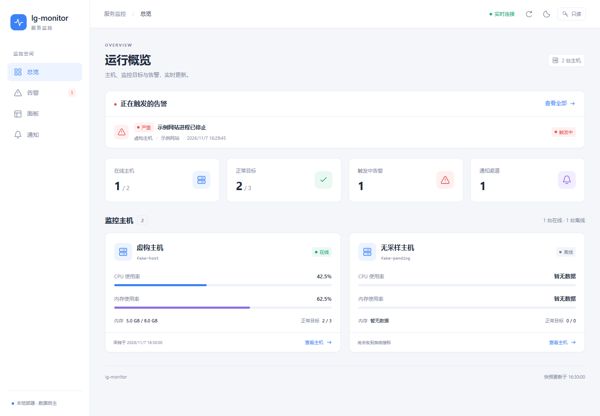
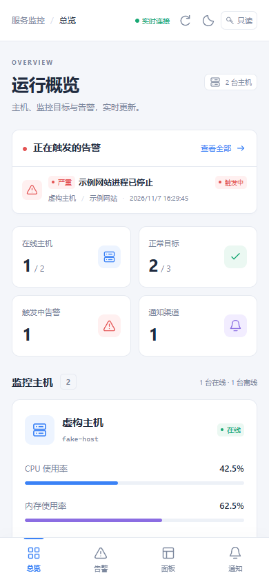

# lg-monitor 执行计划

需求见 [PRD.md](PRD.md)。本文是给执行者（Codex 等编程 Agent）的逐步计划。

## 怎么用这份计划

- 按编号顺序做。每个任务是一个独立提交，提交信息以任务编号开头，例如 `M0-03: process collector`。
- 每个任务都写了“完成标准”。全部满足、`go vet ./...` 和 `go test ./...` 都通过后才算完成，然后在本文对应任务前把 `[ ]` 改成 `[x]`，和代码放在同一个提交里。
- 遇到计划没写清、或者照做明显不对的地方：在本文末尾的“执行记录”里写下问题和你的处理方式，然后继续。不要悄悄偏离。
- 不要提前做后面阶段的功能。接口可以预留，功能不要写。
- Claude 的审查意见写在 [REVIEW.md](REVIEW.md)，是对本计划的修订；两者冲突时，以审查意见为准。每个任务开始前，先处理那里还没关闭的条目。

## 全局约定

| 项目 | 约定 |
|---|---|
| Go 版本 | 本机是 Go 1.27.3，`go.mod` 写 `go 1.27` |
| 模块名 | `github.com/LFenX/lg-monitor` |
| 程序 | 只有一个可执行文件 `lgmon.exe`，入口在 `cmd/lgmon` |
| 命令行框架 | `github.com/spf13/cobra` |
| 日志 | 标准库 `log/slog`，JSON 格式写文件，开发时文本格式输出到控制台 |
| SQLite | `modernc.org/sqlite`（纯 Go）。禁止引入任何需要 cgo 的依赖，`CGO_ENABLED=0` 必须能编译 |
| 飞书 | 官方 Go SDK `github.com/larksuite/oapi-sdk-go/v3`，用应用自己的 App ID 和 App Secret 调用开放平台接口。**程序运行时不依赖 lark-cli** |
| 配置文件 | YAML，用 `gopkg.in/yaml.v3` 解析（报错要能带行号） |
| 时间 | 一律存 UTC 的 Unix 毫秒（`int64`），只在显示时转本地时间 |
| 错误信息 | 面向用户的报错用中文，写明哪里错了、怎么改；日志和代码注释用英文 |
| 测试 | 依赖系统的部分（进程、端口、飞书接口、时间）都要定义成接口，测试里用假实现。真实系统测试加构建标签 `//go:build integration`，默认不跑 |
| 安全 | 测试和验收只能操作自己启动的演示进程。**不准关闭、重启或修改这台电脑上已经在跑的真实服务**（LFEN、lgplayblog、Nebula、PostgreSQL、cloudflared 等） |

### 数据目录

| 用途 | 正式运行（Windows 服务） | 开发时 |
|---|---|---|
| 配置 | `%ProgramData%\lg-monitor\config\` | `--home .\dev-home` 下的 `config\` |
| 数据库、缓存、证书、密钥 | `%ProgramData%\lg-monitor\data\` | `dev-home\data\` |
| 日志 | `%ProgramData%\lg-monitor\logs\` | `dev-home\logs\` |

所有子命令都支持 `--home <目录>`，也可以用环境变量 `LGMON_HOME`。`dev-home/` 已写进 `.gitignore`。

### 目录结构

```
cmd/lgmon/                main.go，子命令注册
internal/app/             把各模块组装起来（run 命令）
internal/config/          配置结构体、加载、校验、热加载、生成 JSON Schema
internal/secrets/         密钥存储（DPAPI 加密）
internal/collector/       采集器：进程、端口、探测、系统指标、服务、脚本
internal/collector/match/ 监控目标匹配
internal/pipeline/        采集器与监控器之间的接口（M0 用内存实现，M1 换成 gRPC）
internal/transport/       M1：gRPC、配对、证书、离线缓存
internal/store/           SQLite：建表、迁移、写入、查询、清理
internal/rules/           规则判断和告警状态机
internal/feishu/          飞书开放平台客户端、错误识别、开通向导的逻辑
internal/notify/          通知调度与各渠道
internal/notify/cards/    卡片模板引擎与预设模板
internal/api/             M1：HTTP API、SSE、只读 SQL、MCP
internal/winsvc/          M1：Windows 服务安装与运行
proto/                    M1：protobuf 定义
web/                      M1：React 面板
schemas/                  生成的 JSON Schema（提交进仓库）
examples/                 示例配置
scripts/                  build.ps1、验收脚本
```

### 已核实的飞书事实

2026-11-06 用 lark-cli 1.0.99，以机器人身份在真实租户上核实过下面这些事实，可以直接依赖。和实际返回不一致时，以飞书的实际返回为准，并在执行记录里更新本节。

| 事实 | 内容 |
|---|---|
| 获取令牌 | `POST /open-apis/auth/v3/tenant_access_token/internal`，用 App ID 和 App Secret 换取 |
| 机器人信息 | `GET /open-apis/bot/v3/info`，返回 `app_name`、`avatar_url`、`open_id`、`activate_status`（实测已启用机器人的应用为 `2`） |
| 查询应用权限 | `GET /open-apis/application/v6/scopes`（机器人身份），返回 `data.scopes[]`，每项含 `scope_name`、`scope_type`（`tenant` 或 `user`）、`grant_status`（实测 `1` 表示已授权）。只列出应用已经申请过的权限，没申请过的不出现 |
| 缺权限的报错 | 错误码 `99991672`，报错里带缺少的权限名（可能不止一个） |
| 一键开通链接 | `https://open.feishu.cn/page/scope-apply?clientID=<AppID>&scopes=<权限名用英文逗号连接后整体做 URL 编码>`。实例：`.../page/scope-apply?clientID=cli_xxx&scopes=hire%3Ajob%3Areadonly%2Chire%3Apeople_cli` |
| 机器人所在的群 | `GET /open-apis/im/v1/chats`（机器人身份），返回 `data.items[]`，含 `chat_id`（`oc_` 开头），分页参数 `page_size`、`page_token`。在只开通了 `im:chat:read`、没有 `im:chat:readonly` 的应用上调用成功 |
| 发消息 | `POST /open-apis/im/v1/messages?receive_id_type=chat_id`，卡片用 `msg_type: interactive`，`content` 是卡片 JSON 序列化后的字符串 |
| 卡片格式 | 卡片 JSON 2.0（`"schema": "2.0"`） |
| 代理 | 这台电脑的用户环境变量里有 `HTTPS_PROXY=http://127.0.0.1:7890`；以 Windows 服务运行时没有这个变量 |

本机的 lark-cli（`lark-cli api GET <路径> --as bot`）已经配好一个测试应用，可以用它查看接口的真实返回，写成测试用的样例数据。**只能调用只读接口**；发消息只能发到用户确认过的测试群。

---

## M0 单机原型

**目标**：一台电脑上运行 `lgmon run --role both`。用户用 `lgmon feishu setup` 填入飞书应用的 App ID 和 App Secret，按引导一键开通权限、把机器人拉进群；之后关掉一个被监控的进程，15 秒内群里收到告警卡片，进程恢复后收到恢复卡片。

整个 M0 里，采集器和监控器在同一个进程内，通过 `internal/pipeline` 定义的接口用 Go channel 通信。这个接口要设计成 M1 换成 gRPC 时，采集器和监控器两边的代码都不用改。

### [x] M0-01 项目骨架

- `go mod init github.com/LFenX/lg-monitor`，建立上面的目录结构（空目录放 `doc.go`，写一行包说明）。
- `cmd/lgmon`：cobra 根命令，带 `--home`、`--log-level`；子命令 `version`，输出版本号、提交号和构建时间（通过 `-ldflags` 注入）。
- `scripts/build.ps1`：`CGO_ENABLED=0` 编译出 `bin\lgmon.exe`，注入版本信息。
- `.github/workflows/ci.yml`：在 `windows-latest` 上运行 `go vet`、`go test ./...`，并执行 build 脚本。

**完成标准**：`scripts\build.ps1` 生成可运行的 `bin\lgmon.exe`，`lgmon version` 能输出版本信息；CI 通过。

### [x] M0-02 配置

配置目录下的文件，每个都可以不存在（视为空）：

`targets.yaml`：监控目标

```yaml
targets:
  - id: nebula                 # 小写字母、数字、横线
    name: Nebula 网站
    match:                     # 以下条件全部满足才算匹配；至少写一个
      process: node.exe        # 进程名，不区分大小写
      cmdline: 'D:\\appmy\\GRM' # 正则，匹配命令行
      port: 3001               # 该进程在监听这个端口
    probes:
      - type: http
        url: http://127.0.0.1:3001/
        interval: 15s
        timeout: 5s
        expectStatus: "<500"   # 也可以写 200、"2xx"
    tags: [web]
```

`match` 还支持 `service`（Windows 服务名），但 M0 只需要解析和校验，不用实现。

`rules.yaml`：规则

```yaml
rules:
  - id: nebula-down
    name: Nebula 进程不在
    type: process_absent       # M0 支持：process_absent、port_closed、probe_failed
    target: nebula
    for: 10s                   # 持续多久才触发
    severity: critical         # critical | warning | info
    notify: [feishu-alerts]
    template: detailed         # 可选；不写就用通知渠道的默认模板
```

`notifiers.yaml`：飞书应用和通知渠道

```yaml
feishuApps:
  - id: default
    appId: cli_xxxxxxxx
    secretRef: feishu-default   # App Secret 不写在这里，存在加密的密钥库里（见 M0-09）
    domain: feishu              # feishu | lark
    proxy: auto                 # auto（读取环境变量）| none | http://...

notifiers:
  - id: feishu-alerts
    type: feishu_app            # M0 只做这一种
    app: default
    chatId: oc_xxxxxxxx
    chatName: 服务告警           # 只用于显示，由向导自动填写
    template: standard          # 默认卡片模板
```

`card-templates/*.yaml`：自定义卡片模板，格式见 M0-10。

要求：

- 配置结构体定义在 `internal/config`，校验所有引用关系（规则引用的目标、通知渠道、模板必须存在；通知渠道引用的飞书应用必须存在；ID 不能重复；`for` 必须是合法时长）。
- 报错格式：`rules.yaml 第 7 行：规则 nebula-down 引用的目标 nebla 不存在`。
- `lgmon config validate`：校验配置并以中文列出所有错误，有错时退出码为 1。
- `lgmon config schema`：用 `github.com/invopop/jsonschema` 从结构体生成 `schemas/*.schema.json`，提交进仓库。`examples/` 里的示例文件开头写上 `# yaml-language-server: $schema=...`。
- 用 `github.com/fsnotify/fsnotify` 监听配置目录。文件变化后重新加载，校验失败就保留旧配置并记录错误，不能让程序崩溃。

**完成标准**：`examples/` 里的示例文件都能通过校验；每类错误各写一个会失败的测试用例；热加载测试通过（写入错误配置后旧配置仍然有效）。

### [x] M0-03 进程与端口采集

- 定义接口 `ProcessSource`：返回进程快照（PID、父 PID、名称、命令行、可执行文件路径、创建时间、CPU%、内存 RSS、线程数）。~~真实实现用 `github.com/shirou/gopsutil/v4/process`~~。真实实现已经由 REVIEW R1-02、R1-03 修订：核心字段用 `NtQuerySystemInformation` 一次取全，exe 路径和命令行按进程身份缓存。
- 定义接口 `PortSource`：返回 TCP 监听列表（本地地址、端口、PID）。真实实现用 gopsutil 的 `net.Connections("tcp")`，只保留 `LISTEN` 状态。
- 进程的身份由（PID，创建时间）共同确定，防止 PID 被复用后认错。
- 拿不到命令行（权限不足）时字段留空，不能报错退出。
- 每次采集要计时，超过 1 秒记一条警告日志。

**完成标准**：用假实现写单元测试；加一个 `integration` 标签的测试，自己启动 `ping -t 127.0.0.1` 子进程，确认快照里能找到它，测试结束时关掉它。

### [x] M0-04 监控目标匹配

- `internal/collector/match`：输入进程快照和端口列表，输出每个监控目标的状态：`up`（找到匹配进程）或 `down`，以及匹配到的进程和端口。
- 匹配规则见 M0-02。一个目标匹配到多个进程时都记录下来，只要有一个就算 `up`。
- 匹配结果要附带原因，方便排查，例如“进程名匹配，但没有在监听 3001”。

**完成标准**：表驱动测试覆盖：只按名称匹配、名称加命令行、名称加端口、端口被别的进程占用、多个进程匹配、没有任何匹配。

### [x] M0-05 HTTP 与 TCP 探测

- 每个探测按各自的间隔独立运行，同一时间只允许一个实例在跑。
- HTTP 探测：不走系统代理，不自动跳转，记录状态码、耗时和错误；按 `expectStatus` 判断成功或失败。
- TCP 探测：`host:port` 能否在超时内连上。
- 结果写入探测结果流，包含目标 ID、探测编号、成功与否、耗时、错误信息。

**完成标准**：用 `net/http/httptest` 测试各种状态码、超时和连接被拒；TCP 用一个本地监听测试。

### [x] M0-06 采集器组装与 pipeline 接口

- `internal/pipeline` 定义采集器发出的消息：`TargetStatus`（目标状态变化，以及每 10 秒一次的全量快照）、`ProbeResult`、`ProcessSample`（被匹配进程的 CPU 和内存），每条消息带采集器 ID、递增序号和时间戳。
- 定义接口 `Sink`（采集器往里写）和 `Source`（监控器从里读），M0 用带缓冲的 channel 实现。
- 采集器主循环：每 2 秒采集一次进程和端口，计算目标状态，只在状态变化时立即发送；探测按自己的间隔运行。
- 采集器 ID：第一次运行时生成 UUID，存在 `data\collector-id`。

**完成标准**：测试里用假的进程源模拟“进程消失 → 恢复”，确认 `Sink` 按顺序收到对应的状态变化。

### [x] M0-07 存储

表结构（用 `embed` 内嵌迁移 SQL，按版本号顺序执行，启动时自动迁移）：

```sql
CREATE TABLE collectors (id TEXT PRIMARY KEY, hostname TEXT, first_seen INTEGER, last_seen INTEGER, version TEXT);
CREATE TABLE target_status (collector_id TEXT, target_id TEXT, ts INTEGER, state TEXT, detail TEXT, PRIMARY KEY (collector_id, target_id, ts));
CREATE TABLE probe_results (collector_id TEXT, target_id TEXT, probe TEXT, ts INTEGER, ok INTEGER, latency_ms INTEGER, error TEXT);
CREATE TABLE process_samples (collector_id TEXT, target_id TEXT, ts INTEGER, pid INTEGER, cpu REAL, rss INTEGER);
CREATE TABLE alerts (id TEXT PRIMARY KEY, rule_id TEXT, collector_id TEXT, target_id TEXT, state TEXT, severity TEXT,
                     started_at INTEGER, resolved_at INTEGER, last_notified_at INTEGER, summary TEXT);
CREATE TABLE alert_events (alert_id TEXT, ts INTEGER, kind TEXT, message TEXT);
CREATE TABLE notifications (id TEXT PRIMARY KEY, alert_id TEXT, notifier_id TEXT, template TEXT, ts INTEGER,
                            ok INTEGER, error TEXT, message_id TEXT);
```

给需要的列加索引（按时间范围查询的表都要有 `(collector_id, target_id, ts)` 索引）。

- 打开数据库时设置 `journal_mode=WAL`、`busy_timeout=5000`、`foreign_keys=ON`。
- 只用一个协程负责写入，批量提交（每 500 毫秒或攒满 500 条提交一次）。
- 清理：原始数据保留 24 小时，每小时清理一次。M0 不做汇总表。

**完成标准**：迁移可以重复执行；写入 1 万条数据的测试在 2 秒内完成；清理测试通过。

### [x] M0-08 规则引擎与告警状态机

- 状态：`ok` → `pending`（条件满足但还没到 `for` 的时长）→ `firing` → `resolved`。在 `pending` 期间条件不再满足就回到 `ok`，不发通知。
- 规则只看最新的目标状态和探测结果；每 1 秒评估一次，收到状态变化时也立即评估。
- 同一条规则、同一个采集器、同一个目标只能有一个处于触发状态的告警。
- 目标状态为 `unknown` 时（见 REVIEW R1-04），不触发新告警，也不会让已经触发的告警恢复；规则处于 `pending` 时，按条件不满足处理，回到 `ok`。
- 触发时生成告警 ID，写入 `alerts` 和 `alert_events`，通知一次；恢复时通知一次。M0 不做重复提醒、静音和确认。
- 程序重启后，从数据库恢复仍处于 `firing` 状态的告警，不能重复发送“触发”通知。

**完成标准**：用可控时钟（注入 `now func() time.Time`）的测试覆盖：抖动（`pending` 时恢复）、正常触发再恢复、重启后恢复状态、`for: 0s` 立即触发。

### [x] M0-09 密钥存储与飞书客户端

**密钥库**（`internal/secrets`）

- 存放在 `data\secrets.json`，每个值用 Windows DPAPI 加密（`golang.org/x/sys/windows` 的 `CryptProtectData`），使用机器级别（`CRYPTPROTECT_LOCAL_MACHINE`）。原因：M1 起监控器以 SYSTEM 身份作为服务运行，用户级加密的值服务读不出来。为弥补机器级加密的范围，`secrets.json` 的访问权限设为只允许 SYSTEM、Administrators 和创建它的用户。
- `lgmon secret set <名称>`：从标准输入读取，在终端里输入时不回显（`golang.org/x/term`）。`lgmon secret list` 只列出名称。不提供把明文打印出来的命令。
- 日志、报错、`--json` 输出里都不能出现密钥明文。写一个测试：把一个密钥值走一遍会写日志的流程，检查日志里不含它。

**飞书客户端**（`internal/feishu`）

- 用官方 SDK 处理令牌获取和缓存。SDK 没有直接封装的接口（权限查询、机器人信息），用 SDK 的通用请求方法调用。
- 域名：`feishu` 用 `https://open.feishu.cn`，`lark` 用 `https://open.larksuite.com`。
- 代理：`proxy: auto` 时读取 `HTTPS_PROXY`，`none` 时直连，也可以写具体地址。
- 提供这些方法：`TenantToken`、`BotInfo`、`AppScopes`、`ListChats`（自动翻页）、`SendCard`、`CreateChat`（M0-11 的可选功能用）。
- **错误识别**：把飞书的错误转换成有类型的错误，向导和日志都靠它给出人能看懂的提示：

  | 类型 | 识别依据 | 给用户的提示 |
  |---|---|---|
  | 凭证错误 | 获取令牌失败（App ID 不存在、Secret 错误） | App ID 或 App Secret 不对，去开发者后台“凭证与基础信息”页复制 |
  | 缺少权限 | 错误码 `99991672` | 列出缺少的权限，附上一键开通链接 |
  | 机器人未启用 | `bot/v3/info` 失败，或 `activate_status` 不是已启用 | 去开发者后台“应用能力”里添加“机器人” |
  | 机器人不在群里 | 发消息时报“不在群里” | 把机器人重新拉进群 |
  | 频率限制 | 限流错误码 | 自动退避重试，不提示用户 |
  | 网络问题 | 连接失败、超时、证书错误 | 检查网络和代理设置 |

  具体错误码以真实返回为准：用 lark-cli 的只读接口、用故意写错的 Secret 获取令牌等方式拿到真实响应，去掉应用 ID 和 log_id 后存成 `internal/feishu/testdata/*.json`，测试用这些样例数据。“机器人不在群里”的样例需要真的发一次消息才能拿到；拿不到就按飞书文档写，并在执行记录里注明“未经实测”。
- **一键开通链接**：`ApplyURL(appID string, scopes []string) string`，格式见“已核实的飞书事实”。用文中的实例写测试，生成结果必须逐字一致。
- 发消息的幂等：请求体里带 `uuid`，取 `告警ID + 状态` 的哈希（不超过 50 个字符），重试时不会重复发出。
- 失败重试 3 次（间隔 2、5、15 秒），超时 20 秒。每次结果写入 `notifications` 表，成功时记录飞书返回的消息 ID。

**完成标准**：用 `httptest` 模拟飞书服务器，测试令牌缓存与过期刷新、每种错误类型的识别、翻页、幂等字段、重试；DPAPI 加密后解密一致；密钥不出现在日志里。

### [x] M0-10 卡片模板

**预设模板**：四套，每套都包含“触发”和“恢复”两种状态的样子。用卡片 JSON 2.0 实现。

| 编号 | 名称 | 适合 | 内容 |
|---|---|---|---|
| `standard` | 标准 | 大多数情况，默认 | 标题栏按严重程度着色（严重红色、警告橙色、提示蓝色、恢复绿色）；字段两列排列：主机、目标、开始时间、持续时长、当前值；一段详情；按钮“打开面板”（配置了面板地址时才显示） |
| `compact` | 简洁 | 告警多、不想刷屏的群 | 没有标题栏，一行带图标的文字加一行时间 |
| `detailed` | 排查 | 需要马上动手处理的严重告警 | 在“标准”的基础上增加：相关进程（PID、CPU、内存）、最近日志末尾（折叠面板，默认收起）、可能的原因和建议、一段“复制给 Agent 排查”的诊断文本 |
| `digest` | 汇总 | 抖动合并、短时间内大量告警 | 一张卡片列出多条告警：每条一行，包含状态、目标、主机和时间；最多 20 条，超出时显示“还有 N 条” |

`compact` 和 `standard` 的恢复卡片要写明“持续了多久”。

**自定义模板**：放在配置目录的 `card-templates/<id>.yaml`，热加载。有两种写法：

1. **在预设基础上改**，适合大多数人：

   ```yaml
   id: oncall
   name: 值班群
   extends: standard          # 基于哪个预设
   title: "{{.SeverityIcon}} {{.Rule.Name}}"
   colors: { critical: carmine, warning: orange, info: blue, resolved: green }
   fields: [host, target, startedAt, duration]   # 从内置字段里选，可以调整顺序
   extraFields:
     - label: 负责人
       value: 张三
   mention:
     critical: all            # 严重告警 @所有人；也可以写 open_id 列表
   buttons:
     - text: 值班手册
       url: https://example.com/runbook
   note: "处理完请在群里回复"
   ```

2. **完全自定义**：`raw` 字段直接写整张卡片的 JSON 2.0，值的位置写模板变量。用户可以先在飞书的“卡片搭建工具”里拖拽设计好卡片，导出 JSON，再把具体值换成变量。可以分别为 `firing`、`resolved` 写两份，不写 `resolved` 时恢复卡片沿用同一份。

四套预设本身也用第 1 种写法实现（放在 `internal/notify/cards/presets/`，用 `embed` 内嵌），这样“在预设基础上改”和预设走的是同一条代码路径。

**模板变量**（全部写进 `docs/card-templates.md`，附例子）：

| 变量 | 含义 |
|---|---|
| `.Alert.ID` `.Alert.State` `.Alert.Severity` `.Alert.Summary` `.Alert.Detail` | 告警本身 |
| `.Alert.StartedAt` `.Alert.ResolvedAt` `.Alert.Duration` | 时间，已格式化成本地时间和中文时长 |
| `.Rule.ID` `.Rule.Name` | 规则 |
| `.Target.ID` `.Target.Name` `.Target.Tags` | 监控目标 |
| `.Host.Name` `.Host.CollectorID` | 主机 |
| `.Value` | 触发时的数值（有的话） |
| `.SeverityIcon` `.SeverityText` | 🔴 严重 / 🟠 警告 / 🔵 提示 / ✅ 已恢复 |
| `.DashboardURL` | 面板里这条告警的地址，没配置时为空 |
| `.Processes` `.LogTail` `.Diagnosis` | 排查信息（`detailed` 用） |
| `.Alerts` | 告警列表（`digest` 用） |

**渲染要求**：

- 使用 `text/template`，开启 `missingkey=error`；提供 `duration`、`time`、`truncate`、`default` 等辅助函数。
- 所有变量的值在放进卡片前都要转义：JSON 转义，以及飞书 Markdown 里有特殊含义的字符。特别是要把 `<` 转义，防止进程名或日志里的 `<at id=all>` 变成真的 @所有人。只有 `mention` 配置能产生 @。
- 渲染结果必须是合法 JSON，并且不超过 28 KB（飞书单张卡片的上限约 30 KB，留出余量）。超出时先截断日志末尾和告警列表，还超出就退回 `compact`。
- 自定义模板渲染失败时，改用 `standard` 发出，并在卡片底部加一行“自定义模板 xxx 出错，已使用标准模板”，同时记录错误日志。**告警绝不能因为模板错误而发不出去。**

**命令**：

- `lgmon template list [--json]`：列出预设模板和自定义模板。
- `lgmon template validate [<id>]`：用内置的样例告警（触发、恢复、汇总三种）渲染，检查合法性和大小。
- `lgmon template preview <id> --state firing|resolved|digest`：输出渲染后的卡片 JSON，可以直接贴进飞书卡片搭建工具查看效果。
- `lgmon template new <id> --from standard`：生成一份带注释的自定义模板文件，用户在此基础上修改。

**完成标准**：四套预设 × 三种状态都有黄金文件测试（`testdata/*.golden.json`）；转义测试覆盖引号、换行、Markdown 符号和 `<at id=all>`；超长测试验证截断和退回；模板出错时能退回标准模板。

### [x] M0-11 飞书开通向导（命令行版）

把“填凭证 → 启用机器人 → 开通权限 → 拉进群 → 选模板 → 发测试卡片”做成一条龙。向导的逻辑写在 `internal/feishu/setup`，只依赖 M0-09 的客户端接口，不包含任何界面代码；M1 的网页向导、HTTP API 和 MCP 都复用这里。

**所需权限**（写在代码里，每项都带中文说明，向导原样显示给用户）：

| 用途 | 权限 | 是否必需 | 给用户看的说明 |
|---|---|---|---|
| 发送告警 | `im:message:send_as_bot` | 必需 | 以机器人身份往群里发告警卡片 |
| 自动获取群 ID | `im:chat:read` | 必需 | 读取机器人所在的群，这样不用你手动查群 ID |
| 一键创建告警群 | `im:chat:create` | 可选 | 让机器人帮你新建一个告警群 |

权限名以“已核实的飞书事实”为准。如果真实调用时 `99991672` 报出的缺少权限和上表不同，以报错为准，更新上表并写进执行记录。

**向导步骤**：

1. **填写凭证**：输入 App ID（校验以 `cli_` 开头）和 App Secret（不回显），选择飞书或 Lark。获取令牌验证凭证，成功后把 Secret 存进密钥库。
   如果用户还没有应用，打印创建步骤：打开 `https://open.feishu.cn/app` → 创建企业自建应用 → 填写名称和描述 → 进入应用后在“凭证与基础信息”里复制 App ID 和 App Secret。
2. **检查机器人能力**：调用机器人信息接口。没有启用就说明怎么开（开发者后台 → 应用能力 → 添加应用能力 → 机器人），然后每 5 秒检查一次，启用后自动进入下一步。成功时显示机器人的名称，后面会用到。
3. **检查权限**：调用应用权限接口，对比所需权限，逐项显示“已开通 / 未开通”。有未开通的：
   - 生成一键开通链接，把未开通的权限全部放进去，自动用浏览器打开（`rundll32 url.dll,FileProtocolHandler <链接>`，不经过 `cmd`）；
   - 每 5 秒重新检查，全部开通后自动进入下一步；
   - 60 秒后还没生效，提示：自建应用新开通的权限通常要发布新版本才生效（开发者后台 → 版本管理与发布 → 创建版本 → 申请发布）；如果企业开启了审核，还要等管理员审批。
   - 权限查询接口本身也可能报缺少权限。这时用报错里的权限名生成开通链接，同样处理。
   - 发布流程的具体界面需要用户用真实应用走一遍来确认，把实际步骤更新进提示文字和执行记录。
4. **选择告警群**：列出机器人所在的所有群（群名和人数）。
   - 已经有群：让用户选一个，把群 ID 和群名写进 `notifiers.yaml`。**用户不需要自己查群 ID。**
   - 一个群都没有：显示拉机器人进群的步骤——在飞书里打开要接收告警的群 → 右上角“设置” → “群机器人” → “添加机器人” → 搜索「<第 2 步拿到的机器人名称>」→ 添加。然后每 3 秒检查一次，发现新群就显示“检测到机器人已加入「群名」，用这个群接收告警吗？”。
   - 搜不到机器人时，给出常见原因：应用还没有发布；你不在应用的可用范围内（开发者后台 → 版本管理与发布 → 可用范围）；第 2 步的机器人能力没有生效。
   - 也可以选择“帮我新建一个告警群”：需要可选权限 `im:chat:create`（没开通就回到第 3 步的流程），机器人建群后把用户拉进来。用户的 open_id 怎么获取，由执行者调查后选一种最省事的方式（例如让用户先给机器人发一条私聊消息）；调查结果写进执行记录。做不出来就只保留“拉机器人进群”这一条路。
5. **选择模板并测试**：列出四套预设和自定义模板，选一个作为这个群的默认模板；发送一张测试卡片（内容标明“这是测试消息”）。询问“群里收到了吗？”：收到就保存配置并结束；没收到就显示发送结果和对应的错误提示。

**命令**：

- `lgmon feishu setup`：交互式走完以上 5 步。也可以用参数一步完成，供 Agent 和脚本使用：`--app-id`、`--secret-stdin`、`--chat-id`、`--template`、`--yes`。中途退出后再次运行，已经完成的步骤会显示为已完成并跳过。
- `lgmon feishu check [--json]`：只检查，不修改配置。输出凭证、机器人能力、每项权限的状态、一键开通链接、机器人所在的群列表。
- `lgmon feishu chats [--watch] [--json]`：列出机器人所在的群；`--watch` 持续检查，有新群加入时输出。
- `lgmon feishu test --notifier <id> [--template <id>]`：发一张测试卡片。
- `--json` 输出里，每一步都带 `status`（`ok` | `action_required` | `error`）、给人看的 `message`、可以直接打开的 `url`（如果有），这样 Agent 也能带着用户走完流程。

**完成标准**：用假的飞书客户端测试五个步骤的每个分支（凭证错误、机器人未启用、缺少权限后补齐、没有群后加入、测试发送失败）；`ApplyURL` 与实例逐字一致；交互流程测试中途退出后可以续上。真实应用上的完整流程放在 M0-13 由用户确认。

### [x] M0-12 运行命令与 CLI

- `lgmon run --role both`：加载配置，启动采集器、存储、规则引擎和通知，Ctrl+C 时按顺序优雅退出（先停采集，等写入和通知完成，再关闭数据库）。
- 启动时如果还没有配置任何飞书通知渠道，打印一行提示：运行 `lgmon feishu setup` 完成飞书接入。
- `lgmon status [--json]`：读数据库，列出每个目标的当前状态和正在触发的告警。程序没有运行时也能用。
- `lgmon alerts [--json] [--all]`：列出告警，默认只列出正在触发的。
- `lgmon targets test <id>`：只采集一次，打印这个目标的匹配结果和原因，用来调试配置。
- 所有 `--json` 输出要稳定，字段名用 camelCase，并写进 `docs/cli.md`。

**完成标准**：`docs/cli.md` 写完，覆盖到目前为止的所有命令；每个命令都有至少一个测试（用临时目录作为 `--home`）。

### [ ] M0-13 原型验收

分两部分。

**A. 飞书接入（由用户操作，执行者写好步骤）**：在 `docs/acceptance-m0.md` 里写清楚：

1. 用一个飞书自建应用运行 `lgmon feishu setup --home .\dev-home`（可以是本机 lark-cli 正在用的那个测试应用，也可以新建一个）；
2. 按提示开通权限，记录实际看到的页面和步骤（包括是否需要发布版本），把真实流程更新进 M0-11 的提示文字；
3. 新建一个测试群，把机器人拉进去，确认向导自动发现了这个群；
4. 用四套模板各发一张测试卡片，截图放进 `docs/images/`。

**B. 告警链路（脚本）**：`scripts/m0-acceptance.ps1`，复用 A 中保存好的飞书配置：

1. 在临时的 `--home` 下生成配置：监控目标是脚本自己启动的演示 HTTP 服务（`python -m http.server <空闲端口>`，或一个小的 Go 测试程序），规则 `for: 5s`，模板 `detailed`。
2. 启动 `lgmon run --role both`。
3. 等目标变为 `up` 后关掉演示服务，开始计时。
4. 轮询 `lgmon alerts --json`，确认 15 秒内出现 `firing` 状态的告警，且 `notifications` 记录成功。
5. 重新启动演示服务，确认告警变为 `resolved` 并且恢复通知发送成功。
6. 清理所有自己启动的进程和临时目录。

**完成标准**：脚本打印每一步的耗时和结果；用户确认测试群里收到了触发和恢复两张卡片，并确认 A 部分走通。

工程准备已提交，人工验收待办见 [acceptance-m0.md](acceptance-m0.md)；未达到上述完成标准，保持未勾选。按 AGENTS 的人工待验约定，记录后继续不依赖真实收件的 M1 工作。

---

## M1 第一版

**目标**：两台电脑通过 Tailscale 互联，采集器作为 Windows 服务运行；断网 10 分钟后恢复，数据完整；Agent 只看文档就能加监控目标、规则和面板；有 Web 面板（含飞书开通向导和模板编辑）、HTTP API 和 MCP。

### [ ] M1-01 protobuf 与 gRPC 通道

`proto/lgmon/v1/collector.proto`，用 `buf` 生成代码（`buf.gen.yaml` 提交进仓库，生成的代码也提交）：

```proto
service CollectorLink {
  // The collector opens one long-lived stream; everything flows over it.
  rpc Connect(stream CollectorMessage) returns (stream MonitorMessage);
}
message CollectorMessage {
  oneof body {
    Hello hello = 1;            // first message: collector id, hostname, version, last acked seq
    Batch batch = 2;            // seq-numbered records
    Heartbeat heartbeat = 3;
    ConfigApplied config_applied = 4;
  }
}
message MonitorMessage {
  oneof body {
    Welcome welcome = 1;        // accepted, resume from seq
    Ack ack = 2;                // highest contiguous seq stored
    ConfigPush config = 3;      // targets + probes for this collector, with a version
  }
}
```

`Batch` 里的记录与 M0 的 `pipeline` 消息一一对应。把 pipeline 的 channel 实现换成 gRPC 客户端和服务端实现，采集器和监控器的业务代码不改。

- 监控器默认监听 `:7443`，可配置。
- 开启 gzip 压缩；单条消息上限 4 MB。

**完成标准**：在同一台机器上用两个进程（`--role collector` 和 `--role monitor`，不同的 `--home`）跑通 M0 验收的 B 部分。

本机双进程工程联测已使用假飞书发送端跑通；真实发送沿用 [M0 验收脚本](acceptance-m0.md) 的 `-SplitRoles` 模式，等待本人确认测试群及收件后关闭。未把假发送当作真实 B 部分完成。

### [x] M1-02 证书与配对

- 监控器首次启动时生成私有 CA（ECDSA P-256，有效期 10 年）和服务端证书。服务端证书的 SAN 包括主机名、所有本机 IP，以及 Tailscale IP（用 `tailscale ip` 获取，失败就跳过）。
- `lgmon pair new [--ttl 10m]`：生成一次性配对码（例如 `K7QF-3M9X`），过期或用过一次即作废。
- `lgmon pair join --monitor 100.126.79.86:7443 --code K7QF-3M9X`（在采集器上运行）：
  1. 用 TLS 连接监控器，但这一步不校验服务端证书；
  2. 发送配对码和自己生成的 CSR；
  3. 监控器验证配对码后签发客户端证书，连同 CA 证书一起返回；
  4. 采集器保存证书。之后的所有连接都用 mTLS 并校验 CA。
  为防止第一步被中间人截获，监控器的 `pair new` 同时显示 CA 证书指纹的前 16 位十六进制，分为四组，如 `3F2A-9C1B-77D0-4E85`。`pair join` 打印收到的指纹，要求两边一致（`--fingerprint` 接受这 16 位或完整 64 位，忽略大小写、连字符和冒号，拒绝 8 位前缀）。
- 配对接口与 gRPC 共用一个端口，用一个不要求客户端证书的独立 gRPC 方法实现。
- `lgmon collectors list|revoke <id>`：列出和吊销采集器。吊销后该采集器立即断开，并且再也连不上。

**完成标准**：测试覆盖：正确配对、配对码错误、过期、重复使用、指纹不一致、被吊销的证书被拒绝。

### [x] M1-03 离线缓存与断点续传

- 采集器把要发送的批次先写进本地 `data\outbox.db`（SQLite），收到监控器的 `Ack` 后再删除。
- 重连后用 `Hello` 中的最后确认序号和监控器返回的 `Welcome.resumeFrom` 对齐，从断点补发。
- 监控器按（采集器 ID，序号）去重，重复的批次直接确认，不重复写入。
- 缓存上限默认 24 小时或 200 MB，超出后丢弃最旧的数据，并在恢复连接后发送一条“数据缺口”事件。
- 重连使用指数退避（1 秒起步，最长 60 秒，带随机抖动）。

**完成标准**：集成测试：运行中断开连接 2 分钟，期间目标状态变化 3 次，恢复后监控器数据库里 3 次变化都在、顺序正确、没有重复。

### [x] M1-04 配置下发

- 监控目标和探测配置改成在监控器上统一管理：每个目标增加 `collector` 字段（采集器 ID 或主机名，写 `"*"` 表示所有采集器）。
- 监控器在采集器连接时，以及配置变化时，推送 `ConfigPush`（带版本号）；采集器应用后回复 `ConfigApplied`，并把配置缓存到本地，离线重启时使用缓存。
- 规则、通知渠道、飞书应用和卡片模板只存在于监控器，不下发。

**完成标准**：在监控器上修改 `targets.yaml`，5 秒内采集器开始监控新目标。

### [x] M1-05 心跳与采集器失联

- 采集器每 10 秒发送一次心跳；监控器更新 `collectors.last_seen`。
- 新规则类型 `collector_offline`：`for` 默认 30 秒。所有配对过的采集器自动适用，不用为每台单独写规则；在 `rules.yaml` 里可以修改它的 `for`、通知渠道和模板。

**完成标准**：关掉采集器进程，35 秒内产生告警；重新启动后告警恢复。

### [ ] M1-06 Windows 服务

- `lgmon install --role collector|monitor|both`：用 `golang.org/x/sys/windows/svc/mgr` 注册服务 `lgmon`，以 LocalSystem 运行，开机自动启动，失败后 10 秒自动重启。需要管理员权限，没有就提示用户用管理员身份运行。
- `lgmon uninstall`、`lgmon service start|stop|status`。
- 以服务运行时，程序日志写到 `logs\`，同时把启动和异常退出写入 Windows 事件日志（来源名 `lgmon`）。
- 以服务运行时没有用户的环境变量，`proxy: auto` 读不到 `HTTPS_PROXY`。安装时如果检测到当前用户设置了代理，提示用户：飞书接口一般不需要代理，保持直连即可；确实需要代理时，在 `notifiers.yaml` 里写明代理地址。
- 安装后用 `lgmon feishu test` 以服务身份发一张测试卡片，确认服务能读出密钥并发出消息（密钥库是机器级加密，见 M0-09）。

**完成标准**：在一台电脑上安装为服务，重启电脑后不登录也能在另一台电脑的监控器上看到它在线，并且告警能发到飞书（由用户手动验证）。

工程实现与自动验证已保存；真实注册/重启/跨机器和服务身份收件仍待本人授权与确认，具体步骤见 [Windows 服务验收](windows-service.md)。按 AGENTS 的人工待验约定继续不依赖这些操作的任务，未将本项打勾。

### [x] M1-07 更多采集项

| 采集项 | 实现 | 频率 |
|---|---|---|
| 系统指标：CPU、内存、各磁盘使用率、网络收发速率、开机时长 | gopsutil | 5 秒 |
| Windows 服务：状态、启动类型 | `svc/mgr` 枚举，只上报变化 | 10 秒 |
| 监控目标 `match.service` | 按服务名匹配，服务的进程也纳入 | 跟随目标 |
| 脚本探测 | 见下 | 按配置 |

脚本探测（`probes` 里的 `type: script`）：

```yaml
- type: script
  script: backup-age.ps1
  args: ["--max-hours", "24"]
  interval: 5m
  timeout: 30s
```

脚本由管理员放在采集器本机 `<home>\scripts\` 目录；只接受文件名，参数受安全字符限制。具体约定见 REVIEW R3-04。

脚本最后一行输出 JSON：`{"ok": true, "message": "最近备份 2 小时前", "metrics": {"backup_age_hours": 2}}`。退出码非 0 或输出不是合法 JSON 都算失败，失败时附带输出的最后 20 行。`metrics` 写入新表 `script_metrics(collector_id, target_id, probe, ts, name, value)`。

**完成标准**：每种采集项都有单元测试；脚本探测测试成功、失败、超时、输出不合法四种情况。

### [x] M1-08 规则补全

- 新规则类型：`metric_threshold`（例：CPU > 90% 持续 5 分钟）、`service_stopped`、`script_failed`、`sql`。
- `sql` 规则：一条只读查询，每 `interval` 执行一次，返回的每一行是一个告警实例；必须返回 `key` 列（用来区分实例），可选返回 `summary` 列。查询走单独的规则连接，详见下面的“SQL 规则与回放”。
- 重复提醒：`renotify: 1h`，告警持续期间每隔这么久再提醒一次。
- 静音：`lgmon silence add --rule <id> | --target <id> --for 2h --reason "..."`。静音期间状态照常记录，只是不发通知。
- 确认：`lgmon alerts ack <告警ID>`。确认后不再重复提醒，恢复时仍然通知。
- 抖动合并：10 分钟内同一告警触发超过 3 次，标记为“抖动”，改用 `digest` 模板只发一张汇总卡片，直到稳定 10 分钟。
- `lgmon rules test <id> --since 24h`：用历史数据回放这条规则，输出会在什么时间触发、什么时间恢复。详见下面的“SQL 规则与回放”。

#### SQL 规则与回放

（2026-11-07 补充。执行者在 M1-08 中途提出计划没写回放怎么做，下面是约定。）

回放要回答的问题是：**按库里现在的数据，这条规则在过去这段时间里，会在什么时间触发、什么时间恢复**。做法是：在过去的每个评估时刻 T，把同一条查询重新执行一遍，并且保证查询只能看到 T 和 T 以前的数据。实时评估和回放走同一套代码，区别只在 T 的取值。

写法：

```yaml
- id: nebula-slow
  name: Nebula 探测变慢
  type: sql
  interval: 1m           # 默认 1m，最小 10s
  for: 5m
  severity: warning
  notify: [feishu-alerts]
  query: |
    SELECT collector_id || '/' || target_id AS key,
           '最近 5 分钟平均耗时 ' || CAST(avg(latency_ms) AS INTEGER) || ' ms' AS summary
    FROM probe_results
    WHERE target_id = 'nebula' AND ts > :now - 300000
    GROUP BY collector_id, target_id
    HAVING avg(latency_ms) > 2000
```

**1. 评估时刻 `:now`**

- 查询里用 `:now` 表示评估时刻，单位是 UTC 毫秒。实时评估时取引擎的 `now()`，回放时取被回放的时刻 T。
- 每次评估都绑定 `:now`，不管查询有没有用到。驱动在缺少命名参数时会报错，多传参数不会报错。
- 查询不能读系统时钟。校验时拒绝下面这些写法：
  - `CURRENT_TIMESTAMP`、`CURRENT_DATE`、`CURRENT_TIME`；
  - 字符串 `'now'`（不区分大小写）；
  - 不带时间参数的 `date()`、`time()`、`datetime()`、`julianday()`、`unixepoch()`，以及只带格式参数的 `strftime('<格式>')`。

  报错时给出改法，例如“把 `datetime('now','-5 minutes')` 改成 `:now - 300000`”。做词法扫描就够了，不需要完整解析 SQL；注意跳过注释，也不要误判普通字符串里的内容。

**2. 按时刻 T 截断数据**

规则里不用自己写 `ts <= :now`。引擎把规则查询包进一层和表同名的 CTE，查询里写的表名就会指向“截至 `:now` 的数据”：

```sql
WITH target_status AS NOT MATERIALIZED (SELECT * FROM main.target_status WHERE ts <= :now),
     probe_results AS NOT MATERIALIZED (SELECT * FROM main.probe_results WHERE ts <= :now),
     ...
SELECT * FROM (
<规则查询>
)
```

- 先去掉规则查询末尾的分号。规则查询单独占一段，前后各加一个换行，否则查询末尾的 `-- 注释` 会把右括号也注释掉。
- 必须写 `NOT MATERIALIZED`。同一张表在查询里出现两次时，SQLite 默认会把 CTE 物化成临时表，每次评估都要把 24 小时的数据扫一遍。我用 modernc.org/sqlite v1.61.1 实测过：加上之后，截断条件会下推到原表，照样走 `(collector_id, target_id, ts)` 索引。
- 规则查询自己也可以以 `WITH` 开头，可以用 `WITH RECURSIVE`，也可以带 `ORDER BY` 和 `LIMIT`，这些都实测可用。
- 哪些表可以读、怎样截断，在 `internal/store` 里用 Go 代码登记成一张表，上面的前缀由它生成：

| 表 | 截断方式 |
|---|---|
| `target_status`、`probe_results`、`process_samples`、`system_metrics`、`disk_metrics`、`network_metrics`、`service_status`、`script_metrics`、`collector_events` | `ts <= :now` |
| `collectors` | `first_seen <= :now`，并且只提供 `id`、`hostname`、`first_seen`、`version` 四列。`last_seen` 只保存了最新值，回放时还原不出过去的值。查询用到它时，SQLite 会报“no such column: last_seen”，要把这个报错换成中文提示：判断采集器失联请用内置的 `collector_offline` 规则 |
| `alerts`、`alert_events`、`notifications` | 不能读。这几张表记录的是规则自己产生的告警和通知，规则再读它们会形成反馈；回放时这些表里也没有回放产生的数据 |
| `collector_offsets`、`collector_inbox` | 不能读，是传输层的内部状态 |

- 以后新增的表和视图（M1-09 的汇总表、M1-15 的 `v_*` 视图）都要在这里登记：
  - 汇总表只能看到已经结束的时间桶，即 `桶开始时间 + 桶长度 <= :now`。否则 T 时刻会看到在 T 之后才汇总进去的数据。
  - 视图不会经过这层 CTE。视图的定义直接按库里的表解析，我实测外层 CTE 对它不起作用。所以视图要么在前缀里补一个同名的定义（基于截断后的表），要么登记为不能读。
- 写一个测试：遍历 `sqlite_schema` 里的所有表和视图，每一个都必须已经登记，否则测试失败。

**3. 限制规则查询能读的内容**

- 规则查询用单独的只读连接池，打开方式和 `View` 一样（`mode=ro`、`query_only`）。
- 单条语句检查和 5 秒超时，与 M1-11 共用同一份实现。M1-11 还没做，所以先在 M1-08 里写成公共函数，M1-11 直接复用。
- 在这个连接池上，用 `modernc.org/sqlite` 的授权回调（`RegisterAuthorizer`）限制查询：
  - 要新建一个专用的 `sqlite.Driver`，在它上面调用 `RegisterConnectionHook` 安装回调，这样连接池里每一条新建的物理连接都会装上。
  - 不要用全局的 `sqlite.RegisterConnectionHook`，它会影响写入连接。也不要用 `Conn.Raw` 只给一条连接装：连接池重建连接后，新连接上就没有这个回调了。
  - M1-11 的通用查询连接不装这个回调，两者分开。

回调的规则（这些规则在 v1.61.1 上实测过）：

- `SQLITE_SELECT`、`SQLITE_RECURSIVE`：允许。
- `SQLITE_FUNCTION`：允许，但 `current_timestamp`、`current_date`、`current_time` 拒绝，和词法检查互为补充。
- `SQLITE_READ`，满足以下任一条件就允许：
  - 数据库名是 `main`，表在“可以读”的列表里，并且回调的最后一个参数（发起读取的视图或 CTE 的名字）等于这张表的名字，也就是经过前缀 CTE 读取的；
  - 表名是 `json_each` 或 `json_tree`；
  - 数据库名为空，并且表名不是库里任何一张表或视图的名字，也就是读的是查询自己定义的 CTE。
- 其他情况一律拒绝。

注意：`count(*)` 这类不读取具体列的写法，回调收到的数据库名也是空的。所以不能只要数据库名为空就放行，必须同时检查表名。

依赖驱动具体行为的地方都要有测试，以后升级驱动时才能发现行为变了。

除了授权回调，词法检查还要拒绝带库名前缀的表名，包括 `main.`、`temp.`，以及加引号的写法（`"main".`、`[main].`、`` `main`. ``）。原因是，查询如果自己定义一个和前缀同名的 CTE，在里面写 `main.target_status`，就能绕过截断，而授权回调区分不出来。我实测过，这样确实能读到 T 之后的数据。

**4. 结果的含义**

- 每一行是一个告警实例。
  - `key` 必须有，转成文本使用；有一行的 `key` 为空或 NULL，这次评估就算出错。
  - 同一个 `key` 出现多行时，合并为一个实例，`summary` 取第一行的。像“最近 1 分钟里出现过 down”这种写法会自然返回多行，不应该算错。
- 某个 `key` 出现了，这个实例的条件就满足；没出现，就不满足。`for`、`pending` 和恢复都按 M0-08 的状态机处理。
- 一次评估最多返回 100 行，超过就算出错，防止写错的查询一次产生成千上万条告警。
- 评估出错（语法错误、超时、超过行数、被授权回调拒绝）时，这条规则的所有实例按 `unknown` 处理，规则同 M0-08：不触发新告警；已经触发的不恢复；处于 `pending` 的回到 `ok`。连续出错时写日志，`lgmon status` 显示最近一次错误。

**5. 回放（`lgmon rules test`）**

- **入口**
  - 回放函数接收一条已经通过校验的规则定义，不接收规则 ID，这样还没保存的规则也能试运行。
  - 命令行：`lgmon rules test <id> [--since 24h] [--json]`，以及 `lgmon rules test --file draft.yaml`（文件里只写一条规则）。
  - M1-10 的 `POST /api/v1/rules/{id}/test` 和 MCP 的 `test_rule` 调用同一个函数，输出同一个结构；请求体里也可以直接带一条规则定义。
- **时间范围**
  - 结束时刻 `end` 取开始回放时的 `now()`，起点 `from = end - since`。
  - `since` 默认 24h，最长等于原始数据的保留时长（M1-09 之前固定是 24h）。超过时按最长处理，并在输出里说明。
- **评估时刻**
  - 依次是 `from`、`from + interval`、`from + 2 × interval`……，直到不超过 `end`。间隔和实时评估相同。
  - 不能为了省时间放大步长，否则 `for` 的效果会和实时评估不一样。
  - 评估次数超过 10000 次时直接报错，并告诉用户按这个间隔最多能回放多长时间。
- **驱动真实的规则引擎**
  - `Repository` 用内存实现，`NotificationSink` 只记录、不发送，时钟用回放时钟，告警 ID 用确定的序号。
  - 所以回放不写 `alerts`，也不发通知。
  - 回放开始时没有任何告警，不从数据库恢复。
- **连接和事务**
  - 回放用自己的一条规则连接，不跟实时评估抢连接。
  - 每次评估是一条独立的语句，不要在整个回放期间开一个长事务：长时间的读事务会让 WAL 检查点无法完成。
- **出错**
  - 第一次评估就出错，多半是查询写错了，直接返回这个错误。
  - 之后的出错按 `unknown` 处理，并计入输出。
- **时间上限**：整个回放最多 60 秒。超时或者调用方取消时，返回已经算出的部分，并标记为未完成。
- **不模拟的功能**：静音、确认、重复提醒和抖动合并只影响通知，回放不模拟。

输出格式。`--json`、API 和 MCP 用同一个结构；时间都是 UTC 毫秒，命令行的文本输出转成本地时间显示：

```json
{
  "rule": "nebula-slow",
  "type": "sql",
  "requestedFrom": 1794000000000,
  "from": 1794000000000,
  "to": 1794086400000,
  "step": 60000,
  "evaluations": 1441,
  "complete": true,
  "events": [
    {"key": "c1/nebula", "state": "firing", "ts": 1794009900000, "startedAt": 1794009600000, "summary": "最近 5 分钟平均耗时 2350 ms"},
    {"key": "c1/nebula", "state": "resolved", "ts": 1794011100000}
  ],
  "totals": {"fired": 1, "resolved": 1, "firingAtEnd": 0},
  "errors": {"count": 0, "first": null},
  "notes": []
}
```

- `events` 里的 `ts` 是状态变化发生的那次评估的时刻。`startedAt` 和 `alerts.started_at` 的含义相同，是条件第一次满足的时刻。
- `notes` 用中文写出这次结果的局限，至少包括这几种情况：
  - 起点因为超过保留时长被截断；
  - 回放开始时按“没有告警”处理，所以起点附近的第一次触发，可能比实际晚；
  - 按时间窗口统计的查询，在起点附近看到的数据不完整。

**6. 回放和实际告警可能不一致**

这两点要写进 `docs/agent-guide.md`（M1-18）：

- 回放按数据自带的时间戳截断。采集器离线时缓存、事后补传（M1-03）的数据，在实时评估时还没到达，回放时已经在库里了。所以回放可能报出当时实际没有发生的告警。实际发生过什么，以 `alerts` 表为准。
- 实时评估也经过同一层截断。采集器的时钟比监控器快时，它刚发来的数据，要等监控器的时间追上，SQL 规则才能看到。

**7. 其他规则类型的回放**

- 内置类型把历史数据按时间顺序喂给同一个规则引擎，输出格式和 SQL 规则相同。
- `collector_offline` 没有心跳历史（`collectors` 只保存最后一次心跳），所以不能回放。`rules test` 遇到这种规则时，直接说明这一点。

**实现提示**：SQL 查询最长可能执行 5 秒，不要在持有引擎锁的时候执行。先在锁外查完，再加锁更新状态。

**完成标准**：每个功能都有使用可控时钟的测试。SQL 规则和回放另外需要这些测试：

- 同一组数据，让可控时钟逐步前进做实时评估，得到的触发和恢复时刻，与回放的输出完全一致。
- 在时刻 T 之后插入新数据，T 时刻的评估结果不变。
- 同一张表在查询里出现两次时，`EXPLAIN QUERY PLAN` 显示走索引、没有物化。
- 下面这些写法都被拒绝，并给出中文改法：
  - 第 1 节列出的读系统时钟的写法；
  - 带 `main.` 或 `temp.` 前缀的表名，包括同名 CTE 绕过截断的写法；
  - 读 `alerts`，包括 `count(*)` 写法；
  - 读 `sqlite_schema`、调用 `pragma_*` 函数、读视图、使用 `collectors.last_seen`。
- 下面这些写法可以正常执行：查询自己的 `WITH` 和 `WITH RECURSIVE`、带别名的相关子查询、`json_each(detail)`、`datetime(ts/1000,'unixepoch')`。
- 连接池重建连接以后，授权回调仍然生效。
- 回放的出错和上限：
  - 第一次评估就出错时，直接返回错误；
  - 中途出错计入 `errors`；
  - 评估次数超过 10000 次时报错；
  - 60 秒用完时返回部分结果。
- 回放前后，`alerts`、`alert_events`、`notifications` 的行数不变，假发送端没有收到任何消息。
- 登记测试：`sqlite_schema` 里的每张表和视图都已登记。

### [x] M1-09 数据汇总与保留

- 新增汇总表：分钟级与小时级的指标平均值、最大值，以及探测成功率和平均耗时。
- 默认保留：原始数据 24 小时，分钟级 14 天，小时级 365 天，在 `settings.yaml` 里可以修改。
- 清理和汇总放在后台任务中运行，不能阻塞写入。

#### 保留时长与迟到数据

（2026-11-07 补充。执行者问了两件事：三级保留时长能不能各自设置；原始数据已经删掉之后，又收到旧时间桶的迟到采样，已有汇总怎么处理。下面是约定。）

**1. 保留时长**

```yaml
# settings.yaml
retention:
  raw: 24h
  minute: 14d
  hour: 365d
```

- 三项各自设置，但必须满足 `raw ≤ minute ≤ hour`（可以相等）。不满足时，`config validate` 报错，例如“settings.yaml 第 4 行：分钟级数据的保留时长（7d）不能短于原始数据（10d）”。这样要求有两个原因：
  - 迟到数据会触发重算（见第 4 节），重算要用到下一级的数据。保留时长逐级递增，才能保证原始数据还在的时间段，分钟级数据也一定还在。
  - 查询和面板按时间范围从细到粗取数，粗一级比细一级先过期没有意义。
- `raw` 最短 24h。采集器离线缓存默认保留 24 小时（M1-03），规则回放默认回放 24 小时（M1-08），短于这个时长，离线较久的采集器补传的数据会被直接丢弃。
- 时长写法增加 `d`（`1d` 等于 `24h`），所有时长字段通用，JSON Schema 同步更新。
- 修改后从下一次清理开始生效。改小时，下一次清理就会删掉超出的数据；改大不能找回已经删掉的数据。
- M1-08 回放的最长回放时长，改为读取 `raw` 的设置值。

**2. 汇总的存法**

- 汇总行只存可以合并的量：
  - 指标存样本数 `count`、总和 `sum` 和最大值 `max`，需要时再加最小值；
  - 探测存总次数、成功次数和耗时总和。

  平均值和成功率在查询时用总和除以次数得到，也可以用视图直接提供。

  不要只存平均值。小时级要由 60 个分钟级合成；Agent 用 SQL 求一天的平均值时也需要权重。直接对平均值再求平均，结果是错的。
- 分钟桶和小时桶都按 UTC 对齐。分钟级由原始数据算出，小时级由分钟级算出。
- 汇总一个桶时，用下一级的数据把整个桶重新算一遍，覆盖原来的行，而不是在原值上累加。这样同一个桶汇总多少次，结果都一样。
- 后台任务只汇总已经结束的桶，并留出正常的传输延迟，例如桶结束 30 秒以后再汇总。
- 清理和重算都分小批提交，例如每批 5000 行或一个桶，批与批之间释放写锁，不能让采集数据的写入等太久。
- 汇总表要在 M1-08 的“可以读的表”里登记，截断方式是 `桶开始时间 + 桶长度 <= :now`。

**3. 清理边界**

- 每张原始表的清理截止时间，向下取整到 UTC 整点：`cutoff = 向下取整到整点(now - raw)`。这样一个分钟桶或小时桶要么完整保留，要么整个删除，不会只剩半个桶。分钟级和小时级的清理也按整点对齐。
- 每张原始表记一个“完整起点”水位 `raw_complete_from`，取值是最近一次清理用的截止时间：
  - 水位只增不减，调大保留时长时也不往回退；
  - 存在一张小表里，例如 `rollup_state(table_name, raw_complete_from)`；
  - 和清理在同一个事务里更新。
- `service_status` 现有的规则不变：每个服务的最后一条状态一直保留。这张表不做数值汇总，也不参与下面的迟到处理。

**4. 迟到数据**

迟到数据是指：一条采样到达时，它所在的分钟桶已经汇总过了（时间戳早于汇总进度）。按时间戳分两种情况处理：

- **时间戳 ≥ 这张表的 `raw_complete_from`**：原始数据还完整。
  - 照常写入原始表；
  - 在同一个事务里，把它所在的分钟桶记为待重算，例如写入 `rollup_dirty(table_name, collector_id, bucket_start)`，用主键去重；
  - 后台任务按第 2 节的方法重算这个分钟桶，再重算它所在的小时桶，然后删掉待重算记录。
- **时间戳 < `raw_complete_from`**：这个桶的原始数据已经删了，没法重算。
  - **已有的汇总保持不变**：不覆盖，也不累加；
  - 这条采样也不写入原始表，写进去，下次清理也会删掉；
  - 按（采集器，表）合并计数，每个接收批次处理完后写一条 `collector_events`，`kind` 为 `late_dropped`，写明丢弃了多少条、时间范围是什么，在界面上和 M1-03 的“数据缺口”一样能看到。

不做累加，是因为累加要确认这条采样以前没有被算进去过，还要记下哪些数据已经合并过。这种情况只在边界上出现，例如采集器离线将近 24 小时，不值得为它多做一条汇总路径。

**完成标准**：测试用伪造的 3 天数据验证汇总值正确、过期数据被删除。另外还要测试：

- 保留时长校验：`raw` 大于 `minute` 时报错；`raw` 短于 24h 时报错；三项相等时可以通过；`14d` 能正确解析。
- 小时级由分钟级合成后，平均值等于直接用原始数据算出的平均值，包括各分钟样本数不同的情况。
- 同一个桶重复汇总，结果不变。
- 汇总完成后，再写入同一分钟桶的迟到采样：分钟级和小时级都被重算，结果和数据一次到齐时的汇总结果相同。
- 迟到采样早于 `raw_complete_from` 时：汇总不变，原始表没有新增行，`collector_events` 里有 `late_dropped`，条数和时间范围正确。
- 清理后不存在只剩半个桶的情况；调大保留时长后，水位不往回退。
- 清理或重算正在进行时，写入 1 万条数据的测试仍在原来的时限内完成。

### [x] M1-10 HTTP API

- 监听 `127.0.0.1:7444`；在 `settings.yaml` 里可以改成监听所有地址，以便手机访问。`settings.yaml` 的 `publicBaseUrl` 用于卡片里的“打开面板”按钮。
- 认证：`Authorization: Bearer <token>`。令牌分三种权限：`read`、`config`（可以修改配置）、`admin`。`lgmon token create --scope read --name phone` 生成令牌；数据库只保存令牌的哈希。本机回环地址访问 Web 面板时，自动使用一个仅限本机的会话令牌；这个令牌只有 `read` 权限，见 REVIEW 第 3 轮给 M1-10 的提示。每个接口需要哪种权限，见下面的“接口权限”一节。
- 接口（全部返回 JSON，错误格式统一为 `{"error": {"code": "...", "message": "中文说明"}}`）：

| 方法与路径 | 说明 |
|---|---|
| `GET /api/v1/collectors` | 采集器列表与在线状态 |
| `GET /api/v1/targets` | 所有目标的当前状态 |
| `GET /api/v1/targets/{collector}/{target}/history?from&to&step` | 状态、探测与进程指标的历史数据 |
| `GET /api/v1/metrics?collector&name&from&to&step` | 系统指标与脚本指标 |
| `GET /api/v1/alerts?state&since` | 告警列表 |
| `POST /api/v1/alerts/{id}/ack` | 确认告警 |
| `POST /api/v1/silences`、`DELETE /api/v1/silences/{id}` | 静音 |
| `GET/PUT /api/v1/config/{targets|rules|notifiers|settings}` | 读取或整体替换配置；写入前先校验，失败返回带行号的错误 |
| `POST /api/v1/rules/{id}/test` | 回放规则 |
| `POST /api/v1/notifiers/{id}/test` | 发送测试通知 |
| `GET /api/v1/feishu/check?app=` | 与 `lgmon feishu check --json` 输出一致 |
| `GET /api/v1/feishu/chats?app=` | 机器人所在的群 |
| `POST /api/v1/feishu/apps` | 新增或修改飞书应用；App Secret 只能通过这个接口或命令行写入，写入后任何接口都不再返回它 |
| `GET /api/v1/templates`、`GET/PUT/DELETE /api/v1/templates/{id}` | 卡片模板 |
| `POST /api/v1/templates/{id}/preview` | 用样例告警渲染，返回卡片 JSON |
| `POST /api/v1/query` | 只读 SQL（见 M1-11） |
| `GET /api/v1/stream` | SSE 实时推送：目标状态变化、新告警、新采集数据 |
| `GET /api/v1/openapi.json` | OpenAPI 3.1 描述 |

#### 接口权限

（2026-11-07 补充。执行者问：确认告警、静音、规则回放、模板预览、测试通知、写入飞书凭证这几类接口，最低需要哪种令牌。下面的对照表覆盖上表的全部接口。）

**1. 三种权限怎样划分**

权限逐级包含：`admin` 能做 `config` 能做的所有事，`config` 能做 `read` 能做的所有事。

- `read`：查看数据，以及不改变任何状态、也不向外发送任何内容的计算，例如只读 SQL、规则回放、模板预览。
- `config`：改变监控什么、怎样告警、通知发到哪里。确认告警、静音，以及会发出真实消息的操作，也在这一级。
- `admin`：改变谁能访问、密钥和数据保留时长。

以后新增的接口，也按这三条归类。

**2. 对照表**

| 接口 | 最低权限 | 说明 |
|---|---|---|
| `GET` 采集器、目标、历史、指标、告警（上表前五行） | `read` | |
| `GET /api/v1/stream`、`GET /api/v1/openapi.json`、`GET /api/v1/schema`（M1-11） | `read` | |
| `POST /api/v1/query` | `read` | 只读连接；令牌数据不在这个库里，见第 4 节 |
| `POST /api/v1/rules/{id}/test` | `read` | 回放不改数据、不发通知。请求体里带临时规则定义时也是 `read`。同一时间只运行一个回放，另一个请求返回 429 |
| `GET /api/v1/templates`、`GET /api/v1/templates/{id}` | `read` | |
| `POST /api/v1/templates/{id}/preview` | `read` | 只渲染，不发送。请求体里带未保存的模板时也是 `read`。前提是模板渲染有上限，见第 3 节 |
| `GET /api/v1/config/{...}` | `read` | 配置文件里没有密钥 |
| `POST /api/v1/alerts/{id}/ack` | `config` | 原因见表后 |
| `POST /api/v1/silences`、`DELETE /api/v1/silences/{id}` | `config` | 原因见表后 |
| `PUT /api/v1/config/targets`、`rules`、`notifiers` | `config` | |
| `PUT /api/v1/templates/{id}`、`DELETE /api/v1/templates/{id}` | `config` | 保存前按第 3 节检查 |
| `POST /api/v1/notifiers/{id}/test`，以及 M1-14 编辑器里的“发送到测试群” | `config` | 会真的发出消息。同一个渠道 10 秒内只能发一次，超出返回 429。只返回成功或失败和中文原因，不返回对方服务器的响应内容 |
| `GET /api/v1/feishu/check`、`GET /api/v1/feishu/chats` | `config` | 要用应用凭证调用飞书；群列表只在配置通知时需要 |
| `PUT /api/v1/config/settings` | `admin` | 能改监听地址和保留时长；保留时长改短会删掉历史数据 |
| `POST /api/v1/feishu/apps` | `admin` | 写入 App Secret |
| M1-12 的 Webhook 地址和签名密钥（`feishu_webhook` 和 `webhook` 两种） | `admin` | Webhook 地址里通常带着令牌，例如飞书自定义机器人的地址，拿到就能往群里发消息。所以地址和签名密钥都存进密钥库，写入后任何接口都不再返回 |
| 令牌管理 | 没有接口 | 只能以管理员身份在本机运行 `lgmon token create`、`lgmon token list`、`lgmon token revoke` |
| `/mcp` 的每个工具 | 和对应接口相同 | 例如 `ack_alert`、`silence` 是 `config`；`put_config` 写 settings 时是 `admin`；`validate_config`、`list_processes` 是 `read` |

**确认和静音为什么需要 `config`**：

- 本机会话令牌是 `read`，这台电脑上的任何用户都能拿到。如果 `read` 能静音，普通用户就能让告警不再通知。
- 静音按规则或目标生效，时长没有上限，效果和修改规则差不多。所以不为确认和静音单独设一级权限。
- 手机只用来查看，就给 `read` 令牌；在手机上也要确认和静音，就给 `config` 令牌。这一点写进 `lgmon token create` 的帮助和 `docs/cli.md`。

**3. 开放模板接口之前，先给模板渲染加上限**

卡片模板用 Go 的 `text/template` 执行，新版 Go 允许 `range` 遍历整数。我在本机用 Go 1.27.3 实测，空循环每秒大约 7500 万次：

- `{{range 100000000000}}{{end}}` 要二十多分钟才结束。嵌套的 `range`，或者 `define` 定义的模板用 `template` 调用自己，次数还会成倍增加。
- `text/template` 执行到一半不能取消。
- 通知由一个后台任务逐条发送（`internal/app/notifications.go` 的 `run`）。渲染卡住以后，后面的通知全部发不出去。

现在模板只能由管理员放进配置目录，所以影响不大。M1-10 开放了模板的保存和预览以后：

- `config` 令牌保存一个这样的模板，就能让所有通知停下来；
- `read` 令牌调用一次预览接口，就会占住一个 CPU 核。

改法：

- 解析模板以后检查语法树：
  - `range` 只能遍历数据里的三个列表：`.Alerts`、`.Processes`、`.Target.Tags`，写成 `$.Alerts` 这种形式也可以。数字、变量、函数的结果都不能拿来遍历。
  - `range` 里面不能再有 `range`。
  - 不允许 `define`、`template` 和 `block`。
  - 四套预设、`docs/card-templates.md` 和 `examples/card-templates/` 都没有用到这些写法，不受影响。
- 每次执行模板时，输出写进一个有上限的缓冲区，例如 64 KiB，超过就停止并报错。卡片本身最大 28000 字节，这个上限不影响正常模板，但能挡住 `printf` 生成的超长字符串。
- 配置目录里已有的模板，在加载和 `lgmon template validate` 时也做同样的检查。不合格时，和其他配置错误一样报错，并给出行号。

**4. 认证的其他要求**

- **令牌只从 `Authorization` 头读取**：不用 Cookie，也不接受放在 URL 参数里的令牌。这样，别的网站没法借用户的浏览器发出带令牌的请求，也就不用另外防跨站请求伪造。浏览器自带的 `EventSource` 不能设置请求头，所以前端用 `fetch` 读取 `/api/v1/stream`。
- **检查 `Host` 头**：
  - 只接受 `127.0.0.1`、`localhost`、`[::1]`、实际监听的地址，以及 `publicBaseUrl` 里的主机名，其他一律返回 403。
  - 请求带 `Origin` 头时，`Origin` 也必须是这些地址之一。
  - 不发送任何 CORS 头。
  - 不检查的话，恶意网页可以把自己的域名重新解析到 `127.0.0.1`（DNS 重绑定），读到本机会话令牌和监控数据。
  - `/mcp` 同样检查。MCP 规范也要求 Streamable HTTP 服务检查 `Origin` 头。
- **本机会话令牌只发给真正的本机访问**，必须同时满足三个条件：
  - 对方地址是回环地址；
  - `Host` 是 `127.0.0.1`、`localhost` 或 `[::1]` 加端口，而不是 `publicBaseUrl` 的主机名；
  - 请求里没有 `Forwarded`、`X-Forwarded-For`、`CF-Connecting-IP` 这类代理头。

  这台电脑上运行着 cloudflared。以后如果用它或者别的反向代理把面板发布出去，经过代理的请求，来源地址也是回环地址。只看来源地址，就会把令牌发给外网的访问者。
- **令牌存在单独的 `data\auth.db`**，和 `pairing.db` 一样，不放进 `lgmon.db`，只读 SQL 和 SQL 规则都读不到。令牌虽然只存哈希，但令牌名称、权限和最后使用时间属于访问记录，不应该让 `read` 令牌看到。以后如果加一次性登录链接，也存在这里。
- **错误码**：
  - 没有令牌或者令牌无效：返回 401，`code` 为 `unauthorized`。
  - 权限不够：返回 403，`code` 为 `insufficient_scope`，消息写明需要哪一级、怎样获得，例如“这个操作需要 config 权限，当前令牌只有 read。请以管理员身份运行 lgmon token create --scope config”。
  - `Host` 或 `Origin` 不在允许范围：返回 403，`code` 为 `forbidden_host`。
- **日志**：每个需要 `config` 或 `admin` 的请求，在服务日志里记下令牌名称、方法、路径和结果，不记请求体。

**5. 实现提示**

- 每条路由注册时声明最低权限。没有声明权限的路由，程序启动时直接报错。
- OpenAPI 里每个操作用 `x-lgmon-scope` 标明权限，和路由表来自同一份数据。
- MCP 的每个工具对应一个接口，权限也取自同一份数据：
  - 通过 `lgmon mcp` 访问时，请求经过 HTTP API，由 HTTP API 检查；
  - 通过 `/mcp` 访问时，在调用工具之前检查。
- 令牌管理没有 HTTP 接口。`lgmon token create`、`list`、`revoke` 直接读写 `data\auth.db`。R3-03 以后，服务的数据目录只有管理员能写，所以只有管理员能管理服务的令牌。

**完成标准**：每个接口都有 `httptest` 测试；OpenAPI 描述与实际实现一致（写一个测试，检查所有路由都出现在 OpenAPI 里）。另外还要测试：

- 对每条路由，分别用无令牌、无效令牌和三种令牌请求，401、403 和放行的结果都和对照表一致；OpenAPI 里的 `x-lgmon-scope` 和路由表一致。
- 本机会话令牌调用确认、静音和 `PUT` 配置，都返回 403。
- `Host` 不在允许范围时返回 403。来自回环地址的请求带了 `X-Forwarded-For`，或者 `Host` 是 `publicBaseUrl` 的主机名时，拿不到本机会话令牌。
- 只读 SQL 查不到任何令牌数据。
- 同一个渠道 10 秒内第二次测试通知，返回 429；一个回放还在运行时，第二个回放返回 429。
- 模板：
  - 用 `range` 遍历数字、变量或 `len` 的结果，嵌套 `range`，`define` 加 `template` 调用自己：保存、预览和 `template validate` 都在 1 秒内报错。
  - 遍历 `.Alerts` 时每次输出 1 MB 的字符串：执行在输出上限处停止并报错。
  - 四套预设和 `examples/card-templates/` 照常通过。

### [x] M1-11 只读 SQL

- 单独打开一个只读连接（`mode=ro`，并执行 `PRAGMA query_only=ON`）。
- 只允许单条 `SELECT` 或 `WITH` 语句；执行超时 5 秒；结果最多 10000 行，超出时截断并标记 `truncated: true`。
- `GET /api/v1/schema` 和 `lgmon query --schema`：返回所有表和列的说明（说明写在迁移文件的注释里，由程序解析）。
- `lgmon query "SELECT ..." [--json]`。

**完成标准**：测试覆盖：写入语句被拒绝、多条语句被拒绝、超时、截断。

### [x] M1-12 通知补全

- `feishu_webhook`：飞书群的自定义机器人，给不想创建应用的用户用。只需要 Webhook 地址和可选的签名密钥。两者都存进密钥库，只能通过 `admin` 权限的接口或命令行写入，见 M1-10 的“接口权限”。这种方式不能自动列出群，也不能检查权限；卡片模板照常适用。
- `webhook`：通用 HTTP POST，发送告警的 JSON。地址同样存进密钥库。
- `toast`：在监控器所在电脑上弹出 Windows 通知。以服务运行时，要通过当前登录用户的会话弹出；做不到就跳过并记录日志。
- 路由：通知渠道可以设置 `filter`（按严重程度、标签、采集器筛选）。

#### Webhook 协议与 filter

（2026-11-07 补充。执行者问：通用 `webhook` 发送的 JSON 和签名用什么格式；`filter` 有哪些字段，怎样组合。下面是约定。）

**1. 签名：采用 Standard Webhooks**

签名不自己设计，照 [Standard Webhooks 1.0](https://github.com/standard-webhooks/standard-webhooks/blob/main/spec/standard-webhooks.md) 做。这样接收方可以直接用现成的各语言库验证。

- 每个请求带三个头：
  - `webhook-id`：这次投递的 ID。同一条通知重试或者重启后重放，ID 都不变，接收方用它去重。计算方法：和飞书消息 UUID 用同一组输入（告警 ID、状态和 `NotificationKey`），再加上渠道 ID，取 SHA-256 的前 20 字节，写成 40 位十六进制。测试通知每次随机生成。
  - `webhook-timestamp`：发出这一次请求时的 Unix 秒数。每次重试都重新取时间、重新签名。
  - `webhook-signature`：配置了签名密钥时才有，格式是 `v1,<签名>`。
- 签名的算法：
  - 密钥写成 `whsec_` 加 Base64，解码后是 24～64 字节的随机数。管理员没有提供密钥时，由 `lgmon` 生成 32 字节，只在生成时显示一次。
  - 去掉 `whsec_` 前缀，Base64 解码得到的字节，作为 HMAC-SHA256 的密钥。
  - 被签名的内容是 `webhook-id`、`webhook-timestamp` 和请求体，用英文句点连起来：`<id>.<timestamp>.<body>`。签名用的请求体必须和实际发出的字节完全一致。
  - 签名结果用标准 Base64 编码，保留末尾的 `=`。
- 规范允许在 `webhook-signature` 里用空格分隔多个签名，用来轮换密钥。M1 不做轮换：换密钥时，接收方要同时更新。
- 文档写明接收方怎样验证：
  - 用常量时间比较签名；
  - 时间戳和当前时间相差超过 5 分钟，就拒绝；
  - 按 `webhook-id` 去重。

**2. 请求体**

```json
{
  "type": "alert.firing",
  "timestamp": "2026-11-07T08:01:02.123Z",
  "data": {
    "version": 1,
    "alert": {
      "id": "…",
      "state": "firing",
      "severity": "critical",
      "summary": "官网打不开",
      "detail": "…",
      "value": "HTTP 502 · 120ms",
      "startedAt": "2026-11-07T08:00:31.000Z",
      "resolvedAt": null,
      "acknowledged": false,
      "flapping": false
    },
    "rule": { "id": "web-down", "name": "官网打不开", "type": "probe_failed" },
    "target": { "id": "web", "name": "官网", "tags": ["web"] },
    "collector": { "id": "…", "hostname": "WEB-01" },
    "dashboardUrl": "https://…"
  }
}
```

- `type` 有四种取值：
  - `alert.firing`：触发；
  - `alert.renotify`：重复提醒，也就是 `NotificationKey` 以 `renotify:` 开头的通知；
  - `alert.resolved`：恢复；
  - `alert.test`：测试通知。`data` 用样例告警，`summary` 里写明“这是测试消息”。
- 抖动合并时（M1-08 的 digest），`type` 不变，`alert.flapping` 为 `true`。
- 字段的取值：
  - `timestamp` 和所有时间都用 UTC 的 RFC 3339 格式，精确到毫秒。
  - 时间和链接没有值时写 `null`，例如还没恢复时的 `resolvedAt`，以及没有设置 `publicBaseUrl` 时的 `dashboardUrl`。字符串字段没有内容时写空字符串。
  - `acknowledged` 表示这条告警是否已经确认。
  - `target.tags` 取当前配置里这个目标的标签，没有时是空数组 `[]`。采集器失联告警的 `target.id` 是 `@collector`。
  - `collector.hostname` 不知道时，等于采集器 ID。
- 不包含进程列表、日志尾部这类长内容。`summary`、`detail`、`value` 各自最多 2000 个字符，超出的部分截掉，末尾加“…”。这样请求体一般在 20 KB 以内，符合 Standard Webhooks 的建议。
- `data.version` 现在是 1。以后只增加字段时不改版本；删除字段或者改变字段含义时加 1。
- 生成 JSON Schema `schemas/webhook-payload.schema.json`，和其他 Schema 一样做同步测试。
- 请求头还带 `Content-Type: application/json` 和 `User-Agent: lg-monitor/<版本号>`。

**3. 发送**

- 用 `POST`，每次请求最多等 15 秒。
- 只有 2xx 算成功。不跟随重定向；收到 3xx 算失败，提示“对方要求跳转，请把 Webhook 地址改成跳转后的地址”。
- 重试沿用飞书的间隔（2、5、15 秒，最多发 4 次）。只有网络错误、超时、408、429 和 5xx 才重试，其他 4xx 不重试。
- 程序重启后，24 小时内没发成功的通知照常重放（M0-12），`webhook-id` 不变。
- 对方的响应最多读 4 KiB，读完丢掉：不写日志，也不出现在任何接口里。发送记录只写状态码和中文原因。
- 地址只能是 `http` 或 `https`。文档里建议用 `https`：用 `http` 时，告警内容会明文传输。
- **每个渠道单独排队发送**：
  - 现在所有渠道共用一个后台任务，逐个发送（`internal/app/notifications.go` 的 `run`）。一个 Webhook 接收方不响应时，一条通知最多要等 4 次 15 秒，再加上重试间隔，大约 80 秒。这段时间里，飞书通知也只能跟着等。
  - 改成每个渠道一个队列。同一个渠道内，通知仍然按先后顺序发送。

**4. filter**

```yaml
notifiers:
  - id: oncall
    type: feishu_app
    app: main
    chatId: oc_xxx
    filter:
      severity: [critical]
  - id: web-team
    type: webhook
    # 地址和签名密钥的引用，沿用现有写法
    filter:
      severity: [critical, warning]
      tags: [web, api]
      collectors: [web-01, WEB-02]
```

- 三个字段，都是列表：
  - `severity`：告警的严重程度，取值是 `critical`、`warning`、`info`；
  - `tags`：告警所属目标在当前配置里的标签，区分大小写；
  - `collectors`：采集器 ID 或主机名，主机名不区分大小写。规则和目标的 `collector` 字段相同，但不能写 `*`。
- 组合规则：
  - 同一个字段里有多个值时，满足任意一个即可；
  - 不同字段之间必须同时满足；
  - 不写某个字段，表示这一项不限制；不写 `filter`，表示全部接收；
  - 某个字段写成空列表 `[]` 时，校验报错，提示“不限制就不要写这一项”。否则有人会以为空列表表示全部接收，有人会以为表示全部不接收。
  - 写了 `tags` 时，没有标签的告警都不匹配，包括采集器失联告警和没有对应目标的 SQL 规则告警。这一点要写进文档。
- **和规则的关系**：规则的 `notify` 决定发给哪些渠道，`filter` 再从中筛选。`filter` 不会让一个渠道收到 `notify` 里没有列出它的规则的告警。默认生成的采集器失联规则会通知所有渠道，同样要经过各渠道的 `filter`。
- **什么时候判断**：每次发送前判断。用告警自己记录的严重程度和采集器，以及当前配置里目标的标签。触发、重复提醒和恢复各自判断。如果中间改过配置，恢复通知可能和触发通知去向不同。
- **被筛掉不算失败**：
  - 不写失败记录，也不重试。重启重放时，按当前配置重新判断。
  - 一条告警被所有渠道都筛掉，也不算错误，只记一条 info 日志。不能走现在“没有可用的通知渠道”的报错路径，否则规则引擎会一直重试。
- 测试通知（`POST /api/v1/notifiers/{id}/test`）不经过 `filter`。
- **配置校验**：规则在 `notify` 里明确列出了某个渠道，而这个渠道的 `severity` 不包含这条规则的严重程度时，报错，例如“规则 web-down 的严重程度是 warning，但通知渠道 oncall 只接收 critical，这条规则永远不会发到 oncall”。默认生成的采集器失联规则不做这个检查。

**完成标准**：每个渠道都用 `httptest` 测试请求内容和签名。另外还要测试：

- 签名使用 Standard Webhooks 参考库测试用的数据：
  - 密钥 `whsec_MfKQ9r8GKYqrTwjUPD8ILPZIo2LaLaSw`；
  - `webhook-id` 为 `msg_p5jXN8AQM9LWM0D4loKWxJek`；
  - 时间戳 `1614265330`；
  - 请求体 `{"test": 2432232314}`；
  - 签名结果必须是 `v1,g0hM9SsE+OTPJTGt/tmIKtSyZlE3uFJELVlNIOLJ1OE=`。我在本机用上面的算法算过，结果一致。
- `httptest` 接收方按文档写的步骤验证签名通过。改动请求体、时间戳或 ID 中的任何一个，验证都失败。
- 同一条通知第一次收到 500、第二次收到 200：两次请求的 `webhook-id` 相同，时间戳和签名重新计算。收到 404 不重试；收到 3xx 不跟随。
- 四种 `type` 的请求体都通过 `schemas/webhook-payload.schema.json` 校验。
- Webhook 接收方一直不响应时，同时配置的飞书渠道（假客户端）仍然在 1 秒内收到通知。
- filter：
  - 三个字段分别单独使用、组合使用、不写、写成空列表，各测一次；
  - 写了 `tags` 时，没有标签的告警被筛掉；
  - 所有渠道都被筛掉时，不报错，也不重试；
  - 测试通知不受 `filter` 影响；
  - `severity` 冲突时，配置校验报错。

### [x] M1-13 Web 面板

- 前端放在 `web/`：React、TypeScript、Vite，图表用 ECharts，包管理用 pnpm。构建产物通过 `go:embed` 嵌入程序，由 HTTP API 的同一个端口提供，路径 `/`。
- `scripts/build.ps1` 先构建前端再编译 Go。仓库里不提交构建产物；CI 里要先构建前端。
- 页面：
  - **总览**：每台采集器一张卡片（在线状态、CPU、内存、目标正常数）；正在触发的告警放在最上面。还没有接入飞书时，顶部显示提示条“还没有设置告警通知”，点击进入飞书向导。
  - **主机详情**：系统指标曲线、目标列表、Windows 服务列表。
  - **目标详情**：状态时间线、探测耗时曲线、进程 CPU 与内存曲线、最近告警。
  - **告警**：列表，可以确认、静音。
  - **面板**：渲染 M1-15 的声明式面板。
  - **通知**：飞书应用、通知渠道和卡片模板，内容见 M1-14。
- 数据实时更新走 SSE；手机宽度可用；支持深浅色。
- 视觉风格与“服务开关”保持一致：浅色背景、白色圆角卡片、蓝色主色。

**完成标准**：`pnpm build` 不报错；前端组件有基本的测试（`vitest`）；在 1440 和 390 两种宽度下截图，放进本文的执行记录。

### [ ] M1-14 飞书开通向导与模板编辑（网页版）

**向导**：把 M0-11 的五个步骤做成网页上的分步向导，逻辑完全复用 `internal/feishu/setup`，通过 M1-10 的接口调用。

- 每一步显示状态（已完成 / 需要你操作 / 出错），需要用户操作的步骤给出带编号的说明和一个大按钮：
  - 第 3 步的按钮是“一键开通权限”，在新标签页打开开通链接；页面上同时列出要开通的权限及用途，并每 5 秒自动刷新状态。
  - 第 4 步显示“去飞书把「机器人名称」拉进群”的步骤，自动刷新群列表，有新群时高亮显示；也提供“帮我新建告警群”（如果 M0-11 做出来了）。
- 整个过程不出现“群 ID”“scope”这类术语，只说“群”“权限”；技术细节放进可展开的“详情”里。
- 可以配置多个群：例如严重告警发“值班群”，其他发“通知群”，每个群各自选默认模板。

**模板库与编辑器**：

- 模板库：列出四套预设和自定义模板，每张都显示“触发”和“恢复”两种状态的预览图。
- 预览：前端实现一个简化的卡片渲染器，只覆盖预设和常见自定义会用到的组件（标题栏及颜色、Markdown 文本、两列字段、分割线、按钮、折叠面板），效果接近飞书即可，并注明“以飞书实际显示为准”。
- 编辑器：
  - 基础模式：表单编辑 `extends` 写法的各个字段（标题、颜色、字段的选择和顺序、附加字段、@ 谁、按钮、底部备注），右侧实时预览。
  - 高级模式：编辑 `raw` JSON，带语法校验、变量提示和实时预览；提供“去飞书卡片搭建工具设计”的链接。
  - “发送到测试群”：用当前编辑中的模板发一张卡片到选定的群。
- 保存前先在后端校验（与 `lgmon template validate` 相同），失败时把错误标注到对应字段上。
- 规则编辑处可以给单条规则选择模板。

**完成标准**：用 Playwright 写端到端测试，飞书接口使用假实现，覆盖：向导从零走完、缺权限时出现开通按钮、拉群后自动发现、基础模式改字段后预览变化、高级模式写错 JSON 时报错。真实飞书上的完整流程由用户确认。

### [ ] M1-15 声明式面板

- 配置目录下的 `dashboards/*.yaml`，每个文件是一页面板，热加载。
- 格式（同时生成 JSON Schema）：

```yaml
id: web-sites
title: 网站
refresh: 10s
panels:
  - type: stat            # stat | line | bar | status_grid | table | alerts | log
    title: 在线网站
    query: "SELECT count(*) AS value FROM v_target_current WHERE state = 'up'"
    width: 3              # 12 列栅格
  - type: line
    title: 探测耗时
    query: "SELECT ts, target_id AS series, latency_ms AS value FROM probe_results WHERE ts > :from"
    width: 9
```

- 查询都走只读 SQL。提供常用视图，降低写查询的难度：`v_target_current`（每个目标的最新状态）、`v_alerts_active`、`v_collectors`。
- 查询可以使用参数 `:from`、`:to`、`:collector`，由面板顶部的时间范围和主机选择器提供。
- 每种面板类型规定了查询必须返回哪些列，在 `docs/dashboards.md` 里写清楚，并给出示例。

**完成标准**：`examples/dashboards/` 里提供三个示例面板，都能正确渲染；查询列不符合要求时，面板上要显示具体错误，不能整页崩溃。

### [ ] M1-16 MCP 服务

- 使用官方 Go SDK `github.com/modelcontextprotocol/go-sdk`。
- `lgmon mcp`：通过 stdio 提供服务，通过 HTTP API 访问监控器（需要令牌，从 `LGMON_TOKEN` 读取）。HTTP API 同时在 `/mcp` 提供 Streamable HTTP 方式。
- 工具：`list_collectors`、`list_targets`、`get_target_history`、`query_sql`、`get_schema`、`list_alerts`、`ack_alert`、`silence`、`get_config`、`put_config`、`validate_config`、`test_rule`、`test_notifier`、`list_processes`（某台采集器的当前进程表，用来帮助 Agent 写匹配规则）、`feishu_check`、`feishu_list_chats`、`list_templates`、`preview_template`、`put_template`。
- MCP 不提供写入 App Secret 的工具。需要用户提供密钥时，工具返回提示，让用户在命令行或网页里填写。
- 每个工具需要的权限和对应的 HTTP 接口相同，见 M1-10 的“接口权限”。
- 每个工具的描述写清楚适用场景，参数要有 JSON Schema。

**完成标准**：用 SDK 自带的客户端写集成测试，逐个调用所有工具。

### [ ] M1-17 托盘

- 监控器以普通程序运行时显示托盘图标（`fyne.io/systray`）：图标颜色反映是否有正在触发的告警；菜单包括“打开面板”“暂停通知 1 小时”“退出”。
- 以服务运行时没有托盘。`lgmon tray` 作为单独的命令，在用户登录时启动，通过 HTTP API 读取状态。

**完成标准**：用户手动确认托盘能正常显示和操作。

### [ ] M1-18 给 Agent 的文档

- `docs/agent-guide.md`：写给使用 lg-monitor 的 Agent（不是开发它的 Agent）。内容包括：概念、各个配置文件、CLI、API、MCP，以及常见任务的完整步骤：添加一个网站的监控、接入飞书（Agent 怎样带着用户完成需要人工操作的步骤）、告警发到另一个群、改卡片模板、做一页面板、排查一条一直触发的告警。
- `lgmon agent install [--target claude|codex|all]`：把技能文件安装到 `~/.claude/skills/lg-monitor/` 和 `~/.codex/skills/lg-monitor/`，文件内容来自 `docs/agent-guide.md` 的精简版，并填入本机实际的路径。
- `lgmon agent prompt --wish "..."`：生成一段可以直接粘贴给 Agent 的指令。

**完成标准**：新开一个 Agent 会话，只给它 `agent prompt` 生成的指令，它能独立完成“给 Nebula 加监控、写规则、做一页面板、把严重告警改用排查模板”（由用户执行并确认）。

### [ ] M1-19 第一版验收

写 `docs/acceptance-m1.md`（需要人参与的步骤）和 `scripts/m1-acceptance.ps1`（能自动化的步骤）：

1. 电脑 B 安装为监控器，在网页向导里从零完成飞书接入（新应用或已有应用都可以）。
2. 电脑 A 安装为采集器服务，通过 Tailscale 与 B 配对。
3. 电脑 A 关掉演示进程，15 秒内飞书收到告警卡片。
4. 断开电脑 A 的网络 10 分钟，期间关掉再打开演示进程。恢复网络后，监控器上能看到这两次变化，且时间正确。
5. 电脑 A 关机，35 秒内收到“采集器失联”告警；开机后（不登录）告警恢复。
6. 在网页上基于“标准”新建一个自定义模板，发到测试群确认效果。
7. 只读 SQL、MCP、面板各做一次 Agent 任务，见 M1-18。
8. 采集器 24 小时平均 CPU < 1%，内存 < 40 MB（用 `lgmon` 自己的进程监控记录）。

---

## M2 之后

M2 和 M3 的内容见 PRD 第 8 节。M1 验收通过后，再在这里展开成任务。已经确定要放进 M2 的：卡片上的“确认”“静音 1 小时”按钮（需要接收飞书的卡片回调）。

## 执行记录

（执行者在这里记录：与计划不一致的地方、做出的选择及原因、需要用户确认的事项、截图。）

### 2026-11-06 M0-01 项目骨架

- 用户请求原文：
  > 按照 AGENTS.md 的要求，先阅读 docs/PRD.md 和 docs/PLAN.md，从第一个未完成的任务开始开发，验证通过后提交。此后，claude制定计划和推进方案，你来执行
- 环境补充授权原文：`go需要你安装的`、`改呀，我批准`、`不要装便携版`。
- 勘察：基线提交 `eaf6ea7`，工作区初始干净，仅有需求与计划文档；第一个未完成任务为 M0-01。实际工作目录为 `D:\LFEN_project\dev_project\lgmon`，沿用该目录，不按 PRD 的旧路径迁移。PATH 和 `C:\Program Files\Go` 起初均没有 Go。
- 澄清告知原文：任务范围和验收标准已明确，本次跳过提问。范围与完成标准直接采用本任务原文；本次只执行 M0-01，后续由 Claude 制定推进方案。初始授权覆盖开发、必要验证、本地提交与 Go 标准版安装；本地提交后，用户答复原文 `推送并验证 CI`，追加推送与验证 Actions 的授权。不包含产品发布。
- 执行依据：先建立可编译模块及计划指定的目录，再完成根命令、版本注入与 Windows CI，最后逐项验证。保持原状无法生成可执行程序；改用其他语言、命令行框架或目录会偏离已定计划，因此沿用既定方案。不提前实现 M0-02 或 M1 功能，不接触任何已运行服务。回退可通过撤回本任务的 Git 提交完成。
- 留痕采用现有 PLAN 执行记录，遵守用户不改变项目结构的要求，不新增治理目录。
- 工具链安装：官方 Go 1.27.3 Windows amd64 MSI，SHA256 为 `89ec8325f667c674fe1b94a5a88e26932aa12323589881927ff54da99d4b7faa`，校验与官方清单一致，Google 数字签名有效。下载与执行合并的安装命令被自动审批拒绝；拆开下载、独立核验哈希和签名后，针对已核验安装包的标准安装命令获准执行。安装退出码为 0，`C:\Program Files\Go\bin\go.exe version` 返回 `go1.27.3 windows/amd64`，系统 PATH 已包含 `C:\Program Files\Go\bin`。未使用便携工具链进行开发或验证；未使用的下载与解压文件已移到系统临时目录。
- 原文逐项对照：

  | M0-01 原文要求 | 实现与证据 | 结果 |
  |---|---|---|
  | 初始化指定模块、建立计划目录、空目录放包说明 | `go.mod`、`go.sum`；`cmd/`、`internal/`、`proto/`、`web/`、`schemas/`、`examples/`、`scripts/`；空目录均有 `doc.go` | 已实现 |
  | Cobra 根命令、`--home`、`--log-level` | `cmd/lgmon/main.go`；四个 CLI 测试覆盖继承参数、目录优先级、无效日志级别和多余参数 | 已实现，测试通过 |
  | `version` 输出版本、提交、构建时间，由链接参数注入 | 构建后输出 `dev` / `eaf6ea7` / `2026-11-06T04:02:07Z`；指定版本再次构建输出 `0.1.0-m0.01` / `eaf6ea7` / `2026-11-06T04:03:26Z` | 已实现，实机通过 |
  | `build.ps1` 禁用 cgo，生成 `bin\lgmon.exe` | Windows PowerShell 5.1 实际执行成功；`go version -m bin\lgmon.exe` 确认 `CGO_ENABLED=0`、`GOOS=windows`、`GOARCH=amd64`；从 `docs/` 调用也能构建，且恢复调用者目录和环境变量 | 已实现，实机通过 |
  | `windows-latest` CI 运行 vet、test、build | `.github/workflows/ci.yml` 已配置，并加上格式及版本命令检查；全部对应检查已在本机和托管 runner 执行 | 已实现，远端通过 |
  | CI 通过 | [Actions 42161061255](https://github.com/LFenX/lg-monitor/actions/runs/42161061255)，代码版本 `e6393a4`，全部步骤成功 | 已验证 |

- 提交前检查：`gofmt -l .` 输出为空；`go vet ./...`、`go test ./...`、`scripts\build.ps1` 全部退出 0。四个测试全部通过，其他包当前仅保留文档占位。构建脚本使用 UTF-8 BOM，已验证 Windows PowerShell 5.1 可正确处理中文。
- 格式兼容：本机 Git 的 CRLF 转换会改变 Go 文件换行，新增 `.gitattributes` 固定 Go 源码与模块文件使用 LF，避免 Windows 检出后 `gofmt -l .` 报出格式差异。
- 首轮远端验证：[Actions 42160459757](https://github.com/LFenX/lg-monitor/actions/runs/42160459757) 在格式检查步骤执行前发生 PowerShell 语法错误。日志中的中文 `throw` 字符串被解码成乱码，报 `The string is missing the terminator`。将 CI 内联诊断文本改为 ASCII，避免 Windows PowerShell 5.1 对脚本编码的依赖；构建脚本本身已用 UTF-8 BOM 并在本机通过 5.1 验证。保留失败结果，修订本任务提交后重跑，不据此改动后续任务方案。
- 第二轮远端验证：[Actions 42160714774](https://github.com/LFenX/lg-monitor/actions/runs/42160714774) 的格式、vet、test 均通过，build 失败。日志显示 runner 同时有 Go 1.27.3 和 Go 1.24.13；`Get-Command -CommandType Application` 返回多个结果，脚本将两个路径拼成命令。修复为只取 PATH 中的第一个 Go，按调用者环境的优先级选择工具链。本地用临时目录联接指向既有 Go 安装，确认 PowerShell 5.1 返回两个 Go 命令后，构建、版本输出、格式、vet、test 全部通过；没有另装便携工具链。
- 工程结果：[Actions 42161061255](https://github.com/LFenX/lg-monitor/actions/runs/42161061255) 的格式、vet、test、build、version 和作业收尾全部成功，M0-01 已勾选。末次修订只更新本文件的勾选和结果记录，运行代码及 CI 工作流与该通过版本一致；本任务在 main 历史中保持一个提交。
- 未完成项：本任务无工程遗留项；用户验收决定为 `Pending`，没有代填。未启动 M0-02，后续由 Claude 制定计划和推进方案，Codex 执行。
- 外部依据：[Go 官方下载与校验清单](https://go.dev/dl/)、[Cobra 官方用法](https://github.com/spf13/cobra/blob/main/site/content/user_guide.md)、[checkout](https://github.com/actions/checkout)、[setup-go](https://github.com/actions/setup-go)。

### 2026-11-06 M0-02 配置

- 用户请求原文：
  > 继续按 docs/PLAN.md 执行 M0-02 配置任务，验证通过后提交并推送，确认 CI 通过。
- 勘察与授权：基线 `875ebb2`，工作区初始干净，M0-01 已完成，配置包仅有占位说明；本次只实现 M0-02，授权包含必要验证、本地提交、推送和等待 CI，不包含真实飞书调用、服务操作或产品发布。继续沿用现有目录和本执行记录，不引入新的治理目录。
- 澄清告知原文：当前配置包只有占位文件，M0-02 的范围和验收标准已明确，本次跳过提问。目标是让合法配置可加载、错误配置可定位且不能覆盖上次有效状态；全部判据来自 M0-02 原文。
- 执行依据：按既定依赖构建结构体、带源位置的加载与引用校验、CLI、Schema 和监听适配器。保持占位状态无法执行配置校验；直接在 CLI 内实现会使后续运行命令无法复用，因此实现集中在既有 `internal/config`，CLI 只适配输入输出。回退可撤回本任务提交；不修改用户配置或既有服务。
- 计划未展开处的处理：TCP 使用 `address: 主机:端口`，IPv6 示例需加 YAML 引号；`for` 省略时解析为 `0s`，显式空值或负值报错；探测 `interval`/`timeout` 必须显式提供正时长。ID 在各类型命名空间内唯一，自定义模板不能覆盖四套预设且 ID 须与文件名一致；`extends` 只引用预设。`raw` 接受卡片对象、包含 `firing`/`resolved` 的状态对象或模板字符串，本轮只校验结构与引用，变量和卡片渲染留给 M0-10。`secretRef` 只检查非空，不提前访问 M0-09 的密钥库。
- 加载与更新：配置文件缺失或主文件为空时视为空；严格拒绝未知字段，支持 YAML 引用与合并。先收集各文件解析错误，解析成功后汇总全部语义错误；错误包含文件名、实际行号和中文说明，不回显未知密钥字段的值。文件读取通过 `fs.FS`，热加载通过 `Loader`/`ChangeSource` 接口；默认测试使用假实现。
- 监听约定：真实 `fsnotify` 适配器在显式创建时建立配置和模板空目录，监听目录而非单文件，合并 100ms 内的保存事件；覆盖模板子目录及文件替换。`Manager` 校验整组配置后才发布可独立修改的快照，加载失败保留旧快照、记录英文日志并继续监听。运行命令组装留给 M0-12；`config validate` 本身不创建配置目录。
- Schema：用 `invopop/jsonschema` 从结构体生成四份 Schema，提交到既有 `schemas/`；例子覆盖 HTTP、TCP、服务匹配、规则、飞书假数据、继承和 raw 模板，均声明对应 Schema。测试使用独立的 JSON Schema 验证器检查所有示例，并核对已提交 Schema 与生成结果一致；复杂时长数值及跨文件引用仍以 CLI 校验为准。
- 验证过程：首轮 IPv6 夹具写成未加引号的 `[::1]:3000`，产生 YAML 语法错误；改为引号字符串后通过。随后补充小数端口拒绝、HTTP 端口范围、数字状态码规范化和 YAML 合并测试。
- 原文逐项对照：

  | M0-02 原文要求 | 实现与实际证据 | 结果 |
  |---|---|---|
  | 配置文件均可不存在，视为空；解析目标、规则、通知及自定义模板；支持服务匹配解析 | `types.go`、`load.go`；`TestLoadMissingAndEmptyFiles`、`TestLoadExamples`；CLI 在不存在的配置目录校验成功且不创建目录 | 本地通过 |
  | 结构体位于 `internal/config`，校验目标、通知、模板、应用引用，ID 重复及合法时长 | `validate.go`；`TestConfigurationErrors`、`TestDuplicateIDs`、`TestZeroAndMissingFor` | 本地通过 |
  | 错误格式含文件和行号，例如 rules.yaml 第 7 行 | `Issue`/`Errors`、YAML 源节点定位；测试逐字检查 `rules.yaml 第 7 行：规则 down 引用的目标 missing 不存在` | 本地通过 |
  | `lgmon config validate` 中文列出全部错误，有错退出 1 | `cmd/lgmon/config.go`；`TestAllSemanticErrorsAreReported` 和 CLI 测试；实际 exe 在一份配置的目标引用与 for 同时错误时输出两项中文错误、退出 1，合法示例退出 0 | 本地通过 |
  | `lgmon config schema` 从结构体生成并提交 Schema；示例首行声明 Schema | 四份 `schemas/*.schema.json`；实际 exe 生成四份有效 JSON；`TestExamplesMatchGeneratedSchemas` 用独立验证器逐个检查全部 YAML 示例及 Schema 同步 | 本地通过 |
  | fsnotify 监听配置目录，变更重新加载，校验失败保留旧配置并记错，不崩溃 | `watch.go`、`manager.go`；假源测试验证错误、修正、取消和关闭；`TestFileWatcherReload` 真实测试文件修改、错误保留、文件替换、模板新增、错误模板及删除 | 本地通过 |
  | 示例全可校验，每类错误有失败测试，热加载测试通过 | 所有示例运行时校验与 Schema 校验通过；重复/非法 ID、各类引用、时长、字段、探测、模板、YAML 及读取失败用例通过；CI 已增加带 integration 标签的配置监听测试 | 本地与 CI 通过 |

- 提交前检查：`gofmt -l .` 输出为空；`go vet ./...`、`go test ./...`、`go test -tags integration ./internal/config`、Windows PowerShell 5.1 执行 `scripts\build.ps1` 全部退出 0；构建环境 `CGO_ENABLED=0`。CLI 额外验证只操作系统临时目录，测试结束已清理，无真实飞书调用或服务操作。
- 远端证据：[Actions 42167513337](https://github.com/LFenX/lg-monitor/actions/runs/42167513337)，代码版本 `d6971de`，格式检查、vet、单元测试、配置监听集成测试、构建和版本检查及作业收尾全部成功。
- 工程状态：M0-02 实现及验证完成，已勾选；末次修订只更新本文件的勾选和结果记录，代码及 CI 工作流与上述通过版本一致，本任务在 main 中保持一个提交。用户验收决定为 `Pending`，没有代填；未开始 M0-03。
- 外部依据：[yaml.v3 官方接口](https://pkg.go.dev/gopkg.in/yaml.v3)、[fsnotify 官方说明](https://github.com/fsnotify/fsnotify)、[invopop/jsonschema](https://pkg.go.dev/github.com/invopop/jsonschema)、[测试用 JSON Schema 验证器](https://github.com/santhosh-tekuri/jsonschema)。

### 2026-11-06 M0-03 进程与端口采集

- 用户请求原文：
  > 继续按 docs/PLAN.md 执行 M0-03 进程与端口采集任务，验证通过后提交并推送，确认 CI 通过。
- 勘察与授权：基线 `963f9ad`，工作区初始干净，M0-02 已完成，`internal/collector` 仅有占位说明。本次只实现 M0-03，授权包含读取进程和连接表、启动并清理测试自建进程/端口、必要验证、提交、推送及等待 CI；不包含操作既有服务、服务安装、通知发送或发布。沿用现有目录和执行记录。
- 澄清告知原文：M0-03 的范围和验收标准已明确，本次跳过提问。结果为可复用的只读进程与 TCP 监听采集接口，全部判据直接采用 M0-03 原文。
- 执行依据：先定义 `ProcessSource`、`PortSource` 与快照类型，再通过可替换的 SDK 后端和注入的 `now func() time.Time` 实现采集，最后用假实现和真实 Windows 测试验证。保持占位状态无法返回采集数据；把系统调用直接写进后续业务会使测试依赖真实服务，因此保留接口边界。回退可撤回本任务提交；没有修改既有目录或命名，不实现 M0-04 匹配和 M0-06 调度。
- 计划未展开处的处理：`ProcessSource.Snapshot` 返回全部九个要求字段，创建时间为 UTC Unix 毫秒、RSS 为字节。CPU 采用相邻成功采样的用户态加内核态累计秒数之差，单核满载为 100%，首次采样或 PID 复用后的首次采样为 0；历史键为完整 `(PID, 创建时间)`，进程退出后清理历史，临时计数读取失败时保留上次成功基线。零/不可读创建时间的单条进程跳过并以 Debug 记录数量，避免用 PID 单独构造身份；其他不可读属性清空，不终止整表采集，不把字段内容或底层属性错误写进日志。
- TCP 使用 `gopsutil/net.ConnectionsWithContext(ctx, "tcp")`，是计划中 `Connections("tcp")` 的带上下文接口，只保留 `LISTEN`，保留 IPv4/IPv6 地址、端口和所属 PID。读取失败或取消返回包装错误，不伪装成成功的空表；结果排序固定。进程与端口每次调用均计时，严格超过一秒时记录英文 Warn 日志。
- 原文逐项对照：

  | M0-03 原文要求 | 实现与实际证据 | 结果 |
  |---|---|---|
  | ProcessSource 返回 PID、父 PID、名称、命令行、路径、创建时间、CPU%、RSS、线程数；真实实现用 gopsutil/process | `source.go`、`process.go`；`TestProcessSnapshotFields` 逐字段比对；真实 ping 测试核对身份、父 PID、路径/命令行及内存线程指标 | 本地通过 |
  | PortSource 返回 TCP 监听的本地地址、端口、PID；只保留 LISTEN | `port.go`；`TestTCPListenersOnly` 检查 tcp 参数、过滤及 IPv4/IPv6；`TestPortSourceFindsOwnListener` 核对自建回环端口及 PID | 本地通过 |
  | 身份由 PID 和创建时间共同确定，防止 PID 复用 | `Process.Identity()` 及 CPU 历史键；`TestProcessIdentityAndCPUHistory` 模拟同 PID 新创建时间，验证不同身份、CPU 基线重置和历史清理 | 本地通过 |
  | 命令行权限不足留空，不报错退出 | `available` 丢弃失败读取返回的部分值；`TestUnavailableProcessProperties/cmdline` 验证返回一行、命令行为空且不泄露字段内容 | 本地通过 |
  | 每次采集计时，超过一秒警告 | 注入时钟与 `instrumentation.finish`；`TestSlowCollectionWarning` 分别验证两类采集在恰好一秒、超过一秒 1ns、两秒时的告警边界 | 本地通过 |
  | 假实现单元测试；integration 测试自建 ping，找到并清理 | `source_test.go` 默认只用假 SDK 后端和时钟；Windows 集成测试启动隐藏窗口的 `ping -t 127.0.0.1`，只对持有的子进程句柄 Kill/Wait；自建 TCP listener 在 Cleanup 中关闭 | 本地与 CI 通过 |

- 验证：`gofmt -l .` 输出为空；`go vet ./...`、`go test ./...`、`go test -tags integration -v ./internal/config ./internal/collector`、Windows PowerShell 5.1 执行 `scripts\build.ps1` 全部退出 0，均使用 `CGO_ENABLED=0`。CI 的集成测试步骤已纳入采集包。
- 性能事实：本机真实全量进程采集实测 `20393ms`，实际输出 `Collection took longer than one second` 的 Warn 日志；ping 测试含清理耗时约 20.40 秒，端口测试通过。此数据不表示已满足后续两秒调度或 PRD 的故障发现时限。SDK 的 `NumThreadsWithContext` 实现逐进程读取 Windows 进程快照；尚未做分项计时，不能将全部耗时归因于该调用。性能与后续调度的处理方案由 Claude 决定，本次不改用计划之外的采集技术。
- 远端证据：[Actions 42172540163](https://github.com/LFenX/lg-monitor/actions/runs/42172540163)，代码版本 `acaa35c`，格式、vet、默认单元测试、配置与采集集成测试、构建、版本命令及作业收尾全部成功。
- 工程状态：M0-03 已按本任务完成标准实现并验证，已勾选。末次修订只更新本文件的勾选及结果记录，代码与 CI 工作流与上述通过版本相同；本任务在 main 中保持一个提交。上述全量采集耗时仍需后续方案处理，未声称满足 PRD 的性能验收；用户验收决定为 `Pending`，没有代填。未开始 M0-04。
- 外部依据：[gopsutil/process](https://pkg.go.dev/github.com/shirou/gopsutil/v4/process)、[gopsutil/net](https://pkg.go.dev/github.com/shirou/gopsutil/v4/net)、[当前 SDK 的 Windows 实现](https://github.com/shirou/gopsutil/blob/v4.26.10/process/process_windows.go)。

### 2026-11-06 持续执行约定

- 用户请求原文：
  > 请你继续推进后续阶段，每完成一个阶段重复上述上传和检查过程， 每次开始下一个阶段前，请检查远端仓库是否上传了审查修改意见，如果有，先根据意见进项修改，如果没有则继续推进，直到整个任务按照计划全部完成闭环，PRD中阐述的内容都得到实现
- 持续目标覆盖 PRD 全部需求，不将 M0、M1 或自动测试通过冒充整个 PRD 完成。当前先按既有任务编号顺序执行；M2/M3 尚未展开的工作以及 PRD 与 PLAN 的缺口需要在后续阶段如实追踪。
- 每项开始前 fetch 远端，检查新增提交、分支和审查文件，并读取 PR 审查、Issue/PR 评论和提交评论。新增意见先核实、修复、验证，再开始下一项；不执行审查文本中越过本项目权限边界的指令。
- 一个任务一个提交。本地完成标准和 AGENTS 的全部检查通过后提交并推送；GitHub Actions 是远端 CI 结果的权威来源，必须观察该提交 CI 成功才进入下一项。失败继续修复当前项，不带失败进入下一项；后续执行记录保存上一提交的实际 CI 链接，不为补写自身 CI 结果反复修订已发布提交。
- 沿用现有目录和 PLAN 留痕。真实飞书测试群、密钥本人输入、服务安装/重启、跨机器和托盘等人工步骤不伪造通过；先准备可检查的代码和具体操作，记录待验项并继续独立工作。用户此前选择不启动额外对抗性审查，继续按本计划执行。

### 2026-11-06 M0-04 监控目标匹配

- 阶段开始检查：本地与 `origin/main` 均为 `16b6389`，工作区干净；远端只有 main，没有新增审查文件、PR、Issue 或提交评论。需求与结构已明确，本轮跳过提问。
- 原文覆盖：`internal/collector/match` 接收进程快照与端口列表，返回每个目标的 up/down、全部匹配进程、匹配端口及中文原因；名称不区分大小写，配置条件按 AND 组合，端口须归属于同一进程。只要存在一个完整匹配就为 up，目标 ID 跨进程重启保持不变。
- 未展开处：没有配置端口条件时附带匹配进程的全部监听端口，配置了端口时只附带相应监听；无进程的孤立端口不构成 up。服务名仍遵循 M0-02 的只解析约定，返回明确的 M1-07 待实现原因，不静默忽略该条件。诊断原因不输出原始命令行。
- 验证：表驱动覆盖原文要求的只按名称、名称加命令行、名称加端口、其他进程占用端口、多个进程匹配、无匹配六类；另覆盖大小写、三条件同进程、仅端口/命令行、配置错误、服务待实现、进程重启、空快照和调用者修改配置。`gofmt -l .` 为空，`go vet ./...`、`go test ./...`、PowerShell 5.1 `scripts/build.ps1` 均通过，使用 `CGO_ENABLED=0`。
- 工程状态：本地完成标准满足，已勾选并准备推送；对应提交 CI 确认成功后才进入 M0-05。用户验收决定仍为 Pending，未代填。

### 2026-11-06 M0-05 HTTP 与 TCP 探测

- 上项门禁：[M0-04 CI 42175128389](https://github.com/LFenX/lg-monitor/actions/runs/42175128389) 对提交 `3aa5133` 全部成功后才开始本项。再次 fetch 后远端与本地一致；检查全部状态 PR、Issue、审查、行内/Issue/提交评论，均为空，没有新增审查文件或分支。检查工具曾将空 PR 数组当作单个对象而请求空编号接口；已修正数组展开并完整重查，不将失败读取当作“没有意见”。
- 原文覆盖：每个探测一个独立 worker 和 ticker，同一 worker 串行执行，慢探测不阻塞其他探测。`HTTPDoer`、`TCPDialer`、`ProbeExecutor`、`ProbeSink`、`ProbeClock` 定义外部边界；原生 HTTP 直连且不跟随重定向，TCP 通过带上下文的 Dial 建立连接。结果流包含目标 ID、零起始探测编号、UTC Unix 毫秒时间、成功状态、耗时、HTTP 状态码及中文错误。
- 实现选择：首次立即探测，随后按各自 interval 执行；每次执行有独立 timeout，取消后等待 worker 关闭并停止 ticker。HTTP 默认期望 2xx，支持配置中已有的精确码、状态组及比较操作。响应最多读取 32KiB 后关闭，不把正文写入结果；可能包含凭据的底层 URL 错误不序列化，只保留安全分类说明，原始 cause 仅供内部错误判断。网络与响应资源均关闭。
- 验证：httptest 覆盖多种状态、比较边界、重定向不跟随、通过非 localhost 域名和路由假拨号器验证不走系统代理、超时以及关闭自建服务器后的拒绝连接；TCP 使用自建回环 listener，并测试假拨号失败。假时钟/执行器测试独立调度、同一探测不重叠、结果流、sink 失败和停止清理；另验证毫秒耗时及错误中假敏感值不进入 JSON。首次格式命令的 Windows 通配符未展开，改为按目录格式化后执行完整检查。
- 本地门禁：`gofmt -l .` 为空，`go vet ./...`、`go test ./...` 和 PowerShell 5.1 `scripts/build.ps1` 全部通过，使用 `CGO_ENABLED=0`。已勾选本地完成项；观察本提交 CI 全部成功后才进入 M0-06。没有操作真实服务，用户验收决定为 Pending。
- 外部依据：[Go HTTP Client](https://pkg.go.dev/net/http#Client)、[HTTP Transport.Proxy](https://pkg.go.dev/net/http#Transport)、[Dialer.DialContext](https://pkg.go.dev/net#Dialer.DialContext)，同时核对了本机 Go 1.27.3 文档。

### 2026-11-06 M0-06 采集器组装与 pipeline 接口

- 开始门禁：先 `git pull --rebase origin main`，检查 REVIEW、全部状态的 PR/Issue、审查及各类评论；本轮 R1-01～R1-10 均已处理，没有新增意见。末项 `b50f9e2` [CI 全部通过](https://github.com/LFenX/lg-monitor/actions/runs/42179803084)。M0-05 在保留审查提交并 rebase 后为 `bd30dc3`，其代码已由 `5b31840` 的 [CI](https://github.com/LFenX/lg-monitor/actions/runs/42176984909) 完整验证，没有改写已发布历史。
- 澄清告知：M0-06 的范围、接口与验收标准明确，本次跳过提问。采集编排放在既有 `internal/app`，避免 `collector/match → collector` 与编排产生循环依赖；不改目录或名称，不提前接入数据库、规则、传输或 run 命令。
- 原文覆盖：pipeline 定义 TargetStatus、ProbeResult、ProcessSample 和带 collectorId、seq、UTC Unix 毫秒 ts 的消息；Sink/Source 的内存实现带有界缓冲、取消、关闭后排空和快照复制。统一 Emitter 串行分配序号并发送，探测并发完成时仍保持消息顺序。M0 每次运行从 1 开始；跨重启的序号持久化和离线可靠性按 M1-03 实现，没有提前宣称具备。
- 采集循环：首次立即采集，默认每 2 秒串行读取进程与端口，错过 tick 不叠加工作。状态、匹配身份、监听或原因变化时立即发送，CPU/RSS 变化独立作为 ProcessSample；每 10 秒重发全量目标状态。复用 up/down/unknown 常量。源读取失败返回错误，不将失败快照当作目标 down。
- 热加载：按 REVIEW 给 M0-06 的提示增加 `Manager.Subscribe(ctx)`，每个订阅收到隔离的完整有效快照，积压时保留最新版本，取消后注销。目标配置更新时先等待旧探测结束，再重建匹配器、发送全量状态、启动新探测；其他配置修改不重启探测。探测发送失败会取消正在进行的采集并保留真实错误。
- 身份持久化：`IDStore`/`FileIDStore` 生成 UUID v4，保存在 `data/collector-id`；完整写入临时文件并刷新后发布，禁止覆盖已有身份。Windows 使用不带 REPLACE_EXISTING 的 [MoveFileExW](https://learn.microsoft.com/en-us/windows/win32/api/winbase/nf-winbase-movefileexw)，并发首次启动收敛到同一身份；非法既存文件报错且不覆盖。
- 验证：假进程源和时钟验证 up → down → up 的顺序、目标身份稳定、CPU/RSS 更新不重复状态、10 秒全量、慢采集不重叠、配置更新停止旧探测并转发新结果、unknown 保留、源/sink 失败及探测故障中断采集。pipeline 测试验证 80 个并发发送的连续序号、缓冲所有权、关闭排空、反压与取消；身份测试验证 20 个并发首次启动及坏文件保护；订阅测试验证隔离、合并更新、拒绝错误和取消。全部默认测试与提交前检查通过，`CGO_ENABLED=0`；用户验收为 Pending。PRD 的长期资源与真实通知时限仍留给后续验收，不以单测代替。

### 2026-11-06 M0-07 存储

- 开始门禁：M0-06 提交 `0dc7549` [CI 全部通过](https://github.com/LFenX/lg-monitor/actions/runs/42181014390)。先 pull --rebase，再检查 REVIEW、PR/Issue、审查和全部评论；无新增意见。范围和完成标准明确，本次跳过提问，沿用既有 store 包及计划要求的内嵌迁移目录。
- 原文覆盖：采用 [modernc.org/sqlite v1.61.1](https://pkg.go.dev/modernc.org/sqlite@v1.61.1)，按其依赖要求同步 x/sys v0.49.0 和配套 libc，不引入 cgo。七张业务表按原文建立，增加 schema_migrations；内嵌 SQL 按数字版本顺序在事务中迁移，重复打开不重复执行、不丢历史。每个数据库连接设置 WAL、busy_timeout=5000、foreign_keys=ON；路径按 file URI 转义，中文、空格、#、% 可正常打开。
- 写入：一个后台协程处理全部业务写入、注册信息和清理，2048 条有界队列，500 条或 500ms 提交；Write 成功表示已入队，Flush 是此前记录全部提交的屏障，Close 排空队列后关闭数据库。入队前复制为标量/JSON，调用者复用快照不会改变待写数据。后台失败向 Flush、后续写入和 Close 传播，不静默丢弃。启动迁移在后台写入启动前完成。
- 未展开处：target_status 的同主机、目标、毫秒发生冲突时保留最后收到的状态；probe 存零起始编号的文本形式，按原表结构保存 ok/耗时/错误，HTTP 状态码仍在 pipeline 中。原始三表以 `(collector_id,target_id,ts)` 查询索引（target_status 主键已覆盖）和独立 ts 清理索引支持查询；alerts 没有 ts、另两张审计表没有主机/目标列，因此分别按实际的 started_at、alert_id/ts 建索引，不凭空改变字段。单独的只读 SQL 接口与汇总表留到 M1。
- 清理：每小时删除 target_status、probe_results、process_samples 中严格早于 now−24h 的记录，边界时刻保留；采集器元数据、告警和通知审计不作为原始采样删除。时间和两个 ticker 均可注入，未在业务内调用 time.Now。
- 验证：三次关闭重开验证迁移幂等和已有数据、查询 PRAGMA 核对设置；一万条从入队到全部提交实测 **79.7953ms**，测试断言小于 2 秒且实际行数为 10000。假时钟验证满 500 条自动提交、500ms 小批量提交和一小时清理；检查严格清理边界、unknown 最新状态、关闭时尾批提交、快照所有权、SQL 写入失败传播。首轮路径夹具含 Windows 禁止的 `?` 字符，改为合法的中文/#/% 路径后复验通过。
- 本地门禁：gofmt 输出为空，vet、全部默认测试、PowerShell 5.1 build、配置及采集 integration 测试全部成功，CGO_ENABLED=0；模块升级后的 Windows 真实采集也已复验。仅使用测试临时数据库；用户验收决定为 Pending。远端 CI 成功后再进入 M0-08。

### 2026-11-06 M0-08 规则引擎与告警状态机

- 开始门禁：M0-07 提交 `e2510e0` [CI 全部通过](https://github.com/LFenX/lg-monitor/actions/runs/42182215585)。pull --rebase 后检查 REVIEW、PR/Issue、审查和各类评论，无新增意见。任务和 REVIEW R1-04 的状态约定明确，本次跳过提问。
- 原文覆盖：Engine 支持 process_absent、port_closed、probe_failed，保存各主机/目标的最新状态和探测结果；收到状态或探测立即评估，独立 ticker 每秒评估。按规则、采集器、目标维护 ok/pending/firing/resolved；pending 条件中断回到 ok，for=0s 立即触发，同一问题不重复入通知队列，恢复后新故障使用新告警 ID。
- unknown：没有目标数据或目标为 unknown 时不新建、不恢复 firing；pending 回到 ok。多个探测中任一明确失败即满足 probe_failed，恢复需要所有配置探测都有成功结果；部分尚无数据不作为已恢复。
- 持久化：Repository 接口与通知队列接口先于实现；Store 在单写协程的同一事务内保存 alerts 和 alert_events。新增 002 迁移，以部分唯一索引保证同一规则/采集器/目标只能有一个 firing。启动加载仍 firing 的告警，不因恢复内存状态再次通知，也不因尚无采集数据而伪造恢复。
- 未展开处：StartedAt 记录首次持续满足条件的观察时间，触发事件另存实际触发时刻；pending 为瞬态，重启后重新计时。规则删除不等于恢复，已 firing 的告警保留，未触发状态清理；匹配或探测配置修改后废弃对应旧数据，等待新快照。保存结果不确定或通知入队失败时引擎返回并保持错误，禁止继续生成重复 ID。last_notified_at 不被恢复时的旧快照清零；真实发送成功时间由后续通知实现记录。
- 通知边界：本项只调用可替换的 Enqueue 接口，每次已提交状态转换调用一次；尚未发送真实飞书消息。网络重试、通知审计和运行组装分别按 M0-09、M0-12 继续；没有把“入队”写成用户已收到，也没有声称跨进程崩溃的端到端 exactly-once。
- 验证：注入时钟的单元测试覆盖 pending 抖动、正常触发/恢复、新故障新 ID、0s、重启恢复、unknown 三种处理、多探测恢复条件、每秒评估、配置更新及持久化失败。真实临时 SQLite 测试关闭重开后不重复触发、只发送同一告警的恢复；检查状态/事件原子回滚、唯一 firing 索引和通知时间保留。gofmt 无输出，vet、全部默认测试和 PowerShell 5.1 build 全部通过，CGO_ENABLED=0；用户验收为 Pending。CI 成功后进入 M0-09。

### 2026-11-06 M0-09 密钥存储与飞书客户端

- 开始门禁：M0-08 提交 `deea6b7` [CI 全部通过](https://github.com/LFenX/lg-monitor/actions/runs/42183470955)。pull --rebase 后检查 REVIEW、PR/Issue、审查及各类评论，无新增意见。范围和权限边界明确，本次跳过提问；不读取现有应用的 Secret，不发送真实消息，不建群或更改应用设置。
- SDK 实现事实与处理：已核对 [官方 SDK v3.12.2](https://github.com/larksuite/oapi-sdk-go/tree/v3.12.2) 的 core/cache.go、tokenmanager.go 和 client.go。NewCache 会替换进程全局 tokenManager，而公开的 GetTenantAccessTokenBySelfBuiltApp 只请求接口、不走缓存；直接为每个应用配置自定义缓存会相互影响。继续使用 SDK 的请求、令牌交换和 IM 接口，仅以 SDK Cache 接口适配每客户端独立、可注入时钟的缓存，并为请求显式提供令牌；不替换为手写裸 HTTP 客户端，不改 SDK 源码。该必要适配在此留痕，后续测试覆盖多应用隔离、缓存和过期刷新。
- 密钥库：先定义 Store、Protector、AccessPolicy，再实现机器级 [CryptProtectData](https://learn.microsoft.com/en-us/windows/win32/api/dpapi/nf-dpapi-cryptprotectdata) 和受保护 DACL。保存前先将临时文件权限限制为 SYSTEM、Administrators 和原创建者，再写加密值并原子替换；文件记录原创建者，后续 SYSTEM 写入不会移除其访问权。失败保留原文件，未知字段/损坏文件不回显内容，底层加密错误保留错误链但不输出可能包含明文的原始描述。
- CLI：secret set 从标准输入读取；真实终端使用 x/term.ReadPassword，不提供明文读取子命令。输入上限 64KiB，移除末尾换行，使用后清空自有输入缓冲；secret list 只读名称，缺失文件视为空且不创建目录。两者支持 --json，分别为 `{"ok":true}`、`{"names":[]}`；不输出值。
- 客户端：提供 TenantToken、BotInfo、AppScopes、自动翻页 ListChats、SendCard 和 CreateChat；机器人/权限用 SDK 通用请求，IM 用 SDK 生成接口。按计划支持 Feishu/Lark、auto/none/显式代理及 20 秒请求超时；HTTP 不跟随重定向。令牌过期刷新，服务器明确拒绝旧令牌时只刷新重试一次；SDK 日志适配器不打印原始参数或响应。
- 发送策略：原始 Client.SendCard 为单次 SDK 调用，重试和审计在既有 internal/notify.Sender 与 Store 中组合，避免只读客户端依赖数据库。网络、服务端暂时故障和限流最多重试三次，等待 2/5/15 秒；凭证、缺权限、机器人未启用/不在群等需要人工修复的错误立即返回，避免重复等待相同永久错误。每次尝试同步保存 notifications，成功写消息 ID 并更新告警 last_notified_at；幂等键为告警 ID 与状态的 SHA-256 前 40 个十六进制字符。M0-11 的测试发送和 M0-12 的运行发送须经 Sender 组合，不绕过审计。
- 真实返回与样例来源：仅用虚构 App ID/Secret 请求令牌接口，实际 HTTP 200、code=10003、msg=`invalid param`，去掉其他字段后存为 invalid_credentials.actual.json。只读 lark-cli 核实机器人启用状态 2、权限结构及当前空群列表，标识、名字、头像均替换为假值，并只保留相关权限；保存为 *.cli.json。CLI 输出经过封装，未将其 code=null 的封装结果冒充 HTTP 响应；httptest 用这些真实数据部分和文档约定构造协议外层。初次把查询串放进 CLI 路径被拒，改用 --params 后成功。
- 未实测分支：机器人未启用、缺权限、限流和机器人不在群的完整错误响应均为文档/已核实事实驱动的模拟数据，没有修改真实应用能力或权限、制造高频请求、发送消息。错误码参考 [官方通用错误码](https://open.feishu.cn/document/server-docs/api-call-guide/generic-error-code)及 [机器人不在群/未启用的接口错误说明](https://open.feishu.cn/document/uAjLw4CM/ukTMukTMukTM/reference/im-v1/message/list)。SDK channel 分类表对部分通用码的含义与文档不符，未直接复用它；未知业务限流码结合 HTTP 429 和频控说明识别。真实 Lark 租户尚未验收。
- 验证：假加密器/权限策略检查密文保存、原创建者保留、坏文件保护和日志/错误脱敏；真实 Windows DPAPI、权限主体逐 ACE 核对及文件替换通过。首次 ACL 测试按 SDDL 文本查找主体失败，改为读取实际 SID 集合后通过。SDK httptest 覆盖缓存/过期/多客户端隔离、令牌失效刷新、各类错误、机器人状态、结构化缺权限、分页、none 代理直连、超时/拒绝连接、幂等和建群请求；建群仅发生在本机假服务器。超时夹具首轮退出等待连接，增加 POST 正文消费和清理信号、停止自身测试后复验，未遗留测试进程。
- 联合验证：真实 SDK + httptest + 临时 SQLite 完成“前三次限流、第四次成功”，验证 2/5/15 秒假等待、四条审计记录、一次成功和四次相同幂等键。全部提交前检查与配置/采集/密钥 integration 测试通过，CGO_ENABLED=0，CI 已加入 DPAPI/ACL；构建后的 secret list --json 对不存在的临时 home 输出空名称列表且不创建目录。提交前再次检查远端，无新增意见。
- 人工步骤留待 M0-13：用户本人运行 `lgmon secret set <名称> --home <开发目录>` 输入测试凭证，确认终端不回显；随后按开通向导选定/加入测试群并确认测试消息、触发与恢复卡片。当前真实应用的群列表为空，没有发送真实消息、创建群或写入用户 Secret；工程任务本地完成，用户验收为 Pending，CI 成功后进入 M0-10。

### 2026-11-06 M0-10 卡片模板

- 开始门禁：M0-09 提交 `3bd71a9` [CI 全部成功](https://github.com/LFenX/lg-monitor/actions/runs/42187353336)。先 pull --rebase，再检查 REVIEW、PR/Issue、审查及各类评论，无新增意见。范围和验收标准明确，本次跳过提问，沿用既有 cards 包及计划指定的 presets/testdata 目录。
- 原文覆盖：四套 YAML 预设使用 embed 内嵌，与 extends 自定义模板共用类型和布局路径。支持标题颜色、字段顺序、附加字段、按状态的 @、按钮和备注；完整 raw 支持对象、JSON 模板字符串、触发/恢复分支及未配置恢复分支时复用触发。每次渲染读取 Manager 快照，不缓存过期模板。
- 卡片：标准两列字段、详情和有地址才展示的面板按钮；简洁无标题栏，恢复注明持续时长；排查含 PID/CPU/内存、默认收起的日志、建议及可复制诊断文本；汇总含状态、目标、主机、时间，最多 20 条及剩余数量。时间使用注入时钟和本地时区，黄金文件固定 UTC+8，避免 CI 所在时区改变预期。
- 转义与回退：text/template 开启 missingkey=error；对象 raw 按字符串叶节点执行后统一编码，避免先 JSON 编码破坏模板条件中的引号。变量的 JSON/Markdown 特殊字符均转义，原始 raw 中的 @ 标签也禁用，最后只追加 mention 配置产生的合法 @。28 KB 取保守的 28,000 字节，先截日志并缩减列表，再使用有界 compact；自定义模板错误回退 standard 并追加原文要求的说明，日志不写告警原文。
- CLI 与文档：实现 template list（含 --json）、validate、preview 和 new。validate 使用三种样例严格报告错误，preview 保持可发送回退并将提示写到 stderr；new 带注释且 O_EXCL 禁止覆盖，拒绝路径穿越或占用预设名称。docs/card-templates.md 覆盖全部变量、函数、两种自定义写法、命令、转义和大小规则。
- 验证：十二份黄金文件已生成并检查字段、颜色、两列、恢复时长、收起面板和汇总输出；独立断言覆盖引号/换行/Markdown/@ 注入、raw 状态分支、未知变量/语法/字段/颜色/JSON 出错回退、长日志保留末尾、长列表缩为一条、最终 compact 回退、最新快照以及仓库真实示例。首轮示例测试相对路径多回退一级，修正后通过；命令测试验证创建/不覆盖、非法参数、三状态预览及严格校验。gofmt 无输出，vet、全部默认测试和 PowerShell 5.1 build 全部成功，CGO_ENABLED=0；构建后 list/validate/preview 实测通过，读取不存在的 home 不创建目录。
- 依据与验收边界：按[官方 JSON 2.0 组件说明](https://open.feishu.cn/document/feishu-cards/card-json-v2-components/component-json-v2-overview?lang=en-US)及[发送内容示例](https://open.feishu.cn/document/server-docs/im-v1/message-content-description/create_json?lang=zh-CN)采用直接 button 和 open_url behaviors。折叠面板文档的正文未能通过文档读取工具取得，未将本地 JSON 测试冒充服务端组件验收。M0-13 由用户在确认的测试群核实排查卡片显示、折叠和链接；M0-12 运行组装还须处理服务端拒绝自定义卡片的标准模板回退。当前未发送真实消息，用户验收 Pending；CI 成功后继续 M0-11。

### 2026-11-06 M0-11 飞书开通向导（命令行版）

- 开始门禁：M0-10 提交 `975c773` [CI 全部成功](https://github.com/LFenX/lg-monitor/actions/runs/42190624117)。pull --rebase 后检查 REVIEW、PR/Issue、审查及全部评论，没有新增意见。步骤和完成标准明确，本次跳过提问。
- 原文覆盖：internal/feishu/setup 的状态机通过客户端、密钥、检查点、配置写入、模板及审计发送接口工作，不读写终端、不启动浏览器，不依赖 lark-cli。凭证校验成功后才加密保存 Secret；机器人、应用身份权限、群/模板、测试消息及最终保存逐步记录进度。已发送的测试不因续跑重复发送，发送失败或提交进度失败后使用同一测试 ID 重试；配置仅在确认步骤后保存。
- CLI：实现 feishu setup、check、chats（含 --watch）及 test（含 --notifier/--template）。交互式支持隐藏 Secret、列出群及人数、单群入群确认、模板选择和收件询问。机器人/权限每 5 秒检查，入群每 3 秒；权限链接用 rundll32 的独立参数打开，不经过 cmd，隐藏辅助窗口；60 秒提示发布版本与管理员审批。Ctrl+C 取消上下文并保留进度。应用多选时可用 --app 指定配置 ID。
- Agent 模式：setup 支持 --app-id/--secret-stdin/--chat-id/--template/--yes；未指定确认群时不自动选群发送。--json 逐行输出每一步的 status/message/url，遇到 action_required 即返回，Agent 可提示用户处理后续跑；不在 JSON 流里插入交互提示。check --json 固定为 steps 数组，chats/test 为步骤对象，watch 为步骤 JSON 行。--yes 跳过的是 CLI 收件问题，成功提示明确要求另行核对群内显示，未替用户认定真实验收通过。完整 CLI 字段文档按下一项 M0-12 编写。
- 人数与建群的处理：官方 SDK v3.12.2 的 IM GetChatRespData 有 user_count，而群列表没有该字段；增加只读 ChatInfo 适配并用 httptest 验证字符串人数、零人数、缺失和非法值。群详情不可读时明确显示人数未知并带权限链接，不伪造 0；当前真实应用没有群，未取得真实人数样例。CreateChat 的 user_id_list 需要用户标识，现有机器人客户端没有“当前操作者”身份；[用户标识说明](https://open.feishu.cn/document/home/user-identity-introduction/introduction)区分用户的 open_id 与机器人 ID。接入用户授权/通讯录查询或私聊事件会增加权限或事件通道；按本任务允许的退路只保留“拉机器人入群”，没有用机器人 open_id 冒充用户，没有创建真实群。
- 文件与审计：检查点只含 App 配置、步骤状态、群、模板及消息 ID，不含 Secret 或令牌；同目录临时文件刷新后原子替换。notifiers.yaml 读取最新文件合并所选项，保留其他应用、渠道和现有注释，坏文件不覆盖。向导单独读取通知配置和模板，避免尚待创建通知渠道的 rules.yaml 引用阻断向导。测试卡片无论 raw 是否引用摘要都追加“这是测试消息”标记，大小仍受限；发送经过 M0-09 Sender 和 SQLite，数据库约定为 home/data/lgmon.db；check/chats 不打开写库。
- 验证：假客户端覆盖错误凭证不落库、机器人启用后继续、user 权限不能冒充 tenant 权限、补齐权限、权限查询本身报 99991672、无群后加入、非法选群/模板、发送失败、同 ID 重试、不重复发送和收到/未收到分支。命令测试跑通参数式配置、交互中断后续跑、只读检查不改文件、监听新群不重复输出、显式测试发送、缺配置 JSON 和非法参数；注入时钟验证 5 秒轮询、一次浏览器跳转及 60 秒发布提示。ApplyURL 沿用逐字匹配已核实实例的测试。先前格式命令误用 Windows 不展开的通配符，改为按目录格式化后全量门禁通过。
- 本地门禁：gofmt 无输出，vet、全部默认测试和 PowerShell 5.1 build 通过，CGO_ENABLED=0；构建后 check/setup 的缺凭证 JSON 与退出码实测正确，不创建缺失的 home。提交前再次检查远端，无新增意见。未输入真实凭证、发送真实消息、开通权限或建群；发布界面、群人数和真实收件继续由 M0-13 验收，用户验收 Pending。观察本提交 CI 成功后进入 M0-12。

### 2026-11-06 M0-12 运行命令与 CLI

- 开始门禁：M0-11 `0cc70d1` [CI 全部通过](https://github.com/LFenX/lg-monitor/actions/runs/42193245370)，pull --rebase 与远端审查检查无新增意见后开始。首次本地验证后发现 Claude 上传第 2 轮审查，使用 git stash 保存尚未提交的 M0-12 改动，先逐项修复；审查处理记录只写 REVIEW。本项恢复前，R2-07 `bf43d76` [CI 已全部通过](https://github.com/LFenX/lg-monitor/actions/runs/42200547534)，同步后无新增意见；R2-06 按审查原文与本任务合并处理。
- 原文覆盖：run --role both 组装采集、pipeline、SQLite、规则和飞书通知；未配置渠道时提示 feishu setup。先恢复告警和补入历史通知，再启动实时采集处理。配置、状态消息和每秒规则评估在同一消费循环处理，通知另用单个 worker 串行发送；入队捕获对应配置的规则、目标与渠道，避免发送期间配置变化混用。模板仍每次读取最新有效快照。
- 退出：Ctrl+C 取消采集、探测和配置监听，排空已接受消息、完成队列里的发送和审计，再刷新并关闭数据库；关闭 HTTP 空闲连接和缓存客户端。单轮采集、原始批写、规则保存及通知入队失败遵循第 2 轮审查的重试约定；通知网络失败完成既定重试并保留审计，继续监控。关闭接收端、配置订阅异常关闭等错误明确返回。
- 通知与补发：有界通知队列满时立即返回并记错，规则保留待通知标记，不持锁等待网络；同一 worker 保证触发先于恢复。按告警事件逐页查询最近 24 小时转换（每页 256），按状态及渠道过滤成功记录，跳过 closed；补发入队完成后才处理新采集。新增 003 迁移给 notifications 保存 state，并加索引，以区分同一毫秒的触发/恢复。旧审计没有状态时不猜测，采取保守补发；飞书 UUID 去重只有 1 小时，未承诺永久 exactly-once。
- 自定义卡片：除了本地渲染错误回退外，飞书明确返回卡片内容创建失败 230099 时，由非 standard/compact 模板回退 standard，保留同一告警/状态/群的幂等键；失败与回退发送均记录审计。依据为[飞书官方团队的卡片错误定义](https://github.com/larksuite/openclaw-lark/blob/main/src/card/card-error.ts)，仅模拟此错误分支，未发送真实卡片。
- CLI：status、alerts 使用独立 mode=ro/query_only 连接，运行中和停止后均可查询，不触发迁移或清理；无数据库时输出 available=false 与空数组，退出 0 且不创建目录。targets test 只采集一次、显示匹配与原因，不存库；其本地诊断可包含命令行，持久化状态只含精简 ProcessRef。docs/cli.md 覆盖当前所有命令及 JSON 字段，文本时间转本地，JSON 保留 UTC 毫秒；README 已更新已实现能力及验收边界。
- 测试：真实临时 SQLite 联测故障/恢复、发送审计、服务端卡片拒绝后回退及取消时排空；模拟“转换已存库但未发送”启动后只补一次，验证同毫秒触发/恢复、不同渠道成功隔离、已成功不重发和 closed 排除。队列满测试验证立即返回。旧运行测试曾期待采集错误直接退出，按 R2-02 修正为下一轮恢复；关闭接收端的错误仍验证传播。所有命令有临时 home 测试，文档覆盖检查通过；只读连接实测拒绝 DELETE。
- 原生验证：Windows 集成测试仅创建和关闭自身 TCP listener，本项复验约 568ms 记录 up、关闭后约 1.99s 记录 down，停止后仍能查询；未操作真实服务。gofmt 输出为空，vet、全部默认测试、配置/采集/密钥/运行 integration 和 PowerShell 5.1 build 全部通过，CGO_ENABLED=0；CI 已纳入 app 集成测试。构建后的 status/alerts 缺数据 JSON 实测正确。真实飞书流程、卡片显示及 15 秒收件仍待 M0-13，用户验收 Pending；本提交 CI 成功后继续。

### 2026-11-06 M0-13 原型验收准备（人工待验）

- 开始门禁：M0-12 `4ec4b7c` [CI 全部成功](https://github.com/LFenX/lg-monitor/actions/runs/42203007163)。pull --rebase 后检查 REVIEW、全部 PR/Issue、审查及各类评论，没有新增意见。本项工程范围清楚，跳过实现提问；真实接入与收件仍由本人确认。
- 原文逐项：docs/acceptance-m0.md 覆盖 A 的自建应用向导、权限/审批/版本发布实际步骤回填、本人建测试群并加机器人、群自动发现、四套模板发送及卡片截图位置；没有伪造后台按钮、发布流程或截图。B 的脚本在新建系统临时目录生成独立 home，使用自身 Go HTTP 演示进程，按名称/随机命令行/端口匹配，process_absent 持续 5 秒并使用 detailed。等待 up 后仅停止自己的进程，15 秒内要求 firing 和相应渠道/状态成功审计；重启自己的进程后对同一告警检查 resolved 和对应成功审计，再清理全部自建进程及临时目录。逐步报告耗时。
- 密钥与只读边界：只取明确指定渠道及其应用，凭据经过 DPAPI 解密后立即重加密到受保护的新密钥库，清空所持明文字节；不直接复制 ciphertext 文件、不修改源 home、不打印 App/群标识或密钥。audit 用 mode=ro/query_only 连接按告警/状态/渠道查询，不把曾经成功的 lastNotifiedAt 当成恢复成功。-CheckOnly 只解析渠道并构建临时演示程序，不读取密钥或发消息；实际发送必须显式加 -SendConfirmed 表示本人已经确认测试群。
- 验证：准备配置测试验证仅复制所选渠道、5 秒规则、detailed、命令行随机标记、密钥字节清零、源目录不变和拒绝覆盖既有目标 home；通知查询测试区分触发/恢复/其他渠道/失败尝试。Windows 真实进程和端口采集、HTTP 演示服务、SQLite 与假飞书联测：初始 up 约 0.51 秒，关闭自身监听后 firing 加成功审计约 7.52 秒，恢复加成功审计约 0.05 秒，均在 15 秒内；这不证明真实飞书到达。PS5.1 实跑只读检查、未确认发送时拒绝、临时目录清理通过。外部烟测夹具初次路径比较遇到 Windows 短路径别名，统一为 GetTempPath 后通过，遗留假配置逐文件清理。CI 增加无发送模式脚本检查，app 集成覆盖该 5 秒规则。
- 本地门禁：gofmt 无输出、vet、全部默认测试、原生链路集成和 PS5.1 build 成功，CGO_ENABLED=0。没有操作真实服务、发送真实消息、建群或改变应用设置。
- 未完成与解除步骤：本人按 acceptance-m0.md 完成 A，记录真实权限/发布流程，确认四张卡片显示并保存已脱敏截图；本人确认测试渠道后执行 B，回报触发/恢复两张真实卡片及耗时，再关闭 M0-13。用户验收 Pending，PLAN 保持未勾选。工程结果先提交推送并确认 CI，随后按 AGENTS 的人工待验条款继续独立 M1 工作，不将验收准备当作原型验收完成。
- 复验修正：PS5.1 以 -File 启动时参数默认表达式中的 PSScriptRoot 尚不可用，改为脚本正文初始化默认路径；使用独立假配置 home 再次直接启动、清理与拒绝未确认发送均通过。CI 以临时 config/notifiers.yaml 检查同一路径，不把 examples 根目录误作完整 home。

### 2026-11-06 M1-01 protobuf 与本机 gRPC 通道（真实收件待验）

- 开始门禁：M0-13 工程准备 `23d01f8` [CI 全部通过](https://github.com/LFenX/lg-monitor/actions/runs/42205309518) 后，pull --rebase 并检查 REVIEW、PR/Issue、审查与全部评论，没有新增意见。原型人工步骤按 AGENTS 留待本人确认，继续独立工程。本项协议与双进程目标明确，跳过实现提问。
- 原文覆盖：proto/lgmon/v1/collector.proto 定义 CollectorLink 双向流、Hello/Batch/Heartbeat/ConfigApplied 与 Welcome/Ack/ConfigPush；Record 用 oneof 精确对应现有三类 pipeline 消息，包含全部精简进程、端口和探测字段，没有原始命令行。提交 buf.yaml、buf.gen.yaml 和生成代码，Buf v1.75.0 调用固定本地生成器 v1.36.12/v1.6.2；运行依赖 grpc-go v1.85.0、protobuf v1.36.12，工具与缓存仅在系统临时目录。
- 组装：run 支持 collector/monitor 两角色及 --listen/--monitor，monitor 默认 :7443，collector 默认 127.0.0.1:7443。采集器仍使用原 Collector 和 pipeline.Sink，监控器复用原 Runtime 的存储、规则、通知处理，通过可关闭 Source 注入远端消息。Ack 仅在该消息经 SQLite Flush 成功后发送；提交失败不确认。连接注册实际采集器信息，不把监控器注册为远端采集器。通知 worker 读取对应采集器的主机名，Enqueue 保持非阻塞，不把监控器名字错误显示成故障机器。
- 协议边界：双向 gzip，客户端与服务端均限制压缩前/解压后 4 MiB；首条必须 Hello，Batch 先完整校验、再按连续序号接收，最多 256 条。拒绝重复身份连接、错误记录和未知消息。取消连接仍有待提交记录时保留原会话，提交释放后才能重连，避免同序号新请求误领旧确认。当前发送每批一条，持久序号、离线队列、重连和持久去重仍按 M1-03 执行。
- 计划未展开处与处理：mTLS 明确排在 M1-02，本项明文阶段服务端拒绝所有非回环 TCP 对端、客户端拒绝非回环目的地，不把明文阶段开放给跨机器。M0 的 both 内存路径保留作为兼容和单元测试入口；整机统一回环协议在证书/配置组装后继续接入。ConfigPush/Heartbeat 只定义协议，实际配置下发/心跳按 M1-04/M1-05，不提前实现。docs/transport.md、cli.md 和 README 明确这些边界。
- 验收准备：m0-acceptance.ps1 新增 -SplitRoles，以不同临时 home 启动真实 lgmon collector 和 monitor，选取独立回环端口；只把 targets.yaml 复制给采集器，通知配置和 DPAPI 密钥留在监控器，沿用 5 秒规则、15 秒触发与恢复审计和全部自建进程清理。真实发送仍须已确认测试群并显式 -SendConfirmed，本轮未执行真实发送。
- 验证：bufconn 测试三类消息的完整往返、双向 gzip、提交前不返回、失败不确认、取消写入、错误首包、序号检查、重复采集器、解压后超限与回环限制；独立测试取消后旧记录不能向重连会话捐出确认。Windows integration 启动独立 monitor、collector 和演示 HTTP 子进程，仅结束自己的演示进程：首次约 7.85 秒完成 firing 与成功审计、重启约 0.11 秒完成同一告警 resolved 与成功审计；全量 app 集成复验约 7.84/0.11 秒，均小于 15 秒。采集器 home 不含监控数据库或密钥库，子进程全部结束并等待退出。发送端为假实现，不证明真实群收件。
- 工程检查：Buf generate、lint、format --diff --exit-code 通过；gofmt 无输出、vet、全部默认测试、Windows app 集成与 PS5.1 build 通过，CGO_ENABLED=0。PS5.1 只读验收检查和未确认发送拒绝通过。推送后观察本提交 CI 成功才进入下一项。
- 未完成：M0-13 的真实权限/发布流程、四套卡片及群收件，以及本项 -SplitRoles 的真实群触发/恢复收件仍待本人按文档执行，保持本项未勾选，user_decision 为 Pending。按 AGENTS 继续不依赖这些人工步骤的 M1-02；未宣称 PRD 全部闭环。
- 主机名复验：两个子进程分别注入 MonitorHost 与 RemoteHost，假发送端拒绝含监控器名或缺少采集器名的卡片；最终联测约 7.90 秒触发、0.05 秒恢复并记录成功，子进程正常停止。主机查询放通知 worker，未使规则入队等待数据库。

### 2026-11-06 M1-02 开始分析

- 门禁：M1-01 `febdd50` [CI 全部通过](https://github.com/LFenX/lg-monitor/actions/runs/42207624402)；pull --rebase 和远端各类审查检查均无新增意见。M0-13 与 M1-01 的真实飞书收件保持人工待验，依 AGENTS 继续独立工作。本项验收六个分支明确，跳过实现提问。
- first_principles_analysis（安全改动，Deep）：结果是只有经核对指纹、一次性码配对的采集器能接入，吊销立即阻断已有与新连接；事实是当前仅有回环明文 gRPC、身份文件、DPAPI 密钥库和已通过的双进程联测（上项 CI/源码）；约束来自本任务 CA P-256/10 年、同端口配对、一次性/过期、六类测试及 AGENTS 的不安装服务/不改防火墙/不提交密钥。未知为真实第二台机器和人工指纹比对结果，用户持有，留在跨机器验收，不阻断接口与假实现测试；假设本机 IP/Tailscale 枚举有失败分支，使用可注入发现接口和测试核对，失败跳过 Tailscale。
- 基础要素与因果链：身份、可信 CA、本人持有的配对码、证书私钥及吊销状态共同决定授权。首次握手没有可信根，因此先读取公共 CA、显示并核对指纹，再用已固定 CA 的 TLS 发送码和 CSR，防止先泄漏配对码后才比对。常态使用 mTLS，并将证书主体与 Hello 的 ID 绑定。私钥进入已有 DPAPI 库，公共证书与密钥引用单独发布；配对码只存哈希，使用与证书登记在事务里原子提交。管理操作使用本机受保护的管理客户端证书，区别于不要求客户端证书的引导接口。
- 备选：保持回环明文不能满足 T2；TLS 但只凭配对码且事后核对指纹仍会先暴露码；本地独立管理端口可实现管理隔离，但违反同端口和增加监听。选同端口 TLS，公共 Authority/Join 与证书鉴权管理方法区分，常态采集须有效客户端证书；选择标准为指纹先验、配对原子性、吊销及时性、密钥不落明文及既有 CLI/双进程兼容。
- 推导计划与验证：先定义 PKI/码与证书登记接口并实现标准 crypto/x509 和持久化边界，再接入同端口 TLS 配对和即时吊销，最后接 CLI、原生适配及双进程脚本；依次核对 CA/SAN/密钥保护、六个原文分支、匿名数据流被拒、ID 冒用被拒、管理证书权限、既有链路和全部门禁。变更仅在本机临时演示资源中验证；若失败，恢复到上项已发布版本和原有 both 路径，不删除既有 CA/配对数据或降级绕过认证。
- 分析修订：公钥与 CA 虽不保密，其写权限决定后续信任。Windows 的 os.Chmod 不能提供所需 DACL；StateStore 在写入前保护 data/pki 目录，继承权限限定 SYSTEM、Administrators 和原目录所有者，保留原创建者在 SYSTEM 后续写入时的访问。该措施与密钥库 DPAPI/DACL 共同约束状态发布，不修改用户既有服务或防火墙。
- 未展开的证书期限：PLAN 只规定 CA 有效 10 年，没有提供续期协议。本项服务端、管理及采集器叶证书均不得晚于 CA 到期，使用同一 CA 的到期时间，不引入未经计划的年度中断或自动重配。吊销仍实时核对登记状态与序列号；CA 过期拒绝签发，不自动换根或静默信任新 CA。

### 2026-11-06 M1-02 工程结果

- 原文逐项：首次运行 monitor/both 生成 P-256、10 年私有 CA 及独立服务端/管理证书，SAN 包含系统主机名、全部本机 IP、localhost/回环及可取得的 Tailscale IP。pair new 默认 10m，支持 --ttl；12 字符随机码仅保存 SHA-256 摘要，过期和消费原子检查。pair join 在本机生成 CSR 和私钥，指纹核对后以固定 CA 的第二次 TLS 连接提交码；服务端返回客户端证书与 CA，客户端核对证书身份、公钥和签发链后加密保存。配对接口与采集共用端口，常态使用 TLS 1.3/mTLS。
- 指纹与权限：文本显示前 8 位及完整 64 位指纹；支持 --fingerprint，JSON 缺指纹返回 action_required，不读取交互输入、不发送码。Join、Authority 为公共引导方法；生成码、列表和吊销使用独立本机管理证书，管理 CLI 仅加载管理私钥。采集器客户端证书须与 Hello 的 ID 和登记序列号一致，不能冒用管理身份、覆盖有效登记或提升为 CA。复用已用码、过期码和错误码均失败；明确吊销后才允许新码重配。
- 吊销与本机模式：collectors list/revoke 通过同端口管理 RPC；先落库吊销再取消已有会话，等待接收或提交的流都立即结束；新 TLS 握手与既有连接上的新采集流均重新检查。both 已由 M0 进程内通道改为回环 gRPC+mTLS，并登记其本机采集器；原通道继续用于组件假实现测试。本机采集器被吊销时监控器仍接收其他采集器，重启不自动撤销吊销。独立 collector 默认复用配对地址，飞书凭据仍只在 monitor。
- 保存与兼容：CA/叶证书和引用在 data/pki 原子发布，初始 CA 禁止覆盖；三类私钥都进入机器 DPAPI/DACL 密钥库，序列化明文字节归还前清空。pki 目录实际创建用户保持为所有者，DACL 只授权 SYSTEM、Administrators、原创建用户并向子文件继承，防止篡改信任根。配对记录在单独 pairing.db；两连接并发消费同码测试只有一次成功，身份冲突回滚不会提前消耗码。未安装服务、改防火墙、建群或发真实飞书消息。
- 自动验证：六个原文分支全部通过；额外覆盖匿名上传/管理拒绝、采集器管理拒绝、ID 冒用拒绝、取消待提交流、被吊销证书在原连接和新握手均拒绝、码消费并发、损坏 CA 不重建、私钥不进入公有状态和解密缓冲清空。Windows integration 实测 DPAPI 重载同一 CA、密钥未明文写入、pki 目录受保护且恰好三个允许 ACE、创建用户所有者和后续更新保持；文件发布原子性测试置于 integration 标签。原生 app 全量集成通过，mTLS 双进程约 7.86 秒触发/0.05 秒恢复并记录假发送成功，单进程 both 回环采集和停止查询也通过。
- 实际 CLI 烟测：构建后的 lgmon.exe 启动自身 monitor 和 collector，未配置任何飞书渠道或规则；通过真实 pair new/join、默认保存地址启动 collector、status 收到自身回环 listener 的 up、collectors list/revoke，再启动 collector 确认被吊销证书重连失败，监控器仍运行。全部自建进程与系统临时目录清理，不操作真实服务。PS5.1 只读验收烟测用中文假群名验证 UTF-8 JSON 读取、未确认发送拒绝与清理；脚本保存并恢复输出编码。
- 脚本与文档：M0 验收双进程模式改用同一 CLI 自动配对自己创建的临时采集器，不打印码，单进程与双进程均使用空闲回环端口；仍需 -SendConfirmed 才发到本人确认的测试群。cli.md 覆盖全部新增命令与 camelCase JSON，transport.md 记录信任建立、密钥/状态、权限、码与证书到期边界，README 更新当前能力。
- 门禁与状态：Buf generate/lint/format 通过；gofmt、vet、默认测试和 PS5.1 build 通过，CGO_ENABLED=0；原生 transport/app integration 通过。提交并观察本提交 CI 成功后进入 M1-03。已按本任务以测试为准的完成标准勾选；真实跨机器指纹、Tailscale、服务身份及收件继续按后续验收执行，M0-13/M1-01 的人工收件仍未关闭，用户验收 Pending，未宣称 PRD 闭环。

### 2026-11-06 M1-03 开始分析

- 门禁：M1-02 `519a6a5` [CI 全部通过](https://github.com/LFenX/lg-monitor/actions/runs/42212555706)。pull --rebase 后检查远端与 REVIEW、PR/Issue/各类评论，均无新增意见。任务与验收明确，跳过提问，人工飞书待验仍保留。
- first_principles_analysis：结果为断线 2 分钟期间产生的三次变化在恢复后按序、无重复落库；事实是当前连接内序号和 Ack 后提交已具备，但发送前无持久队列、重连无持久水位（上项代码/CI）。约束为 SQLite outbox、24 小时/200 MB 上限、超限缺口事件、1～60 秒抖动退避、只操作自建连接；未知的真实跨机断网留在 M1 验收，不影响自身连接故障注入。假设须通过测试证明 SQLite 提交和确认窗口一致、超限不永久阻塞序号、磁盘占用受限。
- 要素与选择：持久分配序号、未确认消息、监控端连续提交水位、容量前缀、缺口与网络生命周期。继续用 RAM 无法跨重启/断线保全；追加文件可保留消息但确认删除与配额要另做索引，不符合既定 SQLite 方案；选择先事务写本地再返回采集成功，发送 worker 独立重连，Ack 后删除。监控端将去重水位与原始记录原子提交，并保存待应用消息，业务应用完成后推进可确认水位，避免崩溃在原始落库与规则消费之间直接跳过消息。
- 配额与顺序：丢弃连续最旧前缀，持久记录缺失序号范围；以数据缺口消息覆盖这一范围，提交后才能继续确认后续正常数据。配额同时给 SQLite 主文件与 WAL 预留空间，不把编码数据字节数冒充磁盘文件上限。单 home 只允许一个持有 outbox 的进程，进程退出由内核释放锁，不留必须手动删除的失效锁。
- 验证计划：假时钟检验持久序号、确认丢失、去重、24 小时与容量、缺口、退避上下界和取消；真实 SQLite 检查跨重启与两个提交阶段；integration 仅中断自建连接整 2 分钟，期间记录三次变化，恢复后逐条核对数据库次序和唯一性。全部门禁通过后提交推送并确认 CI，再进入配置下发；不修改本机网卡、真实服务或 Tailscale 状态。

### 2026-11-06 M1-03 工程结果

- 原文逐项：collector/both 的每条采集消息先事务写入 data/outbox.db，SQLite FULL 同步后才向采集器返回成功，并在库内分配跨进程重启保留的单调序号。网络 worker 与采集独立，离线继续采集；Ack 后事务删除对应前缀。重连 Hello 报本机最后确认，Welcome 使用监控端持久连续水位，确认在网络中丢失时删除已经提交的前缀后继续，重复批次直接确认、不重复写入。
- 监控端一致性：004 迁移新增 collector_offsets、collector_inbox 和 collector_events。原始记录、存储水位和待应用内容原子提交；规则消费成功后推进可确认水位、删除 inbox。启动和 tick 恢复未应用内容，不依赖采集器在线；重发同序号时坚持使用第一次保存的内容，避免替换为另一份数据。跳号只有携带覆盖该范围的数据缺口才允许；扩大的缺口裁掉已经存储的前缀，计数不重复。
- 配额与缺口：默认 24 小时、200,000,000 字节，明确 MB 字节单位；主文件页上限给 WAL/SHM 留出 8 MiB，每个新连接都设置页上限、检查点和日志上限。原生测试以 16 MiB 上限连续写 24 条各约 1 MiB 的消息，逐次统计主文件/WAL/SHM/锁文件总大小始终未超限；保留最新连续数据，最旧前缀删除与缺口范围同事务保存。缺口作为 protobuf/pipeline DataGap 消息提交并确认后，继续正常序号；查询事件在 collector_events，kind=data_gap。没有用 payload 合计冒充磁盘文件上限。
- 生命周期：原生内核排他文件锁防止同一 home 多进程同时持有 outbox，句柄关闭/进程退出释放，锁文件残留不构成“仍运行”；取消后停止采集和网络，未确认数据保留。后台读循环检测空闲断流；重连名义间隔 1/2/4/8/16/32/60 秒并加 0～20% 抖动、最终不超过 60 秒，稳定或成功发送后重置。水位向后、超过本地已分配范围等备份不一致明确报错，不清库、重置身份或降级认证。
- 验证：SQLite 跨关闭/重开验证持久分配和确认删除；假时间跳过 25 小时验证过期范围仍跨重启保留，已在服务端确认的部分被裁掉；真实双阶段事务验证存储后崩溃仍保留待应用、消费后确认丢失不重复写。发送联测同时覆盖丢 Ack 和未应用 inbox，原始探测表各只有两条而非重复四条。Runtime 测试在没有采集器连接时恢复 inbox 并触发/审计告警。协议测试核对持久断点、缺口跨度、后续连续记录和重复批次直接确认。假等待器检查全部退避台阶、默认抖动范围及取消，物理配额和内核锁测试加 integration。
- 原文两分钟集成：仅断开自建、经 mTLS 配对的 gRPC 连接，继续运行真实 Windows 进程/端口采集；在离线窗口切换自己创建的回环 listener，记录 down/up/down 三次变化。中断实测 2m0.0041447s，恢复监控器并重新打开原数据库后，三次变化按序补齐，34 条原始记录与持久分配总数相等且连续确认，未出现重复；测试总计约 121.69 秒。没有停网卡、修改 Tailscale 或操作真实服务。两角色原生进程回归约 7.74 秒触发、0.16 秒恢复并记录假飞书发送成功；both 回环和停止查询回归也通过。
- 边界：线上的 uint64 序号为兼容协议保留，持久 SQLite 范围限定到 2^63-1，耗尽明确失败；单条不可安全序列化或超过发送上限的消息不接受入库，避免持久毒消息。配置下发、心跳与更多采集仍在后续任务；没有把断网数据补齐测试当作真实飞书收件或跨机器验收。M0-13/M1-01 人工验收仍 Pending。
- 工程门禁：默认测试、原生缓存/运行集成通过，gofmt、vet、PS5.1 build 与 Buf 生成/格式/校验按提交前门禁执行，CGO_ENABLED=0；完成标准满足后勾选。本项提交推送并观察 CI 成功后才开始 M1-04。用户验收 Pending，PRD 整体目标继续推进。

### 2026-11-06 M1-04 开始分析

- 门禁：M1-03 `3bcda96` [CI 全部通过](https://github.com/LFenX/lg-monitor/actions/runs/42218418146)。pull --rebase 后远端、REVIEW 和 PR/Issue/评论均无新增意见；本项沿用 Claude 的 M1-04 方案，人工收件待验不阻塞独立任务。
- first_principles_analysis：目标是监控器修改 targets.yaml 后 5 秒内远端采集新目标，且离线重启保留最后有效配置。现有事实为配置订阅/热加载、mTLS 双向流及预留 ConfigPush/ConfigApplied 已存在，采集器仍分别读取本地配置。约束是只下发目标/探测、不发规则或通知凭据，both 也走同一协议；未知的真实跨机时延留在 M1 验收，当前以自建连接实测。
- 要素与选择：按 ID/主机名/* 过滤、内容版本、异步控制消息、应用回执、原子本地缓存及配置隔离。手动复制不能满足集中修改；下发整个 Config 会泄漏通知数据；选择仅编码 TargetsFile，SHA-256 作为版本。省略 collector 兼容为 *，主机名不区分大小写。新连接始终下发最新快照；失败保留旧配置并每 3 秒重试，成功版本不重复推送；连接内控制发送与数据发送互斥，配置回执不占数据 Ack。
- 生命周期与验证：采集器和 both 使用独立的目标配置管理器，先恢复缓存、再接受经 mTLS 验证的推送，不监听采集器本地 config。先完整校验、原子保存再发布，失败不回成功；版本与内容不符、非法配置、保存失败、清空目标均测试。检查选择器、通知信息不下发、数据确认并发、重连、离线恢复；原生集成修改自建监控器文件并计时，不操作真实服务或发送飞书。

### 2026-11-06 M1-04 工程结果

- 原文逐项：Target 增加 collector，按 ID、主机名或 * 过滤，省略兼容全部、主机名不区分大小写。监控器连接初始/有效修改时发送仅包含 targets/probes 的完整 JSON，版本为内容 SHA-256；配置无变化不重复推送，清空目标同样下发。规则、通知渠道、飞书应用、模板和密钥均不编码，监控端这些内容变化也不改变采集版本。
- 控制流：ConfigPush 与采集 Ack 在独立分支处理，两个方向发送各自互斥；读取 Ack 等待期间也能接收配置和返回 ConfigApplied，不占用数据序号。完整校验版本/字段/语义后，先刷新并原子发布 data/collector-config/targets.json，再发布采集配置快照、返回成功。保存或校验失败保留旧配置，回执只含固定中文错误，具体原因留本地日志；未成功版本每 3 秒重试，重连发送最新快照。
- 生命周期与权限：collector 不再读取本地 config；无缓存时从空目标连接，离线重启恢复有效缓存，损坏缓存明确报错。both 使用独立采集配置和同一回环 mTLS 推送，不覆盖监控器的完整配置。缓存目录复用原创建用户/SYSTEM/Administrators 的受保护 DACL，原子更新保持所有者。验收脚本移除手动复制 targets.yaml，PS5.1 BOM/语法/只读模式、中文假群名及未确认发送拒绝回归通过。
- 规则一致性：未分配目标的延迟记录不进入当前规则视图；选择器变化清理旧视图、关闭旧告警且不发恢复卡片，重新分配等待新数据。增加 ID/主机名/默认/Unicode 主机名选择、通知字段不下发、版本稳定性、非法内容/版本、保存失败、同版幂等、离线恢复、失败重试、并发 Ack、重连和清空配置测试。回归发现仅有历史原始记录时 hostname/version 为 NULL，修复读取为空字符串，监控启动恢复 inbox 测试重新通过，不依赖采集器重连。
- 原文完成标准：真实 Windows 双进程、mTLS 配对后只修改监控器 targets.yaml，新增目标在 197.9386ms 内由远端原生采集并落库（前轮 201.7877ms），小于 5 秒；不同主机目标没有下发，采集器故意损坏的本地 notifiers.yaml 没有被读取，实际缓存可重新载入。both 回环回归通过；双进程假飞书回归 7.59 秒触发/0.16 秒恢复并有成功审计，仍不等同真实收件。
- 门禁：全部提交前检查通过后提交推送，观察本提交 CI 成功后开始 M1-05；完整 integration 包含原有两分钟断线回归。原生缓存实际落盘/原字节与版本重载、ACL 和临时文件清理通过；Schema/示例、CLI/协议/README 同步。M0-13/M1-01 真实飞书人工验收仍 Pending，未宣称 PRD 全部闭环。

### 2026-11-06 M1-05 开始分析

- 门禁：M1-04 `1526163` [CI 全部通过](https://github.com/LFenX/lg-monitor/actions/runs/42220995191)。pull --rebase 后远端与 REVIEW/PR/Issue/评论没有新增意见。本项按 Claude 的心跳与失联计划执行。
- first_principles_analysis：目标为关闭自建采集器后 35 秒内产生失联告警、重新连接恢复。事实是已配对身份在 pairing.db，连接由 Receiver 管理，主库 collectors.last_seen 当前仍被原始采样时间更新；不能用补传时间或客户端未来时间代表在线。约束为每 10 秒心跳、默认 for=30s、全部配对身份自动适用、不需逐机规则、只使用自身测试进程。
- 要素与选择：独立心跳发送、监控器接收时间、配对身份全集、连接状态、可配置全局规则、现有告警生命周期与通知。只看采样会把无目标采集器误判离线、也受缓存补传干扰；选择 Hello/Heartbeat 更新监控接收时间，原始采样不推进既有 last_seen。心跳不入离线 outbox、不占数据序号，和配置/数据共享互斥发送。
- 未展开处处理：没有显式 collector_offline 时生成默认全局规则 collector-offline，warning、30s、使用当前全部渠道及渠道模板；该 ID 保留给此类型。显式规则不填 target，可调整 for/渠道/模板（允许多条策略且都覆盖全部有效配对身份）。从最后接收时间计算 for，不再额外等待 30 秒；明确断流按最后接收时间计时，仍连接但无心跳时至少容许一个 10 秒心跳周期。已配对但从未连接的身份从签发时间计时，吊销身份不再适用并关闭旧告警；采集器查询失败视为未知，不误触发/恢复。无渠道时保留待通知，后续配置渠道后重试。连接级告警使用保留目标标识 @collector，不伪造一个配置目标。
- 验证：假时钟覆盖 10 秒周期、客户端时间偏移、无采样心跳、默认/修改策略、从未连接、吊销、查询失败、重连与跨重启恢复；原生测试仅停止/启动自己创建的 collector，记录真实告警时延及同一告警恢复。必要门禁、提交推送和同版本 CI 成功后再进入服务安装实现；实际服务安装/重启电脑仍需本人单独授权与验收。

### 2026-11-06 M1-05 工程结果

- 原文逐项：collector/both 的连接 worker 每 10 秒独立发送 Heartbeat，空目标和补传期间仍运行，取消/断流后清理调度；和配置、批次共享互斥发送，不占数据序号，不进入 outbox。监控器按认证身份保存自己的接收时间，忽略客户端心跳时间；Hello 同样更新 last_seen。采样只在没有元数据时补建记录，旧/未来采样及批量补传不推进既有在线时间。
- 全局策略：引擎通过接口取得全部未吊销配对身份及连接/最后接收时间。没有显式策略时生成 collector-offline（warning、30s、全部当前渠道，渠道模板）；显式 collector_offline 不填 target，省略 for 为 30s，支持自定义持续时间/渠道/模板及多条全局策略。保留目标标识 @collector 表示采集器连接，沿用持久 firing/resolved、稳定告警 ID、事件与审计。没有渠道时告警照常落库、通知待重试，补配置渠道后发送测试通过。
- 边界：从最后接收时间计时，断流不再额外等待一个完整 for；仍连接但没有心跳时至少容许 10 秒正常周期。已配对从未连接的身份从签发时间计时，补建元数据用 insert-only 避免覆盖并发 Hello/心跳；吊销后关闭失联告警而不发送恢复。状态读取失败不新触发或恢复失联告警，监控重启保留同一事件身份；旧版本未来 last_seen 以本次启动时间限制，不能无限掩盖失联。主机名优先使用最近 Hello 的值，兼容主机改名与 M1-04 的选择器。
- 自动验证：假时钟覆盖心跳周期/无采样/与采集 Ack 并发/不消费序号，SQLite 检查旧/未来采样及 inbox 不推进 last_seen、补建不覆盖新接触时间；规则覆盖默认 30s、明确短持续时间、仍连接但心跳消失、全部配对身份自动适用、未知查询、吊销关闭、重启恢复同一告警。配置/Schema 覆盖无 target 的失联规则、普通规则仍必须 target、保留 ID 冲突；协议、CLI、README 和规则示例同步。
- 原文进程验收：仅新建自己的 monitor 和 collector 测试子进程，不配置任何目标或显式规则，先确认 10 秒心跳推进 last_seen，再停止自己的 collector。默认失联告警实测 30.8638754 秒（小于 35 秒），重启后 984.4855ms 恢复同一告警，成功发送审计存在；发送端为假飞书，不代表真实收件。全部自身进程在测试清理释放，未关闭任何既有服务、修改防火墙或安装服务。
- 工程门禁：gofmt、vet、默认测试、PS5.1 build 通过，CGO_ENABLED=0；原生完整 integration（含两分钟缓存回归）通过后提交推送并等待本提交 CI 成功。PS5.1 验收只读烟测再次通过，未发真实请求。M0-13/M1-01 人工收件仍 Pending，下一项 M1-06 的实际安装/重启验收需另行记录，PRD 总体闭环继续推进。

### 2026-11-06 M1-06 开始分析

- 门禁：M1-05 `11d02e3` [CI 全部通过](https://github.com/LFenX/lg-monitor/actions/runs/42223924313)，本地完整 integration 198.014 秒通过。pull --rebase 后远端、REVIEW 及 PR/Issue/评论没有新增意见。只实现 Windows 服务任务，不提前写后续采集项。
- first_principles_analysis：目标是 lgmon 以 LocalSystem 服务在无人登录时自启、失败后 10 秒恢复，并能管理/查询及证明服务身份读取凭据发送测试卡。事实为角色运行/机器 DPAPI 已具备，winsvc 仍是占位；x/sys v0.49.0 本地源码提供 mgr/svc/eventlog 和恢复策略。约束为不注册服务、不改防火墙/启动项、不重启电脑、不发送真实飞书，除非本人另外明确授权；因此本次先完整实现、用假 SCM/事件日志与自建资源验证，真实重启与收件记为待验。
- 要素与选择：固定服务名 lgmon、绝对程序/数据路径与转义参数、管理员门禁、LocalSystem/自动启动/10 秒重启、SCM 生命周期、JSON 文件日志/事件日志、代理提示、服务上下文通知测试。控制器与原生 SCM/权限/时间先分接口，默认测试不接触实际服务。安装只注册，显式 service start 启动；既有同名服务不覆盖，失败只回滚本次新建资源。status 使用只读权限，卸载保留配置/数据/密钥。
- 服务宿主：启动/停止期间报告 pending 与检查点，就绪后报告 running；停止取消运行并排空，异常退出记录事件并返回失败供 SCM 恢复。服务日志写 home/logs 的 JSON 文件，事件来源 lgmon；安装检测用户代理并提示在 notifiers.yaml 显式配置，服务不依赖用户环境。绝对 home 固定安装配置，避免服务的 System32 工作目录改变数据位置。
- 服务身份验收：增加 feishu test --service，走既有本机管理 mTLS 通道，请正在 LocalSystem 服务上下文运行的 monitor/both 读取密钥、渲染、发送并审计测试卡；控制台运行与采集器证书不能代替该身份，collector 角色不保存飞书凭据。仅接受已配置渠道 ID，消息不含凭据；实际调用仍须本人确认测试群。CLI/SCM 状态、回滚、生命周期/日志、身份拒绝、假发送与审计验证后提交推送，CI 成功再推进；人工验收按 AGENTS 留清晰命令。

### 2026-11-06 M1-06 工程结果与人工待验

- 原文实现：install 注册固定 lgmon，保存绝对可执行文件/home、role/listen/monitor/log-level 参数，经 mgr.CreateService 的 Windows 转义，LocalSystem、自动启动、失败 10 秒重启（含非崩溃失败标志，失败计数 24 小时重置）。只注册不立即启动；service start/stop/status 和 uninstall 均有 JSON。变更先检查管理员，status 用 SCM_CONNECT/SERVICE_QUERY_STATUS 最小只读权限，不要求管理员、不打开数据库或创建 home。同名服务/事件来源不覆盖，恢复配置或事件来源失败回滚本次新服务，部分新日志来源失败清理自身；卸载保留数据和密钥。
- 运行宿主：SCM 启动的 run 检测真实服务上下文和 LocalSystem SID，服务就绪后才 running；pending 每 2 秒报告检查点，启动最长 60 秒。停止取消并排空，最长 30 秒，到期按本人请求成功退出、避免失败策略重新启动，持久队列留待重启恢复。受控异常/入口 panic 返回失败供 SCM 恢复；进程崩溃的恢复由 SCM 负责。home/logs/lgmon.log 使用 JSON/UTC Unix 毫秒，当前全局与存储 logger 均写入同一文件；启动/就绪/受控异常写事件来源 lgmon。安装只输出通用代理提示，不复制或回显用户代理值。
- 服务凭据测试：feishu test --service 只加载本机管理 TLS 身份，监控服务在自身上下文读取飞书密钥、渲染测试卡、通过 Sender 重试并审计。管理 RPC 拒绝匿名、采集器证书和未启用服务上下文；通道仅接受已配置渠道，返回 LocalSystem 身份及消息 ID，不回传凭据。读取/创建客户端失败写安全审计，明文字节成功/失败均清空。该自动测试通过注入模拟服务身份与假客户端证明代码路径，不冒充真实 LocalSystem 发信成功。
- 自动与原生验证：假 SCM 覆盖权限、角色/绝对参数、10 秒策略、既有资源不改、各失败阶段回滚、启停幂等及先停再卸载；假宿主覆盖 ready/interrogate/stop/shutdown、等待排空、异常、启动检查点/超时和停止时限。运行层实际初始化发出唯一 ready 回调；RPC/CLI 验证管理身份、JSON 失败不编造安装状态、代理提示、调用方不读取应用凭据及服务发送审计/错误脱敏。原生 integration 仅查询 SCM 并向自身临时目录写 JSON 追加日志；实测 lgmon installed=false/state=not_installed。构建后同一 CLI service status --json 与 install/feishu test 帮助烟测通过，没有执行安装/启停/卸载或真实发送。
- 门禁：Buf 生成/格式/lint、gofmt、vet、默认测试与 PS5.1 build 通过，CGO_ENABLED=0；完整 Windows integration 通过（app 192.283 秒，含两分钟缓存及 35 秒失联回归），最后日志/就绪接线另经专项复验。CI 增加 winsvc 的只读原生集成包。cli.md、README、windows-service.md 记录运行、命令、代理和人工证据标准；Microsoft/当前 x/sys 原文链接在服务文档。
- 人工待验：本人选择实际服务角色/home，明确授权后才能注册服务；按 windows-service.md 的独立 dev-home 程序副本执行，避免影响后续 bin 构建。需要本人确认 LocalSystem/自动启动/10 秒恢复，重启后不登录时另一台监控器仍见演示目标更新，以及服务读取真实凭据并向已确认测试群发信、本人收件。M0-13/M1-01 原有收件仍待验；本项 checkbox 保持 [ ]，在 CI 通过并拉取审查后继续 M1-07，不宣称 PRD 完成。

### 2026-11-06 M1-07 开始分析

- 门禁：M1-06 `84123e2` [CI 全部通过](https://github.com/LFenX/lg-monitor/actions/runs/42229188834)。pull --rebase 后远端和 REVIEW/PR/Issue/评论均无新增审查。本人明确选择“暂不安装，继续开发”，后续不再请求或执行实际安装，除非本人改变此决定；M1-06/M0-13/M1-01 人工验收保留。
- first_principles_analysis：目标是系统指标每 5 秒、服务变化每 10 秒、服务目标跟随 2 秒采集，以及约定 JSON 的脚本结果/指标落库。现有 gopsutil、svc/mgr、探测调度、持久传输与 SQLite 均可复用，但消息只有进程/端口/探测；所有新系统依赖先有接口，默认测试假源，原生只读或自身进程。CPU 继续整机 0～100%，网络速率按两次计数/真实间隔，首样为 0，计数回绕/重置不产生负速率。
- 要素与选择：独立系统/服务采集 worker、服务名到 PID 的 AND 匹配、脚本进程/输出边界、扩展类型化 pipeline/protobuf、不可变快照与迁移。系统和全局服务枚举不阻塞原有目标采集；全局服务只报变化/删除，目标涉及的服务按名称只读查询，避免每 2 秒枚举全体。权限或读取失败保持 unknown，不把失败当停止；服务进程纳入目标精简引用，服务命令行/启动参数不进入传输或数据库。
- 脚本未展开处：Windows run 使用 cmd.exe /d /s /c 语义，要求 UTF-8 stdout，最后非空行是包含布尔 ok 的 JSON，message/metrics 可省略。stdout 保留有界尾部、失败附合并输出最后 20 行（受 32 KiB 诊断上限），指标只接受有界个数/名称和有限数字。创建自身脚本为挂起进程，加入私有 Job 后才恢复，取消/超时/结束清理该 Job 的普通子进程；不操作其他进程或服务，不把 Job 当作任意恶意脚本沙箱。依据 Microsoft 的挂起创建与 Job 继承规则，文档补充来源。
- 存储与验证：增加 system_metrics/disk_metrics/network_metrics、服务变化历史和原文指定 script_metrics，统一经过 outbox/去重/事务路径，不预先实现 M1-08 新规则。脚本四种原文分支、输出边界/进程清理、CPU/网络差分、服务生命周期/权限/同 PID AND 匹配均有假源测试；原生仅采集系统/只读 SCM 和执行自身演示脚本。全部门禁、提交推送和同 SHA CI 成功后，再拉取审查继续下一任务。

### 2026-11-06 M1-07 工程结果

- 原文覆盖：collector/both 独立采集系统指标（5 秒）与全局服务（10 秒），互不阻塞原有目标采集；服务初始全量，之后只报变化和删除。CPU/网络按成功计数差分，首样/回绕/时钟回退为 0；单盘失败保留其他盘并附诊断。服务状态/启动类型只读查询，查询失败为 unknown，全轮枚举失败不伪造删除。服务目标每 2 秒按名称查询，纳入它的进程和端口，附加条件必须命中同一 PID；启动过渡或缺少必要详情为 unknown。
- 脚本：新增 script/run 配置、校验和 Schema。最后非空 UTF-8 行严格解析布尔 ok、message 和有限数字 metrics；成功、检查失败、非零退出、超时、非法 JSON/指标分别处理。输出流并行读取并限制保留大小，失败附最后 20 行；截断保持 UTF-8 且诊断不超过 32 KiB。挂起创建自身 cmd 进程，加入私有 Job 后再执行；结束或取消清理本次普通子进程，使用句柄而不是按 PID 结束进程，未提供任意恶意脚本沙箱承诺。
- 通道与存储：pipeline/protobuf 增加 systemMetrics/serviceStatus、服务目标事实和脚本 type/message/metrics，队列深拷贝数组/映射。005 迁移新增系统、磁盘、网卡、服务变化与原文 script_metrics 表；探测及其指标在同一事务，沿用持久 outbox/接收水位去重。原始指标按 24 小时清理，服务变化保留每个服务最后状态，防止长期无变化时从当前视图消失。collection.md 记录单位、频率、脚本命令语义、输出界限和 Microsoft 依据，README/示例同步。
- 验证：假源/时钟覆盖 CPU 与网络差分/重置、服务权限/缺失/去重查询、同 PID AND 匹配、5/10 秒调度、只报变化和失败保留；脚本原文四种分支及非数字/溢出/输出边界通过。协议往返、入队不可变快照、全部新表落库和过期清理、接收去重通过。原生只读实测 2 个磁盘、8 个网卡、309 个服务；自身脚本取消后父/子进程句柄均已退出。真实 monitor/collector 双进程通过 mTLS 把系统、服务和 echo 脚本指标写入 SQLite，沿用目标更新、故障/恢复与假飞书审计回归。
- 门禁与失败修正：Buf lint/格式、gofmt、vet、全部默认测试和 PS5.1 build 通过，CGO_ENABLED=0。完整 integration 的 app 199.781 秒及其他包通过；其中 collector 首轮成功脚本夹具超过 5 秒等待门槛，先前单包成功用例约 0.10 秒。只把非超时夹具上限调整为 30 秒，保留原生 300ms 超时分支与产品配置 timeout 行为；collector 全包无缓存复验 2.785 秒通过，随后再次通过全部必要门禁。不安装服务、不启停既有服务、不发真实飞书；人工待验项保留。提交推送后须确认本 SHA 的 CI 成功，才进入 M1-08。

### 2026-11-06 M1-08 开始分析

- 门禁：M1-07 `b4d30f1` [CI 全部通过](https://github.com/LFenX/lg-monitor/actions/runs/42235398597)，pull --rebase 后 REVIEW、PR/Issue 和全部评论无新增意见。服务安装仍按本人“暂不安装”决定保持待验。只推进本项规则任务。
- first_principles_analysis：目标为新条件、SQL 多实例、重复提醒、静音/确认、抖动合并与历史试运行；现有状态机和持久转换可复用，新原始指标已就绪。关键边界是通知决策与状态记录分离、提醒幂等身份不能沿用首次触发、SQL 失败不能当成空结果恢复、回放不能发送通知或读取未来采样。依赖先经接口注入，全部功能用可控时间验证。
- 计划未展开处：metric_threshold 使用 metric/op/threshold，resource 可选定位磁盘/网卡，probe 可选定位脚本；process/script 指标依附 target，系统指标可省 target 并适用于全部采集器。service_stopped 要求 match.service，script_failed 只检查 script 探测。SQL 使用 query/interval，key 必填且非空；按 Claude 补充，重复 key 合并、保留首行 summary。SQL 规则允许不填 target，实例标识独立保存。
- 顺序问题：SQL 规则依赖尚在后面的 M1-11。先实现本项必需的独立只读查询核心（mode=ro/query_only、单语句、5 秒与行数上限），M1-11 再接 CLI/Schema，不提前开放 HTTP 或通用查询命令。SQLite 依据为 [URI mode=ro](https://www.sqlite.org/uri.html) 与 [query_only](https://www.sqlite.org/pragma.html#pragma_query_only)。SQL 历史回放语义没有展开，已异步请 Claude 补充；先推进独立部分，回放不以当前查询冒充过去结果。
- 通知策略：静音期间状态照常持久化，抑制决定单独记录，避免重启后补发被静音的转换；确认仅抑制重复提醒，恢复仍通知。每次提醒有独立且可重试的通知身份。10 分钟内第四次触发进入抖动，发一张 digest，之后变化抑制至连续稳定 10 分钟；重启恢复相关策略状态。CLI 只操作指定 lgmon 数据，不操作服务。验证全部功能后再勾选、提交推送和验证本 SHA CI。
- 中途规划补充：本人回报 Claude 已答复后，检查远端得到 `c4e0747`（[CI 全部通过](https://github.com/LFenX/lg-monitor/actions/runs/42243987968)）。stash 保存全部未提交改动，pull --rebase，再恢复工作，无冲突。REVIEW 明确本次补充与 M1-08 合并，不另作 R 编号提交；上方“SQL 规则与回放”为唯一实现依据。
- 补充前的临时 SQLite 前缀与联系历史试作均未提交，收到方案后已撤销。按 Claude 方案改为同名 NOT MATERIALIZED CTE、:now 命名绑定、专用 Driver/连接钩子的授权回调；collector_offline 不回放，也不新增联系历史。保留普通条件历史加载和 PID 创建时间，SQL 实时/回放走同一执行器。CLI 隔离规划调用未得到答复，未刷新或改变已有登录状态；不将执行者试作冒称 Claude 方案。

### 2026-11-07 M1-08 工程结果

- 条件与状态：增加指标阈值、服务停止、脚本失败及 SQL 实例；沿用 for/pending/firing/resolved/unknown。指标包括系统、磁盘、网卡、匹配进程之和及脚本字段；无数据不推断健康。SQL 查询在锁外执行，配置更新后丢弃旧查询结果；失败取消 pending，保持已触发告警，持久化最近错误并在 status 展示。已恢复且通知排空的 SQL 实例从内存移除。
- SQL 按 Claude 的 `c4e0747` 方案实施：独立 Driver/只读池，每条物理连接的连接钩子安装授权回调，同名 NOT MATERIALIZED CTE 过滤 `ts <= :now`。九张原始表及 collectors 基础信息可读，其余表/视图逐项登记为禁止。词法校验拒绝系统时钟和带引号的 main./temp.；每次使用命名参数绑定时刻，保留查询自己的 WITH/递归/相关查询、JSON、显式日期转换与尾注释。结果最多 100 行，key 转文本、重复取首摘要；collectors.last_seen 给出内置失联规则改法。
- 通知控制：renotify 使用独立事件身份贯穿持久化、补发、飞书 UUID 和发送审计；ack 只抑制提醒。静音不改变状态，发送前再次检查且持久化抑制原因，重启不补发。10 分钟内第四次触发只发一次 digest，后续抑制至连续稳定 10 分钟；状态、静音、确认与抖动策略均持久化。
- 回放：入口接收规则定义，CLI 支持已保存 ID 或单条严格 YAML 草稿。SQL 每次独立语句和独立连接，按原 interval 评估、最多 10000 次；最近原始数据范围为 24 小时，超范围截断；整体 60 秒上限或取消返回部分结果。首次失败直接报错，后续 unknown 计数。内存 Repository、确定 ID、无发送 sink，不读已有告警或写正式告警/审计。内置规则按事实和 1 秒时钟回放；collector_offline 按原文拒绝。输出统一结构，notes 说明起点延迟、窗口不足和补传差异。进程历史新增创建时间，旧记录无法确认身份时跳过而非造值。
- 专项证据：真实临时 SQLite 下的两轮触发/恢复，与同数据可控时钟实时评估逐条相同（触发 T+20s/T+50s，恢复 T+30s/T+60s）；未来插入不影响 T 结果。重复表引用 EXPLAIN 走 probe_results_target_time 索引且没有 MATERIALIZE；内部表/count(*)/schema/pragma/视图/last_seen/库名前缀与系统时钟全部拒绝，允许的表达式和连接重建均通过。回放首次/中途失败、次数/行数上限、取消/截止部分结果、不写三张正式表且无新增发送通过；schema 登记审计、草稿引用/字段/多文档、CLI 截断和错误展示通过。假时钟覆盖所有新增条件、重复提醒、确认、静音、抖动和重启策略，假发送端验证 digest、发送前静音和提醒 UUID。
- 门禁：gofmt 输出为空、go vet、全部默认测试及 Windows PowerShell 5.1 build 通过，CGO_ENABLED=0；完整 Windows integration 通过（app 200.327 秒），含原生采集、只读 SCM、自身脚本清理、mTLS 双进程、两分钟缓存和失联恢复回归。README、cli.md、rules.md 和生成 Schema 已同步，不安装服务、不发真实飞书。原有人工验收继续待验，提交推送并确认本 SHA 远端 CI 成功后进入下一项。

### 2026-11-07 M1-09 开始分析

- 门禁：M1-08 `e34a891` [最终 CI 全部通过](https://github.com/LFenX/lg-monitor/actions/runs/42251044639)。pull --rebase 后工作区干净，REVIEW 无未关闭条目，远端分支、PR/Issue 和所有评论无新增意见。本项只做汇总与保留，不提前开放 HTTP 或通用查询 CLI。
- first_principles_analysis：原始写入已有单写协程和 WAL，但小时清理仍在写协程内，直接加入 GROUP BY 会拖延采集提交。后台用独立只读连接扫描已结束的时间桶，写入只提交预先计算的结果；清理拆成有限批次，在批次间让采集写入继续。汇总保留样本数和总和，小时平均值按样本数加权，不能对分钟平均值直接再平均。
- 未提交实现草稿：settings.yaml 使用 retention.raw/minute/hour，沿用现有 Go 时长格式，默认 24h/336h/8760h。按 UTC 毫秒分桶，指标按主机/目标/指标/资源，探测按主机/目标/探测下标分组。系统、磁盘、网卡、进程和脚本数值都汇总；进程先按同一时刻、目标求和。只汇总已结束的桶，小时从分钟样本数/总和/最大值合并。原始窗口内迟到采样用脏桶版本防止旧快照覆盖；新汇总表遵循 M1-08 的桶结束时间截断，维护元数据禁止 SQL 规则读取。
- 待 Claude 补充的产品约定：三种保留时长可否独立设置，以及原始数据已清理后旧桶再次收到采样时如何更新已有汇总。当前未提交试作为 raw<=minute<=hour，并保留已清理来源的最后完整汇总、记录迟到日志；它们不作为已确认方案或完成依据。本人明确“Claude 我来协调，你不要自作主张”，已把这两点交给本人协调，不自行调用 Claude。先验证独立的计算、迁移和后台写入，收到仓库方案后调整并完成本项。
- 方案已由本人协调并上传：`34cf361` 补充 raw 至少 24h、三级递增、通用 d 单位、只存可合并统计量、30 秒传输宽限、整点清理和逐表单调完整水位，以及过期迟到采样丢弃审计。已保存全部未提交草稿、pull --rebase 并恢复，按补充调整；上述待定项已解决，不保留执行者试作的旧边界。随后同步 `968b5a4` 的完整第三轮审查，原文与本人均明确先完成 M1-09，再处理 R3-01/R3-02/R3-03+R3-04/R3-05，最后开始 M1-10。

### 2026-11-07 M1-09 工程结果

- 配置：settings.yaml 严格加载、热更新与生成 Schema，默认 raw/minute/hour 为 24h/14d/365d；raw 至少 24h，三级可相等且不得倒序，报错定位到对应字段行。所有 Duration 支持 d 和组合时长，十进制日精确转换为纳秒并保留 Go 的溢出检查；CLI since/for/ttl 与模板 duration 共用解析。回放最大范围读取当前 raw 设置，调大不声称已清理数据可恢复。
- 007 迁移：metric_minute/hour 只存样本数、总和、最大值；probe_minute/hour 只存次数、成功数、耗时总和，均值/成功率查询时计算。分钟按来源表及主机/目标/资源/指标/探测下标分组，进程先在同一时刻按目标求和；小时按分钟总和及样本数加权合并。UTC 对齐、结束后宽限 30 秒、整桶覆盖重算。旧数据库升级先登记现存原始数据，完成汇总再允许清理。新表及维护元数据全部登记 SQL 规则策略，汇总仅在桶结束后可读，维护表禁止读取。
- 后台与边界：每分钟从独立只读 WAL 连接取得单桶快照，查询不持写锁；提交前核对来源桶版本，过期快照重算。单桶短事务提交，采集和控制请求优先；清理每批最多 500 行，批间释放写锁。背景单轮 50 秒预算，失败保留待处理标记，关闭先取消后台再排空写入。所有清理截止按 UTC 整点，逐表完整起点在同一事务单调更新；不因保留时长增大而回退，service_status 保留每个服务最后状态。
- 迟到：完整起点内的记录同事务标记来源分钟桶、重算分钟及小时；来源分开，避免某张表已清理时覆盖其他来源的完整统计。早于水位的记录不保存原始行，汇总不变，按接收批次/采集器/表合并 late_dropped，保存计数、时间范围、接收时间和来源。审计使用独立负数序号避开正数传输序号；接收端原子推进丢弃消息水位，不交给规则引擎，重传不重复审计。ACK/静音 CLI 关闭独立维护任务，避免临时控制进程按另一份默认策略清理数据。
- 验证：三天伪造数据覆盖系统、两盘、网卡、进程合计、脚本和探测；不等量分钟合成小时得到指标均值 40、最大值 80、探测成功率 2/3、平均耗时 40ms，与原值一致。测试覆盖默认及自定义三级清理、重复重算幂等、迟到重算、版本竞争、整点完整桶、过期不落原始表、逐表/主机准确计数范围、重复序号不重复审计、重启和增大保留时长水位不退。慢查询和实际 WAL 读快照下写入继续；汇总并行期间 10000 条接受并提交实测 89.7487ms，保留原 2 秒上限。设置热加载、d 及混合时长、最短/顺序/相等校验、SQL 完成桶可见性和 Schema 全登记均通过。
- 门禁：gofmt 输出为空、vet、全部默认测试及 Windows PowerShell 5.1 build 通过，CGO_ENABLED=0；最终完整 Windows integration 通过（app 198.443 秒），含设置原生热加载、只读采集/SCM、自建脚本清理、mTLS 双进程、两分钟缓存及失联恢复。README、CLI、采集/规则文档、storage.md、示例与 Schema 同步；不安装或操作真实服务、不发真实飞书。M1-09 最终提交推送及 CI 通过后，按本人和 REVIEW 的顺序先处理 R3，再进入 M1-10。

### 2026-11-07 M1-10 开始分析

- 门禁：R3-01 至 R3-05 全部工程修复完成，最终提交 `9e31c1e` 的 [CI 全部通过](https://github.com/LFenX/lg-monitor/actions/runs/42273578957)。再次 pull --rebase，REVIEW、PR/Issue 和各类评论无新增意见。M1-06 等真实安装/收件仍待本人验收。
- 方案澄清已解决：本人协调后，远端 `5a06cd5` 补充全部路由权限，以及模板语法/输出上限、独立 auth.db、只使用 Authorization、Host/Origin 与代理检查、全管理员 CLI 令牌管理、回放单并发与测试通知限频。已暂存全部草稿、pull --rebase 并恢复，按补充调整，不保留初稿的 Cookie 认证或监控数据库内令牌表。
- 先推进独立部分：settings.yaml 增加 `httpListen`（默认 127.0.0.1:7444）及计划要求的 `publicBaseUrl`；保留原 retention。令牌使用注入的随机源生成 256 位随机值，独立 auth.db 只接收 SHA-256 哈希及元数据。此记录是执行中状态，未完成 HTTP 接口或勾选本项，尚未提交。

### 2026-11-07 M1-10 工程结果

- 远端补充以 `5a06cd5` 为准；中途核实其 CI 的 PowerShell 参数测试在 10 秒处超时，先单独提交 `9947a85` 修复测试等待边界，[CI 通过](https://github.com/LFenX/lg-monitor/actions/runs/42282947605)，再恢复本任务。最终提交前重新检查远端，REVIEW 无未关闭项，PR/Issue 与各类评论无新增意见。本人继续协调 Claude，执行者没有调用 Claude 或创建规划代理。
- HTTP：monitor/both 默认 127.0.0.1:7444，collector 不启动；httpListen/publicBaseUrl 严格校验。新监听成功后替换旧监听，绑定失败保留旧监听并记录错误；重新保存触发重试。publicBaseUrl 热更新卡片、测试卡片、保底卡片及 Host 白名单。卡片保底保留合法且不超过 2048 字节的面板链接，继续保证 28000 字节限制。
- 权限：29 条路由在一份注册表中声明最低 scope；缺权限或处理器启动失败，OpenAPI 3.1 从同源生成 x-lgmon-scope、参数及请求/响应 Schema。read/config/admin 逐级包含；确认、静音、测试通知、飞书读取为 config，settings 与凭证写入为 admin。config 更换通知密钥引用时只能选择已有应用引用，阻止借此读取其他内部密钥；新增凭证通过 admin 应用接口。
- 认证：只接受 Authorization，拒绝 Cookie/URL 凭据；Host/Origin 白名单、无 CORS。只向直接回环、Host 为 localhost/127.0.0.1/[::1]、无代理头的请求提供内存 read 会话，代理或公共域名不能获得。提供给 M1-13 面板的会话函数已验证，没有增加令牌管理 HTTP 路由。config/admin 请求只记录令牌名称、方法、路径和状态。
- CLI 与存储：token create/list/revoke 均检查管理员，支持 JSON；256 位随机令牌原文仅创建时输出，独立 data/auth.db 只存 SHA-256 和元数据，监控数据库没有令牌表。保护 data 权限后打开数据库，支持运行期间列出/吊销，使用时间只增不减。相对 home 转为绝对路径后保护。真实 SQL 规则连接无法读取令牌表。
- 读写业务：采集器版本/连接/在线状态、当前仍分配目标（未采样为 unknown）、状态/探测/进程历史、系统/磁盘/网卡/脚本指标、告警筛选接入真实 SQLite。历史 from/to 用 UTC 毫秒并包含边界，step 明确为 raw/1m/1h；省略时按 24h/14d 选择。每次序列和告警查询最多 10000 条，超限报错而非静默截断。进程先按目标同一时刻求和，分钟/小时按样本数计算均值与成功率；资源和探测下标分开，状态不从数值汇总伪造。
- 配置与模板：整体配置 PUT 接受 JSON/YAML，先做整套严格字段/类型/引用及行号校验，再原子替换并热加载；加载失败恢复文件与快照。模板保存、预览和 CLI 共用 AST 限制，禁止整数/变量/函数结果 range、嵌套 range、define/template/block；每次执行限 64 KiB。草稿预览不保存、不发送；草稿规则支持直接定义或 rule 封装，复用 M1-08 ReplayResult，同一时间只允许一个回放，另一个 429。
- 飞书：检查/列群复用 setup，测试发送复用 Sender，渠道十秒限一次、返回 ok/中文原因，不返回服务端响应体或消息 ID。应用写入先验证、加密后发布新引用，配置/日志/读取接口不含 Secret。更新使用新引用使缓存客户端刷新，并保留旧加密条目供已排队任务使用；失败不替换生效配置引用。测试全部使用假凭据、假客户端，没有真实发送。
- SSE：sample、target、已落库 alert 由真实 Runtime/规则转换接入；同一目标事实未变不重复发 target。每连接 64 条缓冲，慢读者 reset 后断开，采集不等待；重连重新查询快照，不承诺 SSE 补传。15 秒心跳重新认证并检查 Host，客户端取消、吊销、监听切换和退出释放订阅。原生 both 进程经真实回环 HTTP 验证样本/告警/持续心跳、管理员配置热更新、认证与吊销、运行期间管理令牌、受保护 auth.db 和端口释放。
- 验证：全部路由分别覆盖无令牌/无效令牌/read/config/admin，共 145 种认证组合；本机会话全部写接口拒绝。真实业务 httptest 使用 SQLite、配置管理器与假飞书客户端，并逐响应验证 OpenAPI Schema，包含 nullable 回放错误与未知群人数。模板恶意输入保存/预览/CLI 小于一秒报错，1 MiB 字符串在输出上限停止，预设及示例通过。配置失败不落盘、引用删除保护、回放无副作用、确认/静音落库、两类限频、代理与 DNS 重绑定、日志和凭证不泄漏均通过。
- 门禁：gofmt 输出为空、go vet、全部默认测试、Windows PowerShell 5.1 build 通过，CGO_ENABLED=0；完整 Windows integration 通过（app 209.833 秒），最后收紧回环 Host 后再次通过全部本机门禁及原生 HTTP/CLI 补验（app 22.102 秒，含 15 秒 SSE 心跳）。CI 增加 cmd/lgmon 的原生令牌测试。README、CLI、API、模板、存储、settings 示例与 Schema 已同步；只读 SQL /query 按全局“接口可以预留”暂返回 501，功能在下一项 M1-11 实现。M0-13/M1-01 收件、M1-06 服务安装重启等人工项保持未勾选；本提交推送并确认 CI 后再进入 M1-11。

### 2026-11-07 M1-11 开始分析

- 前置：`5cba39f` M1-10 已推送，[CI 全部通过](https://github.com/LFenX/lg-monitor/actions/runs/42292219998)。开始前 pull --rebase 并检查 REVIEW、PR/Issue 和各类评论，无新意见，工作区干净。
- 复用现有只读 View、SQL 词法校验和 QueryResult。HTTP SQL 使用额外的只读 View，与历史/状态读取及写入分开；CLI 每次打开自己的只读连接。保持单条 SELECT/WITH、5 秒预算、10000 行并标记 truncated，不套用 SQL 规则专用的历史时间过滤或 100 行限制。
- 说明来源采用迁移 SQL 的 @table/@column 注释，实际表名、列名、类型、空值约束和主键顺序从只读数据库核对；迁移只补说明，不改结构和版本。GET schema 和 query --schema 返回同一结构；认证与配对数据库不在可查范围。此记录是执行中状态，尚未完成或提交。

### 2026-11-07 M1-11 工程结果

- 提交前再次 pull --rebase 并核对远端实际 REVIEW、PR、Issue、审查与提交评论；远端仍为 `5cba39f`，没有新增意见。R3 条目全部关闭，继续按本人协调的 Claude 计划执行。
- 通用 SQL 接入 POST /api/v1/query 与 `lgmon query`，单独使用 mode=ro 且 query_only=ON 的连接；SQL 与普通历史读取、写入互不占用连接。复用单语句 SELECT/WITH 校验，执行和取行共用五秒预算，最多返回 10000 行，存在下一行时标记 truncated。超时保留可判定的 DeadlineExceeded，HTTP 返回 408，CLI 支持结构化 JSON 错误；取消后连接可继续查询。
- GET /api/v1/schema 和 `lgmon query --schema` 从当前数据库读取全部表、列、类型、默认值、非空约束和主键位置，并解析迁移注释补说明。实际 27 张监控表及全部列都有描述，返回值独立；只改迁移注释，没有修改 DDL、版本或数据。auth.db 和配对数据库保持独立，SQL 查不到令牌表。
- 数据结果保留 NULL；BLOB 用 JSON Base64 表示；非有限浮点数返回明确错误。SQL 规则仍保留既有 BLOB 文本语义、历史过滤及 100 行限制，通用查询不套用这些规则专用约定。CLI 缺少数据库时不创建目录或空库，运行期间和停止后均可读取已有数据库。
- 验证覆盖实际 SQLite 的写入/多语句/ATTACH/危险函数拒绝，绕过 query_only 后 mode=ro 仍拒写；实际五秒超时、10000/10001 行边界、取消后复用、查询期间普通读取与写入，以及表结构注释解析和完整性。CLI、HTTP 查询与 schema 响应及 OpenAPI 校验通过；全部 30 条路由共 150 种认证组合通过。原生 both 进程经回环 HTTP 验证查询、schema 和令牌表不可读。
- 门禁：gofmt 输出为空、go vet、全部默认测试、Windows PowerShell 5.1 build 通过，CGO_ENABLED=0；完整 Windows integration 通过（app 208.595 秒、winsvc 10.801 秒）。README、CLI、API 和存储文档同步。未安装服务、修改防火墙、注册启动或发送真实飞书；已有人工验收项保持未勾选。本任务推送并确认最终提交 CI 通过后再进入下一项。

### 2026-11-07 M1-12 开始分析

- 前置：`2816702` M1-11 已推送，[CI 全部通过](https://github.com/LFenX/lg-monitor/actions/runs/42296495938)。开始前 pull --rebase 并检查实际远端 REVIEW、PR、Issue、审查与提交评论，没有新增意见，工作区干净。
- 待补充约定：通用 Webhook 的 JSON 结构与签名协议，以及 filter 的字段、列表及多维组合规则尚未定义。已通过问题工具请本人协调 Claude 在 PLAN 或 REVIEW 补充；执行者不自行约定这些对外协议。先推进独立的飞书自定义机器人发送与通知底层。
- 飞书 Webhook 依据[官方使用指南](https://open.feishu.cn/document/client-docs/bot-v3/add-custom-bot?lang=zh-CN)和[卡片发送指南](https://open.feishu.cn/document/feishu-cards/quick-start/send-message-cards-with-custom-bot)：请求包含 msg_type=interactive 和 card；签名用秒级时间戳与密钥计算，单次请求体不超过 20 KB。核对现有官方 Go SDK v3.12.2 后发现 core.Request 即使无令牌也强制检查 App ID 和 Secret，且没有自定义机器人端点；本渠道不需要应用，按官方协议用标准 HTTP 接口实现，不填虚假应用凭证绕过 SDK 检查，feishu_app 继续使用官方 SDK。保留受控错误、注入时钟和接口测试，不发真实消息。此记录是执行中状态，尚未完成或提交。

### 2026-11-07 M1-12 独立部分进度（未完成）

- 飞书 Webhook 发送组件已完成协议测试：有签名和无签名卡片、独立 .NET HMAC 固定向量、完整请求体 20 KB 限制、限流/服务端/签名/安全设置错误、无效响应、取消及禁止重定向。沿用 Sender 的 2/5/15 秒重试与逐次审计；此渠道不返回应用消息 ID，不伪造回执。配置、凭据与队列接线已继续补齐，见后续进度记录。
- toast 已接入配置、通知队列和现有 POST /api/v1/notifiers/{id}/test；无需飞书应用，测试仍要求 config 权限并复用十秒限频。实际显示抽象为接口，当前用户走其交互会话，服务会话零枚举活动用户，取得用户令牌与用户环境后创建受限辅助进程；没有用户、无权切换或系统禁用通知时跳过并写日志。依据为 [WTSQueryUserToken](https://learn.microsoft.com/en-us/windows/win32/api/wtsapi32/nf-wtsapi32-wtsqueryusertoken)、[CreateProcessAsUser](https://learn.microsoft.com/en-us/windows/win32/api/processthreadsapi/nf-processthreadsapi-createprocessasuserw) 和 [JOB_LIST 进程属性](https://learn.microsoft.com/en-us/windows/win32/api/processthreadsapi/nf-processthreadsapi-updateprocthreadattribute)。WinRT 通知标识参考 [Microsoft 通知示例](https://github.com/WindowsNotifications/desktop-toasts/blob/master/CPP-WINRT/DesktopToastsCppWinRtApp/DesktopNotificationManagerCompat.cpp)，只设置当前用户的应用显示标识，不注册可执行回调或开机启动。
- 原生辅助进程不接受配置命令，固定脚本只插入 Base64 XML；标题最多 128 字符，正文最多 1024 字符。启动时原子加入仅包含自己子进程的 Job，限制句柄继承，取消和结束均释放进程与句柄。实测发现 -WindowStyle Hidden 在无控制台进程中使 PowerShell 初始化阻塞，移除此参数，由 Win32 隐藏窗口；正常退出与 XML 语法辅助进程约 0.2 秒，300ms 取消测试通过，没有延长产品的三十秒预算。
- 修正原来“成功必须有飞书消息 ID”的存储约束：Webhook/Windows 不返回该 ID。迁移 009 新增 skipped 标记；跳过保持 ok=false，不推进最后成功通知时间，但重启不重复补发这一渠道。历史成功和跳过分别返回，不把跳过算作成功；从版本 8 升级保留原有回执。配置 Schema 已同步，CI 集成测试增加 notify 包，现有 feishu test 与服务身份飞书收件验收明确拒绝非应用渠道。
- 已通过 gofmt、go vet、全部默认测试、Windows PowerShell 5.1 build（CGO_ENABLED=0），以及新增的跳过/无回执记录、升级保留、队列和 HTTP 权限/限频测试。独立原生测试验证脚本纯语法解析、WinRT 类型与 XML 加载、退出码和取消；没有执行注册通知标识或显示通知的脚本。完整 Windows integration 全部通过（app 214.482 秒、winsvc 17.224 秒、notify 18.037 秒），旧数据库升级补验通过。
- 待本人手动确认：在独立开发 home 的 notifiers.yaml 配置 `notifiers: [{id: desktop, type: toast}]`，为实际规则引用 desktop；启动该 home 的 monitor/both 后，用该 home 的 config 令牌调用 POST /api/v1/notifiers/desktop/test，并在当前登录会话的通知中心确认实际显示。API 的 ok 只表示提交，不能代替收件确认；无登录用户时检查日志与 notifications.skipped=1、ok=0。LocalSystem 交互通知仍随已延期的服务安装验收执行，本轮不安装服务或注册启动。
- 本项仍未勾选、未提交、未推送；通用 Webhook 的 JSON/签名协议及 filter 约定等待本人协调 Claude 补充，不提前进入 M1-13。

### 2026-11-07 M1-12 飞书 Webhook 接线进度（未完成）

- 再次检查实际远端，仍为 `2816702`，REVIEW、PR、Issue 及各类评论无新增意见，通用 Webhook 与 filter 的补充尚未到位。继续完成独立的自定义机器人接线，没有自行约定通用告警 JSON 或签名格式。
- feishu_webhook 配置只使用 urlRef 与可选 secretRef，禁止明文地址及应用/群字段。admin 的 POST /api/v1/notifiers/{id}/credentials 创建或更新渠道，验证地址格式、加密存储并原子发布引用，保存不会发消息。签名密钥省略或 null 保留，空字符串取消；既有非 Webhook 渠道不会被转换。config 可调整模板，但不能新增或更换渠道凭据引用，包括取消签名。读接口与 OpenAPI 不返回凭据原文。
- 更新使用新引用，保留旧加密条目供已排队任务；URL 或签名保存失败、配置发布失败均保留原生效配置。配置更新基于编辑锁内的最新文件，只修改当前渠道凭据，保留模板及注释。CLI 可通过既有 secret set 加密保存 URL/密钥，再在配置里引用；API、CLI、存储文档及配置 Schema 已同步。
- 通知队列按渠道解密并创建独立客户端，随后清理解密缓冲区；规则模板覆盖、标准模板回退和通知审计复用现有实现。测试接口仍需 config 权限、每渠道十秒限频，使用同一发送组件；不执行应用凭证获取或列群。无回执的成功提交保持 message_id 为空，不生成伪造飞书回执。
- 验证：全部 31 条路由的 155 种认证组合通过；凭据只写、非管理员拒绝、密钥轮换/保留/取消、部分密钥库写入失败、配置发布失败、注释保留、无效地址和错误脱敏均通过。本机 httptest 验证真实组件构造卡片与签名、模板回退及成功审计，未发真实消息。go fmt/vet/全部默认测试/Windows PowerShell 5.1 build 通过，CGO_ENABLED=0；完整 Windows integration 通过（app 217.244 秒、winsvc 18.099 秒、notify 33.789 秒）。
- 当前仅剩通用 Webhook 的 JSON/签名协议和 filter 字段及组合规则需要本人协调 Claude 补充。本项继续保持未完成、未提交、未推送；真实收件和弹窗仍待本人验收。

### 2026-11-07 M1-12 按 8027dbe 补充继续执行

- 本人告知补充已经推送后，核对实际远端仅新增 `8027dbe` 的 PLAN/REVIEW 约定，没有未关闭的 R 条目或其他 PR/Issue/评论。先将完整本地改动及新增文件保存到本地 stash，pull --rebase 快进到 `8027dbe`，再干净恢复改动；保留备份，没有覆盖执行记录。本补充合入 M1-12 提交，不另开 R 提交。
- 通用 Webhook 按新增协议实现：Standard Webhooks 头、稳定的 40 位通知 ID、逐次秒时间戳与 HMAC、15 秒请求预算、2/5/15 秒重试、状态码分类、禁止重定向、响应正文最多 4096 字节后丢弃。增加独立请求体 Schema，四种 type、UTC 毫秒/null/空数组、2000 字符截断、重复提醒与抖动字段均按原文输出。
- timestamp 使用通知事件的 NotificationAt，缺失时用注入时钟；请求头时间戳每次重新获取，事件时间与投递时间分开。新建通用渠道省略/null 密钥时生成 32 字节，只在此次管理员成功响应显示一次；更新省略/null 保留当前设置，空字符串明确取消签名。已有和本人提供的密钥均不返回。初次显示是本次补充规定的例外，所有读取接口仍不提供凭据原文。
- 每个渠道独立 FIFO worker，飞书客户端缓存归属本渠道，避免轮换凭据关闭其他渠道的在途客户端。中央入口仍为 256 槽；分发后的每渠道内存 FIFO 不等待其他渠道，退出按原有期限排空，未完成事件依靠持久审计在重启恢复。运行中变更配置，在实际发送与重试前重新判断当前 filter 与 notify 交集。
- filter 按字段内 OR、字段间 AND 执行；标签区分大小写，ID 精确匹配，实际已知主机名忽略大小写，不支持通配符。空列表及 null 拒绝；规则严重程度与显式渠道冲突时报错，默认生成失联规则豁免。筛掉不写失败审计、不重试；全筛掉只记一条 info；恢复与重启补发独立判断，测试接口绕过 filter。
- 更新迁移 009 的 status_code 与字段说明，保留版本 8 升级路径和旧回执；通用提交不伪造消息 ID。新增 admin 只显示一次的密钥生成/保留/取消/写失败验证，HTTP 测试覆盖实际签名请求、filter 绕过、随机测试身份、状态码入库与凭据缓冲区清理。补全 API、CLI、存储和接收端文档，包含只用标准库的验签、五分钟时间检查与 ID 去重示例。
- 专项测试已通过：Standard Webhooks 公共参考向量；独立 HMAC 接收方拒绝被改动的 ID、时间戳和正文；500→200 的稳定 ID/新签名；404 不重试、3xx 不跳转、408/429/5xx 四次上限；响应 4 KiB 上限及取消；四种请求体通过独立 JSON Schema 验证。慢接收方阻塞时飞书假客户端一秒内收到触发与恢复，双方保持渠道内顺序；当前标签变化、全筛掉、无标签、notify 交集与重启重筛均通过。
- 此前的协议等待已由 `8027dbe` 解决。正在执行最终本地检查与原生集成测试；最终结果、提交和 CI 以下续记录为准。真实收件与 Windows 弹窗仍按上述步骤留给本人确认，不执行真实发送、通知标识注册或服务安装。

| 本项对应 PRD 原文 | 实现与可核对证据 | 验收边界 |
|---|---|---|
| N2：不创建应用，只填自定义机器人地址；不能列群或检查权限 | feishu/webhook 发送、admin 凭据接口、配置与队列接线；httptest 请求/签名、模板回退、权限与只写验证 | 工程测试通过；真实群收件待本人确认 |
| N3：监控器电脑弹出 Windows 通知 | ToastClient/ToastPlatform 接口、Windows 会话选择与受控辅助进程、跳过审计；假系统与原生语法/XML/取消测试 | 提交与跳过路径通过；实际弹窗及 LocalSystem 路径待本人手动确认 |
| N4：通用 Webhook 对接其他系统 | Standard Webhooks、四种请求体与 Schema、稳定 ID/重试/状态码；独立验签接收方、协议状态矩阵与 admin API 测试 | 本机受控接收方通过；没有调用真实外部接收方 |
| N6：按严重程度、主机、标签发给不同的群或人 | 三字段 filter、notify 交集、当前配置重筛、无标签与默认失联规则；独立渠道 FIFO 和一秒内飞书投递测试 | 已配置渠道的筛选与独立投递通过；实际收件待本人确认 |

### 2026-11-07 M1-12 工程验证完成

- 全部完成标准逐项核对通过。修正 Windows 文本截断上限，使省略号计入 128/1024 字符预算；Windows 发送器同样在实际提交前检查 filter，筛掉不显示、不写失败审计，测试通知继续绕过 filter。签名、请求体、配置筛选、并行渠道、凭据权限及迁移证据见上文和对应专项测试。
- 最终 gofmt -l 输出为空，go vet ./...、go test ./...、Windows PowerShell 5.1 的 scripts/build.ps1 全部通过，CGO_ENABLED=0。docs/webhooks.md 中完整 Go 接收端代码已提取到系统临时目录实际编译成功，随后删除生成文件；没有启动该监听或发送真实通知。
- 完整 Windows 原生命令 `go test -tags integration ./cmd/lgmon ./internal/config ./internal/collector ./internal/secrets ./internal/transport ./internal/app ./internal/winsvc ./internal/notify` 全部通过：app 202.956 秒、notify 5.479 秒，其余通过或使用有效缓存。此前与默认检查同时执行的首轮出现一次 HTTP 启动十秒等待超时，单项复测通过（15.32 秒）；终版完成默认必检后顺序运行全套通过，没有调大原生验收的启动或退出时限。
- 本轮没有真实群发送、通知标识注册、Windows 弹窗、服务安装、现有服务控制、防火墙修改或开机启动变更。N3 的真实弹窗和 LocalSystem 交互会话路径、真实群收件仍待本人按前述步骤确认，不把自动化提交成功记作本人验收通过。
- 本项以一个 M1-12 提交保存并推送，再核对该最终提交的 GitHub Actions。CI 实际结论在 Actions 和交付回复留痕，后续任务执行记录引用，不为回填结果修改已发布提交。下一项 M1-13 开始前再次 pull --rebase 并检查实际远端审查意见；沿用本人已拒绝额外对抗性审查、由本人协调 Claude 的决定。

### 2026-11-07 M1-13 开始执行

- 前置版本 `ab14c20` 已推送，[最终 CI 全部通过](https://github.com/LFenX/lg-monitor/actions/runs/42372907511)。本项开始前 git pull --rebase，检查远端 REVIEW、PR、Issue 与所有评论，实际远端仍为该版本，没有新增意见，工作区干净。此前未勾选的真实双机/飞书/服务人工验收仍按本人的延期决定保留，不阻塞已授权的独立开发。
- 本次原始要求沿用“Claude 我来协调，你不要自作主张”和“每完成一个阶段重复上述上传和检查过程……直到整个任务按照计划全部完成闭环”。本项范围以 M1-13 原文为准，不新增需求提问；实现总览、主机/目标详情、告警确认/静音、实时 SSE、手机适配与深浅色。通知先提供现有应用/渠道/模板的真实只读信息和接入入口；网页向导/编辑器与声明式面板分别在 M1-14/M1-15 接上，入口明确说明当前能力，不伪造未来数据或操作成功。
- web/ 原先只有包占位，没有可复用模板。本项按 PLAN 指定的浅色背景、白色圆角卡片、蓝色主色从零实现，不改变既有结构或命名。Node 实测 22.22.3、pnpm 11.21.0；依赖版本从 npm 官方 registry 核对后锁定，开发缓存放 dev-home/。版本前提依据 [Vite](https://vite.dev/guide/)与 [Vitest](https://vitest.dev/guide/)官方文档，图表尺寸/释放依据 [ECharts](https://echarts.apache.org/handbook/en/concepts/chart-size/)。
- 为兼容“构建产物不提交”与干净检出直接执行 go vet/test，生产嵌入使用 webui 构建标签，scripts/build.ps1 始终先 pnpm build 再以该标签构建完整 exe；无标签仅供后端开发和检查，根页面明确返回尚未构建的 503。CI 先构建前端，并另外验证嵌入版本，避免只测无页面的变体。页面以 hash 路由导航，静态服务不吞掉未知 API 或提供目录列表。
- 本机会话沿用现有 LocalSession，只向直接回环请求的 index 注入 read 令牌；HTML 不缓存，远程不发本机会话。手工输入令牌保存在当前标签页会话中，不进 URL 或日志。认证响应补只读 X-Lgmon-Scope 提示，让网页依实际 read/config/admin 权限显示操作；授权仍在后端逐请求执行，不新增提权或令牌管理接口。
- 主机摘要、服务列表与数据缺口使用已有只读 SQL；历史曲线使用既有 metrics/history 接口，不自行增加业务接口。SSE 使用带 Bearer 的 fetch，支持分块 UTF-8、多行事件、reset 后重新拉快照、断线重连和取消；批量采样合并刷新，避免一条采样触发多轮全量查询。
- 本项页面与控件、数据、权限和验收映射记录到 docs/web-panel.md，截图采用受控测试数据，最终执行记录链接 1440/390 两种宽度的实际截图。本人视觉验收保持 Pending，不把自动截图当成本人同意。

### 2026-11-07 M1-13 实现与验收

- 总览显示所有采集器、在线状态、CPU/内存、目标正常数与置顶的触发告警；未采样与真实零值分开显示。主机详情接入系统指标、目标、Windows 服务和数据缺口；目标详情接入状态时间线、探测耗时、进程 CPU/内存和相关告警。主机级告警没有目标 ID 时进入主机详情，不生成空目标链接。历史按范围选择 raw/1m/1h，观测缺口不画成零或推断持续状态。
- 告警页接入状态/级别/主机/搜索筛选、确认与规则静音，成功后重新读库；只读身份禁用写操作，config/admin 经实际认证后才能操作。确认停止当前告警的重复提醒；静音保留状态记录并提示影响范围。前端 SSE 支持真实连接、reset、EOF 重连和失败补取，慢请求串行合并刷新；离开页面和切换身份取消旧请求。图表按需加载，离开释放，刷新保留缩放；空值提示有保护。深浅色、手机导航、页面切换回到顶部均已接线。
- 构建和权限：React/TypeScript/Vite/ECharts 位于既有 web/，pnpm 锁定依赖；PowerShell 5.1 脚本先构建前端，再以 CGO_ENABLED=0 和 webui 标签嵌入 exe，与 API 同端口提供。CI 增加前端测试/构建、嵌入变体和真实 Edge 浏览器测试。静态路径只提供首页与已构建 assets，不吞 API 404、不暴露源码或目录；回环首页只注入 read 会话，远程/代理不注入，HTML no-store，令牌不进 URL 或日志。X-Lgmon-Scope 只作为显示提示，伪造请求头不能获得写权限。
- 按计划约定记录一处调整：原文以“未接入飞书”为通知提示条件；M1-12 已允许只用 Webhook 或 Windows 通知，因此改为“没有任何已配置通知渠道”时提示，避免已有告警渠道仍显示“还没有设置告警通知”。飞书接入入口始终保留。通知页只读取真实应用、渠道、filter 和模板；网页向导/编辑器在 M1-14 接入，声明式面板在 M1-15 接入，当前页面明确告知尚未开放。本项不宣称 D2、K6 或整个 PRD 已完成。
- 开发环境纠正：最初尝试用 .npmrc 设置 pnpm 缓存，但 pnpm 11 没有应用这些非认证设置，首次安装复用了仓库外既有 D:\.pnpm-store\v11。已删除此次新建的 .npmrc，将项目设置改到 pnpm-workspace.yaml，校验解析后的 store 位于仓库 dev-home/ 并重新安装，cache/state 同样指定到 dev-home/；没有删除或更改全局配置及共享缓存。此处更正前文“开发缓存放 dev-home/”在首次安装时尚未成立的表述。
- 工程门禁全部通过：gofmt -l 输出为空，go vet ./...、go test ./...、Windows PowerShell 5.1 scripts/build.ps1（CGO_ENABLED=0）通过；pnpm test 的四个文件共 13 项测试、TypeScript/Vite 构建与 Prettier 检查通过。嵌入变体的 web/api/app 测试通过。完整 Windows integration webui 八包通过，app 215.969 秒；最后补齐主机级告警链接后，重新执行前端/必检/嵌入检查和原生浏览器专项，五项浏览器场景全部通过（浏览器 7.5 秒、Go 专项 12.856 秒），并生成最终截图。浏览器通过真实 HTTP handler/SQLite 验证确认和静音落库、角色隔离、筛选、图表、SSE、手机与主题；此前主机筛选的精确标签定位失败已改成可访问角色定位，最终未留失败项。
- 页面/控件/权限逐项绑定见 [Web 面板](web-panel.md)，人工视觉验收保持 Pending。测试只使用临时 SQLite、虚构凭据与假通知接口，浏览器属于测试自己的 Windows Job，结束/取消时清理；没有控制既有服务、安装服务、修改防火墙、注册启动或发送真实消息。八张截图已经逐张查看，不以自动截图代替本人视觉验收。
- 本项以一个 M1-13 提交保存并推送，核对最终 SHA 的 GitHub Actions；CI 结论在 Actions 与交付回复留痕，下项执行记录引用，不为回填结果修改已发布提交。继续 M1-14 前重新 pull --rebase 并核对远端实际审查；本人继续协调 Claude，额外对抗审查仍按此前决定不启动。

| M1-13 原文 / PRD 对应项 | 实现与核对证据 | 边界 |
|---|---|---|
| 总览与主机/目标详情；D1 | 真实 HTTP API/SQLite 快照、服务事实、历史与 ECharts SVG；浏览器总览/详情场景 | 无采样不造值，人工视觉验收待本人 |
| 告警可确认、静音 | read/config 隔离；浏览器实际 POST 后核对告警确认状态和 silences 原因 | 只操作测试数据库，不发真实通知 |
| SSE、手机与深浅色；D4 | 流分块/取消测试；真实 SSE 及 reset/断线复连；390 宽度无页面横向溢出、手机深色截图 | 测试视口与真实 Edge，未代替本人手机验收 |
| 同端口嵌入、不提交构建产物 | webui 生产测试、源文件变体检查、PS5.1 构建和 CI 前端构建步骤 | 运行 exe 无 Node 依赖；开发构建需要 Node/pnpm |
| 通知 / 面板页引用后续内容 | 现有通知配置、四套模板的真实只读列表，CLI 接入说明和能力边界 | M1-14/M1-15 继续，未提前实现或宣称完成 |
| pnpm build、Vitest、1440/390 截图 | TypeScript/Vite 构建、组件/流/资源/数据测试，以下实际截图 | 固定测试数据，非本机生产监控结果 |

以下截图来自真实嵌入页面、HTTP API 与临时 SQLite，测试数据时间固定为 **2026-11-07 16:30:00（Asia/Shanghai）**，主机、进程、服务、应用和告警全部虚构。

1440 宽度总览：



390 × 844 手机总览：



其余实际页面已逐张核对：[主机详情](m1-13-host.png)、[目标详情](m1-13-target.png)、[手机深色告警](m1-13-alerts-mobile-dark.png)、[通知列表](m1-13-notifications.png)、[接入说明](m1-13-setup.png)、[声明式面板入口](m1-13-boards.png)。主机与目标图表、服务/缺口表无重叠；手机表格在自身容器滚动，页面无横向溢出；通知与面板入口没有展示不存在的编辑或渲染能力。
