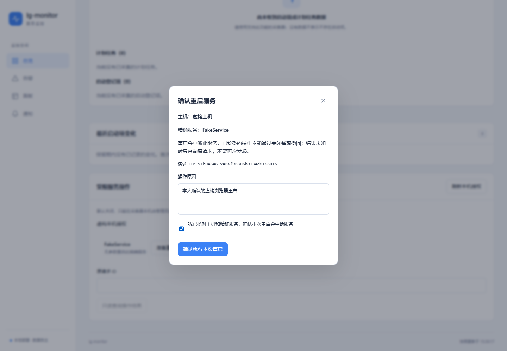
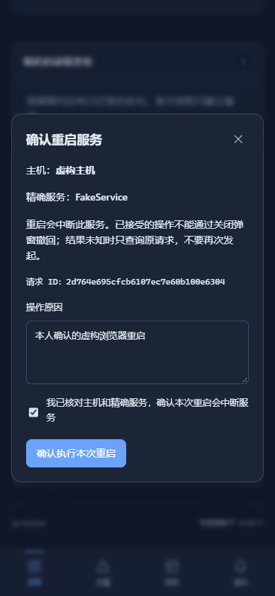

# 受限 Windows 服务重启

主机详情中的“授权服务操作”只列出采集器本机管理员逐条登记的精确 SCM 服务名。默认关闭；监控器、网页和 MCP 均不能授予权限。执行需要 admin 令牌，并逐次核对主机、精确服务和中断影响。read/config 只能查询。

## 本机授权

在采集器的受保护 settings.yaml 中配置，或在该机管理员终端使用本机 CLI。下面全部是假服务示例；登记授权不会安装或启动服务。

```yaml
remoteOperations:
  enabled: false
  services:
    - id: restart-lab
      service: FakeLabService
```

```powershell
.\bin\lgmon.exe operations status --home .\dev-home --json
.\bin\lgmon.exe operations allow restart-lab --service FakeLabService --home .\dev-home --json
.\bin\lgmon.exe operations enable --home .\dev-home --json
.\bin\lgmon.exe operations revoke restart-lab --home .\dev-home --json
.\bin\lgmon.exe operations disable --home .\dev-home --json
```

授权 ID 为 1～64 个小写字母、数字或横线，最多 128 项；服务名按大小写不敏感去重，不接受显示名称代替精确 SCM 名称、路径、通配符、控制字符或命令参数，禁止 lgmon 自身。启用时至少有一项授权；撤销最后一项会关闭功能。修改保留其他配置和注释。HTTP/MCP 写 settings 必须原样保留 remoteOperations，即使撤销也要在本机完成。目标下发不包含这个字段。

每次查询和执行均重新读取磁盘策略，无需重启。真实执行还要求采集器为 LocalSystem，程序及 home/config/settings.yaml/data 通过既有安全路径检查。配置失效、普通进程身份或不安全 ACL 立即拒绝，不能沿用旧授权；查询返回安全中文原因，不返回本机路径或原始系统错误。本机 status 只表示配置，在线 list 才包含执行环境检查。

## HTTP 与结果

| 接口 | 权限 | 行为 |
|---|---|---|
| GET `/api/v1/collectors/{id}/operations` | read | 在线读取 `{enabled,version,services:[{id,service}],reason}` |
| POST `/api/v1/collectors/{id}/operations` | admin | 提交本次明确确认的重启 |
| GET `/api/v1/operations/{requestId}` | read | 查询原请求，可与采集器账本只读对账，不执行服务操作 |

`version` 是采集器整份本机策略的 SHA-256。旧采集器返回 409 collector_outdated，断线返回 503 collector_offline。没有离线执行队列。POST 只接收以下字段，不接受 service、命令、路径或参数：

```json
{
  "requestId": "0123456789abcdef0123456789abcdef",
  "grantId": "restart-lab",
  "version": "0123456789abcdef0123456789abcdef0123456789abcdef0123456789abcdef",
  "reason": "本人确认的实验服务重启",
  "confirmed": true
}
```

先 GET 并展示精确主机和服务，再使用实际返回的 version；上面的版本仅为格式示例。requestId 必须是客户端生成的 32 位小写十六进制，reason 为 1～200 个字符。策略变化拒绝旧确认。监控器和采集器均在执行前持久保存意图；同 ID 同内容返回原记录，改内容返回冲突。不要通过换 ID、删除账本、重连或重新提交来自动重试。

执行结果只在 `succeeded` 且监控器已保存回执时返回 HTTP 200；running/failed/denied/unknown 返回现有 `error.code/message` 非 2xx 结构，消息含原请求 ID。执行结果不明时保留 ID，调用 GET 查询。GET 的 200 仅表示读到了记录，必须检查 state。

记录字段为 requestId、collectorId、grantId、version、service、actor、reason、state、startedAt、finishedAt、collectorStartedAt、collectorFinishedAt、message。时间均为 UTC Unix 毫秒；startedAt/finishedAt 是监控器接受和记录结果的时间，collectorStartedAt/collectorFinishedAt 是采集器回执时间，尚未知时为 0。actor 是首次提交的令牌名称，不保存令牌原文。操作审计可由本机只读 SQL 查询，但不开放给团队分享卡片或历史规则回放。

| state | 含义 |
|---|---|
| running | 原请求已持久接收，仍在执行或等待结果 |
| succeeded | 精确目标服务已实查为 Running，回执已保存 |
| failed | 已确认失败，详情见安全反馈 |
| denied | 授权、身份、策略、时效或执行前条件不满足 |
| unknown | 执行效果无法确认，须查询原请求或本人核对 |

## CLI、网页与 MCP

远程命令只从 LGMON_TOKEN 读取令牌；--url 默认 http://127.0.0.1:7444。下面 run 会实际中断已授权服务，只在本人明确授权后执行，并用 list 返回的真实 version 替换示例变量。

```powershell
.\bin\lgmon.exe operations list --collector fake-host --json
$requestId = [Guid]::NewGuid().ToString('N')
.\bin\lgmon.exe operations run restart-lab --collector fake-host --request-id $requestId --version $reviewedVersion --reason '本人确认的实验服务重启' --confirm --json
.\bin\lgmon.exe operations result $requestId --json
```

网页在主机详情展示授权列表，确认框列出精确主机、服务及请求 ID，要求填写原因并勾选中断确认。关闭弹窗或离开网页不撤销已经接收的操作。浏览器会在当前会话保存最近请求 ID 供只读查询；没有自动 POST 重试。

MCP 提供 read 的 `list_service_operations(id)`、`get_service_operation(id)`，以及 admin 的 `restart_service(id,requestId,grantId,version,reason,confirmed)`。restart_service 标记为有破坏性，说明明确要求本人逐次确认。不得以消除告警为理由自动重启；结果未知只查询原 ID。没有授权编辑工具。

## 执行边界与账本

指令通过既有 mTLS 认证双向流，要求 service_operations_v1 capability 和同会话关联回复，不占采样序号或缓存队列。监控器按采集器时钟生成 40 秒期限；时钟未知拒绝下发，采集器拒绝过期或超过当前时间 60 秒的指令。采集器一次只执行一个重启，采样与 ACK 继续运行。

原为 Running 时 Stop、等 Stopped、无参数 Start、等 Running；原为 Stopped 时直接 Start。过渡或暂停状态拒绝。执行预算 30 秒，只打开目标服务的 QUERY_STATUS/START/STOP 权限，权限依据见 [Microsoft 官方文档](https://learn.microsoft.com/en-us/windows/win32/services/service-security-and-access-rights)。不结束依赖服务或共享进程，不更改服务配置。

接受后的执行属于采集器生命周期，不依赖 HTTP 客户端持续连接。超时、断线、进程关闭或产生效果后的审计失败均不能声称成功，也不能自动补执行。监控器 lgmon.db 保存请求，采集器按需创建 data/operations.db，独立于可淘汰的遥测缓存；默认关闭时不创建该账本。重启后未完成请求为 unknown。备份和恢复 home/设备身份时必须一并保留两端操作账本及 SQLite 的一致性状态，不能用旧账本覆盖来重试。

## 工程证据与人工验收

自动验证采用真实临时 SQLite、真实 mTLS/HTTP/MCP/CLI/Edge 和假 SCM/身份/路径执行器，覆盖默认关闭、热撤销、权限、事务失败、重复/重启不重复执行、未知结果对账及阻塞执行期间的采样增量。没有安装、停止或重启本机真实服务。





人工验收保持 **Pending**：由本人另行授权并选择隔离实验服务，在受保护安装的 LocalSystem 采集器上登记一项授权；用 read/config 验证不能执行，用 admin 核对主机和精确服务后确认一次，观察真实中断和 Running 恢复；再断线查询原 ID、撤销授权、重启测试设备核对账本，不重新执行旧请求。双机、真实 ACL 和开机恢复由本人确认。当前开发不安装真实服务。
